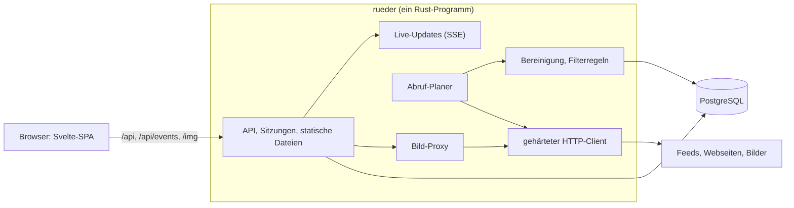

# rueder: Architektur des neuen Systems

Stand 2026-11-10. Dieses Dokument beschreibt, wie der neue rueder aufgebaut ist und warum. Den Plan mit Anforderungen und Entscheidungen führt [plan.md](plan.md), die Umsetzung mit Stand und Arbeitspaketen [implementation.md](implementation.md).

Vom Server stehen seit Schritt 1 das Schema, der Artikelspeicher, der Lesestand und der Import. Alles andere hier ist der Entwurf, nach dem gebaut wird. Sobald ein Teil gebaut ist, gilt der Code: für das Schema die Migrationen in `server/migrations/`, für Artikelspeicher und Lesestand `server/src/articles.rs` und `server/src/reading.rs`, für Filterregeln und Ordnerbaum die Modelle in `web/src/lib/`. Wer von diesem Dokument abweicht, ändert es im selben Pull Request.

- [Überblick](#überblick)
- [Bausteine](#bausteine)
- [Datenmodell](#datenmodell)
- [Artikelspeicher und Versionen](#artikelspeicher-und-versionen)
- [Lesestand und Ungelesen-Zahlen](#lesestand-und-ungelesen-zahlen)
- [Ordner und Abos](#ordner-und-abos)
- [Filterregeln](#filterregeln)
- [Abruf](#abruf)
- [Bereinigung](#bereinigung)
- [Bild-Proxy](#bild-proxy)
- [Live-Updates](#live-updates)
- [Login und Sitzungen](#login-und-sitzungen)
- [Security](#security)
- [API](#api)
- [Frontend](#frontend)
- [Betrieb](#betrieb)

## Überblick

Ein Rust-Programm übernimmt API, Abruf, Bereinigung, Live-Updates, Login und Bild-Proxy und liefert das gebaute Frontend aus. Daneben läuft nur noch PostgreSQL.



Zwei Regeln prägen den Aufbau:

- **Der Browser spricht ausschließlich mit rueder.** Kein Bild, kein Skript, kein Tracker wird direkt von fremden Seiten geladen.
- **Ins Internet geht nur der gehärtete HTTP-Client.** Feeds, Webseiten für die Feed-Suche und Bilder holt allein er. Deshalb gibt es genau eine Stelle für alle Schutzregeln gegen SSRF.

## Bausteine

| Baustein | Wahl | Grund |
|---|---|---|
| Server | Rust mit `axum` auf `tokio` | Ein Programm für alle Aufgaben, SSE ist eingebaut. |
| Datenbank | PostgreSQL 16 mit `sqlx` | Die Daten liegen schon dort. Partitionierung und Volltextsuche sind vorhanden, Abfragen werden beim Kompilieren gegen das Schema geprüft. |
| Feed-Abruf | `reqwest` mit `rustls`, Parser `feed-rs` | RSS, Atom und JSON Feed. Bedingte Abrufe mit ETag schonen die Quellen. |
| Bereinigung | `ammonia` plus eigene Regeln für Links und Bilder | Allowlist statt Sperrliste. |
| Live-Updates | SSE, intern ein Broadcast-Kanal | Ersetzt RabbitMQ. Bei mehreren Prozessen übernimmt `LISTEN/NOTIFY` von PostgreSQL. |
| Bilder | Eigener Proxy mit dem `image`-Crate | Ersetzt imgproxy, der Schlüssel für die Signatur bleibt auf dem Server. |
| Login | Lokale Konten mit Argon2id, OpenID Connect als Option | Ersetzt loginsrv und den Dienst `authbackend`. |
| Frontend | SvelteKit als SPA, Svelte 5, TypeScript, TailwindCSS 4 | Wird vom Server mit ausgeliefert. Die API-Typen werden aus dem Rust-Code erzeugt. |
| Betrieb | Ein Container plus PostgreSQL hinter einem Reverse-Proxy | Heute sind es acht Container plus imgproxy. |

Das Programm hat Unterbefehle: `rueder serve` (Standard) startet Server und Abruf, weitere Befehle erledigen einmalige Arbeiten (Import der alten Datenbank, Konten anlegen, Messdaten erzeugen). Migrationen laufen beim Start von selbst.

## Datenmodell

Die Tabellen im Überblick. Die genauen Spalten stehen in der ersten Migration, `server/migrations/0001_initial.sql`.

| Bereich | Tabellen | Idee |
|---|---|---|
| Konten | `accounts`, `account_identities`, `sessions` | Ein Konto hat einen Login-Namen, optional einen Argon2id-Hash und Einstellungen als JSON. `account_identities` verknüpft Konten mit OpenID-Connect-Anbietern (Aussteller und Subject) und mit dem alten Login (`auth_origin`, `auth_subject`). Eine Sitzung ist der SHA-256 des Cookie-Tokens mit Ablaufzeit. |
| Feeds | `feeds` | Ein Feed gehört allen seinen Abonnenten gemeinsam. Er kennt seine höchste Artikelnummer (`last_seq`), den Abrufstand (nächster Abruf, Intervall, ETag, Last-Modified, letzter Erfolg, letzter Fehler) und den User-Agent, mit dem er abgerufen wird. |
| Baum | `folders`, `subscriptions` | Ordner mit Elternordner und Position. Ein Abo verbindet Konto und Feed, liegt in einem Ordner oder auf oberster Ebene, hat eine Position und trägt die Lesemarke. |
| Artikel | `articles`, `article_content`, `article_versions` | Heiß, warm und kalt getrennt, siehe [Artikelspeicher und Versionen](#artikelspeicher-und-versionen). |
| Lesestand | `subscriptions.read_upto`, `article_states` | Lesemarke je Abo plus Ausnahmen je Artikel, siehe [Lesestand und Ungelesen-Zahlen](#lesestand-und-ungelesen-zahlen). |
| Regeln | `filter_rules` | Filterregeln je Konto, siehe [Filterregeln](#filterregeln). |
| Labels | `labels`, `article_labels` | Labels mit Farbe je Konto und ihre Zuordnung zu Artikeln. Der Stern ist kein Label, sondern eine Ausnahme in `article_states`. |

Schlüssel sind fortlaufende Zahlen (`bigint`), keine UUIDs: Sie halten Zeilen und Indizes schmal, und neue Artikel liegen im Index beieinander. Feeds und Konten behalten ihre alte UUID in einer Spalte `legacy_id`, Artikel in der Tabelle `legacy_articles`, damit der Import wiederholbar ist und Lesestand und Labels aus dem Browser zugeordnet werden können. Die Tabelle statt einer Spalte hält die heiße Artikeltabelle schmal und kann nach dem Umstieg weg.

## Artikelspeicher und Versionen

Listen lesen nie Artikeltext, und alte Versionen berühren nie die Tabellen, aus denen neue Artikel gelesen werden. Dafür wird die eine Tabelle von heute in drei geteilt:

| Tabelle | Inhalt | Wird gelesen | Größe und Pflege |
|---|---|---|---|
| `articles` (heiß) | Eine schmale Zeile je Artikel: Feed, laufende Nummer im Feed, Titel, Anriss, Autor, Datum, Vorschaubild, Nummer der aktuellen Version, Zeitpunkt der letzten Änderung | Bei jeder Liste und jeder Zählung | Klein genug für den Arbeitsspeicher. Index auf Feed und Nummer. |
| `article_content` (warm) | Genau eine Zeile je Artikel: der bereinigte Text der aktuellen Version, dazu was nur die Artikelansicht braucht (Schlagwörter, Anhänge, Kennung des Feeds für den Artikel) | Beim Öffnen eines Artikels, per Primärschlüssel | Wächst mit der Zahl der Artikel, nicht mit der Zahl der Versionen. |
| `article_versions` (kalt) | Jede Version im Original, mit zstd komprimiert, dazu Abrufzeit und Prüfsumme | Nur in der Versionsansicht und beim erneuten Bereinigen | Nach Monat partitioniert, es wird nur angehängt. Alte Partitionen können auf langsameren Speicher. |

So greifen die Teile ineinander:

1. **Neue Version nur bei echter Änderung.** Der Abruf vergleicht eine Prüfsumme über den normalisierten Inhalt. Tracking-Parameter und Leerraum zählen nicht mit, sonst erzeugen wechselnde Werbe-Token bei jedem Abruf eine Scheinversion.
2. **Die aktuelle Fassung bleibt an einem Ort.** Eine neue Version ersetzt die Zeile in `article_content` und hängt das Original an `article_versions` an. Wer die aktuelle Fassung liest, kommt mit der Historie nie in Berührung.
3. **Feste Nummer statt Fensterfunktion.** Jeder Artikel bekommt beim Einfügen seine laufende Nummer im Feed (`seq`). Blättern heißt dann „die 50 Artikel vor Nummer 4711“ und kostet immer gleich viel, egal wie groß der Feed ist.
4. **Keine Zählabfragen.** Der Feed kennt seine höchste Nummer. `COUNT(*)` entfällt.
5. **Alte Artikel kosten nur Plattenplatz.** Neue Zeilen liegen physisch beieinander, der Cache hält deshalb von selbst die neuen Seiten.
6. **Bereinigung ist wiederholbar.** Weil das Original gespeichert ist, lassen sich bessere Filterlisten oder ein Sanitizer-Fix nachträglich auf alte Artikel anwenden.

Regeln, auf die sich der Rest verlässt:

- **Nummern sind lückenlos und werden nie neu vergeben.** Ein Feed vergibt `last_seq + 1` in derselben Transaktion, in der der Artikel eingefügt wird; je Feed läuft immer nur ein Abruf. Die Ungelesen-Zahl rechnet mit `last_seq`, eine Lücke würde als ungelesener Artikel zählen.
- **Ein Artikel wird über seine Kennung im Feed wiedererkannt** (GUID, ersatzweise der Link), eindeutig je Feed.
- **Eine neue Version ändert den Lesestand nicht.** Der Artikel bleibt gelesen; die heiße Zeile bekommt die neue Versionsnummer und den Zeitpunkt, daraus macht die Oberfläche den Hinweis „aktualisiert“.
- **Höchstens 20 Versionen je Artikel.** Bei der 21. bleiben die Erstfassung und die 19 neuesten, die zweitälteste fällt weg.
- **Partitionen entstehen im Voraus.** Der Server legt beim Start und danach regelmäßig die Partitionen für den laufenden und den nächsten Monat an.

Gemischte Listen (ein Ordner, „Alle Artikel“) brauchen eine Reihenfolge über Feeds hinweg. Das ist die Reihenfolge des Eintreffens, also die fortlaufende ID des Artikels; innerhalb eines Feeds stimmt sie mit `seq` überein. Die Abfrage führt die Feeds zusammen wie sortierte Listen: Der Index `(feed_id, id)` liefert je Feed den neuesten passenden Artikel, der neueste davon kommt auf die Seite, und sein Feed liefert den nächsten. Das kostet einen Schritt in den Index je Feed und einen je Zeile der Seite, unabhängig von der Größe der Feeds. Bei „nur ungelesen“ ist die Lesemarke jedes Abos eine Untergrenze, unter der der Index nicht gelesen wird; wieder ungelesene Artikel unter der Marke kommen aus `article_states` dazu. Ein Feed, ein Ordner und alle Feeds sind dieselbe Abfrage. Bei 300 Feeds und 10 Millionen Artikeln bleibt sie mit 18 ms im 99. Perzentil unter dem [Messziel](plan.md#messziel), siehe [Messung](implementation.md#messung).

Beim Import wird der heutige Text jedes Artikels zu Version 1. Die laufenden Nummern werden so vergeben, wie das alte System sie heute bei jeder Abfrage berechnet (`row_number() over (partition by feed_id order by seq)`), damit der Lesestand aus dem Browser weiter passt.

## Lesestand und Ungelesen-Zahlen

Der Server speichert je Konto und Feed eine **Lesemarke** („alles bis Nummer N ist gelesen“, `subscriptions.read_upto`) und die **Ausnahmen** davon in `article_states`, eine Zeile je Konto, Feed und Nummer:

| Ausnahme | Bedeutung |
|---|---|
| gelesen | Der Artikel liegt über der Lesemarke und ist gelesen. |
| ungelesen gehalten | Der Artikel liegt an oder unter der Lesemarke und ist wieder ungelesen. |
| ausgeblendet | Eine Filterregel hat den Artikel ausgeblendet. Er zählt nie als ungelesen. |
| Stern | Unabhängig vom Lesestand. |

Die Ungelesen-Zahl eines Feeds wird immer aus diesen Daten berechnet:

```text
ungelesen = (last_seq − read_upto)
          − Artikel über der Marke, die gelesen oder ausgeblendet sind
          + Artikel an oder unter der Marke, die ungelesen gehalten und nicht ausgeblendet sind
```

Die Zahl eines Ordners ist die Summe seiner Feeds. Es gibt keinen gespeicherten Zähler, der auseinanderlaufen kann.

Die Operationen:

- **Lesen:** über der Marke entsteht die Ausnahme „gelesen“, unter der Marke verschwindet „ungelesen gehalten“.
- **Wieder ungelesen:** umgekehrt.
- **Alle als gelesen markieren (bis Nummer N):** Die Marke rückt auf N vor, alle Ausnahmen „gelesen“ und „ungelesen gehalten“ bis N entfallen. Die Marke bewegt sich nie zurück.
- **Verdichten:** Folgen auf die Marke lückenlos gelesene oder ausgeblendete Artikel, rückt sie darüber vor. So bleibt die Zahl der Ausnahmen klein, auch wenn jemand jahrelang Artikel einzeln liest.

Das maßgebliche Modell mit Tests ist `web/src/lib/unread.ts`. Der Server bildet genau dieses Verhalten nach und wird mit denselben Fällen geprüft, am besten mit Property-Tests gegen ein einfaches Modell („eine Menge gelesener Nummern“).

Der Lesestand hängt an (Konto, Feed, Nummer) und nicht an der ID des Artikels. Die Liste eines Feeds und seine Zählung kommen dadurch ohne Verbund mit der Artikeltabelle aus.

## Ordner und Abos

- Ordner lassen sich bis zu **fünf Ebenen** tief verschachteln. Ein Zug, der tiefer führen würde, wird abgelehnt, im Frontend und auf dem Server.
- Ordner und Abos einer Ebene teilen sich eine Reihenfolge. Jede Zeile trägt eine **Position** als Sortierschlüssel zwischen ihren Nachbarn. Ein Zug ändert genau eine Zeile („verschiebe X vor Y in Ordner Z“); gleichzeitige Änderungen von zwei Geräten überschreiben sich nicht mehr.
- Ein gelöschter Ordner gibt seinen Inhalt an die Ebene darüber ab.
- Grenzen je Konto für Ordner und Abos, wie heute (100 Ordner, 1.000 Feeds je Ordner).

Das Modell mit Tests ist `web/src/lib/tree.ts` (`canMove`, `moveNode`, `nudge` für die Tastatur).

## Filterregeln

Eine Regel hat:

| Teil | Werte |
|---|---|
| Bereich | alle Feeds, ein Ordner (mit allem darunter), ein Feed |
| Feld | überall, Titel, Text, Autor, Schlagwort |
| Vergleich | enthält, ganzes Wort, regulärer Ausdruck |
| Aktion | ausblenden, als gelesen markieren |

- Regeln greifen **beim Eintreffen** eines Artikels, für jeden Abonnenten des Feeds. Treffer zählen nicht als ungelesen.
- Wird eine Regel angelegt oder geändert, bewertet der Server den Bestand des Kontos neu: alle ungelesenen und die jüngsten Artikel der betroffenen Feeds. Eine **Vorschau** zeigt vor dem Speichern, wie viele Artikel betroffen wären.
- Ausgeblendetes bleibt unter „Ausgeblendet“ einsehbar.
- Der Vergleich arbeitet auf Text ohne HTML-Tags, ohne Rücksicht auf Groß- und Kleinschreibung; „ganzes Wort“ behandelt Umlaute als Buchstaben.
- Reguläre Ausdrücke laufen mit dem `regex`-Crate in garantiert linearer Zeit. Muster sind höchstens 200 Zeichen lang, die Zahl der Regeln je Konto ist begrenzt.

Das Modell mit Tests ist `web/src/lib/filters.ts`. Der Server muss dieselben Fälle gleich entscheiden; die Syntax für reguläre Ausdrücke ist die des `regex`-Crates, das Frontend prüft Muster deshalb über den Server und nicht mit `RegExp` des Browsers.

## Abruf

Ein Planer im Server ruft jeden Feed mit mindestens einem Abonnenten in seinem Intervall ab.

1. Fällige Feeds kommen aus der Datenbank (`next_fetch_at`), begrenzt viele laufen gleichzeitig, je Host nur einer.
2. Der gehärtete HTTP-Client holt den Feed, bedingt mit ETag und Last-Modified. „Nicht geändert“ beendet den Abruf.
3. `feed-rs` liest RSS, Atom oder JSON Feed, mit Grenzen für Größe und Zahl der Artikel.
4. Je Artikel: Kennung bestimmen, Inhalt normalisieren, Prüfsumme bilden. Unbekannt heißt neuer Artikel, andere Prüfsumme heißt neue Version, sonst nichts.
5. Bereinigung des Inhalts (siehe unten), Anriss und Vorschaubild ableiten.
6. In einer Transaktion: Nummern vergeben, die drei Tabellen schreiben, Filterregeln der Abonnenten anwenden, `last_seq` und Abrufstand des Feeds setzen.
7. Meldung an die Live-Updates.

Das Intervall passt sich wie heute der Aktivität des Feeds an, zwischen 15 Minuten und 12 Stunden (heutige Logik: `backend/pkg/worker/feed.go`, `updateFetchDelay`). Fehler verlängern das Intervall schrittweise und stehen am Feed, die Oberfläche zeigt ein Warnzeichen. Der User-Agent ist ehrlich („rueder“ mit Version und Adresse des Projekts) und lässt sich je Feed auf einen Browser-User-Agent umstellen.

Die Feed-Suche auf Webseiten (heute der Dienst `feedfinder`) und der OPML-Import nutzen denselben Client.

## Bereinigung

Die Bereinigung läuft **einmal je Version auf dem Server** statt bei jedem Anzeigen im Browser.

1. `ammonia` mit Allowlist: nur bekannte Tags und Attribute, keine Skripte, keine Styles, keine Formulare.
2. Eigene Regeln, übernommen aus `frontend/src/rueder/helpers/ArticleCleaner.ts` samt Tests: Tracking-Parameter aus Links entfernen, Zählpixel (1×1) und Bilder gesperrter Domains entfernen, Social-Media-Leisten entfernen.
3. Bilder zeigen auf den eigenen Bild-Proxy mit signierter Adresse, Links bekommen `rel="noopener noreferrer"` und öffnen in einem neuen Tab. Audio und Video laden erst nach Klick.

Die Listen für gesperrte Domains und Tracking-Parameter sind Daten, keine Programmzeilen: Dateien im Repository, die der Server beim Start lädt. Weil `article_versions` das Original hält, kann ein Befehl alte Artikel mit neuen Listen erneut bereinigen.

## Bild-Proxy

- Adressen der Form `/img/<signatur>/<größe>/<adresse>`. Die Signatur ist ein HMAC über Größe und Adresse mit einem Schlüssel, den nur der Server kennt. Der Server erzeugt die Adressen bei der Bereinigung; der Browser kann keine eigenen bilden.
- Abruf über den gehärteten HTTP-Client, ohne Cookies und Referrer, mit festem User-Agent.
- Durchgelassen werden nur echte Bildformate nach Prüfung der ersten Bytes (PNG, JPEG, GIF, WebP). SVG wird nie durchgereicht, höchstens gerastert.
- Feste Größen (zum Beispiel Vorschaubild und Artikelbreite), Verkleinern mit dem `image`-Crate, Grenzen für Dateigröße und Bildfläche gegen Dekompressionsbomben.
- Cache auf Platte, begrenzt in der Größe. Auslieferung mit `X-Content-Type-Options: nosniff`, `Content-Security-Policy: sandbox` und langem `Cache-Control`.
- Nur für eingeloggte User.

## Live-Updates

Eine SSE-Verbindung je offenem Tab (`GET /api/events`). Intern verteilt ein Broadcast-Kanal die Ereignisse; jede Verbindung filtert auf ihr Konto.

| Ereignis | Auslöser | Was der Client tut |
|---|---|---|
| Neue Artikel | Abruf hat Artikel eingefügt | Ungelesen-Zahl des Feeds anpassen, Hinweis „N neue Artikel“ über der Liste zeigen. Die Liste wird nicht weggeschoben. |
| Lesestand | Ein anderes Gerät desselben Kontos hat gelesen oder markiert | Lesemarke und Ausnahmen des Feeds übernehmen. |
| Baum | Ordner oder Abo angelegt, verschoben, gelöscht | Baum neu laden oder Änderung anwenden. |
| Feed-Status | Abruffehler oder Erholung | Warnzeichen setzen oder entfernen. |
| Aktualisiert | Neue Version eines Artikels | Hinweis „aktualisiert“ am Artikel. |

Ereignisse tragen fortlaufende Nummern. Nach einem Verbindungsabbruch meldet sich der Client mit `Last-Event-ID`; kann der Server nicht nachliefern, gleicht der Client neu ab (Baum und Zahlen laden). Läuft rueder später in mehreren Prozessen, tragen `LISTEN/NOTIFY` von PostgreSQL die Ereignisse zwischen ihnen.

## Login und Sitzungen

- **Lokale Konten** mit Passwort-Hash nach Argon2id. Konten legt die Kommandozeile oder ein Admin an, es gibt keine offene Registrierung.
- **OpenID Connect** als Option, eingestellt über die Konfiguration (Aussteller, Client-ID, Secret). Authorization Code Flow mit PKCE; `account_identities` verknüpft Aussteller und Subject mit dem Konto.
- **Sitzung** als zufälliges Token im Cookie (`HttpOnly`, `Secure`, `SameSite=Lax`, Präfix `__Host-`). In der Datenbank liegt nur der SHA-256 des Tokens. Sitzungen laufen nach einer Frist ohne Nutzung ab und lassen sich einzeln beenden.
- Das Frontend sieht nie ein Token. JWTs entfallen.
- Rate-Limit auf dem Login je Konto und je Adresse.

Wie die bestehenden Konten umziehen, steht bei den [Detailfragen](plan.md#detailfragen): Der Import legt sie ohne Passwort an und verknüpft sie über den alten Login-Namen.

## Security

Der Server ruft Adressen ab, die User eingeben, und zeigt HTML an, das Fremde geschrieben haben. Diese beiden Stellen sind die größten Angriffsflächen und bekommen je eine zentrale, getestete Komponente. Gegen diese Tabelle laufen die Security-Reviews am Ende von Schritt 2 und vor dem Umstieg.

| Angriffsfläche | Maßnahme |
|---|---|
| Login und Sitzung | Sitzung als Cookie mit `HttpOnly`, `Secure` und `SameSite=Lax`. Das Frontend sieht kein Token mehr. Passwörter mit Argon2id, Rate-Limit auf dem Login, OpenID Connect als Option. |
| CSRF | SameSite-Cookie und Prüfung des `Origin`-Headers bei jeder ändernden Anfrage. |
| Zugriff auf Daten | Jede Abfrage ist an die Konto-ID gebunden. Feeds und Artikel sind nur für Abonnenten lesbar. Kein Endpunkt listet fremde Feeds. |
| Abruf fremder Adressen (SSRF) | Ein gemeinsamer HTTP-Client für Feed-Abruf, Feed-Suche und Bild-Proxy. Er erlaubt nur http und https, löst DNS selbst auf, sperrt private, lokale und Link-Local-Adressen und verbindet sich genau mit der geprüften IP. Jede Weiterleitung wird neu geprüft. Grenzen für Größe, Zeit, Weiterleitungen und Dekompression. |
| Artikel-HTML (XSS) | Bereinigung auf dem Server mit `ammonia` nach Allowlist. Zweite Linie ist eine strenge Content-Security-Policy ohne Inline-Skripte, Bilder nur vom eigenen Proxy. Links bekommen `rel="noopener noreferrer"`. |
| Bild-Proxy | Signierte Adressen, der Schlüssel bleibt auf dem Server. Durchgelassen werden nur echte Bildformate nach Prüfung der ersten Bytes, SVG nur gerastert oder gar nicht. Größenlimit und Cache auf Platte. Zur Quelle gehen keine Cookies, kein Referrer und ein fester User-Agent. Auslieferung mit `nosniff` und `Content-Security-Policy: sandbox`. |
| Privacy beim Lesen | Der Browser spricht nur mit dem eigenen Server. Audio und Video laden erst nach Klick, weil sie direkt von der Quelle kommen. `Referrer-Policy: no-referrer`. |
| Filterregeln der User | Reguläre Ausdrücke laufen mit dem `regex`-Crate in garantiert linearer Zeit. Limits für Länge und Anzahl. |
| Feed-Parser | Limits für Feed-Größe und Artikelzahl, keine externen XML-Entitäten. |
| Unerwartete Eingaben (Panics, Hänger, Speicherverbrauch) | [Fuzzing](#fuzzing) von Bereinigung, Feed-Verarbeitung und Bild-Proxy, Property-Test für die Adressprüfung des HTTP-Clients. |
| Missbrauch | Limits je Konto für Feeds, Ordner und Regeln. Rate-Limits auf der API. |
| Lieferkette und Betrieb | `cargo audit` und `cargo deny` in der CI, Lockfiles, Container ohne Root mit schreibgeschütztem Dateisystem. Geheimnisse kommen nie in den Frontend-Build. |

### Fuzzing

Der Server verarbeitet unbeaufsichtigt Eingaben, die Fremde bestimmen. Tests von Hand decken nur die Fälle ab, an die jemand gedacht hat. Gefuzzt wird deshalb dort, wo eigener Code über Sicherheit entscheidet, und geprüft wird nicht nur „stürzt nicht ab“, sondern die Eigenschaft, auf die sich der Rest verlässt:

| Ziel | Eingabe | Was gelten muss |
|---|---|---|
| Bereinigung (`ammonia` plus eigene Regeln) | Beliebiges HTML | Keine Panic. Das Ergebnis enthält kein Skript, keinen Event-Handler, kein Formular und keine Bildadresse außer der des eigenen Proxy. Erneutes Bereinigen ändert es nicht mehr. |
| Feed-Verarbeitung, von den Bytes bis zum fertigen Artikel | Beliebige Bytes als Feed | Keine Panic, Ende in begrenzter Zeit und mit begrenztem Speicher. Die Grenze für die Artikelzahl gilt, jeder Artikel hat eine Kennung, dieselbe Eingabe ergibt dieselbe Prüfsumme. |
| Bild-Proxy: Formatprüfung und Dekodierung | Beliebige Bytes als Bild | Keine Panic. Angenommen werden nur die erlaubten Formate, die Grenzen für Dateigröße und Bildfläche greifen vor dem Dekodieren. |
| Adressprüfung des HTTP-Clients | Adressen in allen Schreibweisen (dezimal, oktal, hexadezimal, IPv4 in IPv6, mit Zugangsdaten, mit Port) | Nur http und https. Keine private, lokale oder Link-Local-Adresse wird erlaubt. Hier ist die Eingabe strukturiert, deshalb ein Property-Test mit `proptest` statt eines Fuzz-Targets. |

- Die Targets liegen in `server/fuzz/` und laufen mit `cargo-fuzz`, das Nightly-Rust braucht. Der Startkorpus sind die aufgezeichneten Feeds des alten Systems (`backend/test/data/`) und die Fälle der Cleaner-Tests.
- Der gespeicherte Korpus läuft in der CI als gewöhnlicher Test mit stabilem Rust. Jeder Fund kommt als Datei in den Korpus und bleibt so als Test erhalten.
- Richtig gefuzzt wird von Hand vor den beiden Security-Reviews, etwa eine halbe Stunde je Target.
- Nicht gefuzzt werden die fremden Parser für sich und einmalige Eingaben (die alte Datenbank, der `localStorage` des alten Frontends). Für sie gelten Grenzen und Tests mit regelwidrigen Eingaben.

Der Ertrag ist kleiner als in einem Programm mit `unsafe`: Fuzzing findet hier Panics, Hänger und Speicherverbrauch, keine Speicherfehler, und eine Panic beendet nur die eine Anfrage oder den einen Abruf. Deshalb die Beschränkung auf wenige Ziele.

## API

JSON unter `/api`, Sitzung über das Cookie. Die Liste ist der Entwurf für Schritt 2; die TypeScript-Typen des Frontends werden aus den Rust-Typen erzeugt, damit beide Seiten nicht auseinanderlaufen.

| Bereich | Endpunkte (Entwurf) |
|---|---|
| Zustand | `GET /api/health` |
| Sitzung | `POST /api/login`, `POST /api/logout`, `GET /api/me`, `GET /api/oidc/start`, `GET /api/oidc/callback` |
| Baum | `GET /api/tree` (Ordner, Abos, Feeds mit `last_seq`, Lesemarken und Ungelesen-Zahlen), `POST /api/tree/move`, Anlegen, Umbenennen und Löschen von Ordnern |
| Abos | Abonnieren (mit Feed-Suche auf einer Webseite), Kündigen, Umbenennen, OPML-Import und -Export |
| Listen | `GET /api/feeds/{id}/articles`, `GET /api/folders/{id}/articles`, `GET /api/articles` (alle), jeweils mit `before`, `limit` und `unread`; dazu die Listen „Mit Stern“, „Ausgeblendet“ und je Label |
| Artikel | `GET /api/articles/{id}` (bereinigter Text), `GET /api/articles/{id}/versions` |
| Lesestand | Lesen, wieder ungelesen, Stern, „alle als gelesen bis Nummer N“ für Feed, Ordner oder alles |
| Regeln | Lesen, Anlegen, Ändern, Löschen, Sortieren, Vorschau |
| Labels | Anlegen, Ändern, Löschen, Zuordnen |
| Einstellungen | `GET` und `PUT /api/settings` |
| Live | `GET /api/events` (SSE) |
| Bilder | `GET /img/<signatur>/<größe>/<adresse>` |

Listen blättern mit einem Anker statt mit einem Offset: „die 50 Artikel vor Nummer N“ im Feed, „vor ID N“ in gemischten Listen. Änderungen am Lesestand wirken im Frontend sofort und werden im Hintergrund bestätigt; lehnt der Server ab, nimmt das Frontend sie zurück.

## Frontend

Das Frontend ist eine SvelteKit-Anwendung ohne Server-Rendering (`adapter-static`), die der Rust-Server als statische Dateien ausliefert. Der Aufbau folgt dem Google Reader ab 2011: Suchleiste oben, links der Abonnieren-Knopf und der Ordnerbaum mit Ungelesen-Zahlen, rechts die Werkzeugleiste über der Artikelliste.

Der abgenommene Entwurf in `web/` enthält bereits:

| Teil | Wo |
|---|---|
| Datentypen der Oberfläche (Feed, Artikel, Version, Baum) | `web/src/lib/model.ts` |
| Lesestand und Ungelesen-Zahlen | `web/src/lib/unread.ts` |
| Filterregeln | `web/src/lib/filters.ts`, `web/src/lib/rule-text.ts` |
| Ordnerbaum und Züge | `web/src/lib/tree.ts` |
| Versionsvergleich | `web/src/lib/diff.ts` |
| Tastaturbelegung | `web/src/lib/keys.ts` |
| Einstellungen (Thema, Akzentfarbe, Dichte, Schrift, Ansicht) | `web/src/lib/settings.svelte.ts` |
| Texte auf Englisch und Deutsch | `web/src/lib/i18n/` |
| Komponenten (Baum, Liste, Artikel, Werkzeugleiste, Dialoge) | `web/src/lib/components/` |
| Stellvertreter für den Server mit erfundenen Daten | `web/src/lib/demo/` |

Die Naht zum Server ist die Klasse `Reader` in `web/src/lib/demo/reader.svelte.ts`: Die Komponenten holen ihre Daten nur von ihr. In Schritt 3 tritt an ihre Stelle eine Fassung, die dieselben Eigenschaften und Methoden aus der API und der SSE-Verbindung füllt. Die Modelle für Lesestand, Regeln und Baum bleiben im Frontend, damit Änderungen sofort wirken, bevor der Server bestätigt.

Was der Entwurf noch nicht hat und Schritt 3 ergänzt: Login, Labels, OPML, eine virtualisierte Liste für sehr lange Feeds, Vorladen des nächsten Artikels, Einstellungen auf dem Server, änderbare Tastaturbelegung.

## Betrieb

- Ein Container mit dem Rust-Programm und dem gebauten Frontend, daneben PostgreSQL, davor ein Reverse-Proxy für TLS.
- Konfiguration über Umgebungsvariablen (`DATABASE_URL`, Adresse zum Lauschen, Verzeichnis des Frontends, Schlüssel für den Bild-Proxy, OpenID Connect). Geheimnisse stehen nie im Image und nie im Frontend-Build.
- Migrationen laufen beim Start. Der Container läuft ohne Root mit schreibgeschütztem Dateisystem; beschreibbar ist nur das Verzeichnis für den Bild-Cache.
- Sicherung: PostgreSQL. Der Bild-Cache lässt sich jederzeit neu aufbauen.
