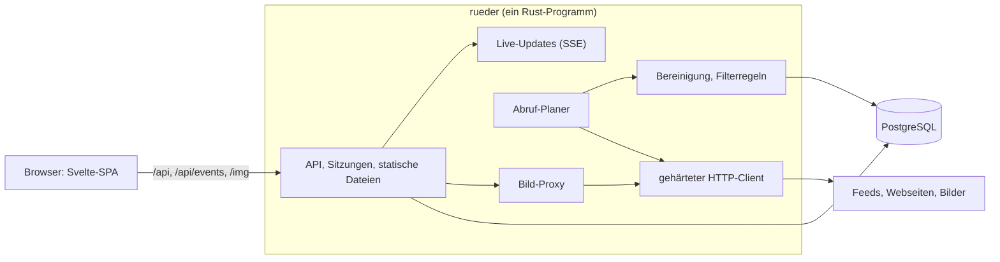

# rueder: Architektur des neuen Systems

Stand 2026-11-10. Dieses Dokument beschreibt, wie der neue rueder aufgebaut ist und warum. Den Plan mit Anforderungen und Entscheidungen führt [plan.md](plan.md), die Umsetzung mit Stand und Arbeitspaketen [implementation.md](implementation.md).

Vom Server stehen seit Schritt 1 das Schema, der Artikelspeicher, der Lesestand und der Import, aus Schritt 2 der gehärtete HTTP-Client, der Abruf, die Bereinigung, der Bild-Proxy und die Live-Updates. Alles andere hier ist der Entwurf, nach dem gebaut wird. Sobald ein Teil gebaut ist, gilt der Code: für das Schema die Migrationen in `server/migrations/`, für Artikelspeicher und Lesestand `server/src/articles.rs` und `server/src/reading.rs`, für den HTTP-Client `server/src/http_client.rs`, für die Bereinigung `server/src/cleaning.rs`, für den Bild-Proxy `server/src/images.rs`, für Filterregeln und Ordnerbaum die Modelle in `web/src/lib/`. Wer von diesem Dokument abweicht, ändert es im selben Pull Request.

- [Überblick](#überblick)
- [Bausteine](#bausteine)
- [Datenmodell](#datenmodell)
- [Artikelspeicher und Versionen](#artikelspeicher-und-versionen)
- [Lesestand und Ungelesen-Zahlen](#lesestand-und-ungelesen-zahlen)
- [Ordner und Abos](#ordner-und-abos)
- [Filterregeln](#filterregeln)
- [Abruf](#abruf)
- [Bereinigung](#bereinigung)
- [Bild-Proxy](#bild-proxy)
- [Live-Updates](#live-updates)
- [Login und Sitzungen](#login-und-sitzungen)
- [Security](#security)
- [API](#api)
- [Frontend](#frontend)
- [Betrieb](#betrieb)

## Überblick

Ein Rust-Programm übernimmt API, Abruf, Bereinigung, Live-Updates, Login und Bild-Proxy und liefert das gebaute Frontend aus. Daneben läuft nur noch PostgreSQL.



Zwei Regeln prägen den Aufbau:

- **Der Browser spricht ausschließlich mit rueder.** Kein Bild, kein Skript, kein Tracker wird direkt von fremden Seiten geladen.
- **Ins Internet geht nur der gehärtete HTTP-Client.** Feeds, Webseiten für die Feed-Suche und Bilder holt allein er. Deshalb gibt es genau eine Stelle für alle Schutzregeln gegen SSRF.

## Bausteine

| Baustein | Wahl | Grund |
|---|---|---|
| Server | Rust mit `axum` auf `tokio` | Ein Programm für alle Aufgaben, SSE ist eingebaut. |
| Datenbank | PostgreSQL 16 mit `sqlx` | Die Daten liegen schon dort. Partitionierung und Volltextsuche sind vorhanden, Abfragen werden beim Kompilieren gegen das Schema geprüft. |
| Feed-Abruf | `reqwest` mit `rustls`, Parser `feed-rs` | RSS, Atom und JSON Feed. Bedingte Abrufe mit ETag schonen die Quellen. |
| Bereinigung | `ammonia` plus eigene Regeln für Links und Bilder | Allowlist statt Sperrliste. |
| Live-Updates | SSE, intern ein Broadcast-Kanal | Ersetzt RabbitMQ. Bei mehreren Prozessen übernimmt `LISTEN/NOTIFY` von PostgreSQL. |
| Bilder | Eigener Proxy mit dem `image`-Crate | Ersetzt imgproxy, der Schlüssel für die Signatur bleibt auf dem Server. |
| Login | Lokale Konten mit Argon2id, OpenID Connect als Option | Ersetzt loginsrv und den Dienst `authbackend`. |
| Frontend | SvelteKit als SPA, Svelte 5, TypeScript, TailwindCSS 4 | Wird vom Server mit ausgeliefert. Die API-Typen werden aus dem Rust-Code erzeugt. |
| Betrieb | Ein Container plus PostgreSQL hinter einem Reverse-Proxy | Heute sind es acht Container plus imgproxy. |

Das Programm hat Unterbefehle: `rueder serve` (Standard) startet Server und Abruf, weitere Befehle erledigen einmalige Arbeiten (Import der alten Datenbank, Konten anlegen, Messdaten erzeugen). Migrationen laufen beim Start von selbst.

## Datenmodell

Die Tabellen im Überblick. Die genauen Spalten stehen in der ersten Migration, `server/migrations/0001_initial.sql`.

| Bereich | Tabellen | Idee |
|---|---|---|
| Konten | `accounts`, `account_identities`, `sessions` | Ein Konto hat einen Login-Namen, optional einen Argon2id-Hash und Einstellungen als JSON. `account_identities` verknüpft Konten mit OpenID-Connect-Anbietern (Aussteller und Subject) und mit dem alten Login (`auth_origin`, `auth_subject`). Eine Sitzung ist der SHA-256 des Cookie-Tokens mit Ablaufzeit. |
| Feeds | `feeds` | Ein Feed gehört allen seinen Abonnenten gemeinsam. Er kennt seine höchste Artikelnummer (`last_seq`), den Abrufstand (nächster Abruf, Intervall, ETag, Last-Modified, letzter Erfolg, letzter Fehler) und den User-Agent, mit dem er abgerufen wird. |
| Baum | `folders`, `subscriptions` | Ordner mit Elternordner und Position. Ein Abo verbindet Konto und Feed, liegt in einem Ordner oder auf oberster Ebene, hat eine Position und trägt die Lesemarke. |
| Artikel | `articles`, `article_content`, `article_versions` | Heiß, warm und kalt getrennt, siehe [Artikelspeicher und Versionen](#artikelspeicher-und-versionen). |
| Lesestand | `subscriptions.read_upto`, `article_states` | Lesemarke je Abo plus Ausnahmen je Artikel, siehe [Lesestand und Ungelesen-Zahlen](#lesestand-und-ungelesen-zahlen). |
| Regeln | `filter_rules` | Filterregeln je Konto, siehe [Filterregeln](#filterregeln). |
| Labels | `labels`, `article_labels` | Labels mit Farbe je Konto und ihre Zuordnung zu Artikeln. Der Stern ist kein Label, sondern eine Ausnahme in `article_states`. |

Schlüssel sind fortlaufende Zahlen (`bigint`), keine UUIDs: Sie halten Zeilen und Indizes schmal, und neue Artikel liegen im Index beieinander. Feeds und Konten behalten ihre alte UUID in einer Spalte `legacy_id`, Artikel in der Tabelle `legacy_articles`, damit der Import weiß, was er schon übernommen hat, und Lesestand und Labels aus dem Browser zugeordnet werden können. Die Tabelle statt einer Spalte hält die heiße Artikeltabelle schmal und kann nach dem Umstieg weg.

## Artikelspeicher und Versionen

Listen lesen nie Artikeltext, und alte Versionen berühren nie die Tabellen, aus denen neue Artikel gelesen werden. Dafür wird die eine Tabelle von heute in drei geteilt:

| Tabelle | Inhalt | Wird gelesen | Größe und Pflege |
|---|---|---|---|
| `articles` (heiß) | Eine schmale Zeile je Artikel: Feed, laufende Nummer im Feed, Titel, Anriss, Autor, Datum, Vorschaubild, Nummer der aktuellen Version, Zeitpunkt der letzten Änderung | Bei jeder Liste und jeder Zählung | Klein genug für den Arbeitsspeicher. Index auf Feed und Nummer. |
| `article_content` (warm) | Genau eine Zeile je Artikel: der bereinigte Text der aktuellen Version, dazu was nur die Artikelansicht braucht (Schlagwörter, Anhänge, Kennung des Feeds für den Artikel) | Beim Öffnen eines Artikels, per Primärschlüssel | Wächst mit der Zahl der Artikel, nicht mit der Zahl der Versionen. |
| `article_versions` (kalt) | Jede Version im Original, mit zstd komprimiert, dazu Abrufzeit und Prüfsumme | Nur in der Versionsansicht und beim erneuten Bereinigen | Nach Monat partitioniert, es wird nur angehängt. Alte Partitionen können auf langsameren Speicher. |

So greifen die Teile ineinander:

1. **Neue Version nur bei echter Änderung.** Der Abruf vergleicht eine Prüfsumme über den normalisierten Inhalt. Tracking-Parameter und Leerraum zählen nicht mit, sonst erzeugen wechselnde Werbe-Token bei jedem Abruf eine Scheinversion.
2. **Die aktuelle Fassung bleibt an einem Ort.** Eine neue Version ersetzt die Zeile in `article_content` und hängt das Original an `article_versions` an. Wer die aktuelle Fassung liest, kommt mit der Historie nie in Berührung.
3. **Feste Nummer statt Fensterfunktion.** Jeder Artikel bekommt beim Einfügen seine laufende Nummer im Feed (`seq`). Blättern heißt dann „die 50 Artikel vor Nummer 4711“ und kostet immer gleich viel, egal wie groß der Feed ist.
4. **Keine Zählabfragen.** Der Feed kennt seine höchste Nummer. `COUNT(*)` entfällt.
5. **Alte Artikel kosten nur Plattenplatz.** Neue Zeilen liegen physisch beieinander, der Cache hält deshalb von selbst die neuen Seiten.
6. **Bereinigung ist wiederholbar.** Weil das Original gespeichert ist, lassen sich bessere Filterlisten oder ein Sanitizer-Fix nachträglich auf alte Artikel anwenden.

Regeln, auf die sich der Rest verlässt:

- **Nummern sind lückenlos und werden nie neu vergeben.** Ein Feed vergibt `last_seq + 1` in derselben Transaktion, in der der Artikel eingefügt wird; je Feed läuft immer nur ein Abruf. Die Ungelesen-Zahl rechnet mit `last_seq`, eine Lücke würde als ungelesener Artikel zählen.
- **Ein Artikel wird über seine Kennung im Feed wiedererkannt** (GUID, ersatzweise der Link), eindeutig je Feed.
- **Eine neue Version ändert den Lesestand nicht.** Der Artikel bleibt gelesen; die heiße Zeile bekommt die neue Versionsnummer und den Zeitpunkt, daraus macht die Oberfläche den Hinweis „aktualisiert“.
- **Höchstens 20 Versionen je Artikel.** Bei der 21. bleiben die Erstfassung und die 19 neuesten, die zweitälteste fällt weg.
- **Partitionen entstehen im Voraus.** Der Server legt beim Start und danach regelmäßig die Partitionen für den laufenden und den nächsten Monat an.

Gemischte Listen (ein Ordner, „Alle Artikel“) brauchen eine Reihenfolge über Feeds hinweg. Das ist die Reihenfolge des Eintreffens, also die fortlaufende ID des Artikels; innerhalb eines Feeds stimmt sie mit `seq` überein. Die Abfrage führt die Feeds zusammen wie sortierte Listen: Der Index `(feed_id, id)` liefert je Feed den neuesten passenden Artikel, der neueste davon kommt auf die Seite, und sein Feed liefert den nächsten. Das kostet einen Schritt in den Index je Feed und einen je Zeile der Seite, unabhängig von der Größe der Feeds. Bei „nur ungelesen“ ist die Lesemarke jedes Abos eine Untergrenze, unter der der Index nicht gelesen wird; wieder ungelesene Artikel unter der Marke kommen aus `article_states` dazu. Ein Feed, ein Ordner und alle Feeds sind dieselbe Abfrage. Bei 300 Feeds und 10 Millionen Artikeln bleibt sie mit 18 ms im 99. Perzentil unter dem [Messziel](plan.md#messziel), siehe [Messung](implementation.md#messung).

Beim Import wird der heutige Text jedes Artikels zu Version 1. Die laufenden Nummern werden so vergeben, wie das alte System sie heute bei jeder Abfrage berechnet (`row_number() over (partition by feed_id order by seq)`), damit der Lesestand aus dem Browser weiter passt.

## Lesestand und Ungelesen-Zahlen

Der Server speichert je Konto und Feed eine **Lesemarke** („alles bis Nummer N ist gelesen“, `subscriptions.read_upto`) und die **Ausnahmen** davon in `article_states`, eine Zeile je Konto, Feed und Nummer:

| Ausnahme | Bedeutung |
|---|---|
| gelesen | Der Artikel liegt über der Lesemarke und ist gelesen. |
| ungelesen gehalten | Der Artikel liegt an oder unter der Lesemarke und ist wieder ungelesen. |
| ausgeblendet | Eine Filterregel hat den Artikel ausgeblendet. Er zählt nie als ungelesen. |
| Stern | Unabhängig vom Lesestand. |

Die Ungelesen-Zahl eines Feeds wird immer aus diesen Daten berechnet:

```text
ungelesen = (last_seq − read_upto)
          − Artikel über der Marke, die gelesen oder ausgeblendet sind
          + Artikel an oder unter der Marke, die ungelesen gehalten und nicht ausgeblendet sind
```

Die Zahl eines Ordners ist die Summe seiner Feeds. Es gibt keinen gespeicherten Zähler, der auseinanderlaufen kann.

Die Operationen:

- **Lesen:** über der Marke entsteht die Ausnahme „gelesen“, unter der Marke verschwindet „ungelesen gehalten“.
- **Wieder ungelesen:** umgekehrt.
- **Alle als gelesen markieren (bis Nummer N):** Die Marke rückt auf N vor, alle Ausnahmen „gelesen“ und „ungelesen gehalten“ bis N entfallen. Die Marke bewegt sich nie zurück.
- **Verdichten:** Folgen auf die Marke lückenlos gelesene oder ausgeblendete Artikel, rückt sie darüber vor. So bleibt die Zahl der Ausnahmen klein, auch wenn jemand jahrelang Artikel einzeln liest.

Das maßgebliche Modell mit Tests ist `web/src/lib/unread.ts`. Der Server bildet genau dieses Verhalten nach und wird mit denselben Fällen geprüft, am besten mit Property-Tests gegen ein einfaches Modell („eine Menge gelesener Nummern“).

Der Lesestand hängt an (Konto, Feed, Nummer) und nicht an der ID des Artikels. Die Liste eines Feeds und seine Zählung kommen dadurch ohne Verbund mit der Artikeltabelle aus.

## Ordner und Abos

- Ordner lassen sich bis zu **fünf Ebenen** tief verschachteln. Ein Zug, der tiefer führen würde, wird abgelehnt, im Frontend und auf dem Server.
- Ordner und Abos einer Ebene teilen sich eine Reihenfolge. Jede Zeile trägt eine **Position** als Sortierschlüssel zwischen ihren Nachbarn. Ein Zug ändert genau eine Zeile („verschiebe X vor Y in Ordner Z“); gleichzeitige Änderungen von zwei Geräten überschreiben sich nicht mehr.
- Ein gelöschter Ordner gibt seinen Inhalt an die Ebene darüber ab.
- Grenzen je Konto für Ordner und Abos, wie heute (100 Ordner, 1.000 Feeds je Ordner).

Das Modell mit Tests ist `web/src/lib/tree.ts` (`canMove`, `moveNode`, `nudge` für die Tastatur).

Gebaut in Paket 2.6 (`server/src/tree.rs`, `server/src/subscribe.rs`):

- **Züge.** `POST /api/tree/move` nimmt Knoten, Ziel und `before`, `after` oder `inside`, wie das Modell im Frontend. Ein Test spielt zufällige Züge gegen ein Modell, das `tree.ts` nachgebaut ist. Jede Änderung am Baum sperrt die Zeile des Kontos, es läuft also je Konto nur eine.
- **Grenzen.** 100 Ordner je Konto, 1.000 Feeds je Ordner und ebenso auf der obersten Ebene, Namen bis 100 Zeichen.
- **Feed-Suche.** `POST /api/feeds/find` sieht sich eine Adresse an. Ist sie ein Feed, ist das der eine Treffer. Ist sie eine Webseite, nennt die Antwort die Feeds, auf die die Seite mit `<link rel="alternate">` zeigt, höchstens 20. Gelesen werden die ersten 512 kB der Seite, mit dem Parser der [Bereinigung](#bereinigung) und in dessen Grenzen. Die Suche legt nichts an.
- **Abonnieren.** `POST /api/feeds` abonniert die Adresse eines Feeds. Einen Feed, den noch niemand liest, ruft der Server dabei ab und behält ihn nur, wenn das gelingt: Aus einer beliebigen Adresse wird so kein Feed. Eine Adresse mit Name und Passwort wird abgelehnt, denn ein Feed gehört allen, die ihn lesen. Ohne Schema gilt eine Adresse als https.
- **Lesemarke eines neuen Abos.** Wer einen Feed abonniert, den andere schon lesen, findet die 20 neuesten Artikel ungelesen und alles davor gelesen. Ein neuer Feed bringt mit, was sein erster Abruf liefert. Die [Filterregeln](#filterregeln) des Kontos sehen sich den Feed sofort an.
- **OPML.** `GET /api/opml` gibt den Baum aus, Ordner als Gliederung um ihre Feeds. `POST /api/opml` nimmt eine Datei bis 1 MB mit höchstens 2.000 Feeds und einer Gliederung bis 32 Ebenen. Ordner werden am Namen an ihrer Stelle wiedererkannt oder angelegt; was tiefer als fünf Ebenen liegt, landet im tiefsten Ordner, der passt. Die Reihenfolge der Datei bleibt, und Feeds, die das Konto schon liest, bleiben, wo sie sind. Der Import ruft nichts ab: Neue Feeds sind sofort fällig, die nächste Runde des [Abrufs](#abruf) holt sie, und ein Feed, der keiner ist, zeigt seinen Fehler im Baum. Der Leser kennt nur die fünf Entitäten von XML. Die Datei muss als `text/x-opml` oder XML gesendet werden, was ein Formular einer fremden Seite nicht kann.
- **User-Agent.** `PUT /api/feeds/{id}/agent` stellt den Abruf eines Feeds auf den Browser-User-Agent um oder zurück. Der Feed gehört allen Abonnenten gemeinsam, die Einstellung gilt deshalb für alle, und jeder von ihnen kann sie setzen.

Abweichungen: Die Grenze von 1.000 Feeds gilt auch für die oberste Ebene. Wer ein Abo kündigt, verliert seinen Lesestand und seine Labels in diesem Feed; der Feed und seine Artikel bleiben, auch wenn ihn niemand mehr liest, und werden dann nicht mehr abgerufen.

## Filterregeln

Eine Regel hat:

| Teil | Werte |
|---|---|
| Bereich | alle Feeds, ein Ordner (mit allem darunter), ein Feed |
| Feld | überall, Titel, Text, Autor, Schlagwort |
| Vergleich | enthält, ganzes Wort, regulärer Ausdruck |
| Aktion | ausblenden, als gelesen markieren |

- Regeln greifen **beim Eintreffen** eines Artikels, für jeden Abonnenten des Feeds. Treffer zählen nicht als ungelesen.
- Wird eine Regel angelegt, geändert oder gelöscht, bewertet der Server den Bestand des Kontos neu: die jüngsten 200 Artikel jedes Feeds und alles, was ausgeblendet ist. Eine **Vorschau** zeigt vor dem Speichern, wie viele Artikel betroffen wären.
- Ausgeblendetes bleibt unter „Ausgeblendet“ einsehbar.
- Der Vergleich arbeitet auf Text ohne HTML-Tags, ohne Rücksicht auf Groß- und Kleinschreibung; „ganzes Wort“ behandelt Umlaute als Buchstaben.
- Reguläre Ausdrücke laufen mit dem `regex`-Crate in garantiert linearer Zeit. Muster sind höchstens 200 Zeichen lang, die Zahl der Regeln je Konto ist begrenzt.

Das Modell mit Tests ist `web/src/lib/filters.ts`. Der Server muss dieselben Fälle gleich entscheiden; die Syntax für reguläre Ausdrücke ist die des `regex`-Crates, das Frontend prüft Muster deshalb über den Server und nicht mit `RegExp` des Browsers.

Gebaut in Paket 2.6 (`server/src/filters.rs`), mit den Fällen aus `filters.test.ts` als Tests:

- **Ausgeblendet ist, was eine Regel trifft.** Ein Artikel ist genau dann ausgeblendet, wenn eine eingeschaltete Regel ihn trifft, in deren Bereich sein Feed liegt. Geht die Regel, wird sie geändert oder ausgeschaltet, kommt der Artikel zurück, auch wenn er längst nicht mehr zu den jüngsten gehört. Von Hand blendet niemand aus. „Als gelesen markieren“ wird dagegen nie zurückgenommen.
- **Ausblenden geht vor.** Trifft eine Regel zum Ausblenden und eine zum Markieren denselben Artikel, wird er ausgeblendet und nicht hinter dem Rücken des Lesers als gelesen markiert.
- **Beim Eintreffen** wendet der Abruf die Regeln aller Abonnenten in der Transaktion an, die die Artikel speichert. Niemand sieht einen Artikel ungefiltert.
- **Der Baum zählt mit.** Ein Zug in einen Ordner oder aus ihm heraus und das Löschen eines Ordners bewerten neu, wenn eine Regel an einem Ordner hängt oder etwas ausgeblendet ist. Eine Regel verschwindet mit ihrem Ordner und mit dem Abo ihres Feeds.
- **Ein Motor für alle Vergleiche.** „Enthält“ und „ganzes Wort“ werden in denselben regulären Ausdruck übersetzt, den auch ein eigenes Muster ergibt. Das übersetzte Programm darf höchstens 1 MB groß werden, sonst gilt das Muster als zu aufwendig. Rückbezüge und Vorausschau kennt das `regex`-Crate nicht; solche Muster lehnt der Server ab.
- **Abseits der Anfragen.** Das Vergleichen läuft auf eigenen Threads, damit eine Regel über viele Artikel den Server nicht aufhält. Den Text ohne Tags gewinnt ein einfacher Abschneider aus dem schon bereinigten Text, nicht der HTML-Parser.
- **Grenzen.** 200 Regeln je Konto, Muster bis 200 Zeichen.
- **Die Reihenfolge** der Regeln ist nur die der Liste; was sie entscheiden, hängt nicht von ihr ab.

Abweichungen vom Entwurf: Neu bewertet werden die jüngsten 200 Artikel je Feed und alles Ausgeblendete, nicht alle ungelesenen. Bei 300 Feeds sind das höchstens 60.000 Artikel statt möglicherweise Millionen, und was eine Regel einmal ausgeblendet hat, bleibt trotzdem nicht hängen. Neue Versionen eines Artikels bewertet der Abruf nicht neu; das holt die nächste Änderung an den Regeln nach.

## Abruf

Ein Planer im Server ruft jeden Feed mit mindestens einem Abonnenten in seinem Intervall ab.

1. Fällige Feeds kommen aus der Datenbank (`next_fetch_at`), begrenzt viele laufen gleichzeitig, je Host nur einer.
2. Der gehärtete HTTP-Client holt den Feed, bedingt mit ETag und Last-Modified. „Nicht geändert“ beendet den Abruf.
3. `feed-rs` liest RSS, Atom oder JSON Feed, mit Grenzen für Größe und Zahl der Artikel.
4. Je Artikel: Kennung bestimmen, Inhalt normalisieren, Prüfsumme bilden. Unbekannt heißt neuer Artikel, andere Prüfsumme heißt neue Version, sonst nichts.
5. Bereinigung des Inhalts (siehe unten), Anriss und Vorschaubild ableiten.
6. In einer Transaktion: Nummern vergeben, die drei Tabellen schreiben, Filterregeln der Abonnenten anwenden, `last_seq` und Abrufstand des Feeds setzen.
7. Meldung an die Live-Updates.

Das Intervall passt sich wie heute der Aktivität des Feeds an, zwischen 15 Minuten und 12 Stunden (heutige Logik: `backend/pkg/worker/feed.go`, `updateFetchDelay`). Fehler verlängern das Intervall schrittweise und stehen am Feed, die Oberfläche zeigt ein Warnzeichen. Der User-Agent ist ehrlich („rueder“ mit Version und Adresse des Projekts) und lässt sich je Feed auf einen Browser-User-Agent umstellen.

Die Feed-Suche auf Webseiten (heute der Dienst `feedfinder`) und der OPML-Import nutzen denselben Client.

Gebaut in Paket 2.2 (`server/src/feeds.rs` liest und speichert, `server/src/fetch.rs` ruft ab):

- **Runde.** `serve` sieht alle 30 Sekunden nach fälligen Feeds mit mindestens einem Abo, höchstens 100 je Runde. Ein genommener Feed ist für zehn Minuten vergeben, damit ihn keine zweite Runde und kein zweiter Server nimmt. Höchstens acht Abrufe laufen gleichzeitig, je Host einer.
- **Kennung.** Die ID, die der Feed dem Eintrag gibt, sonst sein Link, sonst eine Prüfsumme aus Titel und Text. Sie ist bei jedem Abruf dieselbe; ein Eintrag ohne alles wird ausgelassen.
- **Änderung.** Die Prüfsumme geht über Titel und bereinigten Text, Folgen von Leerraum zählen als ein Leerzeichen. Ein nur neu umbrochener Text ist also keine neue Version, und ebenso wenig einer, in dem sich nur ändert, was die [Bereinigung](#bereinigung) entfernt, etwa Tracking-Parameter.
- **Grenzen.** 500 Artikel je Abruf, gezählt vom Anfang des Feeds, 1 MB je Text; was darüber liegt, bleibt weg. Der Feed selbst ist durch den HTTP-Client auf 20 MB begrenzt.
- **Text zum Lesen.** Kommt aus der [Bereinigung](#bereinigung). Das Original bleibt als Version erhalten. Lesen und Bereinigen eines Feeds läuft auf einem eigenen Thread, damit ein großer Feed den Server nicht aufhält: Der Feed von CRE mit 226 Folgen und 2,4 MB Text braucht 0,4 Sekunden, der von tagesschau.de 7 Millisekunden.
- **Adressen.** Der Link des Artikels, Vorschaubild, Anhänge und die Adresse der Seite des Feeds verlieren ihre Tracking-Parameter. Die Kennung eines Artikels ohne eigene ID bleibt der Link, wie der Feed ihn sendet, denn so kennt ihn der alte rueder.
- **Fehler.** Der Grund steht am Feed (`error_message`), jeder Fehlschlag verdoppelt das Intervall bis zwölf Stunden, der erste Erfolg setzt es zurück.
- **Einstellungen.** `FETCH_ALLOW_NETS` gibt interne Netze frei (siehe [Gehärteter HTTP-Client](#gehärteter-http-client)), `FETCH=off` startet den Server ohne Abruf.

Abweichungen vom Entwurf oben: Schritt 7 meldet noch nichts, das kommt mit Paket 2.7. Die Filterregeln aus Schritt 6 gibt es seit Paket 2.6. Anders als der alte rueder probiert der Abruf bei einer http-Adresse nicht zuerst https, und eine dauerhafte Weiterleitung ändert die gespeicherte Adresse des Feeds nicht.

## Bereinigung

Die Bereinigung läuft **einmal je Version auf dem Server** statt bei jedem Anzeigen im Browser. Gebaut in Paket 2.3 (`server/src/cleaning.rs`), in zwei Schritten und in dieser Reihenfolge:

1. **Eigene Regeln auf dem Dokumentbaum**, übernommen aus `frontend/src/rueder/helpers/ArticleCleaner.ts` samt Tests.
2. **`ammonia` mit fester Allowlist.** Es hat immer das letzte Wort: Was der erste Schritt auch tut oder übersieht, das Modul verlässt nur Auszeichnung von der Liste und keine Adresse, die nicht mit `http` oder `https` beginnt.

Die eigenen Regeln:

| Was | Regel |
|---|---|
| Links | Bekommen ihre vollständige Adresse, ohne Tracking-Parameter. Ein Link zu einer gesperrten Adresse (Teilen-Knöpfe) fällt samt Beschriftung weg. Ein Link, der nirgends ins Web führt (kein Ziel, `mailto:`, `javascript:`, relative Adresse ohne Bezug), lässt seine Worte stehen. `ammonia` setzt `rel="nofollow noopener noreferrer"` und `target="_blank"`. |
| Bilder | Bekommen ihre vollständige Adresse, ohne Tracking-Parameter, und `loading="lazy"`. Bilder gesperrter Adressen und Zählpixel (Breite und Höhe 0 oder 1) fallen weg. Fehlt der Titel, wird der Alternativtext auch Titel. `srcset` bleibt nicht, es würde der Seite die Bildschirmgröße verraten. |
| Audio und Video | Die Player fallen weg, ihre Dateien werden Anhänge des Artikels (`enclosures`, mit `"inline": true` markiert). So lädt nichts, bevor jemand es anklickt. |
| Relative Adressen | Werden zuerst von der Seite des Artikels aus aufgelöst, sonst von der Adresse des Feeds aus; `#anker` nur von der Seite des Artikels. Ohne Bezug fallen sie weg, denn im Browser würden sie in rueder selbst zeigen. |
| Leeres | Leere `p` und `span`, Kommentare und Folgen von Zeilenumbrüchen fallen weg oder zusammen, Folgen von Leerraum werden ein Leerzeichen (außer in `pre`). |
| Unbekannte Tags | Fallen weg, ihr Inhalt bleibt. `script` und `style` fallen mit Inhalt weg. |

Erlaubt sind die Tags für Text, Listen, Tabellen, Zitate, Code, Bilder und Links. An Attributen bleiben `href` an Links, `src`, `alt`, `width` und `height` an Bildern, `colspan` und `rowspan` in Tabellen, `start` an Listen, `datetime` an `time` sowie `title`, `lang` und `dir` überall. Es gibt kein `id`, `name`, `class` oder `style`: Nichts in einem Artikel kann sich als Teil von rueders eigener Seite ausgeben oder ihr Aussehen ändern.

Worauf sich der Rest verlässt:

- **Grenzen für den Parser.** Der HTML-Parser sucht bei jedem Tag durch alle offenen Tags, sein Aufwand wächst also mit dem Quadrat der Tiefe: Ein Megabyte aus nichts als öffnenden Tags beschäftigte ihn über eine Minute. Offen gelassene Formatierung wiederholt er in jedem folgenden Absatz, aus einem Megabyte Text kann so das Hundertfache an Baum werden. Deshalb zählt die Bereinigung beim Lesen mit: höchstens 256 Ebenen tief, höchstens 200.000 Knoten. Ein Text darüber wird nicht als HTML gelesen, sondern behält nur seine Worte. Das gilt für alles, was als HTML gelesen wird, auch für Titel und Anriss. Außerhalb von `cleaning.rs` darf niemand fremdes HTML lesen; `clippy.toml` verbietet die Aufrufe.
- **Erneutes Bereinigen ändert nichts.** Was herauskommt, wird als HTML aufgeschrieben und vom Browser wieder gelesen, und in seltenen Fällen lesen die Regeln von HTML es anders, als es gemeint war (eine Tabelle kann nicht in einem Absatz stehen). Deshalb wird das Ergebnis erneut bereinigt, bis es gleich bleibt, in aller Regel eine Runde. Ändert es sich nach vier Runden noch, bleiben nur die Worte.
- **Die Prüfsumme geht über das Bereinigte.** Ob ein Artikel eine neue Version bekommt, entscheidet die Prüfsumme über Titel und bereinigten Text. Was die Bereinigung entfernt, zählt also nicht: Ein Tracking-Token, das bei jedem Abruf wechselt, erzeugt keine Scheinversion.
- **Geänderte Regeln erzeugen keine Version.** Liest sich ein Artikel nach einer Änderung der Regeln anders, wurde aber gleich gesendet wie zuvor, stellt der nächste Abruf nur den Text neu hin.
- **Das Original bleibt.** `article_versions` hält den Text, wie er kam. `rueder reclean` bereinigt den Bestand daraus neu, alle Feeds oder einen; Versionen und Lesestand bleiben unberührt.

Die Listen für gesperrte Adressen und Tracking-Parameter sind Daten, keine Programmzeilen: `server/rules/blocked-links.txt` und `server/rules/tracking-parameters.txt`, mit einer Regel je Zeile. Sie sind ins Programm eingebaut, damit es ohne weitere Dateien läuft. Wer eigene Listen will, legt beide Dateien in ein Verzeichnis und nennt es in `CLEANING_RULES_DIR`; der Server liest sie beim Start.

Abweichungen vom Entwurf und vom alten Cleaner:

- Im gespeicherten Text zeigen Bilder auf ihre Quelle. Die Adresse des [Bild-Proxy](#bild-proxy) kommt erst beim Ausliefern hinein; ausgeliefert wird ein Text nie mit den eigenen Adressen seiner Bilder.
- Der alte Cleaner löste relative Adressen von der Adresse des Feeds aus auf. Ein Text, der `bilder/1.png` sagt, wurde aber für die Seite des Artikels geschrieben, und Feeds liegen oft bei einem anderen Anbieter.
- Der alte Cleaner entfernte jeden Link ohne gültiges Ziel samt Text. Das riss Worte aus Sätzen; jetzt fällt nur bei gesperrten Adressen der Text mit weg.
- Der alte Cleaner merkte sich, ob ein Text ein Bild enthält, um das Aufmacherbild nicht doppelt zu zeigen. Das entscheidet künftig das Frontend (Schritt 3).

## Bild-Proxy

Jedes Bild, das jemand sieht, kommt von rueder und nie von der Seite, die es veröffentlicht hat. Die Seite erfährt so nicht, wer was liest. Gebaut in Paket 2.4 (`server/src/images.rs`).

- **Signierte Adressen.** `/img/<signatur>/<größe>/<adresse>`: Die Adresse ist die Quelle in Base64, die Signatur die ersten 16 Byte eines HMAC-SHA-256 über Größe und Quelle mit einem Schlüssel, den nur der Server kennt. Der Browser kann keine eigenen bilden, der Proxy ruft also nur ab, was in einem Artikel stand. Eine Signatur gilt für genau eine Größe.
- **Die Adresse kommt beim Ausliefern in den Text** (von Fiona am 2026-11-10 entschieden). Gespeichert bleibt der bereinigte Text mit den eigenen Adressen der Bilder. Erst wenn der Server einen Artikel ausliefert, setzt er die Adressen des Proxy ein (`Signer::in_html` für den Text, `Signer::address` für Vorschaubild, Aufmacherbild und Icon). Ein neuer Schlüssel oder eine andere Form der Adressen braucht deshalb kein erneutes Bereinigen des Bestands. Ein Bild, für das es keine Proxy-Adresse gibt, geht nicht hinaus.
- **Der Schlüssel.** `IMAGE_PROXY_KEY`, mindestens 32 Zeichen. Ohne ihn erzeugt der Server beim ersten Start einen eigenen und legt ihn als Datei `key` ins Cache-Verzeichnis, nur für sich lesbar. Er bleibt über Neustarts gleich, damit Adressen weiter gelten, die Browser sich gemerkt haben.
- **Abruf** über den gehärteten HTTP-Client, ohne Cookies und Referrer, mit festem User-Agent. Höchstens acht Quellen gleichzeitig. Eine Quelle, die fehlschlägt, wird fünf Minuten in Ruhe gelassen.
- **Nur Bilder.** PNG, JPEG, GIF und WebP, erkannt an den ersten Bytes und nie an dem, was die Quelle behauptet. Alles andere wird abgelehnt, auch SVG: Das wird nie durchgereicht und in dieser Fassung auch nicht gerastert.
- **Drei feste Größen.** `icon` passt in 256×256, `thumbnail` in 800×800 (beide wie die Presets des alten imgproxy), `image` in 2000×2000. Ein Bild, das passt, geht durch, wie es kam, samt Animation. Ein größeres wird verkleinert und neu geschrieben: als PNG, wenn es durchsichtige Stellen hat, sonst als JPEG; von einer Animation bleibt dabei das erste Bild. Die Ausrichtung aus den Kameradaten wird vorher angewendet.
- **Grenzen.** Höchstens 20 MB je Datei und 30 Millionen Pixel. Die Maße werden aus dem Kopf der Datei gelesen und geprüft, bevor irgendetwas dekodiert wird; eine kleine Datei, die sich zu Gigabytes entpackt, wird so in Millisekunden abgelehnt. Dekodiert wird abseits der Threads, die Anfragen bedienen, höchstens zwei Bilder gleichzeitig.
- **Cache auf Platte** in `IMAGE_CACHE_DIR`, eine Datei je Bild und Größe. Über `IMAGE_CACHE_MB` (Standard 1024) hinaus fallen die am längsten ungenutzten Dateien weg, bis der Cache bei vier Fünfteln der Grenze liegt. Er enthält nichts, was sich nicht neu holen ließe.
- **Nur für eingeloggte User** (seit Paket 2.5). Ohne Sitzung antwortet der Proxy mit 401, auch aus dem Cache und auch auf eine richtig signierte Adresse; die Quelle wird dann gar nicht gefragt.
- **Auslieferung** mit dem Typ, den die Bytes haben, `X-Content-Type-Options: nosniff`, `Content-Security-Policy: default-src 'none'; sandbox`, `Cross-Origin-Resource-Policy: same-origin` und `Cache-Control: private, max-age=31536000, immutable`. Abgelehnt wird mit 404 (keine Adresse des Servers), 502 (Quelle nicht erreichbar oder nicht erlaubt), 415 (kein Bild) und 413 (zu groß), immer ohne Inhalt.

Abweichungen vom Entwurf:

- Die Adresse wird nicht bei der Bereinigung erzeugt, sondern beim Ausliefern (siehe oben).
- `.ico`-Dateien, wie sie viele Seiten als Icon haben, sind keines der vier Formate und werden abgelehnt. Das Frontend zeigt dann seinen Ersatz für Feeds ohne Icon.

## Live-Updates

Was sich für ein Konto ändert, erreicht sofort alle seine offenen Tabs und Geräte: über eine SSE-Verbindung je Tab (`GET /api/events`). Gebaut in Paket 2.7 (`server/src/events.rs`).

Woher die Ereignisse kommen:

- **Vom Abruf.** Eine Runde des Abrufs meldet den Abonnenten eines Feeds neue Artikel, neue Versionen und den Beginn oder das Ende eines Fehlers.
- **Von der API, an einer einzigen Stelle.** Um die ganze API liegt eine Schicht, die nach jeder Anfrage, die etwas ändert und gelingt, ein Ereignis für das Konto veröffentlicht. Was sich geändert hat, liest sie allein an der Adresse der Anfrage ab. Kein Endpunkt braucht dafür eigenen Code, und einer, der später dazukommt, meldet sich von selbst. Eine Adresse, die die Schicht nicht kennt, zählt als Änderung des Baums: Zu viel neu zu laden schadet nicht, zu wenig ließe einen Tab etwas zeigen, das nicht mehr stimmt. Ausgenommen sind Fragen, die wie Änderungen gesendet werden (Vorschau einer Regel, Feed-Suche), und was nur Admins sehen.

Ereignisse sind Hinweise, nicht die Daten selbst. Sie sagen, was sich geändert hat, und tragen nur die wenigen Zahlen, die eine Anfrage sparen:

| Ereignis | Auslöser | Inhalt | Was der Client tut |
|---|---|---|---|
| `articles` | Abruf hat Artikel eingefügt | `feed_id`, `last_seq`, `new` | Ungelesen-Zahl des Feeds aus dem neuen `last_seq` berechnen, Hinweis „N neue Artikel“ über der Liste zeigen. Die Liste wird nicht weggeschoben. |
| `updated` | Neue Version von Artikeln eines Feeds | `feed_id`, `count` | Zeigt er Artikel dieses Feeds, lädt er die sichtbare Liste neu und bekommt so den Hinweis „aktualisiert“. |
| `feed` | Abruffehler beginnt oder endet | `feed_id`, `error` (Grund oder leer) | Warnzeichen setzen oder entfernen. |
| `reading` | Gelesen, wieder ungelesen, Stern, „alle als gelesen“ | `feed` (Nummern des Feeds nach der Änderung: `last_seq`, `read_upto`, `unread`; leer, wenn es um mehrere Feeds ging), `seq` (der Artikel, wenn es um einen ging), `by` | Zahlen des Feeds übernehmen oder, ohne `feed`, den Baum neu laden; die sichtbare Liste neu laden, wenn sie betroffen ist. |
| `tree` | Ordner oder Abo angelegt, umbenannt, verschoben, gelöscht | `by` | Baum neu laden. |
| `labels` | Label angelegt, geändert, gelöscht, zugeordnet | `by` | Labels und die sichtbare Liste neu laden. |
| `settings` | Einstellungen geändert | `by` | Einstellungen neu laden. |
| `rules` | Filterregel geändert | `by` | Regeln und Baum neu laden, denn Regeln blenden Artikel aus. |
| `session` | Eine Sitzung des Kontos wurde beendet: Logout, Beenden von einem anderen Gerät aus, neues Passwort | `by` | Mit `GET /api/me` prüfen, ob die eigene noch gilt. |
| `hello` | Verbindung steht | | Nichts; die ID ist der Stand, ab dem Ereignisse kommen. |
| `resync` | Der Server kann nicht nachliefern | | Alles neu laden: Baum, Zahlen, sichtbare Liste. |

So greift es ineinander:

- **Wer was hört.** Jedes Ereignis nennt die Konten, für die es gilt, und eine Verbindung reicht nur weiter, was ihr eigenes nennt. Ereignisse des Abrufs gehen an alle, die den Feed abonnieren.
- **Der eigene Tab.** Ein Tab kann sich in der Kopfzeile `X-Rueder-Tab` einen Namen geben (bis 64 Zeichen aus Buchstaben, Ziffern, `-` und `_`). Der Name kommt im Ereignis als `by` zurück; so erkennt der Tab seine eigene Änderung und lädt nichts doppelt.
- **Nachliefern.** Ereignisse tragen fortlaufende Nummern, die ID ist die Kennung des Serverlaufs plus Nummer. Der Server hält die letzten 2.000. Nach einem Abbruch meldet sich der Browser von selbst mit `Last-Event-ID` und bekommt, was er verpasst hat, in der richtigen Reihenfolge. Ist das nicht mehr da oder stammt die ID aus einem früheren Lauf des Servers, bekommt er `resync`.
- **Reihenfolge beim Start.** Der Client öffnet erst die Verbindung und lädt dann Baum und Zahlen. Umgekehrt ginge verloren, was dazwischen geschieht.
- **Grenzen.** Höchstens 20 Verbindungen je Konto, die nächste bekommt 429. Liest eine Verbindung zu langsam und stauen sich mehr als 256 Ereignisse, bekommt sie `resync`, statt den Server aufzuhalten. Alle 20 Sekunden hält eine leere Zeile die Verbindung bei Proxys offen.
- **Sitzung.** Die Verbindung gibt es nur mit Sitzung. Nach 30 Minuten schließt der Server sie; der Browser öffnet die nächste von selbst, bekommt nachgeliefert, und der Server prüft die Sitzung dabei erneut. Endet eine Sitzung, durch Logout, von einem anderen Gerät aus oder durch ein neues Passwort, enden ihre Verbindungen sofort.

Abweichungen vom Entwurf:

- Der Entwurf ließ offen, ob Ereignisse die Daten tragen. Sie tragen sie nicht: Beim Lesestand kommen die Nummern des Feeds mit, aber nicht die Ausnahmen, und der Baum wird neu geladen statt nachgeführt. Das hält Server und Client einfach, und ein Tab kann nie von einem verpassten Ereignis falsch werden.
- `updated` nennt den Feed und die Zahl der geänderten Artikel, nicht die einzelnen Artikel.
- Ereignisse des Abrufs entstehen nur in den Runden des Servers, nicht bei einem einzelnen Abruf von Hand.
- Läuft rueder später in mehreren Prozessen, müssen `LISTEN/NOTIFY` von PostgreSQL die Ereignisse zwischen ihnen tragen. Heute hält ein Prozess sie im Speicher; nach einem Neustart bekommen alle Verbindungen `resync`.

## Login und Sitzungen

Gebaut in Paket 2.5 (`server/src/accounts.rs`, `server/src/sessions.rs`, `server/src/login.rs`, `server/src/oidc.rs`).

- **Lokale Konten** mit Passwort-Hash nach Argon2id (19 MiB, 2 Durchläufe, ein Salt je Hash). Es gibt keine offene Registrierung: Konten legt die Kommandozeile an (`rueder account add`, `password`, `link`, `list`). Ein Name ist höchstens 64 Zeichen lang und unterscheidet keine Groß- und Kleinschreibung, ein Passwort hat mindestens 8 Zeichen und höchstens 1024 Byte. Höchstens vier Hashes werden gleichzeitig gerechnet, damit Login-Versuche den Speicher nicht füllen.
- **Sitzung** als zufälliges Token (32 Byte) im Cookie `__Host-rueder` mit `HttpOnly`, `Secure`, `SameSite=Lax` und `Path=/`. In der Datenbank liegt nur der SHA-256 des Tokens. Eine Sitzung endet nach 30 Tagen ohne Nutzung, beim Abmelden und sobald das Konto ein neues Passwort bekommt; ein neuer Login ersetzt die Sitzung, die der Browser noch hatte. Dass eine Sitzung genutzt wurde, schreibt der Server höchstens einmal je Stunde auf. Abgelaufene Sitzungen räumt er stündlich weg.
- **Wer eingeloggt ist**, sagt der Extraktor `Session` mit der Nummer des Kontos. Jeder Handler, der ihn nimmt, antwortet ohne Sitzung mit 401; an seine Kontonummer binden die Endpunkte aus Paket 2.6 ihre Abfragen. Der Bild-Proxy unter `/img/` nimmt ihn schon.
- **Login** über `POST /api/login` mit Name und Passwort als JSON, `POST /api/logout`, `GET /api/me`. Ein falscher Name, ein falsches Passwort und ein Konto ohne Passwort bekommen dieselbe Antwort nach derselben Arbeit: Für einen Namen, den es nicht gibt, wird gegen einen Hash geprüft, dessen Passwort niemand kennt.
- **Rate-Limit** auf falsche Passwörter: 10 je Name und 30 je Adresse in 15 Minuten, danach 429 mit `Retry-After`, auch für das richtige Passwort. Bei IPv6 zählt ein /64 als eine Adresse. Ein Login, der klappt, setzt den Zähler des Namens zurück. Gezählt wird im Speicher des Servers, für höchstens 10.000 Namen und Adressen. Hinter einem Reverse-Proxy kommt jede Verbindung vom Proxy; `CLIENT_IP_HEADER` nennt den Header, in den der Proxy die Adresse des Absenders schreibt (etwa `X-Forwarded-For`), und es zählt dessen letzter Eintrag, also der, für den der Proxy selbst bürgt.
- **OpenID Connect** als Option, eingestellt über `OIDC_ISSUER`, `OIDC_CLIENT_ID`, `OIDC_CLIENT_SECRET` und `OIDC_REDIRECT_URL`. Authorization Code Flow mit PKCE: `GET /api/oidc/start` schickt den Browser zum Anbieter, `GET /api/oidc/callback` tauscht den Code gegen das ID-Token. State, Nonce und Code-Verifier eines Logins liegen zehn Minuten lang in einem eigenen Cookie (`__Host-rueder-oidc`, dieselben Attribute). Geprüft werden State, Aussteller, Empfänger (`aud`, `azp`), Ablauf und Nonce. Der Weg endet mit einer Weiterleitung auf `/`, bei einem Fehler auf `/?oidc=failed`, `denied` oder `unknown`.
- **Niemand bekommt durch OpenID Connect ein Konto.** `account_identities` sagt, welches Konto zu Aussteller und Subject gehört. Die Verknüpfung entsteht auf der Kommandozeile (`rueder account link <name> <subject>`) oder dadurch, dass jemand eingeloggt ist und den Weg mit `/api/oidc/start?link` beginnt. Ein unbekanntes Subject wird abgewiesen.
- Der Anbieter wird wie alles andere über den [gehärteten HTTP-Client](#gehärteter-http-client) erreicht. Der kann dafür Formulare senden; ein solcher Abruf folgt keiner Weiterleitung, damit Code und Secret bei dem bleiben, für den sie bestimmt sind.
- Das Frontend sieht nie ein Token. JWTs als Sitzung entfallen.

Abweichungen vom Entwurf, und was offen ist:

- **Die Signatur des ID-Tokens wird nicht eigens geprüft** (von Fiona am 2026-11-10 bestätigt, ebenso dass durch OpenID Connect nie ein Konto entsteht). Das Token kommt beim Code Flow direkt vom Token-Endpunkt des Anbieters über TLS und nie durch den Browser; OpenID Connect Core 3.1.3.7 lässt dafür die Prüfung des TLS-Zertifikats an Stelle der Signatur zu. Das erspart die Abhängigkeiten für JWT-Signaturen und Schlüsselabruf. Dafür müssen alle Adressen des Anbieters https sein, sonst startet der Server nicht. Das Security-Review (Paket 2.12) soll diese Entscheidung noch einmal ansehen.
- Der Cookie verlangt HTTPS, weil `Secure` und das Präfix `__Host-` fest sind. Ohne TLS lässt sich nur über `localhost` einloggen, wo Browser eine Ausnahme machen.
- Das Rate-Limit je Name kann ein Konto 15 Minuten lang aussperren, wenn jemand absichtlich falsche Passwörter schickt. Wer schon eine Sitzung hat, merkt davon nichts.
- **Eigene Sitzungen** (seit Paket 2.6, `server/src/profile.rs`). `GET /api/sessions` zeigt, wo ein Konto eingeloggt ist, mit Beginn und letzter Nutzung; `DELETE /api/sessions/{id}` beendet eine davon, `DELETE /api/sessions` alle anderen. Der Name einer Sitzung in dieser Liste sind die ersten acht Byte des SHA-256 ihres Tokens; aus ihm lässt sich kein Token bilden. Gerät oder Browser merkt sich der Server nicht.
- **Neues Passwort.** `PUT /api/password` verlangt das bisherige Passwort, zählt Fehlversuche wie der Login (eine gestohlene Sitzung kann also nicht endlos raten), beendet alle Sitzungen des Kontos und gibt dem fragenden Browser eine neue. Ein Konto ohne Passwort, etwa nach einem Login über OpenID Connect, setzt sein erstes ohne das alte.
- **Konten anlegen.** `GET` und `POST /api/accounts` sind einem Admin vorbehalten: die Liste der Konten und ein neues Konto mit einem ersten Passwort, das der Admin weitergibt. Der Einmal-Link aus den [Detailfragen](plan.md#detailfragen) ist für importierte Konten ohne Passwort gedacht und kommt mit dem Import (Paket 4.3); bis dahin setzt `rueder account password` ein Passwort.
- Die Prüfung des `Origin`-Headers kommt mit Paket 2.9.

Wie die bestehenden Konten umziehen, steht bei den [Detailfragen](plan.md#detailfragen): Der Import führt sie mit den Konten zusammen, die es im neuen rueder schon gibt, und legt nur die übrigen ohne Passwort an.

## Security

Der Server ruft Adressen ab, die User eingeben, und zeigt HTML an, das Fremde geschrieben haben. Diese beiden Stellen sind die größten Angriffsflächen und bekommen je eine zentrale, getestete Komponente. Gegen diese Tabelle laufen die Security-Reviews am Ende von Schritt 2 und vor der Inbetriebnahme.

| Angriffsfläche | Maßnahme |
|---|---|
| Login und Sitzung | Sitzung als Cookie mit `HttpOnly`, `Secure` und `SameSite=Lax`. Das Frontend sieht kein Token mehr. Passwörter mit Argon2id, Rate-Limit auf dem Login, OpenID Connect als Option. |
| CSRF | SameSite-Cookie und Prüfung des `Origin`-Headers bei jeder ändernden Anfrage. |
| Zugriff auf Daten | Jede Abfrage ist an die Konto-ID gebunden. Feeds und Artikel sind nur für Abonnenten lesbar. Kein Endpunkt listet fremde Feeds. |
| Abruf fremder Adressen (SSRF) | Ein gemeinsamer HTTP-Client für Feed-Abruf, Feed-Suche und Bild-Proxy. Er erlaubt nur http und https, löst DNS selbst auf, sperrt private, lokale und Link-Local-Adressen und verbindet sich genau mit der geprüften IP. Jede Weiterleitung wird neu geprüft. Grenzen für Größe, Zeit, Weiterleitungen und Dekompression. Gebaut, siehe [Gehärteter HTTP-Client](#gehärteter-http-client). |
| Artikel-HTML (XSS) | Bereinigung auf dem Server; der letzte Schritt ist immer `ammonia` nach fester Allowlist, ohne `id`, `class` und `style`, und nur vollständige `http`- und `https`-Adressen bleiben. Zweite Linie ist eine strenge Content-Security-Policy ohne Inline-Skripte, Bilder nur vom eigenen Proxy. Links bekommen `rel="noopener noreferrer"`. |
| Bild-Proxy | Signierte Adressen, der Schlüssel bleibt auf dem Server. Durchgelassen werden nur echte Bildformate nach Prüfung der ersten Bytes, SVG nur gerastert oder gar nicht. Größenlimit und Cache auf Platte. Zur Quelle gehen keine Cookies, kein Referrer und ein fester User-Agent. Auslieferung mit `nosniff` und `Content-Security-Policy: sandbox`. |
| Privacy beim Lesen | Der Browser spricht nur mit dem eigenen Server. Audio und Video laden erst nach Klick, weil sie direkt von der Quelle kommen. `Referrer-Policy: no-referrer`. |
| Filterregeln der User | Reguläre Ausdrücke laufen mit dem `regex`-Crate in garantiert linearer Zeit. Limits für Länge und Anzahl. |
| Feed-Parser | Limits für Feed-Größe und Artikelzahl, keine externen XML-Entitäten. |
| HTML-Parser | Grenzen für Tiefe und Größe des Baums, den ein Text ergibt (siehe [Bereinigung](#bereinigung)). Gelesen wird fremdes HTML nur in `cleaning.rs`, auf einem Thread, der den Server nicht aufhält. |
| Unerwartete Eingaben (Panics, Hänger, Speicherverbrauch) | [Fuzzing](#fuzzing) von Bereinigung, Feed-Verarbeitung und Bild-Proxy, Property-Test für die Adressprüfung des HTTP-Clients. |
| Missbrauch | Limits je Konto für Feeds, Ordner und Regeln. Rate-Limits auf der API. |
| Lieferkette und Betrieb | `cargo audit` und `cargo deny` in der CI, Lockfiles, Container ohne Root mit schreibgeschütztem Dateisystem. Geheimnisse kommen nie in den Frontend-Build. |

### Gehärteter HTTP-Client

Gebaut in Paket 2.1 (`server/src/http_client.rs`, die Adressregeln in `server/src/http_client/address.rs`). Er ist der einzige Weg ins Internet; `server/clippy.toml` verbietet, an anderer Stelle einen `reqwest`-Client zu bauen.

- **Nur http und https.** Alles andere wird abgelehnt, auch als Ziel einer Weiterleitung.
- **Adressen.** Gesperrt ist, was nicht zum öffentlichen Internet gehört, nach den Listen der IANA: der eigene Rechner, private Netze, Link-Local (darunter `169.254.169.254`, der Metadaten-Dienst der Cloud-Anbieter), Carrier-NAT, Multicast, reservierte und Dokumentations-Netze, bei IPv6 alles außerhalb von `2000::/3` sowie Teredo und 6to4. Eine IPv4-Adresse in IPv6-Schreibweise (`::ffff:…`, NAT64 `64:ff9b::…`) zählt als diese IPv4-Adresse.
- **Zahlen als Host.** Steht im Host eine Adresse, wird sie vor der Anfrage geprüft, in jeder Schreibweise, die der URL-Parser liest (dezimal, oktal, hexadezimal, verkürzt, mit Zugangsdaten davor). An den HTTP-Teil geht die geparste Adresse, nie der eingegebene Text; zwei Lesarten derselben Eingabe gibt es so nicht.
- **Namen.** Der Client löst Namen selbst auf, prüft jede Adresse der Antwort und verbindet sich genau mit den geprüften Adressen. Ein Name kann also nicht mit einer Adresse die Prüfung bestehen und mit einer anderen verbunden werden (DNS-Rebinding). Hat ein Name auch nur eine gesperrte Adresse, wird er ganz abgelehnt.
- **Weiterleitungen** folgt der Client selbst, eine nach der anderen, und prüft jedes Ziel wie die erste Adresse. Höchstens 5.
- **Grenzen.** 30 Sekunden für den ganzen Abruf mit Namensauflösung, Weiterleitungen und Lesen (nicht je Schritt, damit ein tröpfelnder Server nichts gewinnt), 10 Sekunden für den Verbindungsaufbau, 20 MB für den Inhalt, gezählt nach dem Entpacken (gzip, Brotli, deflate, zstd). Ein Aufrufer kann die Größe enger setzen, nicht weiter; der Bild-Proxy wird das tun.
- **Nichts nebenbei.** Kein Proxy aus der Umgebung, denn ein Proxy würde die Namen an unserer Stelle auflösen. Keine Cookies, kein Referrer. Zugangsdaten in einer Adresse gehen nur an deren Host und erscheinen in keiner Fehlermeldung.
- **TLS** mit `rustls` und den Zertifizierungsstellen von Mozilla, einkompiliert (`webpki-roots`). So verhält sich der Client in jedem Container gleich.
- **Ausnahme für den Betreiber.** Wer einen eigenen Feed-Generator im internen Netz betreibt, kann einzelne Netze freigeben (`Config::allow`, etwa `192.168.1.0/24`). Ohne Angabe ist nichts freigegeben. Das weicht vom ersten Entwurf ab, der keine Ausnahme kannte; ohne sie ließe sich weder so ein Feed lesen noch der Client gegen einen lokalen Server testen. Die Einstellung kommt mit Paket 2.2 aus der Umgebung.

Die Tests belegen jede Sperre einzeln und lassen den Client gegen lokale Server laufen, von denen einer nie erreicht werden darf. Ein Property-Test vergleicht die Prüfung für zufällige Adressen in 16 Schreibweisen mit schlichten Tabellen.

### Fuzzing

Der Server verarbeitet unbeaufsichtigt Eingaben, die Fremde bestimmen. Tests von Hand decken nur die Fälle ab, an die jemand gedacht hat. Gefuzzt wird deshalb dort, wo eigener Code über Sicherheit entscheidet, und geprüft wird nicht nur „stürzt nicht ab“, sondern die Eigenschaft, auf die sich der Rest verlässt:

| Ziel | Eingabe | Was gelten muss |
|---|---|---|
| Bereinigung (`ammonia` plus eigene Regeln) | Beliebiges HTML | Keine Panic. Das Ergebnis enthält kein Skript, keinen Event-Handler, kein Formular und keine Bildadresse außer der des eigenen Proxy. Erneutes Bereinigen ändert es nicht mehr. |
| Feed-Verarbeitung, von den Bytes bis zum fertigen Artikel | Beliebige Bytes als Feed | Keine Panic, Ende in begrenzter Zeit und mit begrenztem Speicher. Die Grenze für die Artikelzahl gilt, jeder Artikel hat eine Kennung, dieselbe Eingabe ergibt dieselbe Prüfsumme. |
| Bild-Proxy: Formatprüfung und Dekodierung | Beliebige Bytes als Bild | Keine Panic. Angenommen werden nur die erlaubten Formate, die Grenzen für Dateigröße und Bildfläche greifen vor dem Dekodieren. |
| Adressprüfung des HTTP-Clients | Adressen in allen Schreibweisen (dezimal, oktal, hexadezimal, IPv4 in IPv6, mit Zugangsdaten, mit Port) | Nur http und https. Keine private, lokale oder Link-Local-Adresse wird erlaubt. Hier ist die Eingabe strukturiert, deshalb ein Property-Test mit `proptest` statt eines Fuzz-Targets. |

- Die Targets liegen in `server/fuzz/` und laufen mit `cargo-fuzz`, das Nightly-Rust braucht. Der Startkorpus sind die aufgezeichneten Feeds des alten Systems (`backend/test/data/`) und die Fälle der Cleaner-Tests.
- Der gespeicherte Korpus läuft in der CI als gewöhnlicher Test mit stabilem Rust. Jeder Fund kommt als Datei in den Korpus und bleibt so als Test erhalten.
- Richtig gefuzzt wird von Hand vor den beiden Security-Reviews, etwa eine halbe Stunde je Target.
- Für die Bereinigung gibt es seit Paket 2.3 schon einen Property-Test mit denselben Eigenschaften (`server/tests/cleaning.rs`): Er setzt Texte aus Bruchstücken von Auszeichnung zusammen. Das Fuzz-Target kommt dazu, es ersetzt ihn nicht.
- Nicht gefuzzt werden die fremden Parser für sich und einmalige Eingaben (die alte Datenbank, der `localStorage` des alten Frontends). Für sie gelten Grenzen und Tests mit regelwidrigen Eingaben.

Der Ertrag ist kleiner als in einem Programm mit `unsafe`: Fuzzing findet hier Panics, Hänger und Speicherverbrauch, keine Speicherfehler, und eine Panic beendet nur die eine Anfrage oder den einen Abruf. Deshalb die Beschränkung auf wenige Ziele.

## API

JSON unter `/api`, Sitzung über das Cookie. Gebaut in den Paketen 2.5 und 2.6; die TypeScript-Typen des Frontends werden aus den Rust-Typen erzeugt (Paket 2.8), damit beide Seiten nicht auseinanderlaufen, siehe [Typen für das Frontend](#typen-für-das-frontend).

| Bereich | Endpunkte |
|---|---|
| Zustand | `GET /api/health` |
| Sitzung | `POST /api/login`, `POST /api/logout`, `GET /api/me`, `GET /api/oidc/start`, `GET /api/oidc/callback` |
| Konto | `GET /api/sessions`, `DELETE /api/sessions`, `DELETE /api/sessions/{id}`, `PUT /api/password`; für Admins `GET` und `POST /api/accounts` |
| Baum | `GET /api/tree` (Ordner, Abos, Feeds mit `last_seq`, Lesemarken, Ungelesen-Zahlen und dem Fehler des letzten Abrufs), `POST /api/tree/move`, `POST /api/folders`, `PATCH` und `DELETE /api/folders/{id}` |
| Abos | `POST /api/feeds/find`, `POST /api/feeds`, `PATCH` und `DELETE /api/feeds/{id}`, `PUT /api/feeds/{id}/agent`, `GET` und `POST /api/opml` |
| Listen | `GET /api/feeds/{id}/articles`, `GET /api/folders/{id}/articles`, `GET /api/articles` (alle), `GET /api/starred`, `GET /api/hidden`, `GET /api/labels/{id}/articles`, jeweils mit `before`, `limit` und `unread` |
| Artikel | `GET /api/feeds/{id}/articles/{seq}` (bereinigter Text), `GET /api/feeds/{id}/articles/{seq}/versions` |
| Lesestand | `PUT /api/feeds/{id}/articles/{seq}/state` mit `read` und `starred`; „alle als gelesen“ mit `POST /api/feeds/{id}/read`, `POST /api/folders/{id}/read` und `POST /api/read` |
| Regeln | `GET` und `POST /api/rules`, `PUT` und `DELETE /api/rules/{id}`, `POST /api/rules/order`, `POST /api/rules/preview` |
| Labels | `GET` und `POST /api/labels`, `PATCH` und `DELETE /api/labels/{id}`, `POST /api/labels/order`, `PUT` und `DELETE /api/feeds/{id}/articles/{seq}/labels/{label}` |
| Einstellungen | `GET` und `PUT /api/settings` |
| Live | `GET /api/events` (SSE), siehe [Live-Updates](#live-updates) |
| Bilder | `GET /img/<signatur>/<größe>/<adresse>` |

Was für alle gilt:

- **Ohne Sitzung 401.** Jeder Handler nimmt den Extraktor `Session` und bindet seine Abfragen an dessen Kontonummer. Was einem anderen Konto gehört oder was es nicht gibt, ist beides 404; die Antwort verrät nicht, welches von beiden. Zu jedem Endpunkt gibt es einen Test, in dem ein zweites Konto nichts davon sieht und nichts daran ändert.
- **Listen blättern mit einem Anker** statt mit einem Offset: `before` ist die ID des letzten gezeigten Artikels, `limit` höchstens 200 (Standard 50). Jeder Eintrag trägt Lesestand, Stern und Labels.
- **Bilder zeigen immer auf den Bild-Proxy.** Der Text eines Artikels geht durch `Signer::in_html`, Vorschaubild, Aufmacherbild und Icon durch `Signer::address`. Ein Server ohne Bild-Proxy liefert Texte ohne Bilder aus.
- **Fehler** sind 400 mit einem Satz als Text (eine Eingabe, die gegen eine Regel verstößt), 422 (eine Anfrage, die sich nicht lesen lässt), 403 (nur für Admins, falsches bisheriges Passwort), 429 (zu viele Fehlversuche) und 500 ohne Einzelheiten.
- **Alle als gelesen** nennt, bis wohin: `upto` (Nummer im Feed) oder `upto_id` (ID des neuesten Artikels, den die Liste zeigte). Was danach eintrifft, bleibt ungelesen.
- **Änderungen am Lesestand** wirken im Frontend sofort und werden im Hintergrund bestätigt; lehnt der Server ab, nimmt das Frontend sie zurück.

Abweichungen vom Entwurf:

- Ein Artikel wird über Feed und Nummer angesprochen (`/api/feeds/{id}/articles/{seq}`), nicht über seine ID. So liest jede Abfrage mit dem Schlüssel der Tabellen und prüft das Abo in einem Zug.
- Alle Listen blättern mit der ID als Anker, auch die eines einzelnen Feeds. Die ID wächst mit dem Eintreffen und gibt gemischten Listen eine feste Reihenfolge.
- Alte Versionen eines Artikels sind gespeichert, wie sie kamen, und werden beim Ausliefern bereinigt, mit denselben Regeln wie der aktuelle Text. Das kostet beim seltenen Blick in die Versionen etwas Zeit und spart einen zweiten, bereinigten Bestand.
- Ausblenden von Hand gibt es nicht, siehe [Filterregeln](#filterregeln).
- Die Volltextsuche auf dem Server (Detailfrage in [plan.md](plan.md#detailfragen)) ist nicht Teil dieses Pakets. Sie hängt an der Messung ihres Index und ist als eigenes Paket 2.13 geführt.

### Typen für das Frontend

Was die API als JSON sendet und liest, gibt es als TypeScript-Typen in `web/src/lib/api/types.ts`. Die Datei schreibt der Server aus seinen eigenen Typen; von Hand geändert wird sie nicht.

- **Ableiten.** Jeder Typ, der als JSON hinausgeht oder hereinkommt, leitet neben `Serialize` oder `Deserialize` auch `TS` ab (Crate `ts-rs`), das die Angaben von `serde` mitliest: umbenannte Felder, Enums als Text, eingebettete Typen. Sein Modul nennt ihn in der Funktion `types`; die Typen, aus denen er besteht, kommen von selbst mit.
- **Schreiben.** `server/src/typescript.rs` fragt alle Module und schreibt eine Datei. Die Kommentare der Rust-Typen stehen darin als Kommentare der TypeScript-Typen und nennen zu jedem Typ seinen Endpunkt. In TypeScript teilen sich alle Typen einen Namensraum; ein Typ, dessen Name nur in seinem Modul etwas sagt, bekommt dort einen eigenen (`labels::Change` heißt `LabelChange`). Zwei Module dürfen denselben Namen nur für denselben Typ verwenden, sonst scheitert das Schreiben.
- **Prüfen.** Die Datei ist eingecheckt. Der Test `server/tests/api_types.rs` läuft mit `cargo test` und in der CI: Er scheitert, wenn die Datei nicht dem entspricht, was die Typen heute sagen, und schreibt sie mit `UPDATE_API_TYPES=1` neu. Ein zweiter Test liest den Quelltext und scheitert, wenn ein Typ JSON ist und in der Datei fehlt; ausgenommen ist nur, was nicht zur API gehört (gespeicherte Versionen, die alte Datenbank, die Antworten des OpenID-Anbieters). Auf der anderen Seite hält `web/src/lib/api/types.test.ts` Antworten des Servers gegen die Typen, was `pnpm check` prüft.
- **Was die Typen sagen.** Zeiten sind Text nach RFC 3339. Zahlen mit 64 Bit (IDs von Artikeln, Zähler) sind gewöhnliche Zahlen; keine kommt in die Nähe von 2^53, ab wo JavaScript sie nicht mehr unterscheidet. Ein Feld mit `?` darf in einer Anfrage fehlen. Fehler kommen als Text, nicht als JSON, und haben keinen Typ.
- **Ereignisse.** Die Live-Updates haben einen Typ für alles, was über die Verbindung geht (`ServerEvent`): der Name des Ereignisses und was es trägt. Der Server schreibt die Ereignisse aus genau diesem Typ, er kann also nichts senden, was das Frontend nicht kennt.
- **Anhänge.** Die Dateien eines Artikels (`enclosures`) sind gespeichert, wie sie kamen: aus dem Feed mit der Größe als Zahl, aus dem alten rueder mit der Größe als Text. Hinaus gehen sie in einer Form (`url`, `type`, `length`, `inline`), höchstens 100 je Artikel, und nur mit Adressen, die mit `http` oder `https` beginnen.

Ohne Typ bleiben die Einstellungen eines Kontos: Ihr Inhalt gehört dem Frontend, der Server speichert ihn als JSON und begrenzt nur die Größe. Welcher Endpunkt welchen Typ nimmt und gibt, steht im Kommentar am Typ; eine Tabelle, die das prüfbar festhält, gibt es nicht.

## Frontend

Das Frontend ist eine SvelteKit-Anwendung ohne Server-Rendering (`adapter-static`), die der Rust-Server als statische Dateien ausliefert. Der Aufbau folgt dem Google Reader ab 2011: Suchleiste oben, links der Abonnieren-Knopf und der Ordnerbaum mit Ungelesen-Zahlen, rechts die Werkzeugleiste über der Artikelliste.

Der abgenommene Entwurf in `web/` enthält bereits:

| Teil | Wo |
|---|---|
| Datentypen der Oberfläche (Feed, Artikel, Version, Baum) | `web/src/lib/model.ts` |
| Lesestand und Ungelesen-Zahlen | `web/src/lib/unread.ts` |
| Filterregeln | `web/src/lib/filters.ts`, `web/src/lib/rule-text.ts` |
| Ordnerbaum und Züge | `web/src/lib/tree.ts` |
| Versionsvergleich | `web/src/lib/diff.ts` |
| Tastaturbelegung | `web/src/lib/keys.ts` |
| Einstellungen (Thema, Akzentfarbe, Dichte, Schrift, Ansicht) | `web/src/lib/settings.svelte.ts` |
| Texte auf Englisch und Deutsch | `web/src/lib/i18n/` |
| Komponenten (Baum, Liste, Artikel, Werkzeugleiste, Dialoge) | `web/src/lib/components/` |
| Stellvertreter für den Server mit erfundenen Daten | `web/src/lib/demo/` |

Die Naht zum Server ist die Klasse `Reader` in `web/src/lib/demo/reader.svelte.ts`: Die Komponenten holen ihre Daten nur von ihr. In Schritt 3 tritt an ihre Stelle eine Fassung, die dieselben Eigenschaften und Methoden aus der API und der SSE-Verbindung füllt. Die Modelle für Lesestand, Regeln und Baum bleiben im Frontend, damit Änderungen sofort wirken, bevor der Server bestätigt.

Was der Entwurf noch nicht hat und Schritt 3 ergänzt: Login, Labels, OPML, eine virtualisierte Liste für sehr lange Feeds, Vorladen des nächsten Artikels, Einstellungen auf dem Server, änderbare Tastaturbelegung.

## Betrieb

- Ein Container mit dem Rust-Programm und dem gebauten Frontend, daneben PostgreSQL, davor ein Reverse-Proxy für TLS.
- Konfiguration über Umgebungsvariablen (`DATABASE_URL`, Adresse zum Lauschen, Verzeichnis des Frontends, Verzeichnis, Größe und Schlüssel des Bild-Proxy, `CLIENT_IP_HEADER` für das Rate-Limit hinter dem Reverse-Proxy, OpenID Connect). Geheimnisse stehen nie im Image und nie im Frontend-Build.
- Migrationen laufen beim Start. Der Container läuft ohne Root mit schreibgeschütztem Dateisystem; beschreibbar ist nur das Verzeichnis für den Bild-Cache, in dem auch der selbst erzeugte Schlüssel des Bild-Proxy liegt.
- Sicherung: PostgreSQL. Der Bild-Cache lässt sich jederzeit neu aufbauen.

Gebaut in Paket 2.10 (`Dockerfile`, `deploy/`). Die Anleitung zur Installation ist [deploy/README.md](../deploy/README.md).

- **Das Image** entsteht in drei Stufen: Node baut das Frontend, Rust den Server (mit `SQLX_OFFLINE=true`, also ohne Datenbank), und die letzte Stufe enthält nur das Programm, das Frontend und die C-Bibliothek (`gcr.io/distroless/cc-debian13`). Darin gibt es keine Shell und keinen Paketmanager. Es läuft als User `nonroot` (65532).
- **Schreiben** kann der Server nur nach `/var/cache/rueder`, ein Volume für den Bild-Cache und den selbst erzeugten Schlüssel des Bild-Proxy. Die Compose-Datei startet ihn mit schreibgeschütztem Dateisystem, ohne Capabilities und mit `no-new-privileges`.
- **Healthcheck.** `rueder health` fragt den laufenden Server nach `/api/health` und endet mit einem Fehler, wenn er nicht mit 200 antwortet, also keine Anfragen bedient oder seine Datenbank nicht erreicht. Der Unterbefehl öffnet selbst keine Datenbank. Er spricht nur mit dem eigenen Rechner und nutzt deshalb nicht den gehärteten HTTP-Client, der lokale Adressen ablehnt.
- **Die Compose-Datei** (`deploy/compose.yaml`) startet rueder und PostgreSQL 16. Die Datenbank ist nur für den rueder-Container erreichbar, rueder selbst nur auf `127.0.0.1:3000` für den Reverse-Proxy des Betreibers. Alle Einstellungen stehen in `deploy/.env`; die Vorlage `.env.example` nennt sie. Zwei Volumes: die Datenbank und der Bild-Cache.
- **Der Reverse-Proxy** gehört nicht zur Compose-Datei, weil meist schon einer läuft. Die Anleitung zeigt Caddy und nginx, samt `CLIENT_IP_HEADER` und ohne Pufferung für die Live-Updates.
- **Geprüft** wird das mit `deploy/smoke-test.sh`, lokal und im CI-Job `image`.

Abweichungen vom Entwurf, und was offen ist:

- Die Compose-Datei liegt in `deploy/` und nicht im Wurzelverzeichnis. Dort liegen bis zum Abbau (Paket 4.7) die Dateien des alten Systems, und `docker compose` würde eine neue `compose.yaml` daneben der alten `docker-compose.yaml` vorziehen.
- Das Image wird nirgends veröffentlicht. Wer rueder installiert, baut es aus dem Repository. Ob und wo es veröffentlicht wird, ist nicht entschieden.
- PostgreSQL läuft mit seinen Standardwerten; nur `shared_buffers` lässt sich über `POSTGRES_SHARED_BUFFERS` setzen. Die [Messung](implementation.md#messung) lief mit 2 GB.
