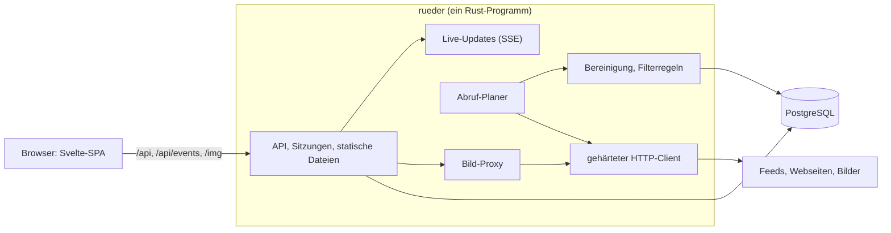

# rueder: Architektur des neuen Systems

Stand 2026-11-12. Dieses Dokument beschreibt, wie der neue rueder aufgebaut ist und warum. Den Plan mit Anforderungen und Entscheidungen führt [plan.md](plan.md), die Umsetzung mit Stand und Arbeitspaketen [implementation.md](implementation.md).

Gebaut sind die Schritte 1 bis 3; das erste Security-Review (Paket 2.12) ist am 2026-11-12 gelaufen, sein Ergebnis steht unter [Security-Review vom 2026-11-12](#security-review-vom-2026-11-12). Jeder Abschnitt nennt das Paket, mit dem sein Teil kam. Was noch Entwurf ist, sagt der Abschnitt selbst. Der [einmalige Import in den laufenden Bestand](implementation.md#einmaliger-import-in-den-laufenden-bestand) aus Schritt 4 ist mit Paket 4.3 gebaut und dort beschrieben. Wo ein Teil gebaut ist, gilt der Code: für das Schema die Migrationen in `server/migrations/`, für Artikelspeicher und Lesestand `server/src/articles.rs` und `server/src/reading.rs`, für den HTTP-Client `server/src/http_client.rs`, für die Bereinigung `server/src/cleaning.rs`, für den Bild-Proxy `server/src/images.rs`, für die Endpunkte die Module in `server/src/`, für die Oberfläche `web/src/lib/`. Wer von diesem Dokument abweicht, ändert es im selben Pull Request.

- [Überblick](#überblick)
- [Bausteine](#bausteine)
- [Datenmodell](#datenmodell)
- [Artikelspeicher und Versionen](#artikelspeicher-und-versionen)
- [Lesestand und Ungelesen-Zahlen](#lesestand-und-ungelesen-zahlen)
- [Ordner und Abos](#ordner-und-abos)
- [Filterregeln](#filterregeln)
- [Abruf](#abruf)
- [Bereinigung](#bereinigung)
- [Bild-Proxy](#bild-proxy)
- [Live-Updates](#live-updates)
- [Login und Sitzungen](#login-und-sitzungen)
- [Umzug eines Kontos](#umzug-eines-kontos)
- [Security](#security)
- [API](#api)
- [Apps anderer Anbieter](#apps-anderer-anbieter)
- [Frontend](#frontend)
- [Betrieb](#betrieb)
- [Status für Admins](#status-für-admins)
- [Android-App](#android-app)

## Überblick

Ein Rust-Programm übernimmt API, Abruf, Bereinigung, Live-Updates, Login und Bild-Proxy und liefert das gebaute Frontend aus. Daneben läuft nur noch PostgreSQL.



Zwei Regeln prägen den Aufbau:

- **Der Browser spricht ausschließlich mit rueder.** Kein Bild, kein Skript, kein Tracker wird direkt von fremden Seiten geladen.
- **Ins Internet geht nur der gehärtete HTTP-Client.** Feeds, Webseiten für die Feed-Suche und Bilder holt allein er. Deshalb gibt es genau eine Stelle für alle Schutzregeln gegen SSRF.

## Bausteine

| Baustein | Wahl | Grund |
|---|---|---|
| Server | Rust mit `axum` auf `tokio` | Ein Programm für alle Aufgaben, SSE ist eingebaut. |
| Datenbank | PostgreSQL 16 mit `sqlx` | Die Daten liegen schon dort. Partitionierung und Volltextsuche sind vorhanden, Abfragen werden beim Kompilieren gegen das Schema geprüft. |
| Feed-Abruf | `reqwest` mit `rustls`, Parser `feed-rs` | RSS, Atom und JSON Feed. Bedingte Abrufe mit ETag schonen die Quellen. |
| Bereinigung | `ammonia` plus eigene Regeln für Links und Bilder | Allowlist statt Sperrliste. |
| Live-Updates | SSE, intern ein Broadcast-Kanal | Ersetzt RabbitMQ. Bei mehreren Prozessen übernimmt `LISTEN/NOTIFY` von PostgreSQL. |
| Bilder | Eigener Proxy mit dem `image`-Crate | Ersetzt imgproxy, der Schlüssel für die Signatur bleibt auf dem Server. |
| Login | Lokale Konten mit Argon2id, OpenID Connect als Option | Ersetzt loginsrv und den Dienst `authbackend`. |
| Frontend | SvelteKit als SPA, Svelte 5, TypeScript, TailwindCSS 4 | Wird vom Server mit ausgeliefert. Die API-Typen werden aus dem Rust-Code erzeugt. |
| Betrieb | Ein Container plus PostgreSQL hinter einem Reverse-Proxy | Heute sind es acht Container plus imgproxy. |

Das Programm hat Unterbefehle: `rueder serve` (Standard) startet Server und Abruf, weitere Befehle erledigen einmalige Arbeiten (Import der alten Datenbank, Konten anlegen, Admins bestimmen, Messdaten erzeugen). Migrationen laufen beim Start von selbst.

## Datenmodell

Die Tabellen im Überblick. Die genauen Spalten stehen in den Migrationen, `server/migrations/0001_initial.sql` und den folgenden.

| Bereich | Tabellen | Idee |
|---|---|---|
| Konten | `accounts`, `account_identities`, `sessions`, `registration`, `invites`, `recovery_codes`, `app_passwords` | Ein Konto hat einen Login-Namen, optional einen Argon2id-Hash und Einstellungen als JSON, dazu das Recht als Admin, die Zustimmung zu [Fehlerberichten](#fehlerberichte-aus-dem-browser) (`sends_reports`) und, woher es stammt (`origin`, `invite_id`, `invite_quota`, siehe [Registrierung und Einladungen](#registrierung-und-einladungen)) und den [zweiten Faktor](#zweiter-faktor) (`totp_secret`, `totp_pending`, `totp_last_step`, die Wiederherstellungscodes in `recovery_codes`, an der Sitzung `second_factor`). `account_identities` verknüpft Konten mit OpenID-Connect-Anbietern (Aussteller und Subject) und mit dem alten Login (`auth_origin`, `auth_subject`). Eine Sitzung ist der SHA-256 des Cookie-Tokens mit Ablaufzeit, ein [App-Passwort](#apps-anderer-anbieter) der SHA-256 des Passworts mit Name und letzter Nutzung. |
| Feeds | `feeds` | Ein Feed gehört allen seinen Abonnenten gemeinsam. Er kennt seine höchste Artikelnummer (`last_seq`), den Abrufstand (nächster Abruf, Intervall, ETag, Last-Modified, letzter Erfolg, letzter Fehler) und den User-Agent, mit dem er abgerufen wird. |
| Baum | `folders`, `subscriptions` | Ordner mit Elternordner und Position. Ein Abo verbindet Konto und Feed, liegt in einem Ordner oder auf oberster Ebene, hat eine Position und trägt die Lesemarke. |
| Artikel | `articles`, `article_content`, `article_versions`, `arrivals` | Heiß, warm und kalt getrennt, siehe [Artikelspeicher und Versionen](#artikelspeicher-und-versionen). Der Index der [Suche](#suche) liegt auf `article_content`. `arrivals` sagt je Minute, welche Nummer als erste eintraf, für die Zeiten der [Apps anderer Anbieter](#apps-anderer-anbieter). |
| Lesestand | `subscriptions.read_upto`, `article_states` | Lesemarke je Abo plus Ausnahmen je Artikel, siehe [Lesestand und Ungelesen-Zahlen](#lesestand-und-ungelesen-zahlen). Nach einem [Umzug](#umzug-eines-kontos) in einen Feed ohne ersten Abruf merkt sich `subscriptions.read_before` die Zeit, bis zu der gelesen ist. |
| Regeln | `filter_rules` | Filterregeln je Konto, siehe [Filterregeln](#filterregeln). |
| Labels | `labels`, `article_labels` | Labels mit Farbe je Konto und ihre Zuordnung zu Artikeln. Der Stern ist kein Label, sondern eine Ausnahme in `article_states`. |
| Fehlerberichte | `client_reports` | Fehler aus den Browsern der User, die zustimmen, je Konto und Fingerabdruck gezählt, siehe [Fehlerberichte aus dem Browser](#fehlerberichte-aus-dem-browser). |

Schlüssel sind fortlaufende Zahlen, keine UUIDs, `bigint` für Artikel und Fehlerberichte, `integer` für alles andere (Konten, Feeds, Ordner, Regeln, Labels, Einladungen): Sie halten Zeilen und Indizes schmal, und neue Artikel liegen im Index beieinander. Feeds und Konten behalten ihre alte UUID in einer Spalte `legacy_id`, Artikel in der Tabelle `legacy_articles`, damit der Import weiß, was er schon übernommen hat, und Lesestand und Labels aus dem Browser zugeordnet werden können. Die Tabelle statt einer Spalte hält die heiße Artikeltabelle schmal und kann nach dem Umstieg weg.

## Artikelspeicher und Versionen

Listen lesen nie Artikeltext, und alte Versionen berühren nie die Tabellen, aus denen neue Artikel gelesen werden. Dafür wird die eine Tabelle von heute in drei geteilt:

| Tabelle | Inhalt | Wird gelesen | Größe und Pflege |
|---|---|---|---|
| `articles` (heiß) | Eine schmale Zeile je Artikel: Feed, laufende Nummer im Feed, Titel, Anriss, Autor, Datum, Vorschaubild, Nummer der aktuellen Version, Zeitpunkt der letzten Änderung | Bei jeder Liste und jeder Zählung | Klein genug für den Arbeitsspeicher. Index auf Feed und Nummer. |
| `article_content` (warm) | Genau eine Zeile je Artikel: der bereinigte Text der aktuellen Version, dazu was nur die Artikelansicht braucht (Schlagwörter, Anhänge, Kennung des Feeds für den Artikel), und für die [Suche](#suche) eine Kopie von Titel, Autor und ID | Beim Öffnen eines Artikels, per Primärschlüssel, und bei der Suche | Wächst mit der Zahl der Artikel, nicht mit der Zahl der Versionen. |
| `article_versions` (kalt) | Jede Version im Original, mit zstd komprimiert, dazu Abrufzeit und Prüfsumme | Nur in der Versionsansicht und beim erneuten Bereinigen | Nach Monat partitioniert, es wird nur angehängt. Alte Partitionen können auf langsameren Speicher. |

So greifen die Teile ineinander:

1. **Neue Version nur bei echter Änderung.** Der Abruf vergleicht eine Prüfsumme über den normalisierten Inhalt. Tracking-Parameter und Leerraum zählen nicht mit, sonst erzeugen wechselnde Werbe-Token bei jedem Abruf eine Scheinversion.
2. **Die aktuelle Fassung bleibt an einem Ort.** Eine neue Version ersetzt die Zeile in `article_content` und hängt das Original an `article_versions` an. Wer die aktuelle Fassung liest, kommt mit der Historie nie in Berührung.
3. **Feste Nummer statt Fensterfunktion.** Jeder Artikel bekommt beim Einfügen seine laufende Nummer im Feed (`seq`). Blättern heißt dann „die 50 Artikel vor Nummer 4711“ und kostet immer gleich viel, egal wie groß der Feed ist.
4. **Keine Zählabfragen.** Der Feed kennt seine höchste Nummer. `COUNT(*)` entfällt.
5. **Alte Artikel kosten nur Plattenplatz.** Neue Zeilen liegen physisch beieinander, der Cache hält deshalb von selbst die neuen Seiten.
6. **Bereinigung ist wiederholbar.** Weil das Original gespeichert ist, lassen sich bessere Filterlisten oder ein Sanitizer-Fix nachträglich auf alte Artikel anwenden.

Regeln, auf die sich der Rest verlässt:

- **Nummern sind lückenlos und werden nie neu vergeben.** Ein Feed vergibt `last_seq + 1` in derselben Transaktion, in der der Artikel eingefügt wird; je Feed läuft immer nur ein Abruf. Die Ungelesen-Zahl rechnet mit `last_seq`, eine Lücke würde als ungelesener Artikel zählen.
- **Ein Artikel wird über seine Kennung im Feed wiedererkannt** (GUID, ersatzweise der Link), eindeutig je Feed.
- **Eine neue Version ändert den Lesestand nicht.** Der Artikel bleibt gelesen; die heiße Zeile bekommt die neue Versionsnummer und den Zeitpunkt, daraus macht die Oberfläche den Hinweis „aktualisiert“. Dazu hält `articles.updated_what` fest, was anders war: `title`, `text` oder `both`. Verglichen werden die beiden Texte, aus denen auch die Prüfsumme entsteht, Titel und bereinigter Text, und Leerraum zählt wie dort nicht mit. Schreibt ein Feed nur die Überschrift um, sagt die Liste „neue Überschrift“ statt „aktualisiert“: Sonst sucht, wer den Artikel öffnet, im Text nach einer Änderung, die es dort nicht gibt. Leer bleibt die Spalte bei jeder Version von vor Paket 5.12; die Oberfläche sagt dann wie bisher „aktualisiert“.
- **Höchstens 20 Versionen je Artikel.** Bei der 21. bleiben die Erstfassung und die 19 neuesten, die zweitälteste fällt weg.
- **Partitionen entstehen im Voraus.** Der Server legt beim Start und danach regelmäßig die Partitionen für den laufenden und den nächsten Monat an.

Gemischte Listen (ein Ordner, „Alle Artikel“) brauchen eine Reihenfolge über Feeds hinweg. Das ist die Reihenfolge des Eintreffens, also die fortlaufende ID des Artikels; innerhalb eines Feeds stimmt sie mit `seq` überein. Die Abfrage führt die Feeds zusammen wie sortierte Listen: Der Index `(feed_id, id)` liefert je Feed den neuesten passenden Artikel, der neueste davon kommt auf die Seite, und sein Feed liefert den nächsten. Das kostet einen Schritt in den Index je Feed und einen je Zeile der Seite, unabhängig von der Größe der Feeds. Bei „nur ungelesen“ ist die Lesemarke jedes Abos eine Untergrenze, unter der der Index nicht gelesen wird; wieder ungelesene Artikel unter der Marke kommen aus `article_states` dazu. Ein Feed, ein Ordner und alle Feeds sind dieselbe Abfrage. Bei 300 Feeds und 10 Millionen Artikeln bleibt sie mit 18 ms im 99. Perzentil unter dem [Messziel](plan.md#messziel), siehe [Messung](implementation.md#messung).

Beim Import wird der heutige Text jedes Artikels zu Version 1. Die laufenden Nummern werden so vergeben, wie das alte System sie heute bei jeder Abfrage berechnet (`row_number() over (partition by feed_id order by seq)`), damit der Lesestand aus dem Browser weiter passt. Hatte der neue rueder einen der Artikel schon selbst abgerufen, weicht die Nummer ab; die alte steht dann in `legacy_articles.legacy_seq`. Beim [Zusammenführen](implementation.md#einmaliger-import-in-den-laufenden-bestand) rücken die Artikel, die der neue rueder schon hat, hinter die alten: Das ist die einzige Stelle, an der vergebene Nummern sich ändern, einmal und bei stehendem Server.

## Lesestand und Ungelesen-Zahlen

Der Server speichert je Konto und Feed eine **Lesemarke** („alles bis Nummer N ist gelesen“, `subscriptions.read_upto`) und die **Ausnahmen** davon in `article_states`, eine Zeile je Konto, Feed und Nummer:

| Ausnahme | Bedeutung |
|---|---|
| gelesen | Der Artikel liegt über der Lesemarke und ist gelesen. |
| ungelesen gehalten | Der Artikel liegt an oder unter der Lesemarke und ist wieder ungelesen. |
| ausgeblendet | Eine Filterregel hat den Artikel ausgeblendet. Er zählt nie als ungelesen. |
| Stern | Unabhängig vom Lesestand. |

Die Ungelesen-Zahl eines Feeds wird immer aus diesen Daten berechnet:

```text
ungelesen = (last_seq − read_upto)
          − Artikel über der Marke, die gelesen oder ausgeblendet sind
          + Artikel an oder unter der Marke, die ungelesen gehalten und nicht ausgeblendet sind
```

Die Zahl eines Ordners ist die Summe seiner Feeds. Es gibt keinen gespeicherten Zähler, der auseinanderlaufen kann.

Die Operationen:

- **Lesen:** über der Marke entsteht die Ausnahme „gelesen“, unter der Marke verschwindet „ungelesen gehalten“.
- **Wieder ungelesen:** umgekehrt.
- **Alle als gelesen markieren (bis Nummer N):** Die Marke rückt auf N vor, alle Ausnahmen „gelesen“ und „ungelesen gehalten“ bis N entfallen. Die Marke bewegt sich nie zurück.
- **Verdichten:** Folgen auf die Marke lückenlos gelesene oder ausgeblendete Artikel, rückt sie darüber vor. So bleibt die Zahl der Ausnahmen klein, auch wenn jemand jahrelang Artikel einzeln liest.

Das maßgebliche Modell mit Tests ist `web/src/lib/unread.ts`. Der Server bildet genau dieses Verhalten nach und wird mit denselben Fällen geprüft, am besten mit Property-Tests gegen ein einfaches Modell („eine Menge gelesener Nummern“).

Der Lesestand hängt an (Konto, Feed, Nummer) und nicht an der ID des Artikels. Die Liste eines Feeds und seine Zählung kommen dadurch ohne Verbund mit der Artikeltabelle aus.

## Ordner und Abos

- Ordner lassen sich bis zu **fünf Ebenen** tief verschachteln. Ein Zug, der tiefer führen würde, wird abgelehnt, im Frontend und auf dem Server.
- Ordner und Abos einer Ebene teilen sich eine Reihenfolge. Jede Zeile trägt eine **Position** als Sortierschlüssel zwischen ihren Nachbarn. Ein Zug ändert genau eine Zeile („verschiebe X vor Y in Ordner Z“); gleichzeitige Änderungen von zwei Geräten überschreiben sich nicht mehr.
- Ein gelöschter Ordner gibt seinen Inhalt an die Ebene darüber ab.
- Grenzen je Konto für Ordner und Abos, wie heute 100 Ordner und 1.000 Feeds je Ordner, dazu 2.000 Feeds insgesamt.

Das Modell mit Tests ist `web/src/lib/tree.ts` (`canMove`, `moveNode`, `nudge` für die Tastatur).

Gebaut in Paket 2.6 (`server/src/tree.rs`, `server/src/subscribe.rs`):

- **Züge.** `POST /api/tree/move` nimmt Knoten, Ziel und `before`, `after` oder `inside`, wie das Modell im Frontend. Ein Test spielt zufällige Züge gegen ein Modell, das `tree.ts` nachgebaut ist. Jede Änderung am Baum sperrt die Zeile des Kontos, es läuft also je Konto nur eine.
- **Grenzen.** 100 Ordner und 2.000 Feeds je Konto, 1.000 Feeds je Ordner und ebenso auf der obersten Ebene, Namen bis 100 Zeichen (siehe [Limits je Konto](#header-herkunft-und-limits)).
- **Feed-Suche.** `POST /api/feeds/find` sieht sich eine Adresse an. Ist sie ein Feed, ist das der eine Treffer. Ist sie eine Webseite, nennt die Antwort die Feeds, auf die die Seite mit `<link rel="alternate">` zeigt, höchstens 20. Gelesen werden die ersten 512 kB der Seite, mit dem Parser der [Bereinigung](#bereinigung) und in dessen Grenzen. Die Suche legt nichts an. **YouTube:** Die Seite eines Kanals nennt seinen Feed zuerst, `https://www.youtube.com/feeds/videos.xml?channel_id=UC…`, mit dem Namen des Kanals. Bei Adressen wie `youtube.com/@name` steht die Kennung des Kanals im `<meta property="og:url">` der Seite (`…/channel/UC…`); eine Adresse `youtube.com/channel/UC…` führt ohne Umweg zum Feed, die Seite wird gar nicht erst geholt. Gilt nur für `youtube.com`, `www.youtube.com` und `m.youtube.com` und nur für eine Kennung aus „UC“ und 22 Buchstaben, Ziffern, `-` oder `_`. Schickt YouTube statt der Seite seine Frage nach Cookies (`consent.youtube.com`, wie es in der EU vorkommt), findet die Suche bei `@name` nichts.
- **Abonnieren.** `POST /api/feeds` abonniert die Adresse eines Feeds. Einen Feed, den noch niemand liest, ruft der Server dabei ab und behält ihn nur, wenn das gelingt: Aus einer beliebigen Adresse wird so kein Feed. Eine Adresse mit Name und Passwort wird abgelehnt, denn ein Feed gehört allen, die ihn lesen. Ohne Schema gilt eine Adresse als https.
- **Lesemarke eines neuen Abos.** Wer einen Feed abonniert, den andere schon lesen, findet die 10 neuesten Artikel ungelesen und alles davor gelesen, wie in den [Detailfragen](plan.md#detailfragen) entschieden (`subscribe::NEWEST_UNREAD`). Ein neuer Feed bringt mit, was sein erster Abruf liefert. Die [Filterregeln](#filterregeln) des Kontos sehen sich den Feed sofort an.
- **OPML.** `GET /api/opml` gibt den Baum aus, Ordner als Gliederung um ihre Feeds. `POST /api/opml` nimmt eine Datei bis 1 MB mit höchstens 2.000 Feeds und einer Gliederung bis 32 Ebenen. Ordner werden am Namen an ihrer Stelle wiedererkannt oder angelegt; was tiefer als fünf Ebenen liegt, landet im tiefsten Ordner, der passt. Die Reihenfolge der Datei bleibt, und Feeds, die das Konto schon liest, bleiben, wo sie sind. Der Import ruft nichts ab: Neue Feeds sind sofort fällig, die nächste Runde des [Abrufs](#abruf) holt sie, und ein Feed, der keiner ist, zeigt seinen Fehler im Baum. Der Leser kennt nur die fünf Entitäten von XML. Die Datei muss als `text/x-opml` oder XML gesendet werden, was ein Formular einer fremden Seite nicht kann.
- **User-Agent.** `PUT /api/feeds/{id}/agent` stellt den Abruf eines Feeds auf den Browser-User-Agent um oder zurück. Der Feed gehört allen Abonnenten gemeinsam, die Einstellung gilt deshalb für alle, und jeder von ihnen kann sie setzen.

Abweichungen: Die Grenze von 1.000 Feeds gilt auch für die oberste Ebene. Wer ein Abo kündigt, verliert seinen Lesestand und seine Labels in diesem Feed; der Feed und seine Artikel bleiben, auch wenn ihn niemand mehr liest, und werden dann nicht mehr abgerufen.

## Filterregeln

Eine Regel hat:

| Teil | Werte |
|---|---|
| Bereich | alle Feeds, ein Ordner (mit allem darunter), ein Feed |
| Feld | überall, Titel, Text, Autor, Schlagwort |
| Vergleich | enthält, ganzes Wort, regulärer Ausdruck |
| Aktion | ausblenden, als gelesen markieren |

- Regeln greifen **beim Eintreffen** eines Artikels, für jeden Abonnenten des Feeds. Treffer zählen nicht als ungelesen.
- Wird eine Regel angelegt, geändert oder gelöscht, bewertet der Server den Bestand des Kontos neu: die jüngsten 200 Artikel jedes Feeds und alles, was ausgeblendet ist. Eine **Vorschau** zeigt vor dem Speichern, wie viele Artikel betroffen wären.
- Ausgeblendetes bleibt unter „Ausgeblendet“ einsehbar.
- Der Vergleich arbeitet auf Text ohne HTML-Tags, ohne Rücksicht auf Groß- und Kleinschreibung; „ganzes Wort“ behandelt Umlaute als Buchstaben.
- Reguläre Ausdrücke laufen mit dem `regex`-Crate in garantiert linearer Zeit. Muster sind höchstens 200 Zeichen lang, die Zahl der Regeln je Konto ist begrenzt.

Das Modell mit Tests ist `web/src/lib/filters.ts`. Der Server muss dieselben Fälle gleich entscheiden; die Syntax für reguläre Ausdrücke ist die des `regex`-Crates, das Frontend prüft Muster deshalb über den Server und nicht mit `RegExp` des Browsers.

Gebaut in Paket 2.6 (`server/src/filters.rs`), mit den Fällen aus `filters.test.ts` als Tests:

- **Ausgeblendet ist, was eine Regel trifft.** Ein Artikel ist genau dann ausgeblendet, wenn eine eingeschaltete Regel ihn trifft, in deren Bereich sein Feed liegt. Geht die Regel, wird sie geändert oder ausgeschaltet, kommt der Artikel zurück, auch wenn er längst nicht mehr zu den jüngsten gehört. Von Hand blendet niemand aus. „Als gelesen markieren“ wird dagegen nie zurückgenommen.
- **Ausblenden geht vor.** Trifft eine Regel zum Ausblenden und eine zum Markieren denselben Artikel, wird er ausgeblendet und nicht hinter dem Rücken des Lesers als gelesen markiert.
- **Beim Eintreffen** wendet der Abruf die Regeln aller Abonnenten in der Transaktion an, die die Artikel speichert. Niemand sieht einen Artikel ungefiltert.
- **Der Baum zählt mit.** Ein Zug in einen Ordner oder aus ihm heraus und das Löschen eines Ordners bewerten neu, wenn eine Regel an einem Ordner hängt oder etwas ausgeblendet ist. Eine Regel verschwindet mit ihrem Ordner und mit dem Abo ihres Feeds.
- **Ein Motor für alle Vergleiche.** „Enthält“ und „ganzes Wort“ werden in denselben regulären Ausdruck übersetzt, den auch ein eigenes Muster ergibt. Das übersetzte Programm darf höchstens 1 MB groß werden, sonst gilt das Muster als zu aufwendig. Rückbezüge und Vorausschau kennt das `regex`-Crate nicht; solche Muster lehnt der Server ab.
- **Abseits der Anfragen.** Das Vergleichen läuft auf eigenen Threads, damit eine Regel über viele Artikel den Server nicht aufhält. Den Text ohne Tags gewinnt ein einfacher Abschneider aus dem schon bereinigten Text, nicht der HTML-Parser.
- **Grenzen.** 200 Regeln je Konto, Muster bis 200 Zeichen.
- **Die Reihenfolge** der Regeln ist nur die der Liste; was sie entscheiden, hängt nicht von ihr ab.

Abweichungen vom Entwurf: Neu bewertet werden die jüngsten 200 Artikel je Feed und alles Ausgeblendete, nicht alle ungelesenen. Bei 300 Feeds sind das höchstens 60.000 Artikel statt möglicherweise Millionen, und was eine Regel einmal ausgeblendet hat, bleibt trotzdem nicht hängen. Neue Versionen eines Artikels bewertet der Abruf nicht neu; das holt die nächste Änderung an den Regeln nach.

## Suche

Gebaut in Paket 2.13 (`server/src/search.rs`, `server/migrations/0005_search.sql`). `GET /api/search` sucht in den Artikeln der eigenen Abos: in allen, in einem Feed (`feed`) oder in einem Ordner mit allem darunter (`folder`).

- **Was gefunden wird.** Ein Artikel, der alle Wörter der Suche hat, in Titel, Autor, Schlagwörtern oder Text seiner aktuellen Fassung. Ein Wort ab drei Buchstaben findet auch, was mit ihm beginnt („wahl“ findet „Wahlen“ und „Wahlkampf“), ein kürzeres nur sich selbst. Groß- und Kleinschreibung zählt nicht, Umlaute und ß bleiben, was sie sind. Wörter zerlegt der Parser von PostgreSQL; HTML-Tags und Entities lässt er aus, ein Wort mit Bindestrich findet er ganz und in seinen Teilen. Höchstens 200 Zeichen und 10 Wörter.
- **Was nicht.** Keine Stammformen: Die Feeds sind deutsch, englisch und gemischt, eine falsche Sprache wäre schlimmer als keine, und die Suche nach Wortanfängen gleicht einen Teil davon aus. Keine Wortfolgen in Anführungszeichen und keine Rangfolge: Die Treffer kommen wie die Listen, der neueste zuerst. Ausgeblendetes fehlt, mit `unread` auch Gelesenes. Vom Text zählen die ersten 100.000 Zeichen, weil die Wörter eines Artikels in PostgreSQL höchstens 1 MB groß sein dürfen und ein Artikel, an dem das scheitert, den Abruf seines Feeds scheitern ließe.
- **Der Index** ist ein GIN-Index über einen Ausdruck auf `article_content`: die Wörter (`to_tsvector('simple', …)`) aus Titel, Autor, Schlagwörtern und Text. Die Wörter selbst werden nicht gespeichert. In einer eigenen Spalte wären sie größer als der Text: In einer Probe mit 200.000 erfundenen Artikeln brauchten sie 830 Byte je Artikel, der Text 560. Damit der Ausdruck alles in einer Zeile findet, trägt `article_content` eine Kopie von Titel, Autor und ID aus `articles`. Trigger halten sie gleich, wer auch immer schreibt (Abruf, Import, erneutes Bereinigen); nur wer beide Tabellen in einer Anweisung füllt, wie die Messdaten, setzt sie selbst. Die Migration baut den Index für alles, was schon gespeichert ist. Er hat keine Warteliste (`fastupdate = off`): Mit ihr sammelt PostgreSQL neue Wörter und arbeitet sie in einem Rutsch ein, was in der Messung einzelne Abrufe Sekunden warten ließ; ohne sie kostet jeder Artikel beim Schreiben gleichmäßig rund 1,5 ms mehr.
- **Zwei Wege zu den neuesten Treffern.** Der Index weiß, welche Artikel ein Wort haben, nicht, in welcher Reihenfolge sie kamen, und was er zu einem Wort hält, zu lesen kostet so viel, wie es Artikel damit gibt, in allen Feeds und Jahren: für ein seltenes Wort fast nichts, für eines in jedem zehnten Artikel bei 10 Millionen Artikeln eine halbe Sekunde. Der andere Weg geht vom neuesten Artikel der Suche rückwärts und bestimmt die Wörter jedes Artikels neu. Das kostet je Artikel gleich viel (in der Messung rund 60 µs), ist also schnell, wenn jeder zehnte ein Treffer ist, und langsam für ein seltenes Wort. Zwischen beiden wählt die Suche selbst, nicht der Planer von PostgreSQL: Der schätzt grob, wie viele Wörter mit einem Anfang beginnen, und nahm in der Messung für häufige Wörter in der Hälfte der Fälle den Index (0,5 s statt 30 ms) und für seltenere manchmal den Weg rückwärts durch Millionen Artikel, bis die Zeit um war (siehe [Messung](implementation.md#suche-vom-2026-11-11)).
- **Wie die Suche wählt.** Sie sieht sich zuerst die neuesten 500 Artikel der Suche an. Das zeigt, wie häufig die Treffer und wie häufig die einzelnen Wörter darin sind, und was ein Artikel anzusehen kostet; das misst sie selbst, weil es an der Länge der Texte hängt und daran, wie weit die Artikel der Suche auseinanderliegen. Daraus schätzt sie, was der Rest der Seite auf beiden Wegen kostet. Für den Index rechnet sie 1,3 µs je Artikel mit dem seltensten Wort, gemessen bei 10 Millionen Artikeln; ist der Weg über den Index billiger und bleibt er unter einer Sekunde, fragt sie ihn, sonst sieht sie weiter Artikel an, in Schritten von höchstens 4.000. Den Index fragt sie nur nach dem seltensten Wort, die anderen sucht sie in dem, was er findet: Nach allen gefragt, läse er jeden Artikel mit irgendeinem davon, auch mit dem häufigsten. Und sie fragt ihn in Zeitfenstern der Reihenfolge des Eintreffens, zuerst 20.000 Artikel, dann doppelt so viele davor und so weiter, damit sie nur die Treffer in einem Fenster liest; dafür nimmt PostgreSQL den Index der ID dazu. Was das Neubestimmen der Wörter kostet, sagt ihm die Funktion des Ausdrucks mit `COST 2000`. Die Statistik über den Index kennt 10.000 Wörter statt 1.000, damit auch die mittlerer Häufigkeit richtig geschätzt werden. Die ganze Tabelle zu lesen ist für die Suche ausgeschaltet.
- **Blättern mit `next`.** Eine Anfrage sucht höchstens eine halbe Sekunde, dann hört sie am Ende eines Schritts auf und sagt mit `next`, wo es weitergeht. Eine Seite kann deshalb weniger Treffer haben als verlangt, auch keinen, und trotzdem weitergehen; `next` ist `null`, wenn nichts Älteres mehr kommt. Die nächste Seite fragt mit `before` gleich `next`. Ein einzelner Schritt, der länger als drei Sekunden braucht, wird abgebrochen, die Antwort ist 503. So hält keine Suche eine Verbindung zur Datenbank lange fest.
- **Im Frontend.** Die Suchleiste fragt den Server, sobald das Tippen 0,3 Sekunden ruht, im gezeigten Feed, im gezeigten Ordner oder in allen Artikeln; von der Startseite aus wechselt die Seite dafür zu „Alle Artikel“. Die Treffer sind eine Liste wie die anderen, mit Lesestand, Stern, Tastatur und Nachladen. Kommt eine Seite wegen der Zeit zu kurz, fragt der Reader gleich weiter, höchstens zehnmal. In den Listen der markierten und der ausgeblendeten Artikel und in denen eines Labels sucht der Server nicht; dort durchsucht die Suchleiste weiter, was geladen ist. Der Reader mit erfundenen Daten durchsucht alle seine Artikel selbst, in Titel, Anriss und Autor.
- **Was es kostet,** steht unter [Messung](implementation.md#suche-vom-2026-11-11): Größe des Index, Zeit zum Bauen, Mehrkosten beim Schreiben und die Zeiten der Suche bei 10 Millionen Artikeln.

## Abruf

Ein Planer im Server ruft jeden Feed mit mindestens einem Abonnenten in seinem Intervall ab.

1. Fällige Feeds kommen aus der Datenbank (`next_fetch_at`), begrenzt viele laufen gleichzeitig, je Host nur einer.
2. Der gehärtete HTTP-Client holt den Feed, bedingt mit ETag und Last-Modified. „Nicht geändert“ beendet den Abruf.
3. `feed-rs` liest RSS, Atom oder JSON Feed, mit Grenzen für Größe und Zahl der Artikel. Atom 0.3, das manche Websites noch senden (die Tagesschau etwa), schreibt der Server vorher als Atom 1.0 um, weil `feed-rs` nur dessen Namensraum liest und die Elemente der älteren Fassung übergeht: Namensraum, die umbenannten Elemente (`issued`, `modified`, `tagline`, `copyright`), die Art der Texte (`mode="escaped"` wird `type="html"`) und `dc:date` als `updated`. Escapter HTML-Text, der zusätzlich in einer CDATA-Markierung als Text steckt, verliert diese Hülle. Davor bekommt `feed-rs` jeden Feed in XML als UTF-8 und ohne Deklarationen, die eine andere Kodierung nennen: Die Bibliothek wechselt sonst mitten im Lesen die Kodierung und bricht mit einer Panic ab, wenn die Deklaration nach den ersten 64 Bytes steht, bei einer langen Deklaration oder einer zweiten weiter unten (gefunden beim [Fuzzing](#fuzzing)). Bytes, die nicht zur Kodierung gehören, werden dabei Ersatzzeichen, denn die Bibliothek ließe sie weg und läse weiter, und aus den Buchstaben drumherum würde eine Deklaration (`enc\xC0oding`, gefunden beim Fuzzing zum [Security-Review](#security-review-vom-2026-11-12)). Die Kodierung nennt das Byte Order Mark, sonst die Deklaration. Adressen des Feeds (Seite, Icon, Links der Artikel, Vorschaubilder, Anhänge) bleiben nur, wenn sie ganze `http`- oder `https`-Adressen mit Host sind; die Kennung eines Artikels nimmt den Link weiter so, wie der Feed ihn nennt.
4. Je Artikel: Kennung bestimmen, Inhalt normalisieren, Prüfsumme bilden. Unbekannt heißt neuer Artikel, andere Prüfsumme heißt neue Version, sonst nichts.
5. Bereinigung des Inhalts (siehe unten), Anriss und Vorschaubild ableiten.
6. In einer Transaktion: Nummern vergeben, die drei Tabellen schreiben, Filterregeln der Abonnenten anwenden, `last_seq` und Abrufstand des Feeds setzen.
7. Meldung an die Live-Updates.

Das Intervall passt sich wie heute der Aktivität des Feeds an, zwischen 15 Minuten und 12 Stunden (Logik des alten rueder: `backend/pkg/worker/feed.go`, `updateFetchDelay`, im Commit `0b36a96`). Fehler verlängern das Intervall schrittweise und stehen am Feed, die Oberfläche zeigt ein Warnzeichen. Der User-Agent ist ehrlich („rueder“ mit Version und Adresse des Projekts) und lässt sich je Feed auf einen Browser-User-Agent umstellen.

Die Feed-Suche auf Webseiten (heute der Dienst `feedfinder`) und der OPML-Import nutzen denselben Client.

Gebaut in Paket 2.2 (`server/src/feeds.rs` liest und speichert, `server/src/fetch.rs` ruft ab):

- **Runde.** `serve` sieht alle 30 Sekunden nach fälligen Feeds mit mindestens einem Abo, höchstens 100 je Runde. Ein genommener Feed ist für zehn Minuten vergeben, damit ihn keine zweite Runde und kein zweiter Server nimmt. Höchstens acht Abrufe laufen gleichzeitig, je Host einer. Das sind höchstens 12.000 Abrufe je Stunde.
- **Takt** (Paket 5.2, `fetch::Pace`). Die drei Werte setzt der Betreiber mit `FETCH_ROUND` (1 bis 10.000 Feeds je Runde), `FETCH_AT_ONCE` (1 bis 256 gleichzeitig) und `FETCH_EVERY` (alle 5 bis 3.600 Sekunden); ohne sie gelten die oben. Ein Wert außerhalb dieser Grenzen oder keine Zahl hält den Start an, statt still den Standard zu nehmen. Je Host bleibt es bei einem Abruf, wie hoch der Takt auch ist. Dauert eine Runde länger als der Takt, wartet die nächste, statt dass mehrere zugleich laufen. Was eine Maschine schafft, misst `rueder bench fetch` gegen eine Quelle auf derselben Maschine, die unter vielen Adressen aus 127.0.0.0/8 antwortet, weil je Host nur ein Abruf läuft ([Messung](implementation.md#abruf-vom-2026-11-12)); Werte für eine große Instanz stehen in [deploy/README.md](../deploy/README.md#a-large-instance).
- **Kennung.** Die ID, die der Feed dem Eintrag gibt, sonst sein Link, sonst eine Prüfsumme aus Titel und Text. Sie ist bei jedem Abruf dieselbe; ein Eintrag ohne alles wird ausgelassen.
- **Änderung.** Die Prüfsumme geht über Titel und bereinigten Text, Folgen von Leerraum zählen als ein Leerzeichen. Ein nur neu umbrochener Text ist also keine neue Version, und ebenso wenig einer, in dem sich nur ändert, was die [Bereinigung](#bereinigung) entfernt, etwa Tracking-Parameter.
- **Grenzen.** 500 Artikel je Abruf, gezählt vom Anfang des Feeds, 1 MB je Text; was darüber liegt, bleibt weg. Der Feed selbst ist durch den HTTP-Client auf 20 MB begrenzt.
- **Text zum Lesen.** Kommt aus der [Bereinigung](#bereinigung). Das Original bleibt als Version erhalten. Lesen und Bereinigen eines Feeds läuft auf einem eigenen Thread, damit ein großer Feed den Server nicht aufhält: Der Feed von CRE mit 226 Folgen und 2,4 MB Text braucht 0,4 Sekunden, der von tagesschau.de 7 Millisekunden.
- **Vorschaubild.** Das Bild, das der Feed zum Artikel nennt (`media:thumbnail` oder `media:content` mit Bildtyp); nennt er keines, das erste Bild des bereinigten Texts, das nicht nach seiner angegebenen Breite oder Höhe unter 100 Pixeln ein Icon ist (`cleaning::first_image`, seit Paket 3.14 für die Magazin-Ansicht). Das Aufmacherbild neben dem Text bleibt das des Feeds. Gespeicherte Artikel behalten ihr Vorschaubild, bis eine neue Version kommt; `reclean` ändert es nicht.
- **Adressen.** Der Link des Artikels, Vorschaubild, Anhänge und die Adresse der Seite des Feeds verlieren ihre Tracking-Parameter. Die Kennung eines Artikels ohne eigene ID bleibt der Link, wie der Feed ihn sendet, denn so kennt ihn der alte rueder.
- **Fehler.** Der Grund steht am Feed (`error_message`), jeder Fehlschlag verdoppelt das Intervall bis zwölf Stunden, der erste Erfolg setzt es zurück.
- **Einstellungen.** `FETCH_ALLOW_NETS` gibt interne Netze frei (siehe [Gehärteter HTTP-Client](#gehärteter-http-client)), `FETCH=off` startet den Server ohne Abruf.

Abweichungen vom Entwurf oben: Die Filterregeln aus Schritt 6 kamen mit Paket 2.6, die Meldung aus Schritt 7 mit Paket 2.7 (`events::Events::publish_to_readers`). Anders als der alte rueder probiert der Abruf bei einer http-Adresse nicht zuerst https, und eine dauerhafte Weiterleitung ändert die gespeicherte Adresse des Feeds nicht.

## Bereinigung

Die Bereinigung läuft **einmal je Version auf dem Server** statt bei jedem Anzeigen im Browser. Gebaut in Paket 2.3 (`server/src/cleaning.rs`), in zwei Schritten und in dieser Reihenfolge:

1. **Eigene Regeln auf dem Dokumentbaum**, übernommen aus `frontend/src/rueder/helpers/ArticleCleaner.ts` des alten rueder (Commit `0b36a96`) samt Tests.
2. **`ammonia` mit fester Allowlist.** Es hat immer das letzte Wort: Was der erste Schritt auch tut oder übersieht, das Modul verlässt nur Auszeichnung von der Liste und keine Adresse, die nicht mit `http` oder `https` beginnt.

Die eigenen Regeln:

| Was | Regel |
|---|---|
| Links | Bekommen ihre vollständige Adresse, ohne Tracking-Parameter. Ein Link zu einer gesperrten Adresse (Teilen-Knöpfe) fällt samt Beschriftung weg. Ein Link, der nirgends ins Web führt (kein Ziel, `mailto:`, `javascript:`, relative Adresse ohne Bezug), lässt seine Worte stehen. `ammonia` setzt `rel="nofollow noopener noreferrer"` und `target="_blank"`. |
| Bilder | Bekommen ihre vollständige Adresse, ohne Tracking-Parameter, und `loading="lazy"`. Bilder gesperrter Adressen und Zählpixel (Breite und Höhe 0 oder 1) fallen weg. Fehlt der Titel, wird der Alternativtext auch Titel. `srcset` bleibt nicht, es würde der Seite die Bildschirmgröße verraten. |
| Audio und Video | Die Player fallen weg, ihre Dateien werden Anhänge des Artikels (`enclosures`, mit `"inline": true` markiert). So lädt nichts, bevor jemand es anklickt. |
| Relative Adressen | Werden zuerst von der Seite des Artikels aus aufgelöst, sonst von der Adresse des Feeds aus; `#anker` nur von der Seite des Artikels. Ohne Bezug fallen sie weg, denn im Browser würden sie in rueder selbst zeigen. |
| Leeres | Leere `p` und `span`, Kommentare und Folgen von Zeilenumbrüchen fallen weg oder zusammen, Folgen von Leerraum werden ein Leerzeichen (außer in `pre`). |
| Unbekannte Tags | Fallen weg, ihr Inhalt bleibt. `script` und `style` fallen mit Inhalt weg. |

Erlaubt sind die Tags für Text, Listen, Tabellen, Zitate, Code, Bilder und Links. An Attributen bleiben `href` an Links, `src`, `alt`, `width` und `height` an Bildern, `colspan` und `rowspan` in Tabellen, `start` an Listen, `datetime` an `time` sowie `title`, `lang` und `dir` überall. Es gibt kein `id`, `name`, `class` oder `style`: Nichts in einem Artikel kann sich als Teil von rueders eigener Seite ausgeben oder ihr Aussehen ändern.

Worauf sich der Rest verlässt:

- **Grenzen für den Parser.** Der HTML-Parser sucht bei jedem Tag durch alle offenen Tags, sein Aufwand wächst also mit dem Quadrat der Tiefe: Ein Megabyte aus nichts als öffnenden Tags beschäftigte ihn über eine Minute. Offen gelassene Formatierung wiederholt er in jedem folgenden Absatz, aus einem Megabyte Text kann so das Hundertfache an Baum werden. Deshalb zählt die Bereinigung beim Lesen mit: höchstens 256 Ebenen tief, höchstens 200.000 Knoten. Ein Text darüber wird nicht als HTML gelesen, sondern behält nur seine Worte. Das gilt für alles, was als HTML gelesen wird, auch für Titel und Anriss. Außerhalb von `cleaning.rs` darf niemand fremdes HTML lesen; `clippy.toml` verbietet die Aufrufe.
- **Erneutes Bereinigen ändert nichts.** Was herauskommt, wird als HTML aufgeschrieben und vom Browser wieder gelesen, und in seltenen Fällen lesen die Regeln von HTML es anders, als es gemeint war (eine Tabelle kann nicht in einem Absatz stehen). Deshalb wird das Ergebnis erneut bereinigt, bis es gleich bleibt, in aller Regel eine Runde. Ändert es sich nach vier Runden noch, bleiben nur die Worte.
- **Die Prüfsumme geht über das Bereinigte.** Ob ein Artikel eine neue Version bekommt, entscheidet die Prüfsumme über Titel und bereinigten Text. Was die Bereinigung entfernt, zählt also nicht: Ein Tracking-Token, das bei jedem Abruf wechselt, erzeugt keine Scheinversion.
- **Geänderte Regeln erzeugen keine Version.** Liest sich ein Artikel nach einer Änderung der Regeln anders, wurde aber gleich gesendet wie zuvor, stellt der nächste Abruf nur den Text neu hin.
- **Das Original bleibt.** `article_versions` hält den Text, wie er kam. `rueder reclean` bereinigt den Bestand daraus neu, alle Feeds oder einen; Versionen und Lesestand bleiben unberührt.

Die Listen für gesperrte Adressen und Tracking-Parameter sind Daten, keine Programmzeilen: `server/rules/blocked-links.txt` und `server/rules/tracking-parameters.txt`, mit einer Regel je Zeile. Sie sind ins Programm eingebaut, damit es ohne weitere Dateien läuft. Wer eigene Listen will, legt beide Dateien in ein Verzeichnis und nennt es in `CLEANING_RULES_DIR`; der Server liest sie beim Start.

Abweichungen vom Entwurf und vom alten Cleaner:

- Im gespeicherten Text zeigen Bilder auf ihre Quelle. Die Adresse des [Bild-Proxy](#bild-proxy) kommt erst beim Ausliefern hinein; ausgeliefert wird ein Text nie mit den eigenen Adressen seiner Bilder.
- Der alte Cleaner löste relative Adressen von der Adresse des Feeds aus auf. Ein Text, der `bilder/1.png` sagt, wurde aber für die Seite des Artikels geschrieben, und Feeds liegen oft bei einem anderen Anbieter.
- Der alte Cleaner entfernte jeden Link ohne gültiges Ziel samt Text. Das riss Worte aus Sätzen; jetzt fällt nur bei gesperrten Adressen der Text mit weg.
- Der alte Cleaner merkte sich, ob ein Text ein Bild enthält, um das Aufmacherbild nicht doppelt zu zeigen. Das entscheidet seit Paket 3.1 das Frontend: Es zeigt das Aufmacherbild nur zu einem Text ohne eigenes Bild (`ArticleBody.svelte`).

## Bild-Proxy

Jedes Bild, das jemand sieht, kommt von rueder und nie von der Seite, die es veröffentlicht hat. Die Seite erfährt so nicht, wer was liest. Gebaut in Paket 2.4 (`server/src/images.rs`).

- **Signierte Adressen.** `/img/<signatur>/<größe>/<adresse>`: Die Adresse ist die Quelle in Base64, die Signatur die ersten 16 Byte eines HMAC-SHA-256 über Größe und Quelle mit einem Schlüssel, den nur der Server kennt. Der Browser kann keine eigenen bilden, der Proxy ruft also nur ab, was in einem Artikel stand. Eine Signatur gilt für genau eine Größe.
- **Die Adresse kommt beim Ausliefern in den Text** (von Fiona am 2026-11-10 entschieden). Gespeichert bleibt der bereinigte Text mit den eigenen Adressen der Bilder. Erst wenn der Server einen Artikel ausliefert, setzt er die Adressen des Proxy ein (`Signer::in_html` für den Text, `Signer::address` für Vorschaubild, Aufmacherbild und Icon). Ein neuer Schlüssel oder eine andere Form der Adressen braucht deshalb kein erneutes Bereinigen des Bestands. Ein Bild, für das es keine Proxy-Adresse gibt, geht nicht hinaus.
- **Der Schlüssel.** `IMAGE_PROXY_KEY`, mindestens 32 Zeichen. Ohne ihn erzeugt der Server beim ersten Start einen eigenen und legt ihn als Datei `key` ins Cache-Verzeichnis, nur für sich lesbar. Er bleibt über Neustarts gleich, damit Adressen weiter gelten, die Browser sich gemerkt haben.
- **Abruf** über den gehärteten HTTP-Client, ohne Cookies und Referrer, mit festem User-Agent. Höchstens acht Quellen gleichzeitig, davon höchstens vier vom selben Host (seit dem 2026-11-12); wer auf einen Host wartet, hält keinen der acht Plätze. Eine Quelle, die fehlschlägt, wird fünf Minuten in Ruhe gelassen.
- **Nur Bilder.** PNG, JPEG, GIF und WebP, erkannt an den ersten Bytes und nie an dem, was die Quelle behauptet. Alles andere wird abgelehnt, auch SVG: Das wird nie durchgereicht und in dieser Fassung auch nicht gerastert.
- **Drei feste Größen.** `icon` passt in 256×256, `thumbnail` in 800×800 (beide wie die Presets des alten imgproxy), `image` in 2000×2000. Ein Bild, das passt, geht durch, wie es kam, samt Animation. Ein größeres wird verkleinert und neu geschrieben: als PNG, wenn es durchsichtige Stellen hat, sonst als JPEG; von einer Animation bleibt dabei das erste Bild. Die Ausrichtung aus den Kameradaten wird vorher angewendet.
- **Grenzen.** Höchstens 20 MB je Datei und 30 Millionen Pixel. Die Maße werden aus dem Kopf der Datei gelesen und geprüft, bevor irgendetwas dekodiert wird; eine kleine Datei, die sich zu Gigabytes entpackt, wird so in Millisekunden abgelehnt. Dekodiert wird abseits der Threads, die Anfragen bedienen, höchstens zwei Bilder gleichzeitig.
- **Cache auf Platte** in `IMAGE_CACHE_DIR`, eine Datei je Bild und Größe. Über `IMAGE_CACHE_MB` (Standard 1024) hinaus fallen die am längsten ungenutzten Dateien weg, bis der Cache bei vier Fünfteln der Grenze liegt. Er enthält nichts, was sich nicht neu holen ließe.
- **Nur für eingeloggte User** (seit Paket 2.5). Ohne Sitzung antwortet der Proxy mit 401, auch aus dem Cache und auch auf eine richtig signierte Adresse; die Quelle wird dann gar nicht gefragt.
- **Auslieferung** mit dem Typ, den die Bytes haben, `X-Content-Type-Options: nosniff`, `Content-Security-Policy: default-src 'none'; sandbox`, `Cross-Origin-Resource-Policy: same-origin` und `Cache-Control: private, max-age=31536000, immutable`. Abgelehnt wird mit 404 (keine Adresse des Servers), 502 (Quelle nicht erreichbar oder nicht erlaubt), 415 (kein Bild) und 413 (zu groß), immer ohne Inhalt.

Abweichungen vom Entwurf:

- Die Adresse wird nicht bei der Bereinigung erzeugt, sondern beim Ausliefern (siehe oben).
- `.ico`-Dateien, wie sie viele Seiten als Icon haben, sind keines der vier Formate und werden abgelehnt. Das Frontend zeigt dann seinen Ersatz für Feeds ohne Icon.

## Live-Updates

Was sich für ein Konto ändert, erreicht sofort alle seine offenen Tabs und Geräte: über eine SSE-Verbindung je Tab (`GET /api/events`). Gebaut in Paket 2.7 (`server/src/events.rs`).

Woher die Ereignisse kommen:

- **Vom Abruf.** Eine Runde des Abrufs meldet den Abonnenten eines Feeds neue Artikel, neue Versionen und den Beginn oder das Ende eines Fehlers.
- **Von der API, an einer einzigen Stelle.** Um die ganze API liegt eine Schicht, die nach jeder Anfrage, die etwas ändert und gelingt, ein Ereignis für das Konto veröffentlicht. Was sich geändert hat, liest sie allein an der Adresse der Anfrage ab. Kein Endpunkt braucht dafür eigenen Code, und einer, der später dazukommt, meldet sich von selbst. Eine Adresse, die die Schicht nicht kennt, zählt als Änderung des Baums: Zu viel neu zu laden schadet nicht, zu wenig ließe einen Tab etwas zeigen, das nicht mehr stimmt. Ausgenommen sind Fragen, die wie Änderungen gesendet werden (Vorschau einer Regel, Feed-Suche), und was nur Admins sehen.

Ereignisse sind Hinweise, nicht die Daten selbst. Sie sagen, was sich geändert hat, und tragen nur die wenigen Zahlen, die eine Anfrage sparen:

| Ereignis | Auslöser | Inhalt | Was der Client tut |
|---|---|---|---|
| `articles` | Abruf hat Artikel eingefügt | `feed_id`, `last_seq`, `new` | Ungelesen-Zahl des Feeds aus dem neuen `last_seq` berechnen, Hinweis „N neue Artikel“ über der Liste zeigen. Die Liste wird nicht weggeschoben. |
| `updated` | Neue Version von Artikeln eines Feeds | `feed_id`, `count` | Zeigt er Artikel dieses Feeds, lädt er die sichtbare Liste neu und bekommt so den Hinweis „aktualisiert“. |
| `feed` | Abruffehler beginnt oder endet | `feed_id`, `error` (Grund oder leer) | Warnzeichen setzen oder entfernen. |
| `reading` | Gelesen, wieder ungelesen, Stern, „alle als gelesen“ | `feed` (Nummern des Feeds nach der Änderung: `last_seq`, `read_upto`, `unread`; leer, wenn es um mehrere Feeds ging), `seq` (der Artikel, wenn es um einen ging), `by` | Zahlen des Feeds übernehmen oder, ohne `feed`, den Baum neu laden; die sichtbare Liste neu laden, wenn sie betroffen ist. |
| `tree` | Ordner oder Abo angelegt, umbenannt, verschoben, gelöscht | `by` | Baum neu laden. |
| `tree`, `labels`, `settings`, `rules` zugleich | Umzug eines Kontos (`POST /api/import`) | `by` | Was jedes einzelne sagt. |
| `labels` | Label angelegt, geändert, gelöscht, zugeordnet | `by` | Labels und die sichtbare Liste neu laden. |
| `settings` | Einstellungen oder die Zustimmung zu Fehlerberichten geändert | `by` | Einstellungen und Zustimmung neu laden. |
| `rules` | Filterregel geändert | `by` | Regeln und Baum neu laden, denn Regeln blenden Artikel aus. |
| `session` | Eine Sitzung des Kontos wurde beendet: Logout, Beenden von einem anderen Gerät aus, neues Passwort | `by` | Mit `GET /api/me` prüfen, ob die eigene noch gilt. |
| `hello` | Verbindung steht | | Nichts; die ID ist der Stand, ab dem Ereignisse kommen. |
| `resync` | Der Server kann nicht nachliefern | | Alles neu laden: Baum, Zahlen, sichtbare Liste. |

So greift es ineinander:

- **Wer was hört.** Jedes Ereignis nennt die Konten, für die es gilt, und eine Verbindung reicht nur weiter, was ihr eigenes nennt. Ereignisse des Abrufs gehen an alle, die den Feed abonnieren.
- **Der eigene Tab.** Ein Tab kann sich in der Kopfzeile `X-Rueder-Tab` einen Namen geben (bis 64 Zeichen aus Buchstaben, Ziffern, `-` und `_`). Der Name kommt im Ereignis als `by` zurück; so erkennt der Tab seine eigene Änderung und lädt nichts doppelt.
- **Nachliefern.** Ereignisse tragen fortlaufende Nummern, die ID ist die Kennung des Serverlaufs plus Nummer. Der Server hält die letzten 2.000. Nach einem Abbruch meldet sich der Browser von selbst mit `Last-Event-ID` und bekommt, was er verpasst hat, in der richtigen Reihenfolge. Ist das nicht mehr da oder stammt die ID aus einem früheren Lauf des Servers, bekommt er `resync`.
- **Reihenfolge beim Start.** Der Client öffnet erst die Verbindung und lädt dann Baum und Zahlen. Umgekehrt ginge verloren, was dazwischen geschieht.
- **Grenzen.** Höchstens 20 Verbindungen je Konto, die nächste bekommt 429. Liest eine Verbindung zu langsam und stauen sich mehr als 256 Ereignisse, bekommt sie `resync`, statt den Server aufzuhalten. Alle 20 Sekunden hält eine leere Zeile die Verbindung bei Proxys offen.
- **Sitzung.** Die Verbindung gibt es nur mit Sitzung. Nach 30 Minuten schließt der Server sie; der Browser öffnet die nächste von selbst, bekommt nachgeliefert, und der Server prüft die Sitzung dabei erneut. Endet eine Sitzung, durch Logout, von einem anderen Gerät aus oder durch ein neues Passwort, enden ihre Verbindungen sofort. Dazu sieht jede Verbindung jede Minute nach, ob ihre Sitzung noch gilt (`events::SESSION_CHECK`, seit dem 2026-11-12), so enden auch die einer Sitzung, die abläuft oder auf der Kommandozeile beendet wird.

Abweichungen vom Entwurf:

- Der Entwurf ließ offen, ob Ereignisse die Daten tragen. Sie tragen sie nicht: Beim Lesestand kommen die Nummern des Feeds mit, aber nicht die Ausnahmen, und der Baum wird neu geladen statt nachgeführt. Das hält Server und Client einfach, und ein Tab kann nie von einem verpassten Ereignis falsch werden.
- `updated` nennt den Feed und die Zahl der geänderten Artikel, nicht die einzelnen Artikel.
- Ereignisse des Abrufs entstehen nur in den Runden des Servers, nicht bei einem einzelnen Abruf von Hand.
- Läuft rueder später in mehreren Prozessen, müssen `LISTEN/NOTIFY` von PostgreSQL die Ereignisse zwischen ihnen tragen. Heute hält ein Prozess sie im Speicher; nach einem Neustart bekommen alle Verbindungen `resync`.

## Login und Sitzungen

Gebaut in Paket 2.5 (`server/src/accounts.rs`, `server/src/sessions.rs`, `server/src/login.rs`, `server/src/oidc.rs`).

- **Lokale Konten** mit Passwort-Hash nach Argon2id (19 MiB, 2 Durchläufe, ein Salt je Hash). Konten legt die Kommandozeile an (`rueder account add`, `password`, `link`, `list`) oder ein Admin; selbst anlegen kann sich jemand nur ein Konto, wenn der Betreiber es erlaubt, siehe [Registrierung und Einladungen](#registrierung-und-einladungen). Ein Name ist höchstens 64 Zeichen lang und unterscheidet keine Groß- und Kleinschreibung, ein Passwort hat mindestens 8 Zeichen und höchstens 1024 Byte. Höchstens vier Hashes werden gleichzeitig gerechnet, damit Login-Versuche den Speicher nicht füllen.
- **Sitzung** als zufälliges Token (32 Byte) im Cookie `__Host-rueder` mit `HttpOnly`, `Secure`, `SameSite=Lax` und `Path=/`. In der Datenbank liegt nur der SHA-256 des Tokens. Eine Sitzung endet nach 30 Tagen ohne Nutzung, beim Abmelden, sobald das Konto ein neues Passwort bekommt, und wenn es gesperrt oder gelöscht wird (seit Paket 5.6); ein neuer Login ersetzt die Sitzung, die der Browser noch hatte. Dass eine Sitzung genutzt wurde, schreibt der Server höchstens einmal je Stunde auf. Abgelaufene Sitzungen räumt er stündlich weg.
- **Wer eingeloggt ist**, sagt der Extraktor `Session` mit der Nummer des Kontos. Jeder Handler, der ihn nimmt, antwortet ohne Sitzung mit 401; an seine Kontonummer binden die Endpunkte aus Paket 2.6 ihre Abfragen. Der Bild-Proxy unter `/img/` nimmt ihn schon.
- **Login** über `POST /api/login` mit Name und Passwort als JSON, `POST /api/logout`, `GET /api/me`. `GET /api/login/ways` sagt der Login-Seite ohne Sitzung, welche Wege es außer Name und Passwort gibt (`{"oidc": true, "passkeys": true, …}`), und sonst nichts. Ein falscher Name, ein falsches Passwort und ein Konto ohne Passwort bekommen dieselbe Antwort nach derselben Arbeit: Für einen Namen, den es nicht gibt, wird gegen einen Hash geprüft, dessen Passwort niemand kennt.
- **Rate-Limit** auf falsche Passwörter: 10 je Name, 30 je Adresse und 100 je Netz in 15 Minuten, danach 429 mit `Retry-After`, auch für das richtige Passwort. Bei IPv6 zählt ein /64 als eine Adresse. Ein Netz ist ein IPv6-/48, das eine Stelle meist als Ganzes bekommt und das 65.536 Netze zu je einem /64 hat, oder ein IPv4-/24 (seit dem 2026-11-12). Gezählt wird jeder Versuch, bevor das Passwort geprüft ist (`login::Limiter::attempt`); ein Login, der klappt, setzt den Zähler des Namens zurück und gibt Adresse und Netz ihren Versuch wieder. So kommen auch Versuche, die alle zugleich unterwegs sind, nicht über die Grenze. Dasselbe gilt für das alte Passwort beim Ändern. Gezählt wird im Speicher des Servers, für höchstens 10.000 Namen und Adressen; ist er voll, weicht der Eintrag mit den wenigsten Versuchen, ein gesperrter Name bleibt gesperrt. Hinter einem Reverse-Proxy kommt jede Verbindung vom Proxy; `CLIENT_IP_HEADER` nennt den Header, in den der Proxy die Adresse des Absenders schreibt (etwa `X-Forwarded-For`), und es zählt dessen letzter Eintrag, also der, für den der Proxy selbst bürgt.
- **OpenID Connect** als Option, eingestellt über `OIDC_ISSUER`, `OIDC_CLIENT_ID`, `OIDC_CLIENT_SECRET` und `OIDC_REDIRECT_URL`. Authorization Code Flow mit PKCE: `GET /api/oidc/start` schickt den Browser zum Anbieter, `GET /api/oidc/callback` tauscht den Code gegen das ID-Token. State, Nonce und Code-Verifier eines Logins liegen zehn Minuten lang in einem eigenen Cookie (`__Host-rueder-oidc`, dieselben Attribute). Geprüft werden State, Aussteller, Empfänger (`aud`, `azp`), Ablauf und Nonce. Der Weg endet mit einer Weiterleitung auf `/`, bei einem Fehler auf `/?oidc=failed`, `denied` oder `unknown`, für ein gesperrtes Konto auf `/?oidc=disabled`.
- **Niemand bekommt durch OpenID Connect ein Konto.** `account_identities` sagt, welches Konto zu Aussteller und Subject gehört. Die Verknüpfung entsteht auf der Kommandozeile (`rueder account link <name> <subject>`) oder dadurch, dass jemand eingeloggt ist und den Weg mit `/api/oidc/start?link` beginnt. Ein unbekanntes Subject wird abgewiesen.
- **Verknüpfen nur von rueders eigener Seite** (seit Paket 2.12). `GET /api/oidc/start?link` ist eine lesende Anfrage und geht deshalb an der Prüfung der Herkunft vorbei. Ohne eigene Prüfung könnte eine fremde Seite einen eingeloggten Reader dorthin schicken, und sein Konto bekäme die Identität, als die sein Browser gerade beim Anbieter angemeldet ist; hat ein Angreifer ihm dort die eigene untergeschoben, gehört ihm danach das Konto. Der Weg beginnt deshalb nur, wenn der Browser mit `Sec-Fetch-Site` sagt, dass die Anfrage von rueder selbst kommt oder von Hand (`same-origin`, `none`), und eine Sitzung mitbringt. Ein Browser ohne diesen Header kann nicht verknüpfen; dafür bleibt die Kommandozeile. Der Cookie des Wegs merkt sich das Konto, und verknüpft wird nur mit ihm, wenn es beim Rückweg noch eingeloggt ist.
- Der Anbieter wird wie alles andere über den [gehärteten HTTP-Client](#gehärteter-http-client) erreicht. Der kann dafür Formulare senden; ein solcher Abruf folgt keiner Weiterleitung, damit Code und Secret bei dem bleiben, für den sie bestimmt sind.
- Das Frontend sieht nie ein Token. JWTs als Sitzung entfallen.

Abweichungen vom Entwurf, und was offen ist:

- **Die Signatur des ID-Tokens wird nicht eigens geprüft** (von Fiona am 2026-11-10 bestätigt, ebenso dass durch OpenID Connect nie ein Konto entsteht). Das Token kommt beim Code Flow direkt vom Token-Endpunkt des Anbieters über TLS und nie durch den Browser; OpenID Connect Core 3.1.3.7 lässt dafür die Prüfung des TLS-Zertifikats an Stelle der Signatur zu. Das erspart die Abhängigkeiten für JWT-Signaturen und Schlüsselabruf. Dafür müssen alle Adressen des Anbieters https sein, sonst startet der Server nicht. Das Security-Review vom 2026-11-12 hat sie noch einmal angesehen und lässt sie stehen: Das Token holt der Server selbst, mit Client-Secret und PKCE, über den gehärteten Client mit den Zertifizierungsstellen von Mozilla; der Anbieter muss sich mit genau dem eingestellten Aussteller melden, und geprüft werden Aussteller, Empfänger, Ablauf und Nonce. Wer das Token fälschen wollte, müsste die TLS-Verbindung zum Anbieter fälschen und hätte dann auch dessen Schlüssel in der Hand.
- Der Cookie verlangt HTTPS, weil `Secure` und das Präfix `__Host-` fest sind. Ohne TLS lässt sich nur über `localhost` einloggen, wo Browser eine Ausnahme machen.
- Das Rate-Limit je Name kann ein Konto 15 Minuten lang aussperren, wenn jemand absichtlich falsche Passwörter schickt. Wer schon eine Sitzung hat, merkt davon nichts.
- **Eigene Sitzungen** (seit Paket 2.6, `server/src/profile.rs`). `GET /api/sessions` zeigt, wo ein Konto eingeloggt ist, mit Beginn und letzter Nutzung; `DELETE /api/sessions/{id}` beendet eine davon, `DELETE /api/sessions` alle anderen. Der Name einer Sitzung in dieser Liste sind die ersten acht Byte des SHA-256 ihres Tokens; aus ihm lässt sich kein Token bilden. Gerät oder Browser merkt sich der Server nicht.
- **Neues Passwort.** `PUT /api/password` verlangt das bisherige Passwort, zählt Fehlversuche wie der Login (eine gestohlene Sitzung kann also nicht endlos raten), beendet alle Sitzungen des Kontos und widerruft seine [App-Passwörter](#apps-anderer-anbieter), weil wer das Passwort hatte, sich solche angelegt haben kann, und gibt dem fragenden Browser eine neue Sitzung. Ein Konto ohne Passwort, etwa nach einem Login über OpenID Connect, setzt sein erstes ohne das alte.
- **Konten anlegen.** `GET` und `POST /api/accounts` sind einem Admin vorbehalten: die Liste der Konten und ein neues Konto mit einem ersten Passwort, das der Admin weitergibt. Für importierte Konten ohne Passwort setzt `rueder account password` eins; den Einmal-Link, den die [Detailfragen](plan.md#detailfragen) als andere Möglichkeit nennen, gibt es nicht (offen seit Paket 4.3, in dem fast alle alten User schon ein Konto hatten).
- Die Prüfung des `Origin`-Headers gibt es seit Paket 2.9, siehe [Header, Herkunft und Limits](#header-herkunft-und-limits). Seither hat ein Konto auch höchstens 100 Sitzungen; mit der nächsten endet die, die am längsten nicht genutzt wurde.

Wie die bestehenden Konten umziehen, steht bei den [Detailfragen](plan.md#detailfragen): Der Import führt sie mit den Konten zusammen, die es im neuen rueder schon gibt, und legt nur die übrigen ohne Passwort an.

### Zweiter Faktor

Gebaut in Paket 5.7 (`server/src/second_factor.rs`, Migration `0007_second_factor.sql`, `web/src/lib/components/SecondFactor.svelte`), für eine öffentliche Instanz (A22), aber für jedes Konto zu haben. Ohne Zutun ändert sich nichts: Wer keinen einrichtet, loggt sich ein wie bisher.

- **TOTP nach RFC 6238** mit SHA-1, sechs Ziffern und 30 Sekunden, wie es jede Authenticator-App kann. Ein Code gilt im Schritt davor und danach (Uhren gehen nicht genau) und nur einmal: Das Konto merkt sich den Schritt des letzten angenommenen (`accounts.totp_last_step`). Das Rechnen ist eigener Code auf `hmac` und `sha1`, getestet gegen die Werte aus dem Anhang von RFC 6238. Das Geheimnis hat 160 Bit und steht, wie es ist, in der Datenbank, weil der Server jeden Code daraus nachrechnet; wer die Datenbank hat, hat es auch.
- **Einrichten** braucht das Passwort (`POST /api/second-factor/setup`). Die Antwort hat ein neues Geheimnis als Schlüssel in Base32 zum Abtippen und als QR-Code (SVG, Crate `qrcode`) für die `otpauth://`-Adresse; die Seite zeigt ihn als `data:`-Bild, was die Content-Security-Policy erlaubt. Bis ein Code der App es bestätigt (`POST /api/second-factor/confirm`), wartet es in `accounts.totp_pending` und gilt nicht. Die Bestätigung gibt die **zehn Wiederherstellungscodes** aus, nur dieses eine Mal, als zweimal fünf Zeichen ohne die, die sich verwechseln lassen. Gespeichert ist nur ihr SHA-256 (`recovery_codes`); sie sind zufällig und lang genug, dass ein langsamer Hash nichts gewinnt. Ein benutzter Code wird gelöscht. Die Seite kopiert den Schlüssel und die Codes auf Knopfdruck, ein Klick vergrößert den QR-Code. Solange das Einrichten läuft oder die Codes zu sehen sind, schließen ein Klick neben das Fenster der Kontoeinstellungen und Escape es nicht, damit nichts davon aus Versehen verloren geht; nur der Knopf zum Schließen tut es.
- **Login.** `POST /api/login` nimmt zu Name und Passwort ein Feld `code`. Stimmt das Passwort und das Konto hat einen zweiten Faktor, antwortet der Server ohne Code mit 401 und `second factor needed`; die Login-Seite fragt dann nach dem Code und schickt alles noch einmal. Ein falscher Code zählt wie ein falsches Passwort (10 je Name, 30 je Adresse in 15 Minuten), die Anfrage, die den Code erst erfährt, zählt nicht. Als Code gilt einer der App oder ein Wiederherstellungscode, gleich in welcher Schreibweise.
- **Abschalten** braucht das Passwort und einen Code, aus der App oder einen Wiederherstellungscode (`DELETE /api/second-factor`), und löscht Geheimnis und Wiederherstellungscodes. So reicht ein Passwort, das zusammen mit einer Sitzung abhandengekommen ist, nicht, um den zweiten Faktor loszuwerden; das hat Fiona am 2026-11-13 entschieden, vorher genügte das Passwort. Ein falscher oder fehlender Code zählt wie ein falsches Passwort, und die Antwort sagt, ob das Passwort (`the password is wrong`) oder der Code (`the code is wrong`) nicht stimmte. Ein Passkey des Kontos gilt statt Passwort und Code (siehe [Passkeys](#passkeys)); die Wiederherstellungscodes bleiben, solange das Konto Passkeys hat. Wer App, Passkeys und Codes verloren hat, braucht einen Admin auf der Kommandozeile: `rueder account second-factor-off <name>`. Einrichten und Abschalten melden andere Tabs als `session`, die dann prüfen, wer sie sind.
- **Admins.** Mit `ADMIN_SECOND_FACTOR=required` ist ein Admin nur in einer Sitzung Admin, die mit dem zweiten Faktor begonnen hat (`sessions.second_factor`): nach einem Login mit Code oder in der, die ihn eingerichtet hat. Sonst ist er ein gewöhnlicher Leser, und `GET /api/me` sagt mit `admin_needs_second_factor`, warum; der Reiter „Sicherheit“ zeigt es an. Ein Login über OpenID Connect beginnt eine Sitzung ohne zweiten Faktor von rueder: Der Anbieter bürgt für die Person, aber nicht für das Recht als Admin. Ohne die Einstellung gilt das Recht wie bisher, und ein anderer Wert als `required` oder `off` hält den Start an.
- **Ein neues Passwort** gibt dem fragenden Browser eine Sitzung mit demselben Stand wie die alte; das Abschalten nimmt allen Sitzungen des Kontos den zweiten Faktor.

Was offen ist: Eine Sitzung über OpenID Connect fragt nicht nach dem Code von rueder.

### Passkeys

Gebaut in Paket 5.15 (`server/src/passkeys.rs`, Migration `0016_passkeys.sql`, `web/src/lib/webauthn.ts`, `web/src/lib/components/Passkeys.svelte` und `PasskeyProof.svelte`), entschieden von Fiona am 2026-11-13 (siehe [Entscheidungen](plan.md#entscheidungen)). Ein Passkey ist ein Schlüssel, den das Gerät des Users hält und nur nach PIN, Fingerabdruck oder Gesicht benutzt (WebAuthn). Er ist ein ganzer Login und ein zweiter Faktor zugleich, und er lässt sich nicht abfischen: Der Browser gibt ihn nur der Seite, für die er gemacht ist.

- **Nur mit `PUBLIC_URL`.** Ein Passkey gehört zu einer Site, dem Host der Adresse, unter der Browser rueder erreichen. Der Server nimmt sie aus der Einstellung, nie aus einer Anfrage, so dass ein Passkey nur für diese Site zählt. Sie muss HTTPS sein, HTTP nur für `localhost`, ohne Pfad; eine andere hält den Start an. Ohne die Einstellung gibt es keine Passkeys, `GET /api/me` und `GET /api/login/ways` sagen es mit `passkeys`.
- **Prüfung.** `webauthn-rs` 0.6 prüft Challenge, Herkunft, RP-ID, die Flags „anwesend“ und „verifiziert“, die Signatur und den Zähler: Geht er zurück, kann der Schlüssel kopiert sein, und der Login scheitert. Verlangt wird immer die Verifikation des Users (`userVerification: required`) und ein Schlüssel, den das Gerät selbst hält (`residentKey: required`), weil der Login ohne Namen auskommt. Attestation fragt rueder nicht ab: Welches Gerät es ist, geht den Server nichts an. Die Bibliothek ist seit 0.6 reines Rust auf RustCrypto; für `rsa`, das sie für Schlüssel wie die von Windows Hello mitbringt, gilt eine Ausnahme für RUSTSEC-2023-0071, weil rueder nur Signaturen mit öffentlichen Schlüsseln prüft und nie einen privaten RSA-Schlüssel hält (`server/.cargo/audit.toml`, `server/deny.toml`).
- **Gespeichert** ist je Passkey nur der öffentliche Schlüssel mit Zähler und Zustand, wie `webauthn-rs` ihn schreibt, seine Nummer (eindeutig über alle Konten) und Name, Beginn und letzte Nutzung. Das Konto bekommt mit dem ersten Passkey eine zufällige UUID (`accounts.passkey_user`), die das Gerät beim Login ohne Namen nennt; sie verrät weder Namen noch Nummer des Kontos.
- **Zeremonien.** Zwischen Beginn und Ende hält der Server, was er das Gerät gefragt hat, fünf Minuten im Speicher, und nur einmal: Ein Ende nimmt sie heraus, ob es klappt oder nicht. Höchstens 10.000 sind offen, je Absender (ein IPv4 oder ein IPv6-/64) 20. Das Hinzufügen und der Nachweis sind an die Sitzung gebunden, die sie begonnen hat.
- **Endpunkte.** `GET /api/passkeys` listet Name, Beginn und letzte Nutzung, höchstens 10 je Konto. `POST /api/passkeys/register` beginnt einen neuen, `POST /api/passkeys` schließt ihn ab, `DELETE /api/passkeys/{id}` entfernt einen. `POST /api/passkeys/proof` beginnt einen Nachweis, dass der Besitzer da ist. `POST /api/login/passkey` und `.../finish` loggen ohne Namen ein.
- **Zweiter Faktor.** Er ist an, wenn das Konto die App oder einen Passkey hat. Dann öffnet das Passwort allein nichts: Nach ihm braucht es einen Code der App, einen Wiederherstellungscode oder einen Login mit Passkey. Der erste Passkey eines Kontos ohne zweiten Faktor bringt die zehn Wiederherstellungscodes, einmal gezeigt; ein Wiederherstellungscode gilt auch ohne App. Die App abschalten lässt die Codes, solange Passkeys da sind; der letzte Passkey nimmt sie mit, wo es keine App gibt. `rueder account second-factor-off` nimmt alles, Passkeys auch.
- **Nachweis.** Wo eine Änderung Passwort und, falls an, einen Code verlangt, gilt ein Passkey des Kontos statt beider (`second_factor::prove`): App-Passwort machen, App einrichten und abschalten, Passkey hinzufügen und entfernen, Konto löschen. Ist der zweite Faktor durch Passkeys schon an, braucht auch das Einrichten der App einen Code oder Passkey, sonst könnte ein Passwort, das mit einer Sitzung abhandenkam, eine eigene App hinzufügen. Ein neues Passwort braucht weiter das alte.
- **Ohne Passwort.** Ein Konto ohne Passwort und ohne zweiten Faktor, etwa nur mit OpenID Connect, fügt seinen ersten Passkey nur in einer Sitzung hinzu, die höchstens zehn Minuten alt ist: Eine gestohlene Sitzung soll keinen eigenen Schlüssel hinterlassen können.
- **Grenzen.** Falsche Antworten beim Login zählen je Adresse und Netz wie falsche Passwörter, beim Nachweis je Name. Ein gesperrtes Konto kommt nicht hinein; dass es gesperrt ist, erfährt nur, wer seinen Passkey hat. Ein Login mit Passkey ist eine Sitzung mit zweitem Faktor, auch für Admins.
- **Live.** Ein Passkey, der kommt oder geht, ändert, was die Sitzungen dürfen, und meldet `session` wie der zweite Faktor; Beginnen meldet nichts.
- **In der Seite.** Die Login-Seite bietet „Mit Passkey anmelden“, wo Server und Browser es können, auch nach einem richtigen Passwort statt des Codes. In den Kontoeinstellungen steht unter „Sicherheit“ neben der App der Abschnitt „Passkeys“: die Liste, hinzufügen auf diesem Gerät, entfernen. Wo Passwort und Code gefragt sind, bietet die Seite „Mit Passkey bestätigen“. `web/src/lib/webauthn.ts` übersetzt zwischen dem JSON des Servers und der WebAuthn-API des Browsers und prüft dabei die Form dessen, was der Server schickt, statt es durchzureichen. Der Reader mit erfundenen Daten kann keine Passkeys (`Reader.can.passkeys`).
- **Getestet** in `server/tests/passkeys.rs` gegen ein Gerät, das der Test selbst baut und das signiert wie ein echtes (P-256, Attestation `none`): Hinzufügen, Login ohne Namen, Nachweis, Entfernen, ein zweites Konto, das nichts sieht und nichts benutzt, und was die Regeln bricht: eine fremde Herkunft, ein Schlüssel für eine andere Site, fehlende Verifikation oder Anwesenheit, eine falsche Signatur, eine fremde Challenge, eine Antwort zweimal, ein Zähler, der zurückgeht, ein fremdes Konto, eine Zeremonie, die es nicht gibt oder die abgelaufen ist, kaputte Antworten. Im Browser gegen den echten Server mit dem virtuellen Authenticator von Chromium (`web/e2e/passkeys.spec.ts`), auch ein Gerät, das den User nicht verifiziert.
- **Kein Fuzz-Target.** Was ein Gerät schickt, liest `webauthn-rs`; die eigene Arbeit ist die Verwaltung der Zeremonien, die Unit-Tests haben. Die Anfragen sind auf 256 KB begrenzt, und Tests schicken kaputte Antworten.
- **In der Android-App** (Paket 5.16, `server/src/asset_links.rs`). Die App zeigt die Seite in einer WebView und schaltet dort WebAuthn ein, wo die WebView es kann (`WEB_AUTHENTICATION_SUPPORT_FOR_APP` aus `androidx.webkit`). Die WebView fragt dann den Credential Manager von Android als die App. Android gibt einer App die Passkeys einer Site nur, wenn die Site sie nennt: `GET /.well-known/assetlinks.json` auf dem Host von `PUBLIC_URL`, für jeden ohne Sitzung, mit Paket und SHA-256 des Signaturzertifikats (Digital Asset Links). Die Antwort der App nennt als Herkunft nicht die Site, sondern `android:apk-key-hash:` und diesen Hash; `webauthn-rs` nimmt sie als zusätzliche erlaubte Herkunft an, und zwar genau so, wie sie ist. Welche Apps es sind, sagt `PASSKEY_ANDROID_APPS` (`paket=fingerabdruck`, durch Kommas getrennt, höchstens 10); ohne die Einstellung ist es die App von GitHub (`asset_links::OFFICIAL`), mit `none` keine, dann fehlt `assetlinks.json` und keine Antwort einer App zählt. Ein Passkey ist derselbe in App und Browser, weil er zur Site gehört. Die App öffnet in der WebView nur den eigenen Server und ihre Startseite; ein Passkey einer anderen Site bekäme sie ohnehin nicht. Google liest `assetlinks.json` selbst, also muss der Server dafür aus dem Internet erreichbar sein. Wo die WebView es nicht kann, zeigt die Seite die Knöpfe nicht, wie in einem Browser ohne WebAuthn.

Was offen ist: Passkeys im Ausfüllen des Browsers (Conditional UI) gibt es nicht. Mit einem echten Android-Gerät ist die App noch nicht probiert.

### Registrierung und Einladungen

Von Fiona am 2026-11-12 entschieden, gebaut in `server/src/registration.rs` und der Migration `0003_registration.sql`. Bis der Betreiber etwas öffnet, ist alles zu: keine Registrierung, kein Kontingent für Einladungen.

- **Zwei Wege zu einem Konto.** Offene Registrierung, wenn der Betreiber sie einschaltet, und Einladungslinks. Beide führen über `POST /api/register` (Name, Passwort, optional das Token der Einladung); die Antwort setzt wie ein Login den Sitzungs-Cookie.
- **Zwei Kontingente, die sich nicht berühren.** Das allgemeine: Konten vom Betreiber, aus offener Registrierung und aus Einladungen von Usern zählen gegen `max_accounts`, die beiden letzten außerdem gegen `per_day` (neue Konten in 24 Stunden). Das der Admins: Konten aus Einladungen von Admins zählen nur gegen `admin_invite_accounts` und belegen keinen Platz im allgemeinen. Woher ein Konto stammt, steht in `accounts.origin`.
- **Einladungen von Usern.** Jeder User darf insgesamt so viele Konten einladen, wie sein Kontingent sagt: der Wert für alle (`invites_per_account`) oder ein eigener (`accounts.invite_quota`). Gezählt wird, was seine Links gebracht haben und noch bringen können; ein abgelaufener oder zurückgezogener Link gibt die Plätze zurück, die er nicht gebraucht hat. Die Grenzen für Gesamtzahl und Tag gelten für diese Einladungen wie für die offene Registrierung.
- **Einladungen von Admins** gehen immer, ohne Kontingent je Admin und unabhängig davon, ob die Registrierung offen ist. Ein Link bleibt der eines Admins, auch wenn sein Konto später keiner mehr ist.
- **Ein Link** ist `/?invite=<token>`. Das Token sind 32 zufällige Byte wie bei einer Sitzung; gespeichert ist nur sein SHA-256, gezeigt wird der Link genau einmal, beim Erzeugen. Er gilt für 1 bis 1000 Konten (Standard 1) und so viele Tage, wie eingestellt ist (Standard 7); wer ihn erzeugt hat, kann ihn zurückziehen.
- **Einstellungen in der Datenbank**, gesetzt mit `rueder registration set` (`--open`, `--max-accounts`, `--per-day`, `--invites`, `--invite-days`, `--admin-invite-accounts`) und für ein einzelnes Konto mit `rueder account invites <name> <n|default>`. Eine Änderung gilt sofort, ohne Neustart; `rueder registration show` zeigt Einstellungen und Stand.
- **Gleichzeitige Registrierungen** laufen nacheinander: Zählen und Anlegen geschehen in einer Transaktion, die die Zeile der Einstellungen sperrt. Es entstehen nie mehr Konten, als Platz ist, und ein Link bringt nie mehr als seine Zahl.
- **Ablehnungen** sind 403 mit einem Wort, das die Oberfläche in ihre Sprache übersetzt: `closed`, `invite`, `full`, `today`. Ob Platz ist, wird geprüft, bevor der Name angesehen und das Passwort gehasht wird: Wer nicht hineinkann, erfährt nicht, welche Namen vergeben sind, und lässt den Server keine Hashes rechnen. Ein vergebener Name ist 409, ebenfalls ohne Hash (seit Paket 2.12; vorher konnte eine Adresse mit vergebenen Namen die vier Plätze für Hashes belegen und so jeden Login bremsen).
- **Die Login-Seite** fragt `GET /api/login/ways` (`registration` ist wahr, wenn die Registrierung offen und Platz ist) und, wenn die Adresse eine Einladung trägt, `GET /api/register?invite=…`, ob der Link gilt. Die Einladungen eines Users stehen in den Kontoeinstellungen im Reiter „Einladungen“.

Was offen ist:

- Es gibt keine Bestätigung über E-Mail und kein CAPTCHA; rueder kennt keine E-Mail-Adressen. Gegen massenhaftes Registrieren stehen die Grenze je Tag, die Gesamtgrenze und das Rate-Limit je Adresse. Wer die Registrierung öffnet, sollte `--per-day` setzen.
- Offene Registrierung verrät, welche Namen vergeben sind (409), solange Platz ist. Das liegt in der Sache.
- Ein Admin sieht nicht, wer wen eingeladen hat; es steht in der Datenbank (`accounts.invite_id`), aber in keiner Ansicht.
- Das Security-Review vom 2026-11-12 hat diese Fläche angesehen; was es fand, steht unter [Security-Review vom 2026-11-12](#security-review-vom-2026-11-12).

### Konto löschen und sperren

Gebaut in Paket 5.6 (`server/src/accounts.rs`, `server/src/profile.rs`, Migration `0008_account_removal.sql`, im Frontend `web/src/lib/components/RemoveAccount.svelte`).

- **Löschen** heißt `DELETE FROM accounts`. Alles, was einem Konto gehört, hängt im Schema mit `ON DELETE CASCADE` an ihm: Sitzungen, Identitäten bei OpenID Connect, das Geheimnis und die Wiederherstellungscodes des zweiten Faktors, Ordner, Abos und mit ihnen Lesestand und Sterne, Labels mit ihren Zuordnungen, Filterregeln, Fehlerberichte und Einladungen; die Einstellungen stehen in der Zeile selbst. Feeds und Artikel gehören niemandem und bleiben für ihre anderen Abonnenten, auch ein Feed, den jetzt keiner mehr liest; den räumt erst Paket 5.3 auf. Konten, die das gelöschte eingeladen hat, bleiben, ihr Verweis auf die Einladung wird leer. Eine E-Mail-Adresse speichert rueder noch nicht; kommt eine dazu, gehört sie in `accounts` oder in eine Tabelle mit `account_id` und geht mit.
- **Selbst löschen** in den Kontoeinstellungen, Reiter „Konto löschen“, über `DELETE /api/account`. Es verlangt das Passwort, mit denselben Grenzen für Fehlversuche wie der Login und das neue Passwort, so dass eine gestohlene Sitzung nicht raten kann. Ein Konto ohne Passwort, das sich nur über OpenID Connect anmeldet, tippt stattdessen seinen Namen; dafür sagt `GET /api/me` mit `has_password`, ob es eins hat. Ist der [zweite Faktor](#zweiter-faktor) eingerichtet, gehört ein Code der App oder ein Wiederherstellungscode dazu (`code`): Ohne ihn antwortet der Server mit 403 `second factor needed` und die Seite fragt danach, ein falscher zählt wie ein falsches Passwort. Danach zeigt die Seite die Anmeldung mit dem Hinweis, dass das Konto gelöscht ist.
- **Auf der Kommandozeile** tut `rueder account remove <name>` dasselbe, ohne Rückfrage.
- **Live-Verbindungen.** `["account"]` zählt in `events::changed` als beendete Sitzung: Nach dem Löschen über die API sehen alle Verbindungen des Kontos sofort nach, finden ihre Sitzung nicht mehr und enden, und die anderen Tabs zeigen die Anmeldung. Löscht oder sperrt die Kommandozeile, erfährt der laufende Server es nicht; seine Verbindungen enden dann binnen `events::SESSION_CHECK` (einer Minute), wenn sie nachsehen.
- **Sperren** bei Missbrauch mit `rueder account disable <name>`, aufheben mit `enable`. Gesperrt ist ein Konto, solange `accounts.disabled_at` gesetzt ist. Das Sperren beendet seine Sitzungen; `sessions::find` nimmt keine Sitzung eines gesperrten Kontos an, auch keine, die danach noch entstünde, und das Entsperren beendet auch die, so dass ein entsperrtes Konto ausgeloggt beginnt. Ohne Sitzung öffnet es keine Live-Verbindung und bekommt keine Ereignisse. Seine Einladungslinks nehmen niemanden auf. Alles andere bleibt, auch seine Abos; der Abruf läuft für sie weiter, solange andere oder es selbst nach dem Entsperren sie lesen. `rueder account list` und die Liste der Konten für Admins zeigen, wer gesperrt ist.
- **Was die Anmeldung sagt.** Nach dem richtigen Passwort antwortet `POST /api/login` einem gesperrten Konto mit 403 `disabled`, ohne nach dem zweiten Faktor zu fragen, und die Seite sagt, dass das Konto gesperrt ist. Wer das Passwort nicht kennt, bekommt dieselbe Antwort wie für jedes falsche, so dass niemand sonst erfährt, welche Konten gesperrt sind. Über OpenID Connect gilt dasselbe, weil der Anbieter für die Person bürgt.
- **Getestet** in `server/tests/account_removal.rs`: Der Test sucht alle Spalten `account_id` des Schemas aus `information_schema`, verlangt, dass vor dem Löschen in jeder davon etwas vom Konto steht, und zeigt, dass danach nichts mehr übrig ist; eine künftige Tabelle, die der Test nicht füllt, lässt ihn scheitern. Dazu verlangt er, dass kein anderer Fremdschlüssel auf `accounts` zeigt. Die Zeilen der anderen Konten und alle Tabellen ohne Konto (Feeds, Artikel, Texte, Versionen) sind danach Zeile für Zeile, wie sie waren. In `server/tests/events.rs` enden die Verbindungen des gelöschten und des gesperrten Kontos, in `server/tests/oidc.rs` meldet ein gesperrtes Konto über den Anbieter `disabled`.

### Rechtliches

Gebaut in Paket 5.8 (`server/src/legal.rs`, Migration `0009_terms.sql`, `web/src/lib/components/TermsDialog.svelte`, `app/www/legal.js`), für eine öffentliche Instanz (A20). Ohne die Einstellungen zeigt rueder nichts davon (A16).

- **Die Texte** liegen auf der Website des Betreibers; rueder verlinkt sie nur. Ihre Adressen setzt er mit `LEGAL_IMPRINT_URL`, `LEGAL_PRIVACY_URL` und `LEGAL_TERMS_URL`. Eine Adresse, die keine ganze `http`- oder `https`-Adresse ist, hält den Start an, ebenso `TERMS_VERSION` ohne Nutzungsbedingungen, auf die sie sich bezieht.
- **Wo sie stehen.** `GET /api/login/ways` nennt sie jedem, der fragt (`legal`), weil die Login-Seite sie vor jedem Login zeigt. Die Seite verlinkt sie dort unten, bei der Registrierung neben der Zustimmung und im Kontomenü; die Startseite der App zeigt sie, sobald ein Server eingestellt ist. Weil diese Seite nur mit ihrem Plugin spricht, fragt das Plugin den eingestellten Server (höchstens 16 KB, fünf Sekunden, keine Weiterleitung) und gibt die Antwort, wie sie ist, an die Seite, die nur ganze Webadressen daraus nimmt. Ein Link zu einer anderen Seite öffnet in der App den Browser.
- **Zustimmung.** Mit `TERMS_VERSION` nimmt `POST /api/register` nur, wer dieser Fassung zustimmt (`accepted_terms`); sonst 403 `terms`, vor allem anderen. Das Konto merkt sich Fassung und Zeit (`accounts.terms_version`, `terms_accepted_at`). Nennt der Betreiber eine neue Fassung, sagt `GET /api/me` bei jedem Konto, das einer anderen oder keiner zugestimmt hat, in `terms_to_accept`, welcher; die Seite fragt dann vor allem anderen mit einem Dialog, der sich nur mit „Ich stimme zu“ (`PUT /api/terms`) oder „Abmelden“ schließt. Das gilt auch für Konten, die der Betreiber oder ein Admin angelegt hat: Sie werden beim ersten Besuch gefragt. Eine Zustimmung erreicht andere Tabs als Ereignis `session`.
- **Gesperrt wird nichts.** Die API beantwortet ein Konto, das nicht zugestimmt hat, wie jedes andere; die Seite fragt nur bei jedem Besuch wieder. Ob mehr nötig ist, etwa eine Sperre bis zur Zustimmung, entscheidet der Betreiber mit seinen Texten.

### Meldungen und gesperrte Feeds

Gebaut in Paket 5.9 (`server/src/moderation.rs`, Migration `0010_moderation.sql`, `web/src/lib/components/ReportDialog.svelte`), für eine öffentliche Instanz (A20, E12). Mit `CONTENT_REPORTS=on` nimmt der Server Meldungen an; aus ist der Standard (A16), dann fehlt der Eintrag „Melden“, und die Endpunkte antworten 404. Sperren kann der Betreiber immer.

- **Melden.** Das Menü eines Feeds im Baum und das Menü unter einem offenen Artikel haben den Eintrag „Melden …“. Der Dialog nimmt einen Grund aus einer festen Liste (gegen das Gesetz, fremdes Werk, Schadsoftware oder Betrug, Spam, anderes) und einen Text von höchstens 500 Zeichen, und er sagt, dass der Betreiber nicht sieht, wer gemeldet hat. `POST /api/feeds/{id}/report` und `POST /api/feeds/{id}/articles/{seq}/report` nehmen nur Meldungen von Abonnenten des Feeds und zu Artikeln, die es gibt; allen anderen antworten sie 404, wie jeder Endpunkt für fremde Feeds. Steuerzeichen außer dem Zeilenumbruch fallen aus dem Text. Ein Konto meldet einen Feed oder einen Artikel einmal, eine zweite Meldung ersetzt die erste (`UNIQUE NULLS NOT DISTINCT (account_id, feed_id, seq)`), so dass niemand einen Feed mit vielen Meldungen nach oben schiebt. Dazu kommt eine Grenze je Konto wie bei den Fehlerberichten: 20 auf einmal und etwa 20 am Tag (`rate::CONTENT_REPORTS`, sonst 429).
- **Speicher.** Tabelle `content_reports` mit Konto, Feed, Artikel (leer für den Feed), Grund, Text und Zeit. Die Meldung ist an das Konto gebunden, damit sie mit ihm geht (`ON DELETE CASCADE`, so zählt sie der Test des Löschens mit) und damit die Regel „einmal je Konto“ gilt. Sie geht auch mit dem Feed.
- **Was die Statusseite zeigt.** Der Abschnitt „Gemeldete Feeds“ nennt die 50 zuletzt gemeldeten Feeds mit Titel, Adresse, Zahl der Meldungen je Grund, der letzten Meldung und ob der Feed gesperrt ist; ein Hinweis zählt die gemeldeten, die nicht gesperrt sind. Wer gemeldet hat und den Text der Meldung zeigt er nicht. Den Text liest nur, wer die Datenbank liest; er steht dort für den Betreiber, der einer Meldung nachgeht.
- **Die Ausnahme aus E12.** Sonst nennt die Statusseite keine Feeds, damit kein Endpunkt die Feeds anderer listet (siehe [Status für Admins](#status-für-admins)). Hier geht es nicht anders: Wer einer Meldung nachgehen soll, muss den Feed ansehen können, und sperren lässt er sich nur über seine Adresse. Die Ausnahme ist schmal gehalten. Sie gilt nur für Admins, die der Betreiber auf der Kommandozeile bestimmt hat. Sie nennt nur Feeds, die jemand gemeldet hat, also selbst für einen fragwürdigen Inhalt hält, und sagt nichts über ihre Abonnenten: weder wer gemeldet hat noch wer den Feed liest noch wie viele. Die Adresse eines Feeds ist ohnehin öffentlich, sie steht auf der Website, von der er kommt. Was ein Konto liest, bleibt also verborgen; sichtbar wird nur, dass irgendein Konto einen Feed beanstandet.
- **Sperren.** `rueder feed block <adresse>` setzt `feeds.blocked_at`, `rueder feed unblock <adresse>` nimmt es wieder weg. Gesperrt ist ein Feed so:
  - Der Abruf nimmt ihn nicht mehr (`f.blocked_at IS NULL` in der Auswahl der Runde).
  - Seine Artikel sind für alle ausgeblendet: Listen, Suche, das Öffnen eines Artikels und seine Versionen fragen nur Feeds ohne Sperre, die Ungelesen-Zahlen zählen ihn als 0, und `GET /api/tree` nennt ihn mit `blocked`, so dass der Baum ihn mit einem Zeichen zeigt und die Liste sagt, warum sie leer ist. Für seine Abonnenten ist die Liste des Feeds leer, statt mit 404 zu antworten, und „Alle als gelesen markieren“ markiert nichts. Lesestand und Sterne bleiben, aber nichts davon ist zu sehen. Abmelden geht weiter.
  - Neue Abos lehnt `POST /api/feeds` mit 403 ab; ein Import aus OPML oder aus der Datei eines Kontos übergeht ihn.
  - Seine Bilder gehen aus dem Cache des Proxy: Die Kommandozeile liest die Adressen von Icon, Vorschaubildern, Aufmacherbildern und den Bildern in den Texten (`moderation::images_of`, `cleaning::images_in`) und löscht jede in jeder Größe (`images::Cache::forget`). Sie läuft dafür in demselben Container wie der Server und mit demselben `IMAGE_CACHE_DIR`. Weil die Artikel nicht mehr ausgeliefert werden, signiert der Server ihre Bilder auch nicht mehr. Die Adressen, die er vorher signiert hat, gelten aber weiter, und ein Browser hat sie noch in seinem Cache, im Service Worker oder in einem offenen Tab; der Proxy hätte ein Bild für sie wieder von der Quelle geholt und neu abgelegt. Deshalb schreibt `moderation::block` vor dem Löschen den SHA-256 jeder dieser Adressen in `blocked_images` (Migration `0014_blocked_images.sql`, nachgetragen am 2026-11-13), und der Proxy fragt dort nach, bevor er ein Bild holt, das nicht im Cache liegt (`ImageProxy::with_blocked_from`). Ein Bild aus dieser Liste beantwortet er mit 404; ohne Antwort der Datenbank holt er nichts. Bilder im Cache fragt er nicht nach, damit nicht jedes Bild die Datenbank kostet: die eines gesperrten Feeds sind dort ja gelöscht. Ein Bild, das ein anderer Feed mit derselben Adresse zeigt, ist mitgesperrt. `unblock` löscht die Zeilen seines Feeds wieder. Was ein Browser selbst schon gespeichert hat, erreicht rueder nicht.

  Die Artikel selbst bleiben in der Datenbank, damit `unblock` den Feed so zurückgibt, wie er war; er wird dann sofort wieder abgerufen. Ob ein gesperrter Feed nach einer Zeit ganz gelöscht wird, entscheidet die Aufbewahrung (Paket 5.3). Laufende Tabs erfahren von einer Sperre nichts, weil die Kommandozeile keine Ereignisse schickt; sie sehen sie beim nächsten Laden des Baums.

## Umzug eines Kontos

Gebaut in Paket 3.12 (`server/src/transfer.rs`, Migration `0004_moving.sql`). Ein Konto zieht als eine JSON-Datei von einem rueder zum anderen: `GET /api/export` gibt sie aus, `POST /api/import` nimmt sie in das eingeloggte Konto, auf demselben rueder oder einem anderen. Für Admins tun `rueder account export <name>` und `rueder account import <name> <datei>` dasselbe auf der Kommandozeile, etwa um mehrere Konten auf einmal umzuziehen.

**Was in der Datei steht.** Die Einstellungen, der Baum von oben nach unten in seiner Reihenfolge (Ordner mit ihrem Pfad aus Namen, Abos mit Feed-Adresse, Website, Titel des Feeds, eigenem Namen, Ordnerpfad und User-Agent), die Labels mit Farbe, die Filterregeln mit ihrem Bereich als Ordnerpfad oder Feed-Adresse, und je Abo der Lesestand: der Artikel, an dem die Lesemarke steht, und die Artikel, die davon abweichen (gelesen über der Marke, ungelesen behalten darunter), die einen Stern oder Labels haben. Jeder Artikel steht mit Nummer im Feed, Kennung (GUID), Adresse seiner Seite, Zeit und Titel darin, jeder Feed mit seiner Nummer. Kopf: `format` (`rueder-account`), `version` (1) und `exported_at`.

**Was nicht darin steht.** Passwort, Sitzungen, die Identitäten bei einem Anbieter von OpenID Connect, das Recht als Admin, die Zustimmung zu Fehlerberichten (sie gilt dem Server, dem sie gegeben wurde), die Texte der Artikel und ihre alten Versionen und „ausgeblendet“, das die Regeln am Ziel neu entscheiden.

**Keine Texte** (von Fiona am 2026-11-12 entschieden, nach einem Befund des Security-Reviews). Bis dahin brachten Artikel mit Stern oder Label ihren Text mit, und einen, den das Ziel nicht hatte, legte der Import im Feed an. Ein Feed gehört aber allen, die ihn lesen: Wer die Datei selbst schrieb, konnte so erfundene Artikel unter dem Namen einer echten Quelle in Feeds stellen, die andere lesen, mit Links, wohin er wollte, und neue Abonnenten sahen sie oben und ungelesen. Die Bereinigung hält Skripte ab, aber keine falsche Meldung. Statt Kopien nur für das eigene Konto (eine Migration und eine Bedingung in jeder Liste) gilt jetzt: Ein Artikel, den das Ziel nicht hat, kommt nicht dazu, und was an ihm gelesen, markiert oder mit Labels versehen war, geht verloren. Eine Datei eines älteren Stands mit Texten wird gelesen; die Texte bleiben draußen.

**Nummern zählen nicht.** Die Nummern von Feeds und Artikeln sind die des Servers, von dem die Datei kommt; ein anderer rueder hat andere. Sie stehen nur zur Orientierung darin. Beim Import gilt:

- Ein **Feed** wird an seiner Adresse erkannt, wie beim Abonnieren. Gibt es ihn nicht, legt der Import ihn an, mit dem User-Agent aus der Datei, und die nächste Runde des [Abrufs](#abruf) holt ihn, wie beim OPML-Import. Ordner werden wie dort an ihrem Namen an ihrer Stelle wiedererkannt oder angelegt (dafür ist der OPML-Import in `subscribe::take` herausgelöst).
- Ein **Artikel** wird im Feed an seiner Kennung erkannt, sonst an der Adresse seiner Seite, aber nur, wenn kein anderer Artikel des Feeds dieselbe hat.
- Die **Lesemarke** steht am Artikel, an dem sie in der Datei stand. Ist er nicht zu finden, gilt seine Zeit: Die Marke rückt so weit, wie alles darunter nicht jünger ist (wie „älter als“ bei „alle als gelesen“). Hat ein Feed am Ziel noch nie einen Abruf hinter sich, merkt sich das Abo die Zeit in `subscriptions.read_before`, und der erste Abruf markiert, was davor erschien, als gelesen (`reading::settle_read_before`). Ohne das wären nach einem Umzug alle Feeds, die am Ziel neu sind, voller Ungelesener.
- **Ausnahmen, Sterne und Labels** werden an den gefundenen Artikeln gesetzt. Was nicht zu finden ist, geht verloren; die Antwort zählt es. Der Import schreibt nie in die Artikel eines Feeds.

**Zusammenführen.** Ein Import fügt hinzu und nimmt nichts weg: Ein Abo, das das Konto schon hat, bleibt an seinem Platz, seine Lesemarke rückt nur vor, Sterne und Labels kommen dazu. Labels werden am Namen erkannt, Regeln, die es genau so schon gibt, nicht doppelt angelegt. Nur die Einstellungen werden ersetzt, wenn die Datei welche hat. Alles geschieht in einer Transaktion, am Ende bewerten die Regeln alles neu (`filters::reapply`). Ein zweiter Import derselben Datei ändert nichts mehr. Die Antwort zählt neue und bekannte Feeds, neue Ordner, gefundene und verlorene Artikel, neue Labels und Regeln, was ausgelassen wurde und ob die Einstellungen kamen. Andere Tabs des Kontos laden alles neu: `["import"]` ist in `events::changed` alles zugleich (`Changed::Everything`), die Schicht der API meldet `tree`, `labels`, `settings` und `rules`.

**Grenzen.** Die Datei darf 32 MB groß sein (`transfer::MAX_FILE`) und höchstens 2.000 Feeds, 100 Ordner, 100 Labels, 200 Regeln und 50.000 Artikel nennen (`transfer::MAX_ARTICLES`); was darüber liegt, lehnt der Import als Ganzes ab, ebenso eine fremde `format` oder `version`. Was nur falsch ist (ein Feed ohne abrufbare Adresse, ein Artikel ohne Kennung, ein Label mit falscher Farbe, eine Regel mit kaputtem Muster oder ohne ihren Ordner), wird ausgelassen und gezählt. Ordnerpfade werden nach fünf Ebenen abgeschnitten. Weil ein Import viel auf einmal schreibt, darf ein Konto drei auf einmal und danach einen alle zwei Stunden (`rate::IMPORTS`), und Export wie Import zählen zu den [teuren Anfragen](#header-herkunft-und-limits). Die Datei muss als `application/json` kommen, was ein Formular einer fremden Seite nicht kann.

**Als Download.** Die Datei kommt mit `Content-Disposition: attachment` und der Policy `default-src 'none'` der API, so dass ein Browser, der sie öffnet, nichts daraus lädt. Seit sie keine Texte mehr trägt, nennt sie auch keine Bilder mehr.

## Security

Der Server ruft Adressen ab, die User eingeben, und zeigt HTML an, das Fremde geschrieben haben. Diese beiden Stellen sind die größten Angriffsflächen und bekommen je eine zentrale, getestete Komponente. Gegen diese Tabelle laufen die Security-Reviews am Ende von Schritt 2 und vor der Inbetriebnahme.

| Angriffsfläche | Maßnahme |
|---|---|
| Login und Sitzung | Sitzung als Cookie mit `HttpOnly`, `Secure` und `SameSite=Lax`. Das Frontend sieht kein Token mehr. Passwörter mit Argon2id, Rate-Limit auf dem Login, das jeden Versuch zählt, bevor er geprüft ist, OpenID Connect als Option. |
| CSRF | SameSite-Cookie und Prüfung der Herkunft (`Sec-Fetch-Site`, sonst `Origin`) bei jeder ändernden Anfrage. Gebaut, siehe [Header, Herkunft und Limits](#header-herkunft-und-limits). |
| Zugriff auf Daten | Jede Abfrage ist an die Konto-ID gebunden. Feeds und Artikel sind nur für Abonnenten lesbar. Kein Endpunkt listet fremde Feeds. Auch der Status für Admins zählt nur, wie viele Feeds aus welchem Grund fehlschlagen, nie welche. |
| Abruf fremder Adressen (SSRF) | Ein gemeinsamer HTTP-Client für Feed-Abruf, Feed-Suche und Bild-Proxy. Er erlaubt nur http und https, löst DNS selbst auf, sperrt private, lokale und Link-Local-Adressen und verbindet sich genau mit der geprüften IP. Jede Weiterleitung wird neu geprüft. Grenzen für Größe, Zeit, Weiterleitungen und Dekompression. Gebaut, siehe [Gehärteter HTTP-Client](#gehärteter-http-client). |
| Artikel-HTML (XSS) | Bereinigung auf dem Server; der letzte Schritt ist immer `ammonia` nach fester Allowlist, ohne `id`, `class` und `style`, und nur vollständige `http`- und `https`-Adressen bleiben. Zweite Linie ist eine strenge Content-Security-Policy ohne Inline-Skripte, Bilder nur vom eigenen Proxy. Links bekommen `rel="noopener noreferrer"`. |
| Bild-Proxy | Signierte Adressen, der Schlüssel bleibt auf dem Server. Durchgelassen werden nur echte Bildformate nach Prüfung der ersten Bytes, SVG nur gerastert oder gar nicht. Größenlimit und Cache auf Platte. Zur Quelle gehen keine Cookies, kein Referrer und ein fester User-Agent. Auslieferung mit `nosniff` und `Content-Security-Policy: sandbox`. |
| Privacy beim Lesen | Der Browser spricht nur mit dem eigenen Server. Audio und Video laden erst nach Klick, weil sie direkt von der Quelle kommen. `Referrer-Policy: no-referrer`. |
| Filterregeln der User | Reguläre Ausdrücke laufen mit dem `regex`-Crate in garantiert linearer Zeit. Limits für Länge und Anzahl. |
| Feed-Parser | Limits für Feed-Größe und Artikelzahl, keine externen XML-Entitäten. |
| HTML-Parser | Grenzen für Tiefe und Größe des Baums, den ein Text ergibt (siehe [Bereinigung](#bereinigung)). Gelesen wird fremdes HTML nur in `cleaning.rs`, auf einem Thread, der den Server nicht aufhält. |
| Unerwartete Eingaben (Panics, Hänger, Speicherverbrauch) | [Fuzzing](#fuzzing) von Bereinigung, Feed-Verarbeitung und Bild-Proxy, Property-Test für die Adressprüfung des HTTP-Clients. |
| Dauerbetrieb (Speicher, Dateien, Verbindungen, die mit der Zeit ausgehen) | [Soak-Test](#soak-test) des ganzen Programms unter der Last von Lesern und Abruf. |
| Missbrauch | Limits je Konto für Feeds, Ordner, Regeln, Labels und Sitzungen. Rate-Limits je Adresse auf allem und je Konto auf Abrufen fremder Adressen. Teure Anfragen nur wenige zugleich, je Konto und auf dem ganzen Server. Gebaut, siehe [Header, Herkunft und Limits](#header-herkunft-und-limits). |
| Lieferkette und Betrieb | `cargo audit` und `cargo deny` in der CI, Lockfiles, Container ohne Root mit schreibgeschütztem Dateisystem. Geheimnisse kommen nie in den Frontend-Build. |

### Security-Review vom 2026-11-12

Paket 2.12, gegen die Tabelle oben, am Code von `main` nach Pull Request #39: alle Module des Servers mit ihren Abfragen und Endpunkten, die Schichten um den Router, der HTTP-Client, der Bild-Proxy, die Bereinigung bis zu ihrer Allowlist, der Login mit OpenID Connect, Registrierung und Umzug, und im Frontend die Stellen, an denen fremder Text in die Seite kommt. Gelesen und mit Tests belegt, nicht mit einem Werkzeug von außen geprüft. Das zweite Review vor der Inbetriebnahme (Paket 4.1) beginnt bei den Restrisiken unten.

**Befunde, behoben:**

| Nr. | Befund | Schwere | Was geändert ist |
|---|---|---|---|
| S1 | Die Grenze für falsche Passwörter zählte einen Versuch erst, nachdem das Passwort geprüft war. Versuche, die alle zugleich unterwegs waren, kamen deshalb alle durch: aus einer Adresse bis zu 1200 auf einmal statt 10 je Name. Dasselbe beim alten Passwort, wenn eine fremde Sitzung das Passwort ändern will. Dazu konnte eine Flut anderer Namen den Zähler eines gesperrten Namens aus dem Speicher drängen. | hoch | Jeder Versuch zählt vorher, ein richtiger gibt seinen zurück; aus dem vollen Speicher weicht der Eintrag mit den wenigsten Versuchen. Test mit 30 gleichzeitigen Versuchen. Siehe [Login und Sitzungen](#login-und-sitzungen). |
| S2 | Der Umzug legte Artikel mit Stern oder Label, die das Ziel nicht hatte, mit ihrem Text im geteilten Feed an. Mit einer selbst geschriebenen Datei ließen sich so erfundene Artikel in Feeds anderer stellen. | hoch | Von Fiona entschieden: Der Umzug bringt keine Texte mehr mit, siehe [Umzug eines Kontos](#umzug-eines-kontos). |
| S3 | `GET /api/oidc/start?link` ließ sich von einer fremden Seite auslösen; zusammen mit einem untergeschobenen Login beim Anbieter hätte das ein fremdes Konto übernommen. Verknüpft wurde außerdem mit dem, der beim Rückweg eingeloggt war, nicht mit dem, der den Weg begann. | mittel | Nur mit `Sec-Fetch-Site` `same-origin` oder `none` und einer Sitzung; der Weg merkt sich das Konto. Siehe [Login und Sitzungen](#login-und-sitzungen). |
| S4 | Teure Anfragen hatten keine Grenze. Ein Konto konnte mit wenigen gleichzeitigen Anfragen an die Treffer der Regeln oder die Versionen den Pool der Datenbank und die Prozessoren belegen. | mittel | Höchstens drei zugleich auf dem Server, zwei je Konto, siehe [Header, Herkunft und Limits](#header-herkunft-und-limits). |
| S5 | Eine Registrierung mit vergebenem Namen rechnete den Hash, bevor sie abgelehnt wurde. Eine Adresse konnte so die vier Plätze für Hashes belegen und jeden Login bremsen, ohne dass etwas gezählt wurde. | niedrig | Der Name wird vor dem Hash geprüft. |
| S6 | Lehnte der HTTP-Client einen Namen ab, weil er auf eine interne Adresse zeigt, nannte die Meldung diese Adresse (`intranet is at 10.0.0.5`). Über die Feed-Suche ließ sich so das DNS im Netz des Servers abfragen. | niedrig | Die Meldung nennt Namen und Grund, nicht die Adresse. |
| S7 | Beim Fuzzing zum Review: Ein Feed, der kein gültiges UTF-8 ist und keine andere Kodierung nennt, ging unverändert an `feed-rs`. Die Bibliothek lässt ein Byte, das sie nicht dekodieren kann, weg und liest weiter; aus `enc\xC0oding` wurde so `encoding`, eine Deklaration nach dem Anfang, und die Bibliothek brach mit einer Panic ab. Ein Feed konnte damit den Abruf und den Server zu Fall bringen. | hoch | Solche Bytes werden vorher Ersatzzeichen, die Bibliothek bekommt immer gültiges UTF-8 (siehe [Abruf](#abruf)). Als `found-broken-declaration` im Korpus. |

**Angesehen und in Ordnung:** jede Abfrage nach Daten eines Kontos ist an seine Nummer gebunden, auch über Ordner, Labels und Regeln, und die Schlüssel des Schemas verhindern Ordner und Abos über Konten hinweg; Sitzungen nur als Hash, mit `__Host-`-Cookie; die Prüfung der Herkunft und die Header an jeder Antwort; die Policy und das einzige `{@html}` des Frontends für bereinigte Texte; Adressen von Artikeln, Anhängen und Bildern nur als `http` und `https`; die Signatur des Bild-Proxy mit HMAC und Vergleich in fester Zeit, das Format nach den ersten Bytes und die Grenzen vor dem Dekodieren; der HTTP-Client mit eigener Namensauflösung, Prüfung jeder Weiterleitung und ohne Zugangsdaten bei Weiterleitungen; die Prüfung des ID-Tokens (siehe oben); die Grenzen von Feeds, OPML, Umzug und Fehlerberichten; der Container ohne Root und mit schreibgeschütztem Dateisystem.

**Restrisiken, bewusst offen:**

- **Geteilte Feeds verraten, was gelesen wird.** Wer eine Adresse abonniert, die schon jemand auf diesem Server liest, bekommt sofort eine Antwort und ihre Geschichte, ohne Abruf. So lässt sich erfahren, ob jemand eine bestimmte Adresse liest, nicht wer. Das folgt aus geteilten Feeds.
- **Viele Netze gegen den Login.** Wer Adressen in vielen IPv4-/24 oder IPv6-/48 hat, etwa ein Botnetz, kann mit falschen Passwörtern weiter die vier Plätze für Hashes belegen und Logins aller langsam machen, und einen Namen absichtlich sperren. Wer eine Sitzung hat, merkt davon nichts. Ein einzelnes /48 hilft dabei seit dem 2026-11-12 nicht mehr (siehe unten).
- **Neue Feeds im Takt der Grenze.** Ein Konto kann den Server weiterhin fremde Adressen abrufen lassen, indem es neue Feeds abonniert oder importiert, aber nur so viele, wie `rate::NEW_FEEDS` erlaubt: 2000 auf einmal, danach einer alle 30 Sekunden, und immer über den gehärteten Client.

**Nach dem Review geschlossen** (2026-11-12, auf Fionas Wunsch): Vier Restrisiken, die hier zuerst standen.

- *OPML und Umzug riefen ohne Grenze ab.* Mit Abbestellen und neuem Import konnte ein Konto den Server nach und nach beliebig viele fremde Adressen abrufen lassen. Jetzt zählen Feeds, die noch niemand liest, gegen `rate::NEW_FEEDS`, beim Abonnieren, beim OPML-Import und beim Umzug; ein Import, der darüber käme, wird als Ganzes abgelehnt (429).
- *Langsame Bildquellen.* Ein Server, der jede Antwort hinzieht, konnte mit einem Feed voller Bilder alle acht Plätze des Bild-Proxy belegen. Jetzt gehen höchstens vier an einen Host.
- *Ein /48 gegen den Login.* Ein /48 hat 65.536 Netze zu je einem /64, die jedes für sich als Adresse zählten. Jetzt zählt das /48 (bei IPv4 das /24) dazu als ein Netz mit 100 Versuchen.
- *Offene Live-Verbindungen* sahen erst bei einem Ereignis zu Sitzungen oder nach bis zu 30 Minuten, dass ihre Sitzung vorbei war, etwa nach einem neuen Passwort von der Kommandozeile. Jetzt sehen sie jede Minute nach.
- **Kleinigkeiten:** `GET /api/health` nennt ohne Sitzung die Zahl der Feeds. Ein Admin, dem das Recht genommen wird, behält Einladungen, die gegen das Kontingent der Admins zählen. Offene Registrierung verrät vergebene Namen (siehe [Registrierung und Einladungen](#registrierung-und-einladungen)).

### Nachtrag: App, Service Worker, CI und Deploy

Auf Fionas Wunsch vom 2026-11-12 nach dem Merge von Pull Request #40, weil das Review oben diese Teile nicht angesehen hatte: die Android-App in `app/` (Startseite, Plugin, WebView-Client, Adressprüfung, Updates, Manifest, Backup), der Service Worker des Frontends mit `web/src/lib/offline.ts`, die Workflows in `.github/workflows/` mit Dependabot und die Vorlage in `deploy/`. Wieder gelesen und, wo es geht, mit Tests belegt; die App konnte hier nicht gebaut werden, das tut die CI.

**Befunde, behoben:**

| Nr. | Befund | Schwere | Was geändert ist |
|---|---|---|---|
| S8 | Das Update der App lag nach dem Download im Ordner der App auf dem geteilten Speicher und ging von dort an Androids Installer. Bis Android 9 darf dort jede App mit Speicher-Berechtigung schreiben. Eine solche App konnte das APK zwischen Download und Installation gegen eines mit anderem Paketnamen tauschen: Androids Installer prüft den Schlüssel nur bei einem Update desselben Pakets und hätte die fremde App installiert, nach einer Frage, die wie das Update aussah. | mittel | Die App kopiert das APK in ihren eigenen Cache, prüft dort Paketname und Build gegen `version.json` und gibt nur diese Kopie weiter; der `FileProvider` gibt nur noch diesen Ordner frei (`Updates.java`, `Release.describes`, Test in `ReleaseTest.java`). |
| S9 | Der Job `app` gab den Signier-Schlüssel der App auch Pull Requests aus Zweigen dieses Repositorys. Ein Pull Request führt seine eigenen Build-Skripte aus, bevor jemand sie gemergt hat; eine geänderte `build.gradle` oder eine Abhängigkeit mit eigenem Skript hätte den Schlüssel lesen können, mit dem jedes künftige Update signiert sein muss. | mittel | Schlüssel und Passwörter gibt es nur bei einem Push auf `main`; ein Pull Request baut immer ein Debug-APK. |
| S10 | `ci.yml` und `gitleaks.yml` sagten nicht, was der Token eines Jobs darf; es galt die Voreinstellung des Repositorys, bei älteren Repositorys Schreiben. Jede Action eines Drittanbieters in diesen Jobs hätte damit ins Repository schreiben können. | niedrig | Beide lesen nur noch, wenn ein Job nicht mehr sagt; nur `app-release` und `publish` schreiben, jeder in das, was er veröffentlicht. |

**Angesehen und in Ordnung:** Die Startseite der App setzt alles mit `textContent`, auch die Adresse aus `?unreachable=`; die Adresse prüfen Startseite und native Seite (nur der Ursprung einer https-Adresse, ohne Zugangsdaten, Leer- oder Steuerzeichen). Andere Adressen öffnet die App im Browser, Artikel-Links sind nach der Bereinigung nur `http` und `https`. Die App hat nur die Berechtigung fürs Internet (die Build `github` dazu die zum Installieren und zum Netzstatus), kein Backup und keine Übertragung auf ein neues Gerät, WebView-Debugging nur in Debug-Builds; dass andere Apps sie mit der Startseite öffnen können, ändert nichts. `version.json` hat Grenzen für Größe, Build und Commit, das APK eine für die Größe. Der Service Worker hält nur die Dateien des Builds; die API, Bilder und alles Fremde gehen immer zum Server, Antworten mit Daten eines Kontos liegen nie in seinem Cache, auch nicht nach dem Logout, und ein alter Build wird beim Wechsel gelöscht. Im `localStorage` liegen nur Einstellungen, zugeklappte Ordner und wo der Leser war (Nummern von Feed, Ordner, Label und Artikel und Pixel, kein Inhalt; das Abmelden löscht es). In den Workflows kommt kein Text aus Pull Requests oder Issues in ein Skript; der Cache von Docker und Rust ist pro Zweig, ein Pull Request kann den Build von `main` darüber nicht beeinflussen; `publish` und `app-release` laufen nur nach allen Prüfungen auf `main`. In `deploy/` lauscht rueder nur auf `127.0.0.1`, die Datenbank hat keinen Port nach außen, ihr Passwort ist Pflicht, `.env` bleibt aus dem Repository, der Container läuft ohne Root, schreibgeschützt und ohne Capabilities, und die Beispiele für Caddy und nginx setzen `X-Forwarded-For` selbst, von dem rueder den letzten Eintrag nimmt.

**Restrisiken, bewusst offen:**

- **Alte WebViews.** Auf Android System WebView vor Version 86 gibt Capacitor seine Brücke jeder Seite in der WebView, auch der des Servers. Das Plugin der App prüft dann, welche Seite gezeigt wird; die eingebauten Plugins von Capacitor (etwa `WebView.setServerBasePath`) prüfen nichts. Ausnutzen kann das nur ein Skript in der Seite des Servers, also nach einem Fehler, an dem die Content-Security-Policy vorbeikäme. Version 86 kam im Oktober 2020; eine ältere WebView ist seitdem nicht mehr aktualisiert worden.
- **Actions nach Tag, nicht nach Commit** (behoben am selben Tag, auf Fionas Wunsch): Actions stehen mit dem Hash ihres Commits, die Basis-Images des Image mit Digest, die Tools der CI mit fester Version und geprüfter Prüfsumme, und der Gradle-Wrapper wird geprüft (siehe [CI](implementation.md#ci)). Die Distribution von Gradle prüft der Wrapper gegen ihre Prüfsumme.
- **Der Signier-Schlüssel in den Secrets von GitHub** (enger seit dem 2026-11-12, auf Fionas Wunsch): Nur noch `app-release` signiert, mit `apksigner` und ohne die Build-Skripte des Repositorys, in der Environment `android-release`, die vor jedem Release Fionas Freigabe verlangen kann. Wie man sie einrichtet, steht in [app/README.md](../app/README.md#the-environment-android-release). Bis die Secrets dort liegen und die Freigabe eingeschaltet ist, kann ein anderer Workflow auf `main` sie noch lesen.

### Header, Herkunft und Limits

Gebaut in Paket 2.9 (`server/src/hardening.rs`, `server/src/rate.rs`). Drei Schichten liegen um alles, was der Server beantwortet, auch um das Frontend und den Bild-Proxy. Von außen nach innen: Header, Rate-Limit, Herkunft. Eine abgelehnte Anfrage bekommt also dieselben Header wie jede andere, und sie erreicht weder einen Endpunkt noch die Live-Updates.

**Header an jeder Antwort.** Ein Endpunkt, der einen davon selbst setzt, behält seinen Wert; das tut nur der Bild-Proxy.

| Header | Wert | Wozu |
|---|---|---|
| `Content-Security-Policy` | Für das Frontend die Policy unten, für `/api` und `/img` `default-src 'none'; frame-ancestors 'none'` | Zweite Linie hinter der Bereinigung. |
| `X-Content-Type-Options` | `nosniff` | Der genannte Typ gilt, was auch immer in den Bytes steht. |
| `Strict-Transport-Security` | `max-age=31536000` | Ein Browser, der einmal da war, kommt ein Jahr lang nur über HTTPS wieder (seit dem 2026-11-12, siehe unten). |
| `Referrer-Policy` | `no-referrer` | Verlinkte Seiten erfahren nicht, woher jemand kommt. |
| `X-Frame-Options` | `DENY` | Kein Rahmen auf fremden Seiten, für Browser ohne `frame-ancestors`. |
| `Cross-Origin-Opener-Policy`, `Cross-Origin-Resource-Policy` | `same-origin` | Eine geöffnete oder öffnende Seite bekommt keinen Zugriff auf das Fenster, und keine fremde Seite lädt, was rueder ausliefert. |
| `Permissions-Policy` | Kamera, Mikrofon, Standort, Bildschirmaufnahme, Zahlung und USB aus | Braucht ein Reader nicht, also bekommt es auch kein Artikel. |
| `Cache-Control` | `no-store` für `/api` | Antworten gehören einem Konto und bleiben in keinem Cache. Bilder behalten ihr `private, immutable`. |

**Die Content-Security-Policy des Frontends:**

```text
default-src 'none'; script-src 'self' 'sha256-…' 'sha256-…'; style-src 'self';
img-src 'self' data:; font-src 'self'; connect-src 'self'; media-src http: https:;
manifest-src 'self'; base-uri 'none'; form-action 'self'; frame-ancestors 'none'
```

- **Skripte** nur aus den eigenen Dateien. Die Seite von SvelteKit enthält zwei Skripte im HTML: das für das Thema vor dem ersten Bild und das, das die App startet. Der Server liest `index.html` beim Start, bildet ihre SHA-256 und nennt sie in der Policy. So kommt sie ohne `'unsafe-inline'` und ohne `'unsafe-eval'` aus: Ein Skript, ein `onerror` oder ein `javascript:`-Link in einem Artikeltext läuft nicht, auch wenn die Bereinigung es einmal durchließe. Nach einem neuen Build des Frontends braucht der Server deshalb einen Neustart; im Container ist das ohnehin so.
- **Styles** nur aus den eigenen Dateien, auch keine `style`-Attribute. Svelte setzt berechnete Styles über das DOM, das ist davon nicht betroffen. Die eine Ausnahme ist das `style`-Attribut, mit dem SvelteKit sein Element für Screenreader versteckt (`#svelte-announcer`): Der Server liest es beim Start aus den Skripten des Builds (`_app/immutable`, höchstens 500 Dateien zu je 4 MB) und erlaubt genau diesen Wert über seinen Hash (`style-src-attr 'unsafe-hashes' 'sha256-…'`). Bis 2026-11-12 lehnte der Browser es ab und meldete das bei jedem Laden in der Konsole, in Firefox als Fehler. Findet der Server das Attribut nicht, bleibt es abgelehnt; dieselben Regeln stehen deshalb weiter in `web/src/routes/layout.css`.
- **Bilder** nur vom eigenen Server, also vom Bild-Proxy. `data:` ist für das Icon in der Seite.
- **Verbindungen** (API, Live-Updates) nur zum eigenen Server.
- **Audio und Video** von überall: Sie kommen direkt von der Quelle und laden erst nach Klick, wie unter [Security](#security) beschrieben.
- Geprüft im Browser (Chromium) am gebauten Frontend: Die Oberfläche läuft, und ein eingeschleustes Skript, ein Event-Handler, `eval`, ein fremdes Bild und ein Abruf an einen fremden Server werden abgelehnt.
- Für Schritt 3: Der Login über OpenID Connect beginnt mit einem Link auf `/api/oidc/start`, nicht mit einem Formular, weil `form-action 'self'` die Weiterleitung zum Anbieter sonst sperrt.

`Strict-Transport-Security` setzt seit dem 2026-11-12 der Server selbst, ohne `includeSubDomains`. Bis dahin sollte der Reverse-Proxy ihn setzen, weil nur der weiß, ob die ganze Domain HTTPS spricht. Aber nicht jeder Proxy kann das: `tailscale serve`, über das rueder bei Fiona im Tailnet läuft, setzt keine eigenen Header, und `deploy/check.sh` meldete den fehlenden Header als Fehler. Ohne `includeSubDomains` gilt der Header nur für den Host von rueder, und der braucht ohnehin HTTPS, weil der Sitzungs-Cookie `Secure` ist. Browser nehmen ihn nur aus einer Antwort über HTTPS an, `http://localhost` in der Entwicklung bleibt also, wie es ist. Ein Proxy, der ihn selbst setzt, ersetzt ihn oder schickt ihn doppelt; dann gilt der erste.

**Herkunft ändernder Anfragen.** Jede Anfrage außer `GET`, `HEAD` und `OPTIONS` wird geprüft, bevor sie einen Endpunkt erreicht:

1. Sagt der Browser mit `Sec-Fetch-Site`, woher die Anfrage kommt, gilt das: `same-origin` und `none` (von Hand ausgelöst) gehen durch, alles andere wird mit 403 abgelehnt, auch `same-site`, also eine andere Subdomain. Diesen Header kann eine Seite nicht setzen oder ändern.
2. Ältere Browser nennen nur `Origin`. Dann muss dessen Host mit Port der sein, an den die Anfrage ging (`Host`). `null` wird abgelehnt.
3. Eine Anfrage ohne beides kommt von keinem Browser, etwa von `curl` mit dem Cookie in der Hand; die lässt sich von einer fremden Seite aus nicht senden und geht durch.

Der Server braucht dafür keine Einstellung mit seiner eigenen Adresse. Der Reverse-Proxy muss für Punkt 2 den `Host`-Header durchreichen; Caddy tut das von selbst, das nginx-Beispiel setzt ihn. Lesende Anfragen von fremden Seiten bleiben erlaubt, sonst ließe sich rueder nicht über einen Link öffnen; dort schützt `SameSite=Lax` des Cookies. Die eine lesende Anfrage, die etwas ändert, `GET /api/oidc/start?link`, prüft ihre Herkunft selbst, siehe [Login und Sitzungen](#login-und-sitzungen).

**Rate-Limits**, gezählt im Speicher des Servers für höchstens 10.000 Adressen und Konten. Wer darüber liegt, bekommt 429 mit `Retry-After`.

| Was | Grenze | Gezählt je |
|---|---|---|
| Jede Anfrage, auch an Frontend und Bild-Proxy | 1200 auf einmal, danach 50 je Sekunde | Adresse (bei IPv6 das /64) |
| Abrufe fremder Adressen: Feed-Suche und das Abonnieren eines Feeds, den noch niemand liest | 30 auf einmal, danach einer alle zwei Sekunden | Konto |
| Feeds, die noch niemand liest: beim Abonnieren, beim OPML-Import und beim Umzug (`rate::NEW_FEEDS`) | 2000 auf einmal, danach einer alle 30 Sekunden; ein Import darüber wird als Ganzes abgelehnt | Konto |
| Umzüge in ein Konto (`POST /api/import`) | 3 auf einmal, danach einer alle zwei Stunden | Konto |
| Fehlerberichte (`POST /api/reports`) | 100 auf einmal, danach etwa 100 am Tag, siehe [Fehlerberichte aus dem Browser](#fehlerberichte-aus-dem-browser) | Konto |
| Falsche Passwörter | 10 je Name, 30 je Adresse und 100 je Netz in 15 Minuten, siehe [Login und Sitzungen](#login-und-sitzungen) | Name, Adresse und Netz |
| Offene Live-Verbindungen | 20, siehe [Live-Updates](#live-updates) | Konto |

Die Grenze je Adresse liegt weit über dem, was Lesen braucht: Eine Liste lädt bis zu 200 Vorschaubilder auf einmal, und mehrere Leser können eine Adresse teilen. Sie soll verhindern, dass einer den Server für alle belegt. Hinter einem Reverse-Proxy ohne `CLIENT_IP_HEADER` zählen alle Leser als eine Adresse. Die Bilder des Proxy brauchen keine eigene Grenze je Konto, weil nur der Server ihre Adressen signiert: Niemand kann ihn darüber zu beliebigen Abrufen bringen. Ein OPML-Import ruft nichts ab, seine Feeds holt die nächste Runde des Abrufs; jeder Feed, den noch niemand liest, zählt aber gegen die Grenze für neue Feeds.

**Teure Anfragen** (seit Paket 2.12, `rate::Rates::heavy`). Manche Anfragen lesen viel: die Vorschau und die Treffer der Filterregeln und jede Änderung an einer Regel (bis zu 200 Artikel in jedem der bis zu 2000 Feeds), die Versionen eines Artikels (bis zu 20 Fassungen zu je 1 MB, jede neu bereinigt), der Export und der Import eines Kontos und der OPML-Import. Ohne Grenze belegte ein einziges Konto mit wenigen gleichzeitigen Anfragen die zehn Verbindungen zur Datenbank und die Prozessoren, und mit offener Registrierung kann jeder ein Konto haben. Deshalb laufen auf dem ganzen Server höchstens drei davon zugleich (`rate::HEAVY_AT_ONCE`), weitere warten, ohne eine Verbindung zu halten; ein Konto darf zwei unterwegs haben (`rate::HEAVY_PER_ACCOUNT`), die dritte bekommt 429. Lesen, Lesestand und alles andere sind davon nicht betroffen. Nicht darunter fällt das Verschieben im Baum, das Regeln mit einem Ordner als Bereich neu bewertet, weil Drag & Drop sonst abgewiesen würde.

**Limits je Konto.** Was darüber hinausgeht, lehnt die API mit 400 ab.

| Was | Grenze | Wo |
|---|---|---|
| Abonnierte Feeds | 2000, davon höchstens 1000 in einem Ordner | `tree::MAX_FEEDS`, `tree::MAX_FEEDS_IN_FOLDER` |
| Ordner | 100, höchstens fünf Ebenen | `tree::MAX_FOLDERS` |
| Filterregeln | 200, ein Muster höchstens 200 Zeichen | `filters::MAX_RULES`, `filters::MAX_PATTERN` |
| Labels | 100 | `labels::MAX_LABELS` |
| Sitzungen | 100, die am längsten ungenutzte endet | `sessions::MAX_PER_ACCOUNT` |
| Einstellungen | 16 KB | `tree::MAX_SETTINGS` |
| Eine Anfrage an die API | 256 KB, eine OPML-Datei 1 MB mit höchstens 2000 Feeds, die Datei eines Kontos 32 MB mit höchstens 50.000 Artikeln | `MAX_BODY`, `subscribe::MAX_OPML`, `transfer::MAX_FILE` |

Die Grenze für Feeds ist mit diesem Paket dazugekommen: Jeder abonnierte Feed wird abgerufen, solange ihn jemand liest, und ohne sie hätte ein Konto den Server über wiederholte OPML-Importe beliebig viele Feeds abrufen lassen können. Ein Import, der sie überschreiten würde, wird als Ganzes abgelehnt.

**Abhängigkeiten.** Der CI-Job `dependencies` läuft bei jedem Pull Request und jeden Montag. `cargo audit` prüft `Cargo.lock` gegen die Datenbank von RustSec. `cargo deny check` prüft, was wirklich gebaut wird (`server/deny.toml`): bekannte Lücken und nicht mehr gepflegte Crates, Lizenzen nach einer festen Liste, Quellen (nur crates.io) und gesperrte Crates (`openssl`, `native-tls`, damit TLS bei `rustls` bleibt). Eine Ausnahme steht mit Begründung in `server/.cargo/audit.toml`: `libsqlite3-sys` (RUSTSEC-2026-0459) steht nur im Lockfile, weil `sqlx` seinen SQLite-Treiber als Option nennt; gebaut wird es nicht, und `cargo deny` sieht es deshalb auch nicht. Sie fällt weg, sobald ein Update von `sqlx` eine neuere Version zulässt.

### Gehärteter HTTP-Client

Gebaut in Paket 2.1 (`server/src/http_client.rs`, die Adressregeln in `server/src/http_client/address.rs`). Er ist der einzige Weg ins Internet; `server/clippy.toml` verbietet, an anderer Stelle einen `reqwest`-Client zu bauen.

- **Nur http und https.** Alles andere wird abgelehnt, auch als Ziel einer Weiterleitung.
- **Adressen.** Gesperrt ist, was nicht zum öffentlichen Internet gehört, nach den Listen der IANA: der eigene Rechner, private Netze, Link-Local (darunter `169.254.169.254`, der Metadaten-Dienst der Cloud-Anbieter), Carrier-NAT, Multicast, reservierte und Dokumentations-Netze, bei IPv6 alles außerhalb von `2000::/3` sowie Teredo und 6to4. Eine IPv4-Adresse in IPv6-Schreibweise (`::ffff:…`, NAT64 `64:ff9b::…`) zählt als diese IPv4-Adresse.
- **Zahlen als Host.** Steht im Host eine Adresse, wird sie vor der Anfrage geprüft, in jeder Schreibweise, die der URL-Parser liest (dezimal, oktal, hexadezimal, verkürzt, mit Zugangsdaten davor). An den HTTP-Teil geht die geparste Adresse, nie der eingegebene Text; zwei Lesarten derselben Eingabe gibt es so nicht.
- **Namen.** Der Client löst Namen selbst auf, prüft jede Adresse der Antwort und verbindet sich genau mit den geprüften Adressen. Ein Name kann also nicht mit einer Adresse die Prüfung bestehen und mit einer anderen verbunden werden (DNS-Rebinding). Hat ein Name auch nur eine gesperrte Adresse, wird er ganz abgelehnt.
- **Weiterleitungen** folgt der Client selbst, eine nach der anderen, und prüft jedes Ziel wie die erste Adresse. Höchstens 5.
- **Grenzen.** 30 Sekunden für den ganzen Abruf mit Namensauflösung, Weiterleitungen und Lesen (nicht je Schritt, damit ein tröpfelnder Server nichts gewinnt), 10 Sekunden für den Verbindungsaufbau, 20 MB für den Inhalt, gezählt nach dem Entpacken (gzip, Brotli, deflate, zstd). Ein Aufrufer kann die Größe enger setzen, nicht weiter; der Bild-Proxy wird das tun.
- **Nichts nebenbei.** Kein Proxy aus der Umgebung, denn ein Proxy würde die Namen an unserer Stelle auflösen. Keine Cookies, kein Referrer. Zugangsdaten in einer Adresse gehen nur an deren Host und erscheinen in keiner Fehlermeldung.
- **TLS** mit `rustls` und den Zertifizierungsstellen von Mozilla, einkompiliert (`webpki-roots`). So verhält sich der Client in jedem Container gleich.
- **Ausnahme für den Betreiber.** Wer einen eigenen Feed-Generator im internen Netz betreibt, kann einzelne Netze freigeben (`Config::allow`, etwa `192.168.1.0/24`). Ohne Angabe ist nichts freigegeben. Das weicht vom ersten Entwurf ab, der keine Ausnahme kannte; ohne sie ließe sich weder so ein Feed lesen noch der Client gegen einen lokalen Server testen. Die Einstellung kommt mit Paket 2.2 aus der Umgebung.

Die Tests belegen jede Sperre einzeln und lassen den Client gegen lokale Server laufen, von denen einer nie erreicht werden darf. Ein Property-Test vergleicht die Prüfung für zufällige Adressen in 16 Schreibweisen mit schlichten Tabellen.

### Fuzzing

Der Server verarbeitet unbeaufsichtigt Eingaben, die Fremde bestimmen. Tests von Hand decken nur die Fälle ab, an die jemand gedacht hat. Gefuzzt wird deshalb dort, wo eigener Code über Sicherheit entscheidet, und geprüft wird nicht nur „stürzt nicht ab“, sondern die Eigenschaft, auf die sich der Rest verlässt:

| Ziel | Eingabe | Was gelten muss |
|---|---|---|
| Bereinigung (`ammonia` plus eigene Regeln) | Beliebiges HTML | Keine Panic. Das Ergebnis enthält kein Skript, keinen Event-Handler, kein Formular und keine Bildadresse außer der des eigenen Proxy. Erneutes Bereinigen ändert es nicht mehr. |
| Feed-Verarbeitung, von den Bytes bis zum fertigen Artikel | Beliebige Bytes als Feed | Keine Panic, Ende in begrenzter Zeit und mit begrenztem Speicher. Die Grenze für die Artikelzahl gilt, jeder Artikel hat eine Kennung, dieselbe Eingabe ergibt dieselbe Prüfsumme. |
| Bild-Proxy: Formatprüfung und Dekodierung | Beliebige Bytes als Bild | Keine Panic. Angenommen werden nur die erlaubten Formate, die Grenzen für Dateigröße und Bildfläche greifen vor dem Dekodieren. |
| Anfragen der Google-Reader-API (`greader`, seit Paket 2.15) | Beliebige Bytes als Query und Formular | Keine Panic. Die Grenzen für Anzahl und Länge greifen. Jede gelesene Stream-ID, Item-ID und jeder Pfad von Ordnern ergibt, wieder geschrieben und gelesen, dasselbe; ein Pfad hat höchstens fünf Teile, keinen leeren. |
| Adressprüfung des HTTP-Clients | Adressen in allen Schreibweisen (dezimal, oktal, hexadezimal, IPv4 in IPv6, mit Zugangsdaten, mit Port) | Nur http und https. Keine private, lokale oder Link-Local-Adresse wird erlaubt. Hier ist die Eingabe strukturiert, deshalb ein Property-Test mit `proptest` statt eines Fuzz-Targets. |

- Die Targets liegen in `server/fuzz/` und laufen mit `cargo-fuzz`, das Nightly-Rust braucht. Der Startkorpus sind die aufgezeichneten Feeds des alten Systems (früher `backend/test/data/`, jetzt `server/tests/data/`) und die Fälle der Cleaner-Tests, dazu ein paar Feeds in RSS, Atom und JSON Feed und kleine Bilder jedes Formats.
- Was gelten muss, steht einmal in `server/fuzz/checks.rs`. Die Targets binden die Datei ein, und `server/tests/fuzz_corpus.rs` auch: Der gespeicherte Korpus läuft so in der CI als gewöhnlicher Test mit stabilem Rust und prüft dasselbe wie der Fuzzer. Jeder Fund kommt als Datei in den Korpus, mit einem Namen, der sagt, was er fand (`found-…`), und bleibt so als Test erhalten.
- Die Bereinigung wird mit zwei Basisadressen geprüft, mit und ohne Seite des Artikels, und danach so, wie der Text ausgeliefert wird: Jedes Bild zeigt dann auf `/img/`. Beim Bild-Proxy sagt das erste Byte der Eingabe, für welche Größe; was herauskommt, muss das Format haben, das der Proxy nennt, und in diese Größe passen.
- Richtig gefuzzt wird von Hand vor den beiden Security-Reviews, etwa eine halbe Stunde je Target. Seit Paket 2.15 laufen alle Targets dazu auf GitHub (`.github/workflows/fuzz.yml`): drei Minuten bei einem Pull Request, der sie berührt, eine halbe Stunde jeden Montag, von Hand so lange wie angegeben (siehe [Apps anderer Anbieter](#apps-anderer-anbieter)).
- Für die Bereinigung gibt es seit Paket 2.3 schon einen Property-Test mit denselben Eigenschaften (`server/tests/cleaning.rs`): Er setzt Texte aus Bruchstücken von Auszeichnung zusammen. Das Fuzz-Target kommt dazu, es ersetzt ihn nicht.
- Nicht gefuzzt werden die fremden Parser für sich und einmalige Eingaben (die alte Datenbank, der `localStorage` des alten Frontends). Für sie gelten Grenzen und Tests mit regelwidrigen Eingaben.

Der Ertrag ist kleiner als in einem Programm mit `unsafe`: Fuzzing findet hier Panics, Hänger und Speicherverbrauch, keine Speicherfehler, und eine Panic beendet nur die eine Anfrage oder den einen Abruf. Deshalb die Beschränkung auf wenige Ziele.

### Soak-Test

Tests und Fuzzing prüfen einzelne Anfragen. Was erst mit der Zeit ausgeht, sehen sie nicht: Speicher, der nicht zurückkommt, Dateien und Verbindungen, die offen bleiben, Aufgaben, die sich stauen, Antworten, die langsamer werden. Dafür läuft das ganze Programm eine Weile unter gleichmäßiger Last (`server/tests/soak.rs`, auf Fionas Wunsch vom 2026-11-11):

- Der Test startet `rueder serve` als eigenen Prozess, so wie er in Betrieb läuft, auf einer eigenen Datenbank. Neben ihm läuft ein kleiner Server des Tests mit 24 erfundenen Feeds und acht Bildern auf 127.0.0.1 (`FETCH_ALLOW_NETS`). Die Feeds wachsen mit der Zeit, jeder fünfte Artikel bekommt alle anderthalb Minuten einen neuen Text, und ein Feed fällt jede zweite Minute aus. Damit der Abruf in jeder Runde des Servers etwas zu tun hat, setzt der Test die Feeds alle fünf Sekunden auf fällig.
- Sechs erfundene Leser, jeder mit eigener Adresse in `X-Forwarded-For` wie hinter einem Reverse-Proxy, melden sich an, halten den Strom der Ereignisse offen und lesen: Baum, Liste mit dem Neuen eines Feeds, Artikel mit ihren Bildern über den Proxy, gelesen, Stern, Versionen, Ordner, alle Artikel und weiter unten, als gelesen bis hier und älter als eine Stunde, eine Filterregel samt Treffern, die wieder geht, ab und zu Ab- und wieder Anmelden. Zwischen zwei Anfragen eines Lesers liegen 20 bis 80 Millisekunden.
- Verlangt wird, dass jede Anfrage die Antwort bekommt, die sie bekommen soll, dass Ereignisse ankommen, dass die Ungelesen-Zahlen im Baum am Ende mit den Listen übereinstimmen, je Feed und über alle, dass im Log weder `ERROR` noch eine Panic steht und dass der Server auf `SIGTERM` sauber endet. Der Server hält nie mehr als die zehn Verbindungen seines Pools.
- Alle paar Sekunden notiert der Test aus `/proc`, was der Prozess hält (Speicher, Threads, offene Dateien), dazu die Verbindungen zur Datenbank und Median und 99. Perzentil der Antwortzeiten. Läuft er fünf Minuten oder länger, vergleicht er das Ende mit der Zeit nach dem Aufwärmen: Speicher darf um ein Viertel wachsen, mindestens um 32 MB, offene Dateien und Threads um 16, das 99. Perzentil auf das Dreifache, mindestens auf 250 ms.
- In der CI läuft er mit `cargo test` 20 Sekunden lang, länger von Hand mit `SOAK_SECONDS`. Ergebnisse stehen unter [Messung](implementation.md#messung).

## API

JSON unter `/api`, Sitzung über das Cookie. Gebaut in den Paketen 2.5 und 2.6; die TypeScript-Typen des Frontends werden aus den Rust-Typen erzeugt (Paket 2.8), damit beide Seiten nicht auseinanderlaufen, siehe [Typen für das Frontend](#typen-für-das-frontend).

| Bereich | Endpunkte |
|---|---|
| Zustand | `GET /api/health`; für Admins `GET /api/status`, siehe [Status für Admins](#status-für-admins) |
| Sitzung | `POST /api/login`, `GET /api/login/ways`, `POST /api/logout`, `GET /api/me`, `PUT /api/terms` (siehe [Rechtliches](#rechtliches)), `GET /api/oidc/start`, `GET /api/oidc/callback` |
| Registrierung | `GET` und `POST /api/register` (ohne Sitzung), `GET` und `POST /api/invites`, `DELETE /api/invites/{id}` |
| Konto | `GET /api/sessions`, `DELETE /api/sessions`, `DELETE /api/sessions/{id}`, `PUT /api/password`, `GET` und `DELETE /api/second-factor`, `POST /api/second-factor/setup`, `POST /api/second-factor/confirm` (siehe [Zweiter Faktor](#zweiter-faktor)), `DELETE /api/account` (siehe [Konto löschen und sperren](#konto-löschen-und-sperren)), `GET` und `POST /api/app-passwords`, `DELETE /api/app-passwords/{id}` (siehe [Apps anderer Anbieter](#apps-anderer-anbieter)); für Admins `GET` und `POST /api/accounts` |
| Baum | `GET /api/tree` (Ordner, Abos, Feeds mit `last_seq`, Lesemarken, Ungelesen-Zahlen und dem Fehler des letzten Abrufs, dazu die Zahl der ausgeblendeten Artikel), `POST /api/tree/move`, `POST /api/folders`, `PATCH` und `DELETE /api/folders/{id}` |
| Abos | `POST /api/feeds/find`, `POST /api/feeds`, `PATCH` und `DELETE /api/feeds/{id}`, `PUT /api/feeds/{id}/agent`, `GET` und `POST /api/opml` |
| Listen | `GET /api/feeds/{id}/articles`, `GET /api/folders/{id}/articles`, `GET /api/articles` (alle), `GET /api/starred`, `GET /api/hidden`, `GET /api/labels/{id}/articles`, jeweils mit `before` oder `after`, `limit` und `unread` |
| Suche | `GET /api/search` mit `q`, dazu `feed` oder `folder`, `before`, `limit` und `unread`, siehe [Suche](#suche) |
| Artikel | `GET /api/feeds/{id}/articles/{seq}` (bereinigter Text, Anhänge, Aufmacherbild, die ausblendende Regel), `GET /api/feeds/{id}/articles/{seq}/versions` |
| Lesestand | `PUT /api/feeds/{id}/articles/{seq}/state` mit `read` und `starred`; „alle als gelesen“ mit `POST /api/feeds/{id}/read`, `POST /api/folders/{id}/read` und `POST /api/read` |
| Regeln | `GET` und `POST /api/rules`, `PUT` und `DELETE /api/rules/{id}`, `POST /api/rules/order`, `POST /api/rules/preview`, `GET /api/rules/hits` |
| Labels | `GET` und `POST /api/labels`, `PATCH` und `DELETE /api/labels/{id}`, `POST /api/labels/order`, `PUT` und `DELETE /api/feeds/{id}/articles/{seq}/labels/{label}` |
| Einstellungen | `GET` und `PUT /api/settings` |
| Fehlerberichte | `POST /api/reports`, `GET` und `PUT /api/reports/consent`, siehe [Fehlerberichte aus dem Browser](#fehlerberichte-aus-dem-browser) |
| Umzug | `GET /api/export`, `POST /api/import`, siehe [Umzug eines Kontos](#umzug-eines-kontos) |
| Live | `GET /api/events` (SSE), siehe [Live-Updates](#live-updates) |
| Bilder | `GET /img/<signatur>/<größe>/<adresse>`; für Apps `GET /greader/img/<app-passwort>/<signatur>/<größe>/<adresse>` |
| Apps anderer Anbieter | die Google-Reader-API unter `/greader`, angemeldet mit App-Passwörtern, siehe [Apps anderer Anbieter](#apps-anderer-anbieter) |

Was für alle gilt:

- **Ohne Sitzung 401.** Jeder Handler nimmt den Extraktor `Session` und bindet seine Abfragen an dessen Kontonummer. Was einem anderen Konto gehört oder was es nicht gibt, ist beides 404; die Antwort verrät nicht, welches von beiden. Zu jedem Endpunkt gibt es einen Test, in dem ein zweites Konto nichts davon sieht und nichts daran ändert.
- **Listen blättern mit einem Anker** statt mit einem Offset: `before` ist die ID des letzten gezeigten Artikels, `limit` höchstens 200 (Standard 50). Mit `after` statt `before` läuft die Liste vom ältesten Artikel an, `after=0` beginnt ganz vorn; beides zugleich ist 400. Die aufsteigende Liste ist dieselbe Zusammenführung der Feeds, nur in die andere Richtung, und kostet dasselbe. Jeder Eintrag trägt Lesestand, Stern und Labels.
- **Bilder zeigen immer auf den Bild-Proxy.** Der Text eines Artikels geht durch `Signer::in_html`, Vorschaubild, Aufmacherbild und Icon durch `Signer::address`. Ein Server ohne Bild-Proxy liefert Texte ohne Bilder aus.
- **Fehler** sind 400 mit einem Satz als Text (eine Eingabe, die gegen eine Regel verstößt), 422 (eine Anfrage, die sich nicht lesen lässt), 403 (nur für Admins, falsches bisheriges Passwort, eine ändernde Anfrage von einer fremden Seite), 413 (eine Anfrage über 256 KB), 429 mit `Retry-After` (zu viele Fehlversuche, zu viele Anfragen) und 500 ohne Einzelheiten. Was für jede Anfrage und jede Antwort gilt, steht unter [Header, Herkunft und Limits](#header-herkunft-und-limits).
- **Alle als gelesen** nennt, bis wohin: `upto` (Nummer im Feed) oder `upto_id` (ID des neuesten Artikels, den die Liste zeigte). Was danach eintrifft, bleibt ungelesen. Mit `older_than` (Sekunden, höchstens hundert Jahre) gilt es nur für das, was länger her veröffentlicht wurde; der Server rechnet die Grenze mit seiner eigenen Uhr. Die Lesemarke rückt so weit vor, wie alles darunter alt genug ist; ein alter Artikel, der zwischen jüngeren eintraf, wird eine Ausnahme über der Marke.
- **Welche Regel ausblendet,** nennt ein geöffneter Artikel in `hidden_by`: die erste eingeschaltete Regel in der Reihenfolge der Liste, die für den Feed gilt, ausblendet und trifft. Gespeichert wird das nicht, es wird beim Öffnen nachgerechnet; nur wenn der Artikel ausgeblendet ist.
- **Treffer je Regel** zählt `GET /api/rules/hits` für alle Regeln des Kontos, auch die ausgeschalteten, über dieselben Artikel wie die Vorschau (die neuesten 200 je Feed). Jeder Artikel wird dabei einmal gelesen, wie viele Regeln es auch sind.
- **Änderungen am Lesestand** wirken im Frontend sofort und werden im Hintergrund bestätigt; lehnt der Server ab, nimmt das Frontend sie zurück.

Abweichungen vom Entwurf:

- Ein Artikel wird über Feed und Nummer angesprochen (`/api/feeds/{id}/articles/{seq}`), nicht über seine ID. So liest jede Abfrage mit dem Schlüssel der Tabellen und prüft das Abo in einem Zug.
- Alle Listen blättern mit der ID als Anker, auch die eines einzelnen Feeds. Die ID wächst mit dem Eintreffen und gibt gemischten Listen eine feste Reihenfolge.
- Alte Versionen eines Artikels sind gespeichert, wie sie kamen, und werden beim Ausliefern bereinigt, mit denselben Regeln wie der aktuelle Text. Das kostet beim seltenen Blick in die Versionen etwas Zeit und spart einen zweiten, bereinigten Bestand.
- Ausblenden von Hand gibt es nicht, siehe [Filterregeln](#filterregeln).
- Die Volltextsuche auf dem Server kam erst mit Paket 2.13, nach der Messung ihres Index, siehe [Suche](#suche).

### Typen für das Frontend

Was die API als JSON sendet und liest, gibt es als TypeScript-Typen in `web/src/lib/api/types.ts`. Die Datei schreibt der Server aus seinen eigenen Typen; von Hand geändert wird sie nicht.

- **Ableiten.** Jeder Typ, der als JSON hinausgeht oder hereinkommt, leitet neben `Serialize` oder `Deserialize` auch `TS` ab (Crate `ts-rs`), das die Angaben von `serde` mitliest: umbenannte Felder, Enums als Text, eingebettete Typen. Sein Modul nennt ihn in der Funktion `types`; die Typen, aus denen er besteht, kommen von selbst mit.
- **Schreiben.** `server/src/typescript.rs` fragt alle Module und schreibt eine Datei. Die Kommentare der Rust-Typen stehen darin als Kommentare der TypeScript-Typen und nennen zu jedem Typ seinen Endpunkt. In TypeScript teilen sich alle Typen einen Namensraum; ein Typ, dessen Name nur in seinem Modul etwas sagt, bekommt dort einen eigenen (`labels::Change` heißt `LabelChange`). Zwei Module dürfen denselben Namen nur für denselben Typ verwenden, sonst scheitert das Schreiben. Die Reihenfolge in der Datei ist fest: die Typen, wie die Module sie nennen, hinter jedem seine Teile nach Namen. In welcher Reihenfolge `ts-rs` die Teile findet, wechselt von einem Compiler zum nächsten und darf die Datei nicht ändern.
- **Prüfen.** Die Datei ist eingecheckt. Der Test `server/tests/api_types.rs` läuft mit `cargo test` und in der CI: Er scheitert, wenn die Datei nicht dem entspricht, was die Typen heute sagen, und schreibt sie mit `UPDATE_API_TYPES=1` neu. Ein zweiter Test liest den Quelltext und scheitert, wenn ein Typ JSON ist und in der Datei fehlt; ausgenommen ist nur, was nicht zur API gehört (gespeicherte Versionen, die alte Datenbank, die Antworten des OpenID-Anbieters). Auf der anderen Seite hält `web/src/lib/api/types.test.ts` Antworten des Servers gegen die Typen, was `pnpm check` prüft.
- **Was die Typen sagen.** Zeiten sind Text nach RFC 3339. Zahlen mit 64 Bit (IDs von Artikeln, Zähler) sind gewöhnliche Zahlen; keine kommt in die Nähe von 2^53, ab wo JavaScript sie nicht mehr unterscheidet. Ein Feld mit `?` darf in einer Anfrage fehlen. Fehler kommen als Text, nicht als JSON, und haben keinen Typ.
- **Ereignisse.** Die Live-Updates haben einen Typ für alles, was über die Verbindung geht (`ServerEvent`): der Name des Ereignisses und was es trägt. Der Server schreibt die Ereignisse aus genau diesem Typ, er kann also nichts senden, was das Frontend nicht kennt.
- **Anhänge.** Die Dateien eines Artikels (`enclosures`) sind gespeichert, wie sie kamen: aus dem Feed mit der Größe als Zahl, aus dem alten rueder mit der Größe als Text. Hinaus gehen sie in einer Form (`url`, `type`, `length`, `inline`), höchstens 100 je Artikel, und nur mit Adressen, die mit `http` oder `https` beginnen.

Ohne Typ bleiben die Einstellungen eines Kontos: Ihr Inhalt gehört dem Frontend, der Server speichert ihn als JSON und begrenzt nur die Größe. Welcher Endpunkt welchen Typ nimmt und gibt, steht im Kommentar am Typ; eine Tabelle, die das prüfbar festhält, gibt es nicht.


## Apps anderer Anbieter

Gebaut in Paket 2.15 (A24, entschieden am 2026-11-13): `server/src/greader/` (`parse.rs` liest Anfragen, `read.rs` antwortet, `write.rs` ändert), `server/src/app_passwords.rs`, die Migrationen `0012_app_passwords.sql` und `0013_arrivals.sql`, im Frontend der Reiter „Apps“ (`web/src/lib/components/Apps.svelte`, die Liste der Apps in `web/src/lib/apps.ts`). Feedreader-Apps anderer Anbieter lesen und bedienen ein rueder-Konto, ohne dass jemand eine eigene App schreibt. Wo der Bau vom Entwurf abweicht, steht es an seiner Stelle.

- **Protokoll: die Google-Reader-API.** FreshRSS, Miniflux, Inoreader und The Old Reader bieten sie an, und deshalb sprechen sie viele Apps: Reeder, ReadKit, Fiery Feeds, FeedMe, Read You, Fluent Reader, NewsFlash, NetNewsWire über das Konto „FreshRSS“. Sie kann alles, was eine App braucht: Lesestand, Sterne, Ordner, Labels und Abos. Verworfen sind Fever (der Schlüssel ist ein MD5 aus Name und Passwort, keine Verwaltung der Abos, keine Labels) und eine eigene API für Apps, die keine App spricht. Eine Spezifikation gibt es nicht; maßgeblich ist, was FreshRSS und Miniflux tun und was die Apps erwarten.
- **Wo.** Unter einem eigenen Präfix, `/greader`: `POST /greader/accounts/ClientLogin` und `/greader/reader/api/0/…`. In der App trägt man `https://<rueder>/greader` als Server ein, in Read You mit `/` am Ende, weil Read You die Pfade der API ohne Trennzeichen an die Adresse hängt. Mit `APP_API=off` antwortet alles unter `/greader` mit 404, die Endpunkte der App-Passwörter auch, und der Reiter „Apps“ der Kontoeinstellungen fehlt (`GET /api/me` sagt es mit `app_api`); eingeschaltet ist es als Standard.
- **Anmeldung nur mit App-Passwörtern.** Ein App-Passwort sind 24 Zeichen aus den Buchstaben und Ziffern von Base32 (120 Bit), klein geschrieben und in Vierergruppen gezeigt, damit es sich zur Not auch auf einem Handy abtippen lässt; Groß- und Kleinschreibung, Striche und Leerzeichen zählen nicht. Abweichung vom Entwurf, der 32 Byte wie bei einer Sitzung vorsah: Die wären nicht abzutippen, und 120 Bit sind bei gezählten Fehlversuchen weit mehr als genug. Gespeichert ist es als SHA-256 in einer eigenen Tabelle mit Konto, Name und letzter Nutzung (`ON DELETE CASCADE` am Konto, damit es mit dem Konto geht). Erzeugt wird es mit `POST /api/app-passwords`, das das Passwort und, wo eingerichtet, einen Code des zweiten Faktors verlangt, gezählt wie beim Login; gezeigt wird es einmal. `GET /api/app-passwords` listet Name, Beginn und letzte Nutzung, `DELETE /api/app-passwords/{id}` widerruft. Höchstens 20 je Konto. `ClientLogin` nimmt Name und App-Passwort (`Email`, `Passwd`), zählt Fehlversuche wie der Login und antwortet mit `Auth=` (mit `output=json` als JSON, wie Read You fragt); jede weitere Anfrage trägt `Authorization: GoogleLogin auth=…`. Das Token ist das App-Passwort ohne Striche: NetNewsWire liest es nur bis zu einem `=`, das darin deshalb nicht vorkommen darf. Das Passwort des Kontos gilt hier nie: So bleibt der zweite Faktor wirksam, Konten nur mit OpenID Connect können Apps nutzen, und eine verlorene App kostet nur ihr eigenes Passwort. Ein neues Passwort des Kontos, das Sperren und das Löschen beenden auch die App-Passwörter.
- **Einrichtung in der Seite.** Sie soll sich selbst erklären. Der Reiter „Apps“ der Kontoeinstellungen führt in drei Schritten:
  1. **App wählen.** Eine Liste der Apps, die mit rueder gehen, jede mit ihren Plattformen und einem Link zu ihrer eigenen Seite. In die Liste kommt nur, was geprüft ist: Der Ablauf der App ist als Test nachgestellt, oder Fiona hat sie auf einem Gerät eingerichtet. Geprüft sind NetNewsWire (Mac, iPhone, iPad) und Read You (Android): Ihr Quellcode ist offen, und ihre Anfragen sind in `server/tests/greader.rs` nachgestellt; Read You hat Fiona am 2026-11-13 auf Android mit dem Server eingerichtet, NetNewsWire am selben Tag auf dem Mac als Konto „FreshRSS“. Der Link von NetNewsWire steht in dessen README, der von Read You führt auf F-Droid, wo Fiona es installiert hat. Die übrigen Kandidaten (Reeder, ReadKit, Fiery Feeds, FeedMe, Fluent Reader, NewsFlash) ließen sich beim Bau nicht prüfen: Ihr Code ist nicht offen, oder ihre Seiten waren aus der Umgebung nicht erreichbar. Sie kommen dazu, sobald Fiona sie auf einem Gerät eingerichtet hat; bis dahin finden sie sich unter „Eine andere App“, gemeint ist jede, die „Google Reader API“ oder „FreshRSS“ anbietet.
  2. **App-Passwort erzeugen.** Mit dem Namen der App vorbelegt, mit Passwort und, wo eingerichtet, Code des zweiten Faktors.
  3. **In der App eintragen.** Die Seite zeigt, was die App fragt, jedes mit einem Knopf zum Kopieren: die Adresse des Servers (`https://<rueder>/greader`, aus der Adresse der Seite), den Namen des Kontos und das App-Passwort, dazu für die gewählte App den Weg zum richtigen Kontotyp: bei NetNewsWire FreshRSS, bei Read You Google Reader, die Wörter so, wie sie in den Apps stehen, auch die Felder (bei NetNewsWire Login, Password und API URL). Darunter steht „Wartet auf die App …“; sobald die App sich zum ersten Mal anmeldet, wechselt es zu „Verbunden“, weil die Anmeldung den offenen Tabs als Ereignis gemeldet wird.

  Für Read You und NetNewsWire zeigt der dritte Schritt den Weg in der App auch in Bildern, Schritt für Schritt, aus Fionas Einrichtungen und ohne etwas von ihrem Konto: für Read You fünf Bildschirmfotos ohne Statusleiste (`web/static/apps/readyou-1.webp` bis `-5.webp`, je um 7 KB), für NetNewsWire drei vom Mac, das Fenster „Accounts“, die Wahl des Kontotyps und die Anmeldung mit leeren Feldern (`netnewswire-1.webp` bis `-3.webp`, 12 bis 25 KB). Die Bilder haben die doppelte Größe, in der sie erscheinen, und ein Klick öffnet sie groß. Weitere Apps bekommen ihre Bilder, wenn jemand sie so festhält.

  Die Liste der Apps mit Namen, Plattformen, Link, ob die Adresse mit `/` endet, und ihren Bildern mit deren Größe ist Daten im Frontend (`web/src/lib/apps.ts`), die Texte stehen wie alle in `web/src/lib/i18n/`. Links gehen nur auf die eigene Seite der App. Während eines Schritts schließen ein Klick neben das Fenster der Kontoeinstellungen und Escape es nicht, wie beim zweiten Faktor. Die Seite mit erfundenen Daten zeigt den Reiter auch, mit App-Passwörtern, die nichts öffnen.
- **Härtung.** Unter `/greader` gilt kein Cookie; ohne Cookie gibt es nichts, was eine fremde Seite ausnutzen könnte. Die Prüfung der Herkunft läuft trotzdem, wie überall, und lässt Anfragen ohne `Sec-Fetch-Site` und `Origin` durch, wie Apps sie schicken. Das Token `T`, das die Google-Reader-API für ändernde Anfragen kennt, gibt `/greader/reader/api/0/token` aus, für Apps, die eins verlangen; es ist aus der Nummer des App-Passworts abgeleitet, nicht das App-Passwort, und wird nicht geprüft: Die Sicherheit trägt das App-Passwort im Header. Header, die Content-Security-Policy für Daten, Grenzen je Adresse und die 256 KB je Anfrage gelten wie überall. Was rueder von der API nicht hat, beantwortet es einer angemeldeten App mit `[]`, wie Miniflux, weil Apps manches nebenbei fragen und eine Fehlermeldung für einen Fehler nehmen. Was nur liest, nimmt GET und POST: NetNewsWire schickt nach einem abgelehnten Token jede Anfrage als Formular mit Name und App-Passwort, auch die, die nur lesen (`readerBasic` in seinem `URLRequest+ReaderAPI.swift`); mit GET allein hätte es 405 bekommen und „HTTP 405“ gemeldet, so bekommt es 401 und bittet, sich neu anzumelden. Nur `ClientLogin` liest Name und App-Passwort aus dem Formular, jede andere Anfrage braucht den Header.
- **Abbildung.**

  | Google-Reader-API | rueder |
  |---|---|
  | Item-ID, 64 Bit, als Zahl oder `tag:google.com,2005:reader/item/<16 hex>` | Feed und Nummer im Feed als eine Zahl (`feed_id << 32 \| seq`); in Listen dezimal, in Texten in der langen Form |
  | `feed/<nummer>` | ein Abo; Titel ist der eigene Name im Konto. Anfragen dürfen auch `feed/<adresse>` sagen, zum Abonnieren müssen sie es |
  | `user/-/label/<name>` an Feeds | ein Ordner; verschachtelte als Pfad, `News/Tech` |
  | `user/-/label/<name>` an Artikeln | ein Label |
  | `user/-/state/com.google/reading-list` | alle Artikel |
  | `user/-/state/com.google/read` | Lesemarke und Ausnahmen; `mark-all-as-read` mit `ts` setzt die Lesemarke bis zu dieser Zeit |
  | `user/-/state/com.google/kept-unread` | die Ausnahme „ungelesen halten“ über der Lesemarke |
  | `user/-/state/com.google/starred` | Stern |

  Ein Ordner und ein Label gleichen Namens sind kein Widerspruch: `tag/list` nennt beide mit ihrer Art, an Feeds ist es der Ordner, an Artikeln das Label. Legt eine App einen Feed in `A/B`, entstehen fehlende Ordner auf diesem Pfad, höchstens fünf Ebenen. Ein `/` im Namen eines Ordners erscheint als „∕“ (U+2215) und wird beim Lesen wieder zu `/`; ein Ordner, dessen Name selbst „∕“ hat, ist für Apps nicht von einem mit `/` zu unterscheiden.

  Abweichung vom Entwurf: Die Item-ID ist nicht `articles.id`, sondern Feed und Nummer. Beide ändern sich nie, und rueder findet einen Artikel über den Primärschlüssel; `articles.id` hätte für jede ID, die eine App schickt, einen Index nur über diese Spalte gebraucht, bei zehn Millionen Artikeln einige hundert MB. Die Reihenfolge des Eintreffens bleibt die der Listen und der Fortsetzung `c`.
- **Was nicht hinausgeht.** Wie in der Seite: Artikel, die eine Filterregel ausblendet, und gesperrte Feeds (siehe [Meldungen und gesperrte Feeds](#meldungen-und-gesperrte-feeds)). Ein neues Abo eines schon gelesenen Feeds beginnt wie in der Seite mit den neuesten ungelesen.
- **Zeiten.** Apps fragen, was seit einer Zeit eingetroffen ist (`ot`, `nt`, `ts`). rueder kennt die Reihenfolge des Eintreffens, aber zu keinem Artikel die Zeit. Statt jedem Artikel eine Zeit und einen Index zu geben, merkt sich die Tabelle `arrivals` je Minute, in der etwas eintraf, die kleinste Nummer (`articles::write` schreibt sie mit); eine Zeit wird so zu einer Grenze für `articles.id`, und die Listen bleiben so billig wie die der Seite. Genau ist das auf die Minute, und zwar so, dass eher ein Artikel zu viel als einer zu wenig kommt. Was vor dieser Migration eintraf, hat keine Marke: Eine Zeit davor schließt nichts aus. `mark-all-as-read` mit `ts` setzt die Lesemarke bis zu dem, was bis dahin eingetroffen war.
- **Was nur Apps fragen** (nur Gelesenes, nur mit Stern, `it` und `xt`) liest dieselben Listen und lässt aus, was nicht passt, höchstens 5000 Artikel je Anfrage; findet es bis dahin nicht genug, gibt es mit dem, was es hat, eine Fortsetzung zurück.
- **Viele auf einmal.** `edit-tag` ändert die Artikel eines Feeds mit `reading::set_many_on` in wenigen Anweisungen, wie viele es auch sind; ein Test mit Zufallsfolgen zeigt, dass es endet wie Artikel für Artikel (`tests/reading.rs`). Labels, die eine App an Artikel hängt und die es noch nicht gibt, entstehen mit den Grenzen der Seite.
- **Endpunkte.** Lesen: `user-info`, `subscription/list`, `tag/list`, `unread-count`, `stream/items/ids`, `stream/items/contents`, `stream/contents/<stream>` (oder mit `s`), jeweils mit `n`, `c` als Fortsetzung (der Anker wie bei den Listen), `ot` und `nt` als Zeitgrenzen, `xt` zum Ausschließen (etwa des Gelesenen) und `r=o` für das Älteste zuerst. Ändern: `edit-tag` (`a` und `r` für gelesen, Stern, ungelesen halten und Labels), `mark-all-as-read`, `subscription/edit` (abonnieren, abbestellen, umbenennen, Ordner wechseln), `subscription/quickadd`, `rename-tag`, `disable-tag` (ein Ordner geht, sein Inhalt bleibt; ein Label wird gelöscht). Abonnieren geht über die Feed-Suche und den gehärteten HTTP-Client und zählt gegen `rate::NEW_FEEDS` und die Grenzen je Konto wie in der Seite.
- **Grenzen.** Beschlossen am 2026-11-13, die Zahlen nach dem, was NetNewsWire schickt (`ReaderAPIAccountDelegate.swift`, `ReaderAPICaller.swift`):
  - Listen von IDs (`stream/items/ids`) höchstens 1000 je Anfrage; NetNewsWire fragt mit `n=1000`, und eine ID kostet fast nichts.
  - Texte (`stream/items/contents`, `stream/contents`) höchstens 250 je Anfrage, weil ein Text Zehntausende Byte haben kann; NetNewsWire holt sie zu 150. Wer mehr will, blättert mit `c` weiter.
  - `edit-tag` höchstens 1000 `i` je Anfrage, nicht weniger: NetNewsWire schickt Lesestand und Sterne in Stücken von genau 1000, und ein abgelehntes Stück schickt es bei jedem Abgleich wieder, ohne Ende. Ein Stück ist eine Anweisung an die Datenbank für alle seine IDs, billiger als ein „alle als gelesen“.
  - Knapp wird dafür die Zeit: ändernde Anfragen von Apps zählen je Konto (`rate::APP_CHANGES`), 60 auf einmal, dann eine je Sekunde, danach 429 mit `Retry-After`. Ein gewöhnlicher Abgleich schickt eine Handvoll. Gemessen an echten Apps ist der Wert noch nicht.
  - Höchstens 20 App-Passwörter je Konto; Abonnieren, Ordner und Labels mit den Grenzen der Seite.
- **Bilder.** Apps laden Bilder ohne Anmeldung, `/img/` antwortet aber nur mit Sitzung. Für Apps bekommt der Proxy deshalb Adressen, die für ein App-Passwort signiert sind: die Nummer des App-Passworts steht in der Adresse und geht in die Signatur ein, und der Proxy liefert nur, solange es das App-Passwort gibt. Mit dem Widerruf laden die Bilder nicht mehr. Der Proxy prüft zuerst die Signatur, dann das App-Passwort, und holt erst danach. Die Adressen sind vollständig (`https://<host>/greader/img/<nummer>/<signatur>/<größe>/<quelle>`, `Signer::in_html_for_app`, `Signer::app_address`), weil Apps Texte in einer eigenen Seite zeigen, in der eine Adresse ohne Host auf die Seite des Artikels zeigen würde; Schema und Host kommen aus `Host` und `X-Forwarded-Proto`, ohne diesen gilt HTTPS, für diese Maschine selbst HTTP. Die Antwort sagt `Cross-Origin-Resource-Policy: cross-origin`, weil die Seite der App von keinem Ursprung dieses Servers kommt. Bildadressen fremder Server gehen auch an Apps nie hinaus.
- **Was Apps selbst holen.** NetNewsWire liest `iconUrl` aus `subscription/list` nicht. Das Symbol eines Feeds sucht es selbst: Es lädt die Startseite des Feeds (`htmlUrl`, ohne sie den Host der Adresse des Feeds), liest dort die Links auf Symbole und versucht sonst `/favicon.ico` (`FaviconDownloader.swift`, `HTMLMetadataDownloader.swift`). Damit verbindet es sich mit den Websites der Feeds, wie Fiona am 2026-11-13 mit Little Snitch gesehen hat. Abstellen ließe es sich nur, indem `htmlUrl` auf eine eigene Seite von rueder zeigt, die das Symbol über den Proxy nennt und Browser weiterleitet; Fiona hat am selben Tag entschieden, diesen umständlichen Umweg nicht zu gehen, zumal er „Website öffnen“ und den OPML-Export der Apps verbogen hätte. Stattdessen sagt der dritte Schritt der Einrichtung bei einer solchen App kurz und sachlich, was das heißt: Die Websites der Feeds sehen dabei die IP-Adresse, Artikel und ihre Bilder kommen nur über rueder (`ownIcons` in `web/src/lib/apps.ts`).
- **Live.** Was eine App ändert, erreicht die offenen Tabs desselben Kontos als Ereignis; die Schicht um die API (`greader::around`) meldet es an der Adresse der Anfrage über dasselbe `events::publish` wie die Seite, dafür kennt `events::changed` die Adressen unter `/greader`: `edit-tag` meldet Lesestand und Labels, `rename-tag` und `disable-tag` Baum und Labels, `subscription/edit` und `subscription/quickadd` den Baum. Anders als unter `/api` meldet jede andere Adresse nichts: Sie liest nur, wie `subscription/list`, das Apps alle paar Minuten fragen, oder die API hat sie nicht und antwortet `[]`. Ein neuer Endpunkt, der ändert, braucht deshalb seine Zeile in `events::changed`. Die erste Anmeldung mit einem App-Passwort und jede Änderung an den App-Passwörtern melden das Ereignis `apps`, auf das der Reiter wartet.
- **Typen.** Die JSON-Typen der Google-Reader-API gehen an Apps, nicht an die Seite; sie stehen deshalb nicht in `web/src/lib/api/types.ts`. Die Endpunkte der App-Passwörter unter `/api` schon.
- **Fuzzing.** Ein Target `greader` liest Anfragen, wie Apps sie schicken: Formular und Query, Stream-IDs, Item-IDs in allen drei Schreibweisen, Fortsetzung, Zeiten, `n`. Gelten muss: keine Panic; die Grenzen für Anzahl und Länge greifen; jede gelesene ID ergibt, wieder geschrieben und gelesen, dieselbe; ein Pfad hat höchstens fünf Teile, keiner davon leer. Die Fuzz-Targets laufen auf GitHub in einem eigenen Workflow mit Nightly-Rust (`.github/workflows/fuzz.yml`), nicht in der Entwicklungsumgebung: alle vier je drei Minuten bei einem Pull Request, der sie oder ihren Code berührt, je eine halbe Stunde jeden Montag und von Hand so lange wie angegeben; ein Fund lässt den Lauf scheitern und hängt die Eingabe an, und wer ihn behebt, legt sie als `found-…` in den Korpus. Wie bei den anderen Targets läuft der Korpus als Test in jedem `cargo test` (siehe [Fuzzing](#fuzzing)).
- **Getestet** in `server/tests/greader.rs` und `server/tests/app_passwords.rs`: jeder Endpunkt, ein zweites Konto, das nichts sieht und nichts ändert, ein widerrufenes App-Passwort, das nichts mehr öffnet, auch keine Bilder, die Grenzen, die Zeiten und die Abläufe, mit denen NetNewsWire und Read You anmelden, abgleichen und ändern, nach ihrem Quellcode. `server/tests/events.rs` zeigt, dass die erste Anmeldung und eine Änderung einer App die Tabs erreichen, `web/e2e/apps.spec.ts` die Einrichtung im Browser gegen den echten Server bis zur Anmeldung, zum Abgleich, zu Bildern und zum Widerruf. Ob echte Apps damit zurechtkommen, prüft Fiona auf ihren Geräten.

## Frontend

Das Frontend ist eine SvelteKit-Anwendung ohne Server-Rendering (`adapter-static`), die der Rust-Server als statische Dateien ausliefert. Der Aufbau folgt dem Google Reader ab 2011: Suchleiste oben, links der Abonnieren-Knopf und der Ordnerbaum mit Ungelesen-Zahlen, rechts die Werkzeugleiste über der Artikelliste.

Der abgenommene Entwurf in `web/` enthält bereits:

| Teil | Wo |
|---|---|
| Datentypen der Oberfläche (Feed, Artikel, Version, Baum) | `web/src/lib/model.ts` |
| Lesestand und Ungelesen-Zahlen | `web/src/lib/unread.ts` |
| Filterregeln | `web/src/lib/filters.ts`, `web/src/lib/rule-text.ts` |
| Ordnerbaum und Züge | `web/src/lib/tree.ts` |
| Versionsvergleich | `web/src/lib/diff.ts` |
| Tastaturbelegung | `web/src/lib/keys.ts` |
| Einstellungen (Thema, Akzentfarbe, Dichte, Schrift, Ansicht) | `web/src/lib/settings.svelte.ts` |
| Texte auf Englisch und Deutsch | `web/src/lib/i18n/` |
| Komponenten (Baum, Liste, Artikel, Werkzeugleiste, Dialoge) | `web/src/lib/components/` |
| Die Naht zur Datenquelle | `web/src/lib/reader.ts` |
| Anbindung an den Server: API, Reader, Sitzung | `web/src/lib/api/` |
| Stellvertreter für den Server mit erfundenen Daten | `web/src/lib/demo/` |

Die Naht zum Server ist das Interface `Reader` in `web/src/lib/reader.ts`: Die Komponenten holen ihre Daten nur von einem `Reader`. Es gibt zwei. `ServerReader` (`web/src/lib/api/reader.svelte.ts`) füllt es aus der API, `DemoReader` (`web/src/lib/demo/reader.svelte.ts`) aus erfundenen Daten im Browser, für die Tests, für `pnpm dev:demo` und für die Ein-Datei-Fassung.

Gebaut in Paket 3.1 (`web/src/lib/api/`):

- **Die Seite.** `src/routes/+page.svelte` fragt mit `GET /api/me`, wer da ist, und zeigt den Reader oder die Login-Seite. Die Seite selbst ist die Komponente `ReaderPage`, die ihren `Reader` gereicht bekommt; die Fassungen ohne Server (`src/single`) geben ihr den `DemoReader`.
- **Login.** Name und Passwort gehen an `POST /api/login`; die Sitzung ist das Cookie, von dem das Frontend nichts sieht. `GET /api/login/ways` sagt, ob es den Weg über OpenID Connect gibt, dann zeigt die Seite den Knopf dafür. Antwortet irgendein Endpunkt mit 401, ist die Sitzung zu Ende, und die Login-Seite erscheint wieder.
- **Die API im Frontend** ist `client.ts`: eine Funktion je Endpunkt, mit den Formen der Antworten. Die Formen kommen aus `types.ts`, das der Server aus seinen Rust-Typen schreibt (siehe [Typen für das Frontend](#typen-für-das-frontend)); `client.ts` gibt ihnen nur die Namen, unter denen die Seite sie kennt. Feeds und Ordner heißen in der Seite `feed-12` und `folder-3`, weil der Baum beide in einer Liste führt und ihre Nummern sich überschneiden.
- **Listen** kommen seitenweise (40 Artikel, Anker `before`, bei „Älteste zuerst“ `after`) und ohne Texte. Eine Liste, die beim ältesten beginnt, fragt zugleich nach dem neuesten Artikel, damit „alle als gelesen“ weiß, wo es aufhört. Der Text eines Artikels wird geholt, wenn er gezeigt wird, höchstens vier zugleich, und mit einem geöffneten Artikel der, den der nächste Schritt öffnen würde (Paket 3.6). Wie die Suche im Frontend arbeitet, steht unter [Suche](#suche).
- **Lange Listen** (Paket 3.6) zeichnen nur, was in der Nähe des Sichtbaren liegt: ab 61 Zeilen in der Listenansicht, ab 13 Karten in der erweiterten, die mit ihren Texten schwer sind. Was darüber und darunter liegt, ist leerer Raum in der Höhe, die die Zeilen beim Zeichnen hatten; für Zeilen, die nie gezeichnet wurden, gilt der Durchschnitt der gezeichneten. Gezeichnet wird bis 1200 Pixel über und unter dem Sichtbaren, damit schnelles Scrollen keine Lücke zeigt. Die Rechnung steht in `web/src/lib/virtual.ts`, ein Zufallstest hält sie gegen das Modell, jede Zeile einzeln zu fragen. Ein Schritt mit der Tastatur zu einem Artikel, der nicht gezeichnet ist, scrollt erst an seine Stelle. Dass in der erweiterten Ansicht gelesen ist, was oben hinausscrollt, ergibt sich aus denselben Höhen. Die erweiterte Ansicht holt so auch nur die Texte der Karten in der Nähe, statt einer ganzen Seite auf einmal.
- **Als App** (Paket 3.10): Das Frontend ist eine PWA. `static/manifest.webmanifest` gibt Name, Farben und Icons (`static/`, als SVG und als PNG gerendert, auch maskierbar), `app.html` verweist darauf. Der Service Worker (`src/service-worker.ts`, von SvelteKit als `/service-worker.js` gebaut) hält die Dateien seiner Version in einem Cache, der nach ihr benannt ist: die Seite selbst und alles unter `_app/immutable` und `static`. Jede Adresse der App bekommt die gehaltene Seite, jede Datei ihre gehaltene Fassung, beides ohne Netz; `/api`, `/img`, der Worker selbst und alles von anderen Adressen gehen immer an den Server und werden nie gehalten (`src/lib/offline.ts`). So liegt nichts, was einem Konto gehört, im Cache, und ohne Server startet die Seite und sagt, dass er nicht antwortet. Eine neue Version des Servers bringt einen neuen Worker; er wartet, bis der Leser „Neu laden“ wählt (`src/lib/updates.svelte.ts`, `UpdateNotice.svelte`), damit die Seite nicht unter ihm wechselt. Gesucht wird beim Start, stündlich und wenn die Seite nach mindestens fünf Minuten wieder sichtbar wird. Der erste Worker übernimmt ohne Frage, beim Aktivieren gehen die Caches älterer Versionen. Registriert wird nur in der Seite mit Server, nicht im Dev-Server und nicht in den Fassungen mit erfundenen Daten, die keinen Worker haben. Die Content-Security-Policy erlaubt den Worker über `script-src 'self'` und das Manifest über `manifest-src 'self'`; der Server ändert sich dafür nicht. Die Leisten des Browsers und der installierten App folgen dem Theme der Einstellungen, nicht nur dem des Systems: Das Skript in `app.html` setzt `theme-color` vor dem ersten Bild auf die Farbe der oberen Leiste (`panel`), und im dunklen Theme verweist die Seite auf `static/manifest-dark.webmanifest`, das bis auf die Farben gleich ist (`barColors` und `manifests` in `src/lib/settings.svelte.ts`). Firefox auf Android färbt die Leisten einer installierten App nur nach dem Manifest, und ein Manifest kann dem Theme nicht selbst folgen; es nimmt das Manifest, auf das die Seite beim Installieren verweist.
- **Änderungen wirken sofort.** Lesen, Stern, alle als gelesen und jeder Zug im Baum zeigen sich gleich und gehen im Hintergrund an den Server, eine nach der anderen in der Reihenfolge, in der sie gemacht wurden. Lehnt der Server eine ab, wird sie zurückgenommen, eine Zeile über der Liste sagt es, und Baum und Zahlen werden neu geholt. Eine abgelehnte Änderung, die eine spätere schon überholt hat, wird nicht zurückgenommen.
- **Artikel** zeigen mit ihrem Text die Anhänge und, wo der Text kein eigenes Bild hat, das Aufmacherbild über den Bild-Proxy. Audio und Video bekommen erst einen Spieler, wenn man auf „Abspielen“ klickt; vorher lädt die Seite nichts von der Adresse des Anhangs. Die Content-Security-Policy erlaubt Medien von `http:` und `https:`.
- **Filterregeln** kommen aus `/api/rules`. Die Treffer je Regel holt der Editor, wenn er geöffnet wird, und nach jeder Änderung neu. Eine Änderung zeigt sich in der Liste der Regeln sofort; was sie ausblendet und als gelesen markiert, rechnet der Server, deshalb werden Baum und Liste danach neu geholt. Während eine Regel geschrieben wird, fragt der Editor `POST /api/rules/preview`, sobald das Tippen eine Viertelsekunde ruht: So erfährt er, was die Regel träfe und ob ihr Muster eines ist, denn die regulären Ausdrücke des Servers sind nicht die des Browsers.
- **Live-Updates** (Paket 3.2): Der `ServerReader` öffnet beim Start erst `GET /api/events` und lädt dann, wie oben unter [Live-Updates](#live-updates) verlangt. Jede Anfrage trägt den Namen des Tabs (`X-Rueder-Tab`, zufällig je Tab); ein Ereignis, das ihn in `by` nennt, ist die eigene Änderung und ändert nichts mehr. Ein Ereignis sagt nur, was sich geändert hat, und der Reader fragt danach: den Baum für die Zahlen, die Regeln, die gezeigte Liste in ihrer ganzen Länge. Mehrere Ereignisse kurz hintereinander (eine Runde des Abrufs bringt viele) lösen eine Anfrage aus, und diese wartet auf die eigenen Änderungen, die noch unterwegs sind, damit sie sie nicht zurückdreht. Neue Artikel in der gezeigten Liste schieben sie nicht weg, sondern zählen in den Hinweis „N neue Artikel“. Bricht die Verbindung ab, öffnet der Browser sie selbst und bekommt nachgeliefert; lehnt der Server sie ab, prüft der Reader die Sitzung und versucht es nach 30 Sekunden neu, und weil eine neue Verbindung nichts nachliefert, lädt er dann alles neu.
- **Einstellungen** (Paket 3.3) liegen beim Konto (`GET` und `PUT /api/settings`) und als Kopie im Browser, damit die Seite vor der Antwort des Servers richtig aussieht. Was in ihnen steht, ist Sache der Seite (`web/src/lib/settings.svelte.ts`); was sie nicht versteht, wird zum Standard. Ein Konto ohne Einstellungen bekommt beim ersten Start die des Browsers. Dazu gehören die eigenen Tasten der Kürzel: Jedes Kürzel ist eine Aktion (`web/src/lib/keys.ts`), und die Seite schlägt nach, welche Aktion eine Taste hat. Enter, Escape und `g` (der Anfang von „g dann x“) bleiben fest.
- **Einstellungen und Kontoeinstellungen sind zwei Fenster** (Paket 5.13, auf Fionas Wunsch vom 2026-11-13). Unter „Einstellungen“ (dem Zahnrad in der oberen Leiste) steht nur, was die Seite tut: Aussehen, Lesen, Filterregeln, Tastatur. Was dem Konto selbst gehört, steht in den „Kontoeinstellungen“ im Menü des Kontos, wo auch das Abmelden ist: Passwort, zweiter Faktor, Apps anderer Anbieter, Einladungen, Umzug, Datenschutz und das Löschen des Kontos. Welche Reiter ein Reader hat, rechnet `tabsOf` (`web/src/lib/account.ts`) aus `Reader.can`, und das Menü bietet die Kontoeinstellungen nur an, wenn wenigstens einer bleibt; die Seite mit erfundenen Daten hat kein Konto, erreicht ihren Reiter „Apps“ aber über das Menü des Entwurfs, wie die Statusseite. Jedes der beiden Fenster sagt in einer Zeile, wo das andere steht.
- **Das Passwort ändern** (Paket 5.13) ist der erste Reiter der Kontoeinstellungen: das bisherige Passwort, das neue zweimal. `PUT /api/password` beendet jede andere Sitzung des Kontos und widerruft seine App-Passwörter, gibt diesem Browser aber ein neues Cookie, so dass die Seite weiterläuft; der Reiter sagt beides. Ein Konto, das sich nur über OpenID Connect anmeldet (`has_password` ist falsch), setzt hier sein erstes Passwort und kann sich danach auch mit seinem Namen anmelden. Zu kurze Passwörter hält schon die Seite auf (acht Zeichen, wie der Server), ein falsches bisheriges zählt wie ein falsches beim Login (429 mit den Minuten).
- **Die Breiten der Bereiche** (Paket 5.10): Die Seitenleiste und, in der Ansicht mit drei Bereichen, die Liste lassen sich an ihrem Rand breiter und schmaler ziehen (`Resizer.svelte`). Der Griff ist in ARIA ein `separator`, den man anfassen kann: Ziehen mit der Maus oder dem Finger, mit dem Fokus die Pfeiltasten (mit Shift weiter), Pos1 und Ende für die Grenzen, ein Doppelklick für die Breite vom Anfang. Die Grenzen stehen in `widths` in `web/src/lib/settings.svelte.ts`; eine Breite von einem anderen Bildschirm wird auf das gestutzt, was hier passt. Auf dem Handy gibt es den Griff nicht: Dort liegt die Seitenleiste über der Liste, und die drei Bereiche weichen ohnehin der einen Liste.
- **Textgröße und Breiten gelten je Gerät** (seit 2026-11-13, auf Fionas Wunsch): Auf dem Handy passt oft eine andere Textgröße als am Desktop, und ein großer Bildschirm hat Platz für eine breitere Seitenleiste als ein Laptop. Sie bleibt im Browser, geht nicht mit den Einstellungen an das Konto und wird beim Laden nicht von dort überschrieben (`perDevice` in `web/src/lib/settings.svelte.ts`; weitere Einstellungen lassen sich dort dazunehmen).
- **Labels** (Paket 3.4) stehen in der Seitenleiste unter den festen Listen, jedes mit seiner Liste (`GET /api/labels/{id}/articles`). Welche Labels ein Artikel hat, sagen die Listen; eine Änderung wirkt sofort und geht mit `PUT` oder `DELETE /api/feeds/{id}/articles/{seq}/labels/{label}` an den Server. Ein neues Label erscheint, wenn der Server es hat. Das Menü „Labels“ eines Artikels steht immer da, auch ohne Labels, und legt mit „Neues Label“ eines an, das gleich am Artikel hängt (`Reader.addLabel` mit dem Artikel). Farben sind eine von acht festen (`labelColors` in `web/src/lib/model.ts`); der Server nimmt jedes `#rrggbb`.
- **Eine Antwort, die zu spät kommt,** wird verworfen: Wer schnell von Feed zu Feed klickt, sieht nie die Liste des vorigen.
- **Abonnieren** (Paket 3.5) geht in zwei Schritten: Der Dialog fragt `POST /api/feeds/find`, was unter einer Adresse zu finden ist, und zeigt den Feed selbst oder die Feeds, die eine Website nennt; der gewählte wird mit `POST /api/feeds` abonniert, auf Wunsch in einen Ordner. Der Server ruft einen Feed, den noch niemand liest, dabei zuerst ab, das kann Sekunden dauern; erst dann erscheint er im Baum, und die Seite zeigt ihn. Suchen und Abonnieren stehen in derselben Reihe wie alle Änderungen, ein gerade angelegter Ordner ist also da, wenn ein Feed hinein soll. Was der Server ablehnt, sagt der Dialog mit eigenen Worten und darunter mit denen des Servers, der etwa nennt, was die Website geantwortet hat; zu viele Abfragen (429) und ein Server ohne Abruf (503) haben eigene Sätze. Die Suche nennt bei jedem gefundenen Feed, ob das Konto ihn schon abonniert hat (`feed_id`, nur für die eigenen Abos); dann bietet der Dialog „Zeigen“ statt „Abonnieren“. Hat die Website die Anfrage weitergeleitet (`moved_to`) und es gibt dort keinen Feed, sagt der Dialog, wohin: Manche Websites schicken alle, die nicht eingeloggt sind, auf ihre Login-Seite, Reddit etwa.
- **Ein neuer Ordner aus zwei Feeds:** Wird ein Feed auf die mittlere Zone eines anderen gezogen, entsteht an dessen Stelle ein Ordner „Neuer Ordner“ mit beiden darin. Der `ServerReader` legt ihn mit `POST /api/folders` im Ordner des Ziels an und zieht ihn und die beiden Feeds mit `POST /api/tree/move` an ihren Platz; der Ordner erscheint, wenn der Server ihn hat, wie jeder neue Ordner.
- **Umbenennen und Abbestellen** eines Feeds stehen im Menü seiner Zeile im Baum und wirken sofort. Ein leerer Name gibt dem Feed seinen eigenen zurück, den nur der Server kennt; deshalb wird der Baum danach neu geholt. Abbestellen fragt nach, weil mit dem Abo der Lesestand des Feeds geht; eine Regel, die für den Feed gilt, bleibt wie auf dem Server und greift wieder, wenn er erneut abonniert wird.
- **OPML** steht im selben Dialog. Eine Datei geht, wie sie ist, als `text/x-opml` an `POST /api/opml`; eine über 1 MB lehnt schon der Browser ab. Der Dialog nennt, wie viele Feeds und Ordner neu sind, welche schon abonniert waren und was ausgelassen wurde. Der Export holt `GET /api/opml` und bietet die Datei als `rueder-<Datum>.opml` zum Speichern an. Der `DemoReader` hat kein OPML (`Reader.can.opml`): Er bräuchte einen eigenen Parser im Browser, der nur dem Entwurf diente.
- **Drei Bereiche** (Paket 3.13) sind die dritte Ansicht neben Liste und erweiterter Ansicht (`settings.view` ist `split`, Taste `3`): Baum, Liste und Artikel nebeneinander. Die Werkzeugleiste steht über Liste und Artikel. Die Liste ist schmal (zwischen 20 und 30 rem) und ihre Zeilen gestapelt: Feed und Zeit, darunter der Titel und die ersten Worte in je bis zu zwei Zeilen. Ein Klick, `j` und `k` öffnen einen Artikel im rechten Bereich (`ArticlePane.svelte`), der für sich scrollt und jeden Artikel oben beginnt; seine Zeile bleibt markiert, Escape schließt ihn. `n` und `p` bewegen nur den Cursor. Sind Liste und Artikel zusammen schmaler als 880 Pixel, etwa auf dem Handy oder neben der offenen Seitenleiste auf einem kleinen Bildschirm, gilt die Listenansicht mit dem Artikel unter seiner Zeile; die Wahl bleibt und greift wieder, sobald Platz ist. Gemessen wird die Breite des Hauptbereichs, nicht des Fensters, so dass das Zuklappen der Seitenleiste Platz schafft.
- **Zurück und Vor** (seit 2026-11-13): Die Seite legt für jede Liste, die der Reader öffnet, und für jeden Artikel, den er in einer Liste öffnet, einen Eintrag in der History des Browsers an (`web/src/lib/history.ts`); der Schritt zum nächsten Artikel ersetzt den Eintrag, damit Zurück nicht durch jeden einzelnen geht, und das Schließen eines Artikels geht seinen Eintrag zurück. Zurück und Vor des Browsers, und der Zurück-Knopf des Handys, bringen so die Liste und den Artikel davor. Die Einträge halten nur Art und Nummer der Liste und die Nummer des Artikels in `history.state`; die Adresse der Seite bleibt, wie sie ist. Ein Artikel, zu dem Zurück führt, öffnet, sobald seine Liste ihn hat.
- **Die Werkzeugleiste auf dem Handy** (seit 2026-11-13): Der Titel hat dort eine eigene Zeile, die vier Ansichten sind ein Menü, und „Anzeigen“ zeigt nur sein Symbol. So stehen die Knöpfe bei jedem Titel und jeder Wahl an derselben Stelle in einer Zeile, ab 360 Pixeln Breite.
- **Magazin** (Paket 3.14) ist die vierte Ansicht (`settings.view` ist `magazine`, Taste `4`, `Magazine.svelte`). Oben steht groß ein Artikel mit seinem Bild über die ganze Breite: der erste der sechs neuesten, der ein Vorschaubild hat, sonst der erste, dann ohne Bild. Darunter stehen die übrigen in der Reihenfolge der Liste als Kacheln in einem Raster, das so viele Spalten hat, wie Kacheln von mindestens 15 rem passen: Bild, Feed und Zeit, Titel in bis zu drei Zeilen und die ersten Worte. Eine Kachel ohne Bild zeigt den ersten Buchstaben des Feeds, damit das Raster gleichmäßig bleibt. Die Bilder sind die Vorschaubilder der Listen über den Bild-Proxy (bis 800 Pixel), geladen erst, wenn sie in die Nähe kommen. Gelesenes ist blasser, die Kachel unter dem Cursor hat den Rahmen in der Akzentfarbe. Ein Klick öffnet den Artikel als Blatt über den Kacheln, mit Knöpfen für vorher, nächster und schließen; `j`, `k` und Escape wirken wie in der Liste. Die Kacheln sind leicht und werden alle gezeichnet, ohne das Verfahren für lange Listen; weitere kommen wie dort seitenweise, wenn das Ende in Sicht kommt. `j` und `k` folgen der Liste, nicht dem Platz im Raster, gehen also auch über den großen Artikel, wo er in der Liste steht.
- **Umzug** (Paket 3.12) ist ein Reiter der Kontoeinstellungen. „Konto exportieren“ holt `GET /api/export` und bietet die Datei als `rueder-<Datum>.json` zum Speichern an; „Kontodatei importieren“ schickt eine gewählte Datei, wie sie ist, als `application/json` an `POST /api/import`, eine über 32 MB lehnt schon der Browser ab. Danach lädt der `ServerReader` Baum, Einstellungen, Labels, Regeln und die gezeigte Liste neu, denn die Ereignisse des Servers überhört er als eigene. Der Reiter nennt, was kam, was verloren ging und was ausgelassen wurde, und bei 429 die Minuten bis zum nächsten Versuch. Der `DemoReader` kann es nicht (`Reader.can.move`), der Reiter fehlt dort.

Abweichungen vom Entwurf:

- **Die Ungelesen-Zahlen rechnet der `ServerReader` nicht selbst.** Der Entwurf sah vor, dass das Modell aus `unread.ts` (Lesemarke und Ausnahmen) im Frontend bleibt. Die API liefert aber je Feed die fertige Zahl und je Artikel „gelesen“ und „Stern“, nicht die Ausnahmen. Der `ServerReader` übernimmt die Zahl des Servers und bewegt sie bei einer eigenen Änderung um eins; nach „alle als gelesen“ und nach jeder Ablehnung fragt er den Server neu. So gibt es weiterhin keine zweite Stelle, die zählt. Das Modell `unread.ts` bleibt das des `DemoReader` und der Maßstab für den Server.
- **Ein neuer Ordner erscheint erst, wenn der Server ihn hat,** weil der Server seine Nummer vergibt. Alle anderen Änderungen am Baum wirken sofort.
- **Welche Ordner zugeklappt sind,** merkt sich der Browser (`localStorage`), nicht der Server. Seit Paket 5.10 steht dort auch, ob die Labels zugeklappt sind; sie stehen unter dem Namen `labels` neben den Nummern der Ordner, denn so heißt keiner.
- **Wo der Leser war** (Paket 3.15), merkt sich auch der Browser, unter `rueder.view` (`web/src/lib/view.ts`): die gezeigte Liste mit „nur ungelesene“ und der Reihenfolge, Cursor und geöffneter Artikel, wie weit Seitenleiste, Liste und der Artikel im eigenen Bereich gescrollt waren. Die Liste merkt sich nicht ihre Pixel, sondern den Artikel oben im Sichtbaren, wie weit sie in ihn hineingescrollt war, und die vier darunter; nur das Magazin, dessen Kacheln nicht gemessen werden, merkt sich die Pixel. Geschrieben wird, wenn das Scrollen eine Drittelsekunde ruht, und sofort, wenn die Seite verschwindet (`pagehide`, `visibilitychange`). Nach dem Neuladen zeigt `Reader.resume` die Liste wieder, bevor `start` lädt, die Startseite wird also gar nicht erst geholt. Der `ServerReader` lädt weitere Seiten, bis die Liste die gemerkten Artikel hat oder an ihrer Stelle vorbei ist, höchstens zehn; ist der geöffnete Artikel nicht darunter, weil er in „nur ungelesene“ jetzt gelesen ist, holt er ihn allein (`before` seine Nummer plus eins, `limit=1`) und setzt ihn an seinen Platz. Ist der gemerkte Artikel oben nicht mehr da, nimmt die Liste den nächsten darunter, der noch da ist. Weil Zeilen erst beim Zeichnen ihre Höhe bekommen und Texte und Bilder nachkommen, hält `web/src/lib/hold.ts` die Position Bild für Bild, bis sich 1,5 Sekunden nichts mehr bewegt hat, höchstens 15 Sekunden, und lässt sofort los, wenn der Leser scrollt, tippt, klickt oder eine Taste drückt. Solange sie hält, markiert die erweiterte Ansicht nichts als gelesen. Was gemerkt ist, gehört einem Konto (der Name steht dabei); ein anderes beginnt auf der Startseite, ebenso eine Liste, die es nicht mehr gibt. Anders als der `sessionStorage` überlebt der `localStorage` auch, dass Android die App im Hintergrund beendet; dafür beginnt ein neuer Tab dort, wo zuletzt einer war. Im Artikelbereich entscheidet seit Paket 5.10 allein die Nummer des offenen Artikels, ob der Bereich wieder oben beginnt: Er bekommt sein Objekt neu, sobald die Liste neu geladen ist oder sein Text eintrifft, und das hatte den Bereich bis dahin wieder nach oben geworfen, auch wenn derselbe Artikel offen blieb.
- Was der Oberfläche mit Server zuerst fehlte und mit welchem Paket es kam, steht bei [Paket 3.1](implementation.md#schritt-3-frontend).

### Prüfung im Browser

Gebaut in Paket 3.7 (`web/e2e/`, `web/playwright.config.ts`). Die Tests in `web/src/` prüfen die Oberfläche gegen einen nachgebauten Server; ob Oberfläche und echter Server zusammenpassen, zeigen erst diese.

- **Was läuft.** Playwright steuert Chromium gegen den gebauten Server mit dem gebauten Frontend, so wie beides in Betrieb geht. Der Server bekommt je Lauf eine eigene, neu angelegte Datenbank und für jede Spec ein eigenes Konto, damit das Lesen der einen nicht in der anderen auftaucht.
- **Fixtures.** Eine erfundene Website (`harness/site.js`) liefert drei Feeds, eine Seite je Feed, die ihren Feed nennt, und ein Bild. Die Artikel enthalten, was die Bereinigung entfernen muss: ein Skript, ein Zählpixel, einen Tracking-Parameter. Der Server ruft sie über den gehärteten HTTP-Client ab, mit `FETCH_ALLOW_NETS=127.0.0.0/8`; das ist die Ausnahme für den Betreiber, sonst ist nichts abgeschaltet oder ersetzt. Über `/_control` lassen die Tests einen Artikel eintreffen oder sich ändern. Jede Spec liest ihre eigene Kopie eines Feeds unter eigener Adresse (`/harbour-tree/` ist `harbour`), damit nicht davon abhängt, welche Spec ihn vorher abonniert hat; ob ein zweiter Leser nur die 10 neuesten Artikel ungelesen findet, prüft `accounts.spec.ts` eigens.
- **Wege.** Login mit falschem und richtigem Passwort, Attribute des Sitzungs-Cookies, Abmelden. Abonnieren über die Adresse einer Webseite, Lesen, Stern, wieder ungelesen, nur ungelesene, alle als gelesen, jeweils auch nach einem Neuladen. Ordner anlegen, mit Tastatur und Drag & Drop einsortieren, umbenennen, auflösen. Eine Filterregel mit Vorschau, der Liste der ausgeblendeten und dem Löschen. Live-Updates: ein neuer Artikel, eine neue Version mit Vergleich, Lesestand im zweiten Tab. Zwei Konten, von denen das eine nichts vom anderen sieht.
- **Was sie an Security mitprüfen.** Ohne Sitzung antworten API und Bild-Proxy mit 401. Der Cookie ist `HttpOnly`, `Secure` und `SameSite=Lax` und für Skripte unsichtbar. Der Browser fragt beim Lesen nichts außer rueder selbst. Das Bild kommt vom Proxy, das Skript des Artikels läuft nicht. Ein fremdes Konto bekommt für Feed, Artikel und Ordner 404.
- **Abruf auf Wunsch gibt es nicht.** Ein Test, der auf einen Abruf wartet, setzt in der Datenbank alle Feeds auf fällig und wartet die nächste Runde des Servers ab, höchstens 30 Sekunden.
- **Umzug** (`move.spec.ts`, Paket 3.12): Ein Konto liest und markiert einen Artikel, exportiert sich, ein zweites importiert die Datei und findet Feed, Lesestand und Stern wieder, auch nach einem Neuladen.
- **Nicht abgedeckt:** OpenID Connect (braucht einen Anbieter), OPML, Labels, Einstellungen außer dem Umzug, von der Statusseite alles außer den gemeldeten Feeds und dem Zählen über einen Tag (`status.spec.ts`), und die Ansicht fürs Handy. Geprüft wird nur in Chromium.

## Betrieb

- Ein Container mit dem Rust-Programm und dem gebauten Frontend, daneben PostgreSQL, davor ein Reverse-Proxy für TLS.
- Konfiguration über Umgebungsvariablen (`DATABASE_URL`, Adresse zum Lauschen, Verzeichnis des Frontends, Verzeichnis, Größe und Schlüssel des Bild-Proxy, `CLIENT_IP_HEADER` für die Rate-Limits hinter dem Reverse-Proxy, OpenID Connect). Geheimnisse stehen nie im Image und nie im Frontend-Build.
- Migrationen laufen beim Start. Der Container läuft ohne Root mit schreibgeschütztem Dateisystem; beschreibbar ist nur das Verzeichnis für den Bild-Cache, in dem auch der selbst erzeugte Schlüssel des Bild-Proxy liegt.
- Sicherung: PostgreSQL. Der Bild-Cache lässt sich jederzeit neu aufbauen.

Gebaut in Paket 2.10 (`Dockerfile`, `deploy/`). Die Anleitung zur Installation ist [deploy/README.md](../deploy/README.md).

- **Das Image** entsteht in drei Stufen: Node baut das Frontend, Rust den Server (mit `SQLX_OFFLINE=true`, also ohne Datenbank), und die letzte Stufe enthält nur das Programm, das Frontend und die C-Bibliothek (`gcr.io/distroless/cc-debian13`). Darin gibt es keine Shell und keinen Paketmanager. Es läuft als User `nonroot` (65532).
- **Schreiben** kann der Server nur nach `/var/cache/rueder`, ein Volume für den Bild-Cache und den selbst erzeugten Schlüssel des Bild-Proxy. Die Compose-Datei startet ihn mit schreibgeschütztem Dateisystem, ohne Capabilities und mit `no-new-privileges`.
- **Healthcheck.** `rueder health` fragt den laufenden Server nach `/api/health` und endet mit einem Fehler, wenn er nicht mit 200 antwortet, also keine Anfragen bedient oder seine Datenbank nicht erreicht. Der Unterbefehl öffnet selbst keine Datenbank. Er spricht nur mit dem eigenen Rechner und nutzt deshalb nicht den gehärteten HTTP-Client, der lokale Adressen ablehnt.
- **Die Compose-Datei** (`deploy/compose.yaml`) startet rueder und PostgreSQL 16. Die Datenbank ist nur für den rueder-Container erreichbar, rueder selbst nur auf `127.0.0.1:3000` für den Reverse-Proxy des Betreibers. Alle Einstellungen stehen in `deploy/.env`; die Vorlage `.env.example` nennt sie. Zwei Volumes: die Datenbank und der Bild-Cache.
- **Der Reverse-Proxy** gehört nicht zur Compose-Datei, weil meist schon einer läuft. Die Anleitung zeigt Caddy und nginx, samt `CLIENT_IP_HEADER` und ohne Pufferung für die Live-Updates.
- **Geprüft** wird das mit `deploy/smoke-test.sh`, lokal und im CI-Job `image`.

Abweichungen vom Entwurf, und was offen ist:

- Die Compose-Datei liegt in `deploy/` und nicht im Wurzelverzeichnis. Dort lagen die Compose-Dateien des alten Systems, als sie entstand; sie sind seit dem 2026-11-11 weg, `deploy/` bleibt trotzdem, weil `.env.example`, Anleitung und Smoke-Test dazugehören.
- **Veröffentlicht** wird das Image seit dem 2026-11-11 von der CI, auf Fionas Wunsch: Jeder Push auf `main`, dessen Jobs grün sind, wird `ghcr.io/fionapreroll/rueder:sha-<commit>` und, solange `main` noch darauf zeigt, `:latest`. Gebaut wird es einmal im Job `image` und vom Smoke-Test gestartet; der Job `publish` baut es aus deren Cache noch einmal und schiebt es. Wer installiert, kann es nehmen (`RUEDER_IMAGE` in `deploy/.env`) oder weiter selbst bauen. Seit Paket 5.12 gibt es das Image für amd64 und arm64. Jede der beiden Architekturen baut auf einem Runner ihrer Art (`ubuntu-latest` und `ubuntu-24.04-arm`, für ein öffentliches Repository beide kostenlos) und schiebt ihr Image ohne Tag, nur unter seinem Digest; ein dritter Job fasst die beiden Digests mit `docker buildx imagetools create` zu einer Manifest-Liste zusammen, die die Tags und die Attestierung bekommt. Unter Emulation für arm64 zu bauen war der Weg davor und dauerte länger als alle anderen Jobs zusammen. Versionsnummern gibt es noch keine.
- PostgreSQL läuft mit seinen Standardwerten; nur `shared_buffers` lässt sich über `POSTGRES_SHARED_BUFFERS` setzen. Die [Messung](implementation.md#messung) lief mit 2 GB.

## Status für Admins

Gebaut in Paket 3.8 (`server/src/monitor.rs`, `server/src/status.rs`, `web/src/lib/components/StatusDialog.svelte`). Ein Admin öffnet im Menü seines Kontos den „Serverstatus“. Die Seite fragt `GET /api/status` und fragt alle 15 Sekunden neu, solange sie offen ist. Wer Admin ist, bestimmt die Kommandozeile: `rueder admin add <name>`, `rueder admin remove <name>`, `rueder admin list`, dazu wie bisher `rueder account add --admin`. Jede Anfrage liest das Recht neu aus der Datenbank, eine Änderung gilt also sofort und ohne neue Sitzung. Alle anderen bekommen 403.

**Was der Server über sich festhält.** Der `Monitor` hält die letzte Stunde im Speicher, in sechs Abschnitten zu zehn Minuten; ein Abschnitt, der älter als eine Stunde ist, wird wiederverwendet. Die Abschnitte gehen nach der Uhr, nicht nach dem Start des Prozesses: Ein Abschnitt ist die Zahl der zehn Minuten seit 1970, in die er fällt, damit er nach einem Neustart derselbe ist (Paket 5.14, siehe unten). Gezählt werden:

- jede Anfrage nach ihrer Route, mit der Zeit bis zum Beginn der Antwort und der Klasse der Antwort. Ein Bild, dessen Quelle es nicht liefert, beantwortet der Proxy mit 502; es zählt aber als abgelehnt und beim Proxy als „Quelle fehlgeschlagen“, nicht als Fehler des Servers, und auch das Log nimmt es nicht als Fehler (`images::SourceFailed`, `monitor::Failures`). Der Fehler liegt bei der Quelle, und tote Bilder in alten Artikeln sind alltäglich; so entschieden von Fiona am 2026-11-13. Die Route ist Methode und Muster aus `MatchedPath`, etwa `GET /api/feeds/{id}/articles`, nie die Adresse selbst. Was keine Route trifft, zählt als `frontend` oder `other`; höchstens 200 Routen. Die Schicht liegt außen um Rate-Limit und Header und sieht also auch die 429. Ein Strom von Ereignissen zählt, bis er offen ist, nicht so lange er offen bleibt.
- jeder Abruf eines Feeds (mit Inhalt, unverändert, fehlgeschlagen, an der Datenbank gescheitert, neue Artikel, Dauer) und die letzte Runde.
- jede Feed-Suche (Feeds gefunden, keine, fehlgeschlagen, über dem Limit des Kontos, Dauer).
- jedes Bild des Proxy (aus dem Cache, abgerufen, abgelehnt nach Grund, Dauer der abgerufenen), dazu der Füllstand des Cache und die Quellen, die er gerade meidet.
- die Warnungen und Fehler des Logs. Eine eigene Schicht von `tracing` gibt sie an `Problems`. Gleicher Text vom gleichen Ort ist ein Problem mit Zähler; Felder, die sich jedes Mal ändern (Dauer, Zeilenzahl), fallen weg. Höchstens 100 Probleme zu je 1000 Zeichen, das neueste zuerst.

Zeiten stehen in Eimern, die bei 0,1 ms beginnen und um eine Drittel-Oktave wachsen. Median und 95. Perzentil sind die Obergrenze ihres Eimers, höchstens die längste gemessene Zeit; sie liegen also bis zu einem Viertel über dem wahren Wert. Ein Zufallstest hält das gegen die sortierten Werte.

**Was dazu aus PostgreSQL kommt**, bei jeder Anfrage: Zahl der Konten und Feeds, die geschätzte Zahl der Artikel (`reltuples`; ein `count(*)` über zehn Millionen Zeilen wäre zu teuer), Größe der Datenbank und der größten Tabellen samt ihrer Partitionen, Verbindungen, Anteil der Blöcke aus dem Speicher, Deadlocks, die am längsten laufende Abfrage und der Pool des Servers. Für den Abruf: Feeds, die mehr als zehn Minuten überfällig sind, der Rückstand des Feeds, der am längsten über seiner Zeit wartet, Feeds ohne ersten Abruf und die fehlschlagenden Feeds, gruppiert nach Grund. Aus dem `Monitor` kommen dazu der Takt und die Abrufe der letzten Stunde (Paket 5.2).

**Gründe statt Feeds.** Ein fehlschlagender Feed wird nur gezählt, nach dem Grund seines Fehlers: Antwort der Seite mit Status, Zeitüberschreitung, gesperrtes Netz, Name ohne Adresse, keine Verbindung, zu groß, Weiterleitungen, kein lesbarer Feed, anderes. Der Grund wird aus dem gespeicherten Fehlertext gelesen; ein Test bindet das an die Texte des HTTP-Clients und des Abrufs. Adresse, Titel und Abonnenten nennt der Status nie, damit kein Endpunkt fremde Feeds listet. Die Ausnahmen sind die Texte des Logs, die liest, wer den Server betreibt, ohnehin, und die gemeldeten Feeds (E12, siehe [Meldungen und gesperrte Feeds](#meldungen-und-gesperrte-feeds)): von ihnen nennt der Status Titel und Adresse, nie die Abonnenten und nie, wer gemeldet hat.

**Was dieser Build ist.** Unter `build` sagt der Status, woraus das laufende Programm entstand: Commit, Branch und Tag aus git, ob beim Bauen etwas nicht eingecheckt war, Zeitpunkt des Baus, Zielarchitektur, Profil und Optimierungsstufe, die Adresse des CI-Laufs und ob es in einem Container läuft. Ein `build.rs` schreibt das beim Übersetzen als Umgebungsvariablen in das Programm; dieselbe Zeile gibt `rueder --version` aus. Im Image gibt es kein `.git`, dort reicht die CI die Werte als Build-Argumente herein (`RUEDER_COMMIT`, `RUEDER_BRANCH`, `RUEDER_TAG`, `RUEDER_DIRTY`, `RUEDER_CI_RUN`); wer von Hand baut, braucht nichts zu setzen, dann ruft `build.rs` git selbst. Dass es in einem Container läuft, erkennt der Server an `RUEDER_CONTAINER=1`, das die letzte Stufe des Images setzt, sonst an `/.dockerenv` oder `/run/.containerenv`. Der Smoke-Test prüft, dass das gebaute Image sich als Release im Container meldet und den Commit nennt, den die CI gebaut hat.

**Über einen Neustart und länger als eine Stunde** (Paket 5.14, auf Fionas Wunsch vom 2026-11-13, `server/src/history.rs`, Migration `0015_status_history.sql`). Jede Minute schreibt der Server die Abschnitte, in denen seit dem letzten Mal gezählt wurde, als Ganzes nach `status_slots`: eine Zeile je Abschnitt und Art (Anfragen je Route, Abrufe, Feed-Suchen, Bilder, Warnungen und Fehler), die Zahlen als JSON, wie der `Monitor` sie hält; von den Zeiten nur die Eimer bis zum letzten belegten. Die Liste der Probleme schreibt er ganz neu nach `status_problems`, wenn sie sich geändert hat. Beim Beenden (`SIGTERM`, Ctrl+C) schreibt er ein letztes Mal, nach einem Absturz fehlt höchstens die letzte Minute. Beim Start liest er die Abschnitte der letzten Stunde und die Probleme zurück; was er vorher schon gezählt hat, etwa Warnungen beim Start, kommt dazu, und dasselbe Problem vor und nach dem Neustart ist eines.

Die Seite wählt, worüber sie zählt: die letzte Stunde, 24 Stunden, 7 Tage, 30 Tage, soweit der Server die Zahlen so lange aufbewahrt, und sonst alles, was er aufbewahrt. `GET /api/status?hours=N` nimmt 1 bis 24 mal die Tage der Aufbewahrung und nimmt eine Zahl darüber als die größte; die Antwort nennt mit `hours` und `kept_days`, worüber gezählt wurde und wie lange die Zahlen bleiben. Die letzte Stunde kommt aus dem Speicher wie bisher; für mehr schreibt der Server zuerst, was er im Speicher hat, und zählt dann die Zeilen aus der Datenbank zusammen. Die Hinweise gelten immer der letzten Stunde, weil sie sagen, was jetzt einen Blick wert ist; ebenso die Abrufe je Stunde, die mit dem Takt verglichen werden.

Wie lange die Zahlen bleiben, setzt der Betreiber mit `rueder retention set --status-days N` (1 bis 3.650 Tage, Standard 7), `rueder retention show` zeigt es. Die Einstellung steht in der Tabelle `retention` mit genau einer Zeile, wie die der Registrierung, und gilt ohne Neustart; Paket 5.3 setzt die Aufbewahrung der Artikel dazu. Einmal in der Stunde löscht der Server Abschnitte und Probleme, die älter sind, auch aus dem Speicher. Eine Zeile, deren JSON nicht das ist, was der Server schreibt, lässt er beim Lesen aus, statt an ihr zu scheitern; Zähler, die beim Zusammenzählen überlaufen würden, bleiben beim größten Wert stehen.

In den Zahlen steht wie bisher keine Adresse, kein Name und kein Text von jemandem: Anfragen zählen nach ihrer Route, und die Probleme sind, was der Server selbst geloggt hat. Sie liegen jetzt auch in der Datenbank, also in ihrem Backup, für die Tage der Aufbewahrung. Gemessen unter [Status über längere Zeit vom 2026-11-13](implementation.md#status-über-längere-zeit-vom-2026-11-13).

**Hinweise.** Der Server nennt, was einen Blick wert ist, als Art mit Zahlen; die Worte hat die Seite. Es gibt Hinweise auf Fehler im Log der letzten Stunde, einen voll belegten Pool, einen stillstehenden oder hinterherhinkenden Abruf, Runden, die voll kommen, während Feeds warten (dann bremst der Takt, nicht die Websites), eine Abfrage, die seit 30 Sekunden läuft, Routen mit Fehlern des Servers, Routen mit mindestens fünf Anfragen, deren 95. Perzentil über 500 ms liegt, ein Fünftel oder mehr fehlschlagende Feeds, weniger als 90 % Lesezugriffe aus dem Speicher, einen Bild-Cache über 95 % und abgewiesene Anfragen.

Abweichungen und Grenzen:

- Mit einem Neustart weg sind nur noch die letzte Runde des Abrufs (die nächste kommt nach Sekunden), die Quellen, die der Bild-Proxy gerade meidet, Laufzeit und Speicher; alles andere liest der Server zurück (seit Paket 5.14). Bis dahin war alles außer den Zahlen aus PostgreSQL mit einem Neustart weg.
- Ein Status gilt je Prozess. Liefen zwei Prozesse auf einer Datenbank, schrieben sie dieselben Abschnitte und der letzte gewönne; das passt, solange rueder ein Prozess ist.
- Ein eigenes Werkzeug statt Prometheus oder OpenTelemetry, weil es keinen weiteren Dienst neben PostgreSQL braucht. Ein Endpunkt für Prometheus ließe sich später aus denselben Zählern bauen.
- `pg_stat_statements` wird nicht genutzt, weil es eine Erweiterung in PostgreSQL braucht. Langsame Abfragen meldet `sqlx` selbst als Warnung, und die landen bei den Problemen.

### Fehlerberichte aus dem Browser

Gebaut in Paket 3.9 (`server/src/reports.rs`, `server/migrations/0002_client_reports.sql`, `web/src/lib/reports.ts`). Fehler, die im Browser eines Users auftreten, kommen auf die Statusseite, aber nur von Usern, die zustimmen, und ohne fremden Dienst: rueder sammelt sie selbst, der Code liegt offen im Repository, die Daten bleiben beim Betreiber. Fiona hat am 2026-11-11 entschieden: aus als Standard, 30 Tage Aufbewahrung, Admins sehen keine Namen von Konten.

- **Zustimmung.** Der Reiter „Datenschutz“ der Kontoeinstellungen hat einen Haken „Fehlerberichte aus diesem Browser an diesen Server schicken“, aus als Standard, und sagt, was ein Bericht enthält. Die Zustimmung steht beim Konto (`accounts.sends_reports`, `GET` und `PUT /api/reports/consent`), nicht in den Einstellungen der Seite, damit der Server sie prüfen kann. Nur der User selbst schaltet sie ein; Admins können das nicht für andere. Ausschalten löscht die Berichte des Kontos. Andere Tabs hören davon über das Ereignis `settings`. Mit `CLIENT_REPORTS=off` nimmt der Server keine Berichte an, und der Reiter fehlt.
- **Was ein Bericht enthält.** Unbehandelte Fehler (`error`), fehlgeschlagene Promises (`unhandledrejection`), Teile der Seite, die beim Zeichnen scheitern (`<svelte:boundary>` um die Seite, die dann anbietet, neu zu laden), und Anfragen an die API, an denen der Server gescheitert ist (5xx) oder die keine Antwort bekamen. Was der Server ablehnt (4xx), ist kein Fehler der Seite. Dazu die Version des Frontends und der Browser mit Hauptversion, sonst nichts aus dem User-Agent. Der Text wird vor dem Senden auf eine Zeile und 500 Zeichen gebracht, Adressen werden `<address>`, Zahlen nach `/`, `=` oder `#` und Zahlen ab vier Stellen werden `<n>`. Vom Stack bleiben nur Zeilen in den eigenen Dateien (`_app/…js:Zeile:Spalte`) desselben Hosts, höchstens zehn. Nichts aus Artikeln, Feeds, Labels oder Regeln.
- **Wohin.** Nur an den eigenen Server, `POST /api/reports`: gesammelt, höchstens 20, alle 30 Sekunden und beim Verlassen der Seite, dann als `fetch` mit `keepalive`. Ein Fehler, der zweimal wartet, wird einmal geschickt. Der Browser spricht weiter mit nichts als rueder.
- **Auf dem Server.** Er vertraut keinem Browser und bereinigt Text und Stack ein zweites Mal mit denselben Regeln; Version und Browser behalten nur Buchstaben, Ziffern, Punkt, Strich und Leerzeichen. Ohne Zustimmung 403, mehr als 20 Berichte 400, ein Körper über 32 KB 413, und je Konto 100 Berichte auf einmal und etwa 100 am Tag (429).
- **Speicher.** Tabelle `client_reports` mit einem Fingerabdruck (SHA-256 über Art, Meldung und erste eigene Stack-Zeile), Zähler, erstem und letztem Auftreten, Version und Browser, je Konto in einer Zeile gezählt. Ein Bericht ist an das Konto gebunden, damit Ausschalten und das Löschen eines Kontos ihn mitnehmen. Stündlich geht, was vor mehr als 30 Tagen zuletzt auftrat.
- **Anzeige.** Der Abschnitt „Fehler in Browsern“ der Statusseite fasst je Fingerabdruck zusammen: Art, Meldung, Stack, wie oft, bei wie vielen Konten, Versionen, Browser, zuletzt; die 20 zuletzt aufgetretenen. Namen von Konten zeigt er nicht. Dazu, wie viele Konten Berichte schicken, und ein Hinweis, wenn am letzten Tag Fehler gemeldet wurden.
- **Verworfen:** ein selbst gehostetes Sentry oder GlitchTip mit deren SDK. Das wäre ein weiterer Dienst neben PostgreSQL, das SDK ist groß, und die Content-Security-Policy müsste dem Browser einen zweiten Host erlauben. Ebenso `navigator.sendBeacon`: `fetch` mit `keepalive` leistet dasselbe und geht durch denselben Client wie jede Anfrage.

## Android-App

Gebaut in Paket 3.11 (`app/`, beschrieben in [app/README.md](../app/README.md)). Capacitor um eine kleine Startseite, die nach der Adresse des eigenen rueder fragt und ihn dann öffnet. Die Seite von rueder kommt vom Server wie im Browser: gleicher Ursprung, das Sitzungs-Cookie, die Content-Security-Policy und die Prüfung der Herkunft bleiben, wie sie sind, und auch die PWA mit ihrem Hinweis auf neue Versionen läuft in der App.

- **Startseite** (`app/www/`): Adresse (nur https, nur der Ursprung, weil rueder ganz oben auf seinem Host läuft) und die Zustimmung zur Update-Suche, aus als Standard. Bekannte Server öffnet sie sofort. Zurück kommt man über eine Verknüpfung am App-Icon („Server und Updates“) und über das Kontomenü der Seite, das in der App einen Eintrag dafür hat (erkannt an `rueder-android` im User-Agent, `web/src/lib/app.ts`). Antwortet der Server nicht, sagt es die Startseite.
- **Wohin die WebView darf** (`ServerClient`): Seiten des eingestellten Servers bleiben in der App, die Startseite auch, alles andere öffnet der Browser. Login über OpenID Connect geht deshalb in der App nicht, nur mit Passwort.
- **Zurück** (seit 2026-11-13) geht in der WebView zurück: in der Seite von rueder zur Liste oder zum Artikel davor, von der Startseite zum Server. Gibt es nichts davor, sagt der erste Druck in einem Hinweis, dass ein zweiter rueder schließt, und erst ein zweiter innerhalb von zwei Sekunden tut es (`MainActivity`, `BackPress`). Vorher schloss jedes Zurück die App, auch auf der Startseite.
- **Rechtliches** (Paket 5.8): Ist ein Server eingestellt, zeigt die Startseite die Links zu Impressum, Datenschutzerklärung und Nutzungsbedingungen seines Betreibers, siehe [Rechtliches](#rechtliches).
- **Das Plugin der App** (`RuederPlugin`) antwortet nur der Startseite. Die Seite des Servers läuft in derselben WebView. Capacitor gibt seine Brücke nur der Startseite (`https://localhost`), wenn die WebView Web-Message-Listener kennt (ab Version 86 von Android System WebView); auf älteren gibt es sie jeder Seite, und das Plugin prüft deshalb selbst, welche Seite gerade gezeigt wird. Ein Skript der Seite des Servers darf so weder den Server ändern noch die Update-Suche. Die Adresse prüft auch die native Seite (`Address.java`).
- **Updates** nur im Build `github`: Mit Zustimmung liest die App bei jedem Start `version.json` aus dem Release `android-latest` (höchstens 4 KB, mit Build-Nummer, Commit und Größe), vergleicht die Build-Nummer mit ihrer eigenen und bietet einen neueren Build in einem Dialog an, mit Größe und einem Hinweis bei Netzen, die Geld kosten können. Den Download macht Androids Download-Manager, die Größe wird geprüft. Weil der Download-Manager in den Ordner der App auf dem geteilten Speicher schreibt, in den bis Android 9 jede App mit Speicher-Berechtigung schreiben darf, kopiert die App das APK in ihren eigenen Cache und gibt es nur weiter, wenn es diese App in dem Build ist, den `version.json` nennt (seit dem [Nachtrag zum Security-Review](#nachtrag-app-service-worker-ci-und-deploy)). Die Installation übernimmt Androids Installer, der fragt und ein Update nur mit demselben Schlüssel annimmt; ein APK eines anderen Pakets prüft er nicht gegen den Schlüssel, sondern installiert es als eigene App. Sonst geht nichts nach außen.
- **Zwei Builds**: `github` mit Update-Suche und der Berechtigung, Apps zu installieren; `play` für den Play Store ohne beides (`src/play/`), weil der Store Updates selbst bringt.
- **CI** (`app` und `app-release` in `ci.yml`): Tests der Startseite und der nativen Teile, beide Builds. `app` baut ein Debug-APK und ein unsigniertes Release, ohne den Schlüssel je zu sehen, denn der Job führt die Build-Skripte jedes Pull Requests aus. Auf `main` signiert `app-release` das Release mit `apksigner` aus dem Android SDK des Runners, ohne ein Build-Skript des Repositorys auszuführen, und ersetzt das Release `android-latest` durch das signierte APK und `version.json`, wenn die Prüfungen bestanden sind und der Schlüssel in den Secrets liegt; sonst veröffentlicht es nichts. Seit dem 2026-11-12, auf Fionas Wunsch, nur noch, wenn sich die App geändert hat: Der Job `app-changed` vergleicht `app/` mit dem Commit, auf den der Tag `android-latest` zeigt, ohne README, Tests und die Einstellungen von Prettier. Vorher wurde jeder Push auf `main` ein neuer Build, und die App bot nach jeder Änderung am Server oder an der Seite ein Update an, das nichts Neues brachte; mit Freigabe in der Environment wartete außerdem jeder Push auf sie. Eine Änderung nur an der CI, die die App anders baut oder signiert, zählt nicht; sie kommt mit der nächsten Änderung in `app/` ins Release. Der Job läuft in der Environment `android-release`, die eine Freigabe verlangen kann, und attestiert das APK, so dass `gh attestation verify rueder.apk --repo FionaPreroll/rueder` seine Herkunft prüft. Der Schlüssel liegt nie im Repository (anders als im Vorbild, dessen öffentlicher Schlüssel nur beweist, dass ein APK aus einem Build des Projekts stammt).

Abweichungen vom Vorbild: eigene Update-Logik statt `@fionapreroll/app-updates`, das nicht aus der npm-Registry kommt; kein Fortsetzen eines abgebrochenen Downloads über einen Neustart der App hinaus, das übernimmt der Download-Manager, soweit er es kann. Die Texte der App stehen nicht in `web/src/lib/i18n/`, weil sie nicht Teil der Seite sind: die der Startseite in `app/www/texts.js`, die nativen in `res/values*/strings.xml`, jeweils Englisch und Deutsch.

