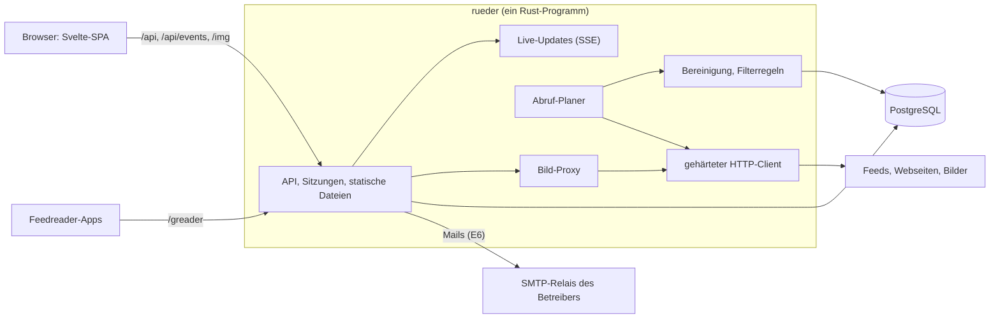

# rueder: Architektur des neuen Systems

Dieses Dokument beschreibt, wie der neue rueder aufgebaut ist und warum. Den Plan mit Anforderungen und Entscheidungen führt [plan.md](plan.md), die Umsetzung mit Stand und Arbeitspaketen [implementation.md](implementation.md).

Was noch Entwurf ist, sagt der Abschnitt selbst. Der [einmalige Import in den laufenden Bestand](implementation.md#einmaliger-import-in-den-laufenden-bestand) ist dort beschrieben. Wo ein Teil gebaut ist, gilt der Code: für das Schema die Migrationen in `server/migrations/`, für Artikelspeicher und Lesestand `server/src/articles.rs` und `server/src/reading.rs`, für den HTTP-Client `server/src/http_client.rs`, für die Bereinigung `server/src/cleaning.rs`, für den Bild-Proxy `server/src/images.rs`, für die Endpunkte die Module in `server/src/`, für die Oberfläche `web/src/lib/`. Wer von diesem Dokument abweicht, ändert es im selben Pull Request.

- [Überblick](#überblick)
- [Bausteine](#bausteine)
- [Datenmodell](#datenmodell)
- [Artikelspeicher und Versionen](#artikelspeicher-und-versionen)
- [Lesestand und Ungelesen-Zahlen](#lesestand-und-ungelesen-zahlen)
- [Aufbewahrung](#aufbewahrung)
- [Ordner und Abos](#ordner-und-abos)
- [Filterregeln](#filterregeln)
- [Suche](#suche)
- [Abruf](#abruf)
- [Bereinigung](#bereinigung)
- [Bild-Proxy](#bild-proxy)
- [Live-Updates](#live-updates)
- [Login und Sitzungen](#login-und-sitzungen)
- [Umzug eines Kontos](#umzug-eines-kontos)
- [Security](#security)
- [API](#api)
- [Apps anderer Anbieter](#apps-anderer-anbieter)
- [Frontend](#frontend)
- [Betrieb](#betrieb)
- [Status für Admins](#status-für-admins)
- [Android-App](#android-app)
- [Seite auf GitHub Pages](#seite-auf-github-pages)

## Überblick

Ein Rust-Programm übernimmt API, Abruf, Bereinigung, Live-Updates, Login und Bild-Proxy und liefert das gebaute Frontend aus. Daneben läuft nur noch PostgreSQL.



Zwei Regeln prägen den Aufbau:

- **Der Browser spricht ausschließlich mit rueder.** Kein Bild, kein Skript, kein Tracker wird direkt von fremden Seiten geladen.
- **Ins Internet geht nur der gehärtete HTTP-Client.** Feeds, Webseiten für die Feed-Suche und Bilder holt allein er. Deshalb gibt es genau eine Stelle für alle Schutzregeln gegen SSRF. Die einzige Ausnahme sind Mails (Entscheidung E6): Sie gehen über SMTP an das Relais, das der Betreiber einstellt, nie an eine Adresse, die ein User wählt, siehe [E-Mail am Konto](#e-mail-am-konto).

## Bausteine

| Baustein | Wahl | Grund |
|---|---|---|
| Server | Rust mit `axum` auf `tokio` | Ein Programm für alle Aufgaben, SSE ist eingebaut. |
| Datenbank | PostgreSQL 16 mit `sqlx` | Die Daten liegen schon dort. Partitionierung und Volltextsuche sind vorhanden, Abfragen werden beim Kompilieren gegen das Schema geprüft. |
| Feed-Abruf | `reqwest` mit `rustls`, Parser `feed-rs` | RSS, Atom und JSON Feed. Bedingte Abrufe mit ETag schonen die Quellen. |
| Bereinigung | `ammonia` plus eigene Regeln für Links und Bilder | Allowlist statt Sperrliste. |
| Live-Updates | SSE, intern ein Broadcast-Kanal | Ersetzt RabbitMQ. Bei mehreren Prozessen übernimmt `LISTEN/NOTIFY` von PostgreSQL. |
| Bilder | Eigener Proxy mit dem `image`-Crate | Ersetzt imgproxy, der Schlüssel für die Signatur bleibt auf dem Server. |
| Login | Lokale Konten mit Argon2id, OpenID Connect als Option, zweiter Faktor mit TOTP, Passkeys mit `webauthn-rs` | Siehe [Passkeys](#passkeys). |
| E-Mail | `lettre` mit rustls, SMTP an ein Relais des Betreibers | Nur wenn der Betreiber es einschaltet, siehe [E-Mail am Konto](#e-mail-am-konto). |
| Frontend | SvelteKit als SPA, Svelte 5, TypeScript, TailwindCSS 4 | Wird vom Server mit ausgeliefert. Die API-Typen werden aus dem Rust-Code erzeugt. |
| Betrieb | Ein Container plus PostgreSQL hinter einem Reverse-Proxy | Der alte rueder brauchte acht Container plus imgproxy. |

Das Programm hat Unterbefehle: `rueder serve` (Standard) startet Server und Abruf, weitere Befehle erledigen einmalige Arbeiten (Import der alten Datenbank, Konten anlegen, Admins bestimmen, Messdaten erzeugen). Migrationen laufen beim Start von selbst.

## Datenmodell

Die Tabellen im Überblick. Die genauen Spalten stehen in den Migrationen, `server/migrations/0001_initial.sql` und den folgenden.

| Bereich | Tabellen | Idee |
|---|---|---|
| Konten | `accounts`, `account_identities`, `sessions`, `registration`, `invites`, `recovery_codes`, `app_passwords`, `passkeys`, `email_links`, `password_resets` | Ein Konto hat einen Login-Namen, optional einen Argon2id-Hash und Einstellungen als JSON, dazu das Recht als Admin, die Zustimmung zu [Fehlerberichten](#fehlerberichte-aus-dem-browser) (`sends_reports`) und, woher es stammt (`origin`, `invite_id`, `invite_quota`, siehe [Registrierung und Einladungen](#registrierung-und-einladungen)) und den [zweiten Faktor](#zweiter-faktor) (`totp_secret`, `totp_pending`, `totp_last_step`, die Wiederherstellungscodes in `recovery_codes`, an der Sitzung `second_factor`). `account_identities` verknüpft Konten mit OpenID-Connect-Anbietern (Aussteller und Subject) und mit dem alten Login (`auth_origin`, `auth_subject`). Eine Sitzung ist der SHA-256 des Cookie-Tokens mit Ablaufzeit, ein [App-Passwort](#apps-anderer-anbieter) der SHA-256 des Passworts mit Name und letzter Nutzung. Dazu die [Passkeys](#passkeys) eines Kontos und seine [E-Mail-Adresse](#e-mail-am-konto) (`accounts.email`, die Links zur Bestätigung in `email_links`, die für [Passwort vergessen](#passwort-vergessen) in `password_resets`). |
| Feeds | `feeds` | Ein Feed gehört allen seinen Abonnenten gemeinsam. Er kennt seine höchste Artikelnummer (`last_seq`), den Abrufstand (nächster Abruf, Intervall, ETag, Last-Modified, letzter Erfolg, letzter Fehler, letztes 429) und den User-Agent, mit dem er abgerufen wird. |
| Baum | `folders`, `subscriptions` | Ordner mit Elternordner und Position. Ein Abo verbindet Konto und Feed, liegt in einem Ordner oder auf oberster Ebene, hat eine Position und trägt die Lesemarke. |
| Artikel | `articles`, `article_content`, `article_versions`, `arrivals` | Heiß, warm und kalt getrennt, siehe [Artikelspeicher und Versionen](#artikelspeicher-und-versionen). Der Index der [Suche](#suche) liegt auf `article_content`. `arrivals` sagt je Minute, welche Nummer als erste eintraf, für die Zeiten der [Apps anderer Anbieter](#apps-anderer-anbieter). |
| Lesestand | `subscriptions.read_upto`, `article_states` | Lesemarke je Abo plus Ausnahmen je Artikel, siehe [Lesestand und Ungelesen-Zahlen](#lesestand-und-ungelesen-zahlen). Nach einem [Umzug](#umzug-eines-kontos) in einen Feed ohne ersten Abruf merkt sich `subscriptions.read_before` die Zeit, bis zu der gelesen ist. |
| Regeln | `filter_rules` | Filterregeln je Konto, siehe [Filterregeln](#filterregeln). |
| Labels | `labels`, `article_labels` | Labels mit Farbe je Konto und ihre Zuordnung zu Artikeln. Der Stern ist kein Label, sondern eine Ausnahme in `article_states`. |
| Fehlerberichte | `client_reports` | Fehler aus den Browsern der User, die zustimmen, je Konto und Fingerabdruck gezählt, siehe [Fehlerberichte aus dem Browser](#fehlerberichte-aus-dem-browser). |
| Meldungen | `content_reports`, `feeds.blocked_at`, `blocked_images` | Meldungen von Feeds und Artikeln und gesperrte Feeds samt ihren Bildern, siehe [Meldungen und gesperrte Feeds](#meldungen-und-gesperrte-feeds). |
| Aufbewahrung | `retention`, `article_tombstones`, `feeds.cut_seq`, `articles.arrived_at` | Wie lange was bleibt, die Kennungen ganz gelöschter Artikel und die Grenze, bis zu der ein Feed aufgeräumt ist, siehe [Aufbewahrung](#aufbewahrung). |

Schlüssel sind fortlaufende Zahlen, keine UUIDs, `bigint` für Artikel und Fehlerberichte, `integer` für alles andere (Konten, Feeds, Ordner, Regeln, Labels, Einladungen): Sie halten Zeilen und Indizes schmal, und neue Artikel liegen im Index beieinander. Feeds und Konten behalten ihre alte UUID in einer Spalte `legacy_id`, Artikel in der Tabelle `legacy_articles`, damit der Import weiß, was er schon übernommen hat, und Lesestand und Labels aus dem Browser zugeordnet werden können. Die Tabelle statt einer Spalte hält die heiße Artikeltabelle schmal und kann nach dem Umstieg weg.

## Artikelspeicher und Versionen

Listen lesen nie Artikeltext, und alte Versionen berühren nie die Tabellen, aus denen neue Artikel gelesen werden. Dafür liegt ein Artikel in drei Tabellen:

| Tabelle | Inhalt | Wird gelesen | Größe und Pflege |
|---|---|---|---|
| `articles` (heiß) | Eine schmale Zeile je Artikel: Feed, laufende Nummer im Feed, Titel, Anriss, Autor, Datum, Vorschaubild, Nummer der aktuellen Version, Zeitpunkt der letzten Änderung | Bei jeder Liste und jeder Zählung | Klein genug für den Arbeitsspeicher. Index auf Feed und Nummer, für den [Abruf](#abruf) auch auf Feed und Datum. |
| `article_content` (warm) | Genau eine Zeile je Artikel: der bereinigte Text der aktuellen Version, dazu was nur die Artikelansicht braucht (Schlagwörter, Anhänge, Kennung des Feeds für den Artikel), und für die [Suche](#suche) eine Kopie von Titel, Autor und ID | Beim Öffnen eines Artikels, per Primärschlüssel, und bei der Suche | Wächst mit der Zahl der Artikel, nicht mit der Zahl der Versionen. |
| `article_versions` (kalt) | Jede Version im Original, mit zstd komprimiert, dazu Abrufzeit und Prüfsumme | Nur in der Versionsansicht und beim erneuten Bereinigen | Nach Monat partitioniert, es wird nur angehängt. Alte Partitionen können auf langsameren Speicher. |

So greifen die Teile ineinander:

1. **Neue Version nur bei echter Änderung.** Der Abruf vergleicht eine Prüfsumme über den normalisierten Inhalt. Tracking-Parameter und Leerraum zählen nicht mit, sonst erzeugen wechselnde Werbe-Token bei jedem Abruf eine Scheinversion.
2. **Die aktuelle Fassung bleibt an einem Ort.** Eine neue Version ersetzt die Zeile in `article_content` und hängt das Original an `article_versions` an. Wer die aktuelle Fassung liest, kommt mit der Historie nie in Berührung.
3. **Feste Nummer statt Fensterfunktion.** Jeder Artikel bekommt beim Einfügen seine laufende Nummer im Feed (`seq`). Blättern heißt dann „die 50 Artikel vor Nummer 4711“ und kostet immer gleich viel, egal wie groß der Feed ist.
4. **Keine Zählabfragen.** Der Feed kennt seine höchste Nummer. `COUNT(*)` entfällt.
5. **Alte Artikel kosten nur Plattenplatz.** Neue Zeilen liegen physisch beieinander, der Cache hält deshalb von selbst die neuen Seiten.
6. **Bereinigung ist wiederholbar.** Weil das Original gespeichert ist, lassen sich bessere Filterlisten oder ein Sanitizer-Fix nachträglich auf alte Artikel anwenden.

Regeln, auf die sich der Rest verlässt:

- **Nummern sind lückenlos und werden nie neu vergeben.** Ein Feed vergibt `last_seq + 1` in derselben Transaktion, in der der Artikel eingefügt wird; je Feed läuft immer nur ein Abruf. Die Ungelesen-Zahl rechnet mit `last_seq`, eine Lücke würde als ungelesener Artikel zählen. Lücken gibt es deshalb nur unter der Grenze, bis zu der die [Aufbewahrung](#aufbewahrung) einen Feed aufgeräumt hat, und keine Lesemarke steht darunter.
- **Ein Artikel wird über seine Kennung im Feed wiedererkannt** (GUID, ersatzweise der Link), eindeutig je Feed. Wie der Abruf mit einer Kennung umgeht, die wechselt, steht unter [Abruf](#abruf).
- **Eine neue Version ändert den Lesestand nicht.** Der Artikel bleibt gelesen; die heiße Zeile bekommt die neue Versionsnummer und den Zeitpunkt, daraus macht die Oberfläche den Hinweis „aktualisiert“. Dazu hält `articles.updated_what` fest, was anders war: `title`, `text` oder `both`. Verglichen werden die beiden Texte, aus denen auch die Prüfsumme entsteht, Titel und bereinigter Text, und Leerraum zählt wie dort nicht mit. Schreibt ein Feed nur die Überschrift um, sagt die Liste „neue Überschrift“ statt „aktualisiert“: Sonst sucht, wer den Artikel öffnet, im Text nach einer Änderung, die es dort nicht gibt. Ist sie leer, sagt die Oberfläche „aktualisiert“.
- **Die Versionen je Artikel sind begrenzt.** Darüber bleiben die Erstfassung und die neuesten, die zweitälteste fällt weg.
- **Partitionen entstehen im Voraus.** Der Server legt beim Start und danach regelmäßig die Partitionen für den laufenden und den nächsten Monat an.

Gemischte Listen (ein Ordner, „Alle Artikel“) brauchen eine Reihenfolge über Feeds hinweg. Das ist die Reihenfolge des Eintreffens, also die fortlaufende ID des Artikels; innerhalb eines Feeds stimmt sie mit `seq` überein. Die Abfrage führt die Feeds zusammen wie sortierte Listen: Der Index `(feed_id, id)` liefert je Feed den neuesten passenden Artikel, der neueste davon kommt auf die Seite, und sein Feed liefert den nächsten. Das kostet einen Schritt in den Index je Feed und einen je Zeile der Seite, unabhängig von der Größe der Feeds. Bei „nur ungelesen“ ist die Lesemarke jedes Abos eine Untergrenze, unter der der Index nicht gelesen wird; wieder ungelesene Artikel unter der Marke kommen aus `article_states` dazu. Ein Feed, ein Ordner und alle Feeds sind dieselbe Abfrage. Sie bleibt unter dem [Messziel](plan.md#messziel), siehe [Messung](implementation.md#messung).

Beim Import wird der heutige Text jedes Artikels zu Version 1. Die laufenden Nummern werden so vergeben, wie das alte System sie bei jeder Abfrage berechnete (`row_number() over (partition by feed_id order by seq)`), damit der Lesestand aus dem Browser weiter passt. Hatte der neue rueder einen der Artikel schon selbst abgerufen, weicht die Nummer ab; die alte steht dann in `legacy_articles.legacy_seq`. Beim [Zusammenführen](implementation.md#einmaliger-import-in-den-laufenden-bestand) rücken die Artikel, die der neue rueder schon hat, hinter die alten: Das ist die einzige Stelle, an der vergebene Nummern sich ändern, einmal und bei stehendem Server.

## Lesestand und Ungelesen-Zahlen

Der Server speichert je Konto und Feed eine **Lesemarke** („alles bis Nummer N ist gelesen“, `subscriptions.read_upto`) und die **Ausnahmen** davon in `article_states`, eine Zeile je Konto, Feed und Nummer:

| Ausnahme | Bedeutung |
|---|---|
| gelesen | Der Artikel liegt über der Lesemarke und ist gelesen. |
| ungelesen gehalten | Der Artikel liegt an oder unter der Lesemarke und ist wieder ungelesen. |
| ausgeblendet | Eine Filterregel hat den Artikel ausgeblendet. Er zählt nie als ungelesen. |
| Stern | Unabhängig vom Lesestand. |

Die Ungelesen-Zahl eines Feeds wird immer aus diesen Daten berechnet:

```text
ungelesen = (last_seq − read_upto)
          − Artikel über der Marke, die gelesen oder ausgeblendet sind
          + Artikel an oder unter der Marke, die ungelesen gehalten und nicht ausgeblendet sind
```

Die Zahl eines Ordners ist die Summe seiner Feeds. Es gibt keinen gespeicherten Zähler, der auseinanderlaufen kann.

Die Operationen:

- **Lesen:** über der Marke entsteht die Ausnahme „gelesen“, unter der Marke verschwindet „ungelesen gehalten“.
- **Wieder ungelesen:** umgekehrt.
- **Alle als gelesen markieren (bis Nummer N):** Die Marke rückt auf N vor, alle Ausnahmen „gelesen“ und „ungelesen gehalten“ bis N entfallen. Die Marke bewegt sich nie zurück.
- **Verdichten:** Folgen auf die Marke lückenlos gelesene oder ausgeblendete Artikel, rückt sie darüber vor. So bleibt die Zahl der Ausnahmen klein, auch wenn jemand jahrelang Artikel einzeln liest.

Das maßgebliche Modell mit Tests ist `web/src/lib/unread.ts`. Der Server bildet genau dieses Verhalten nach und wird mit denselben Fällen geprüft, am besten mit Property-Tests gegen ein einfaches Modell („eine Menge gelesener Nummern“).

Der Lesestand hängt an (Konto, Feed, Nummer) und nicht an der ID des Artikels. Die Liste eines Feeds und seine Zählung kommen dadurch ohne Verbund mit der Artikeltabelle aus.

## Aufbewahrung

Im Code: `server/src/retention.rs` (A21, E4), die Einstellungen in der Tabelle `retention` mit genau einer Zeile. Was alt ist, darf gehen, wenn der Betreiber es einstellt; als Standard bleibt alles, und der Lauf tut dann nichts. `rueder retention set` stellt ein, `show` zeigt es, `run` räumt sofort alles auf, statt auf den Server zu warten:

| Einstellung | Was geht | Wie |
|---|---|---|
| `--articles <Monate> --remove article` | Artikel, die vor so vielen Monaten ankamen, ganz: aus Listen, Ungelesen-Zahlen und Suche | Vom ältesten Artikel eines Feeds an aufwärts, siehe unten |
| `--articles <Monate> --remove text` | Nur ihr Text und ihre Versionen; die Zeile in der Liste bleibt, mit Titel und Anriss, und zählt weiter | `article_content.html` wird leer, `text_dropped` gesetzt; Schlagwörter, Anhänge und Bild bleiben, so bleibt eine Podcast-Folge abspielbar |
| `--versions <Monate>` | Versionen, nach ganzen Monaten | Die Monatspartitionen von `article_versions` fallen mit `DROP TABLE` (Funktion `drop_versions_partitions`); wartet die Sperre der Tabelle zu lange, ist der nächste Lauf dran |
| `--orphans <Tage>` | Feeds, die so lange kein Abo haben, samt Artikeln | Der Lauf merkt sich in `feeds.orphaned_at`, seit wann er keinen Leser sah, und löscht danach Portion für Portion |

Entschieden hat Fiona: Ob ganze Artikel oder nur Texte gehen, wählt der Betreiber je Instanz, und er muss es nennen (`--remove`), weil beides unerwartet sein kann; das Alter zählt ab der Ankunft in rueder; gesperrte Feeds bekommen keine Sonderregel.

- **Was bleibt.** Artikel mit Stern oder Label irgendeines Kontos bleiben, mit ihrem Text. Was beim Aufräumen einen Stern hatte und ihn später verliert, bleibt trotzdem; ein Lauf sieht nur über der Grenze nach. Ein gesperrter Feed ohne Abonnenten verliert seine Artikel, behält aber seine Zeile und damit die Sperre, sonst könnte jemand seine Adresse neu abonnieren (eigene Entscheidung).
- **Das Alter** ist `articles.arrived_at`, die Zeit des ersten Abrufs, die auch die erste Version trägt. Ein Feed kann einen Artikel rückdatieren, und der Import des alten rueder bringt Artikel mit altem Datum; mit der Ankunft verliert keiner einen Artikel, den er gerade erst bekam. Der Import setzt die Zeit, zu der der alte rueder den Artikel zuerst abrief.
- **Lesestand ohne Zählen.** Ein Feed wird von seinem ältesten Artikel an aufgeräumt, bis zu einer Grenze `feeds.cut_seq`, und in derselben Transaktion rückt jede Lesemarke des Feeds auf diese Grenze vor. Was darunter stehen bleibt, die markierten Artikel, behält für jeden Leser seinen Stand: ungelesen wird zur Ausnahme „ungelesen gehalten“, gelesen braucht keine Zeile mehr, ausgeblendet bleibt ausgeblendet. Ausnahmen zu gelöschten Artikeln fallen weg. So bleibt die Formel aus [Lesestand und Ungelesen-Zahlen](#lesestand-und-ungelesen-zahlen) richtig, ohne Artikel zu zählen. Ein neues Abo beginnt nie unter der Grenze: Ein Trigger auf `subscriptions` hebt die Marke an, wer es auch anlegt (Abonnieren, Umzug, Import), und wartet dafür mit `FOR KEY SHARE`, falls gerade aufgeräumt wird. Lesen, Stern und Ausblenden lehnen eine Nummer unter der Grenze ab, wenn der Artikel nicht mehr da ist, sonst zählte eine Ausnahme ohne Artikel als ungelesen.
- **Kein Artikel kommt zurück.** Steht ein ganz gelöschter Artikel noch im Feed, wie bei Podcasts mit allen Folgen, erkennt der Abruf ihn an seiner Kennung in `article_tombstones` (ein kurzer Hash der Kennung, der mit dem Feed geht) und legt ihn nicht neu an. Einen Artikel ohne Text lässt der Abruf in Ruhe, auch wenn die Quelle ihn ändert. Ist zu einem Artikel keine Version mehr da, gilt ein anders bereinigter Text nicht als neue Version, eine neue Überschrift aber schon, weil sonst Titel und Text auseinanderliefen.
- **Portionen.** Eine Transaktion räumt eine begrenzte Zahl von Artikeln eines Feeds und sperrt dafür den Feed, seine Abos und diese Artikel, wie es ein Abruf auch tut. Der Server räumt stündlich, eine begrenzte Zeit lang; was übrig bleibt, kommt beim nächsten Lauf. Gehen ganze Artikel, hören die offenen Tabs der Leser davon als Ereignis `reading` ohne Feed und laden Zahlen und Liste neu.
- **Was davon abhängt.** Die Liste „nur ungelesen“ nimmt als Untergrenze den neuesten Artikel an oder unter der Lesemarke, nicht den an der Marke, der nach dem Aufräumen fehlen kann; sonst las sie den ganzen Feed und zeigte markierte Artikel doppelt. Der Umzug eines Kontos nennt für eine Marke an der Grenze den Artikel, der dort stand, wie ihn der Feed sich beim Aufräumen gemerkt hat (`cut_guid`, `cut_url`, `cut_published_at`); ohne ihn wüsste die andere Instanz nicht, bis wohin gelesen ist.
- **Für die Apps** anderer Anbieter ist ein Artikel ohne Text einer mit leerem Text.

Offen:

- **E13, inaktive Konten** nach zwei Mails löschen: Adressen und Versand gibt es ([E-Mail am Konto](#e-mail-am-konto)); das Löschen selbst fehlt noch.
- Wer Lesestand und Labels aus dem alten Browser übernehmen will, schaltet die Aufbewahrung erst danach ein: Die Übernahme findet Artikel über `legacy_articles`, die mit ihren Artikeln gehen.

## Ordner und Abos

Im Code: `server/src/tree.rs`, `server/src/subscribe.rs`; das Modell mit Tests ist `web/src/lib/tree.ts`, die Feed-Infos sind `web/src/lib/components/FeedInfoDialog.svelte`.

- Ordner lassen sich bis zu **fünf Ebenen** tief verschachteln. Ein Zug, der tiefer führen würde, wird abgelehnt, im Frontend und auf dem Server.
- Ordner und Abos einer Ebene teilen sich eine Reihenfolge. Jede Zeile trägt eine **Position** als Sortierschlüssel zwischen ihren Nachbarn. Ein Zug ändert genau eine Zeile („verschiebe X vor Y in Ordner Z“), so dass sich Änderungen von zwei Geräten nicht überschreiben.
- Ein gelöschter Ordner gibt seinen Inhalt an die Ebene darüber ab.

- **Züge.** `POST /api/tree/move` nimmt Knoten, Ziel und `before`, `after` oder `inside`, wie das Modell im Frontend. Ein Test spielt zufällige Züge gegen ein Modell, das `tree.ts` nachgebaut ist. Jede Änderung am Baum sperrt die Zeile des Kontos, es läuft also je Konto nur eine.
- **Grenzen** für Ordner, Feeds, Feeds je Ordner (auch auf der obersten Ebene) und Namen stehen in `tree.rs`, siehe [Header, Herkunft und Limits](#header-herkunft-und-limits).
- **Feed-Suche.** `POST /api/feeds/find` sieht sich eine Adresse an. Ist sie ein Feed, ist das der eine Treffer. Ist sie eine Webseite, nennt die Antwort die Feeds, auf die die Seite mit `<link rel="alternate">` zeigt. Gelesen wird der Anfang der Seite, mit dem Parser der [Bereinigung](#bereinigung) und in dessen Grenzen. Die Suche legt nichts an. **YouTube:** Die Seite eines Kanals nennt seinen Feed zuerst, `https://www.youtube.com/feeds/videos.xml?channel_id=UC…`, mit dem Namen des Kanals. Bei Adressen wie `youtube.com/@name` steht die Kennung des Kanals im `<meta property="og:url">` der Seite (`…/channel/UC…`); eine Adresse `youtube.com/channel/UC…` führt ohne Umweg zum Feed, die Seite wird gar nicht erst geholt. Gilt nur für `youtube.com`, `www.youtube.com` und `m.youtube.com` und nur für eine Kennung aus „UC“ und 22 Buchstaben, Ziffern, `-` oder `_`. Schickt YouTube statt der Seite seine Frage nach Cookies (`consent.youtube.com`, wie es in der EU vorkommt), findet die Suche bei `@name` nichts.
- **Abonnieren.** `POST /api/feeds` abonniert die Adresse eines Feeds. Einen Feed, den noch niemand liest, ruft der Server dabei ab und behält ihn nur, wenn das gelingt: Aus einer beliebigen Adresse wird so kein Feed. Eine Adresse mit Name und Passwort wird abgelehnt, denn ein Feed gehört allen, die ihn lesen. Ohne Schema gilt eine Adresse als https.
- **Lesemarke eines neuen Abos.** Wer einen Feed abonniert, den andere schon lesen, findet die neuesten Artikel ungelesen und alles davor gelesen, wie in den [Detailfragen](plan.md#detailfragen) entschieden (`subscribe::NEWEST_UNREAD`). Ein neuer Feed bringt mit, was sein erster Abruf liefert. Die [Filterregeln](#filterregeln) des Kontos sehen sich den Feed sofort an.
- **OPML.** `GET /api/opml` gibt den Baum aus, Ordner als Gliederung um ihre Feeds. `POST /api/opml` nimmt eine Datei in den Grenzen von `subscribe.rs`. Ordner werden am Namen an ihrer Stelle wiedererkannt oder angelegt; was tiefer als fünf Ebenen liegt, landet im tiefsten Ordner, der passt. Die Reihenfolge der Datei bleibt, und Feeds, die das Konto schon liest, bleiben, wo sie sind. Der Import ruft nichts ab: Neue Feeds sind sofort fällig, die nächste Runde des [Abrufs](#abruf) holt sie, und ein Feed, der keiner ist, zeigt seinen Fehler im Baum. Der Leser kennt nur die fünf Entitäten von XML. Die Datei muss als `text/x-opml` oder XML gesendet werden, was ein Formular einer fremden Seite nicht kann.
- **Feed-Infos.** `GET /api/feeds/{id}/info` sagt einem Abonnenten, was der Server über den Feed weiß: Nummer, Adressen, User-Agent, Intervall, letzter Abruf, letzter Erfolg, letzter Fehler, nächster Abruf und die Zahl seiner Artikel, nichts über andere Konten. Die Seite zeigt das im Menü des Feeds unter „Feed-Infos …“ und kopiert es für eine Nachricht an den Betreiber, die Zeiten so, wie der Server sie nennt. Der Betreiber sieht dasselbe mit `rueder feed show <nummer oder adresse>`, für jeden Feed, dazu die Zahl der Abonnenten ohne Namen.
- **User-Agent.** `PUT /api/feeds/{id}/agent` stellt den Abruf eines Feeds auf den Browser-User-Agent um oder zurück, und der Feed wird sofort abgerufen. Der Feed gehört allen Abonnenten gemeinsam, die Einstellung gilt deshalb für alle, und rueder gibt sich damit im Namen der ganzen Instanz als Browser aus: Setzen kann sie nur ein Admin, der den Feed liest (im Dialog der Feed-Infos), und der Betreiber für jeden Feed mit `rueder feed agent <nummer oder adresse> browser|rueder` ([Detailfragen](plan.md#detailfragen)).

Wer ein Abo kündigt, verliert seinen Lesestand und seine Labels in diesem Feed; der Feed und seine Artikel bleiben für andere; liest ihn niemand mehr, wird er nicht mehr abgerufen, und die [Aufbewahrung](#aufbewahrung) kann ihn wegräumen.

## Filterregeln

Eine Regel hat:

| Teil | Werte |
|---|---|
| Bereich | alle Feeds, ein Ordner (mit allem darunter), ein Feed |
| Feld | überall, Titel, Text, Autor, Schlagwort |
| Vergleich | enthält, ganzes Wort, beginnt mit, endet mit, regulärer Ausdruck; oder jeder Artikel, ohne Feld und Muster |
| Aktion | ausblenden, als gelesen markieren |

- Regeln greifen **beim Eintreffen** eines Artikels, für jeden Abonnenten des Feeds. Treffer zählen nicht als ungelesen.
- Wird eine Regel angelegt, geändert oder gelöscht, bewertet der Server den Bestand des Kontos neu: die jüngsten Artikel jedes Feeds und alles, was ausgeblendet ist. Eine **Vorschau** zeigt vor dem Speichern, wie viele Artikel betroffen wären.
- Ausgeblendetes bleibt unter „Ausgeblendet“ einsehbar.
- Der Vergleich arbeitet auf Text ohne HTML-Tags, ohne Rücksicht auf Groß- und Kleinschreibung; „ganzes Wort“ behandelt Umlaute als Buchstaben. „Beginnt mit“ und „endet mit“ meinen den ganzen Text, bei Schlagwörtern jedes einzeln. Zeilen gibt es dabei nicht: Titel, Autor und Schlagwort haben eine, und der Text ist eine Folge von Wörtern mit einfachen Leerzeichen.
- Reguläre Ausdrücke laufen mit dem `regex`-Crate in garantiert linearer Zeit. Länge der Muster und Zahl der Regeln sind begrenzt (`filters::MAX_PATTERN`, `filters::MAX_RULES`).

Das Modell mit Tests ist `web/src/lib/filters.ts`. Der Server muss dieselben Fälle gleich entscheiden; die Syntax für reguläre Ausdrücke ist die des `regex`-Crates, das Frontend prüft Muster deshalb über den Server und nicht mit `RegExp` des Browsers.

Im Code: `server/src/filters.rs`, mit den Fällen aus `filters.test.ts` als Tests:

- **Ausgeblendet ist, was eine Regel trifft.** Ein Artikel ist genau dann ausgeblendet, wenn eine eingeschaltete Regel ihn trifft, in deren Bereich sein Feed liegt. Geht die Regel, wird sie geändert oder ausgeschaltet, kommt der Artikel zurück, auch wenn er längst nicht mehr zu den jüngsten gehört. Von Hand blendet niemand aus. „Als gelesen markieren“ wird dagegen nie zurückgenommen.
- **Ausblenden geht vor.** Trifft eine Regel zum Ausblenden und eine zum Markieren denselben Artikel, wird er ausgeblendet und nicht hinter dem Rücken des Lesers als gelesen markiert.
- **Beim Eintreffen** wendet der Abruf die Regeln aller Abonnenten in der Transaktion an, die die Artikel speichert. Niemand sieht einen Artikel ungefiltert.
- **Der Baum zählt mit.** Ein Zug in einen Ordner oder aus ihm heraus und das Löschen eines Ordners bewerten neu, wenn eine Regel an einem Ordner hängt oder etwas ausgeblendet ist. Eine Regel verschwindet mit ihrem Ordner und mit dem Abo ihres Feeds.
- **Ein Motor für alle Vergleiche.** „Enthält“, „ganzes Wort“, „beginnt mit“ und „endet mit“ werden in denselben regulären Ausdruck übersetzt, den auch ein eigenes Muster ergibt. Wird das übersetzte Programm zu groß, gilt das Muster als zu aufwendig. Rückbezüge und Vorausschau kennt das `regex`-Crate nicht; solche Muster lehnt der Server ab.
- **Abseits der Anfragen.** Das Vergleichen läuft auf eigenen Threads, damit eine Regel über viele Artikel den Server nicht aufhält. Den Text ohne Tags gewinnt ein einfacher Abschneider aus dem schon bereinigten Text, nicht der HTML-Parser.
- **Die Reihenfolge** der Regeln ist nur die der Liste; was sie entscheiden, hängt nicht von ihr ab.

Neu bewertet werden nur die jüngsten Artikel je Feed und alles Ausgeblendete, nicht alle ungelesenen: Das hält eine Änderung an den Regeln billig, und was eine Regel einmal ausgeblendet hat, bleibt trotzdem nicht hängen. Neue Versionen eines Artikels bewertet der Abruf nicht neu; das holt die nächste Änderung an den Regeln nach.

## Suche

Im Code: `server/src/search.rs`. `GET /api/search` sucht in den Artikeln der eigenen Abos: in allen, in einem Feed oder in einem Ordner mit allem darunter.

- **Was gefunden wird.** Ein Artikel, der alle Wörter der Suche hat, in Titel, Autor, Schlagwörtern oder Text seiner aktuellen Fassung. Ein Wort ab drei Buchstaben findet auch, was mit ihm beginnt („wahl“ findet „Wahlen“), ein kürzeres nur sich selbst. Groß- und Kleinschreibung zählt nicht; Wörter zerlegt der Parser von PostgreSQL.
- **Was nicht.** Keine Stammformen: Die Feeds sind deutsch, englisch und gemischt, eine falsche Sprache wäre schlimmer als keine, und die Suche nach Wortanfängen gleicht einen Teil davon aus. Keine Wortfolgen und keine Rangfolge: Die Treffer kommen wie die Listen, der neueste zuerst. Ausgeblendetes fehlt. Vom Text zählt nur der Anfang, weil PostgreSQL die Wörter eines Artikels begrenzt und ein Artikel, an dem das scheitert, den Abruf seines Feeds scheitern ließe.
- **Die Wörter** eines Artikels bestimmt PostgreSQL einmal beim Speichern (`to_tsvector('simple', …)`, ohne Positionen) und hält sie in einer eigenen Spalte von `article_content`, mit einem GIN-Index darauf. Gespeichert werden sie, weil die Suche sich die neuesten Artikel selbst ansieht: Müsste sie deren Wörter jedes Mal neu bestimmen, hinge ihre Zeit an der Länge der neuesten Texte, und Feeds mit dem ganzen Artikel machten jede Suche langsam ([Messung](implementation.md#gespeicherte-wörter-vom-2026-11-16)). Das kostet etwa so viel Platz wie der Text. Damit die Wörter alles in einer Zeile finden, trägt `article_content` eine Kopie von Titel, Autor und ID, die Trigger gleich halten. Der Index hat keine Warteliste (`fastupdate = off`), damit nicht einzelne Abrufe Sekunden auf das Einarbeiten warten; dafür kostet jeder Artikel beim Schreiben gleichmäßig etwas mehr.
- **Zwei Wege zu den neuesten Treffern.** Der Index weiß, welche Artikel ein Wort haben, nicht in welcher Reihenfolge: Für ein seltenes Wort ist er billig, für ein häufiges liest er sehr viel. Der andere Weg geht vom neuesten Artikel rückwärts und sieht sich die Wörter jedes Artikels an: billig, wenn viele treffen, teuer für ein seltenes Wort. Zwischen beiden wählt die Suche selbst, nicht der Planer von PostgreSQL, der in der [Messung](implementation.md#messung) oft falsch schätzte: Sie sieht sich die neuesten Artikel an, misst, wie häufig die Wörter sind und was ein Artikel kostet, und nimmt den billigeren Weg. Den Index fragt sie nur nach dem seltensten Wort und in Fenstern der Reihenfolge des Eintreffens, die sie verdoppelt, bis genug Treffer da sind.
- **Blättern mit `next`.** Eine Anfrage sucht nur eine begrenzte Zeit, dann sagt sie mit `next`, wo es weitergeht; eine Seite kann deshalb weniger Treffer haben als verlangt, auch keinen. Ein einzelner Schritt, der zu lange braucht, wird abgebrochen (503). So hält keine Suche eine Verbindung zur Datenbank lange fest.
- **Im Frontend** fragt die Suchleiste den Server, sobald das Tippen ruht; die Treffer sind eine Liste wie die anderen, und eine zu kurze Seite holt der Reader gleich weiter. In den Listen der markierten und ausgeblendeten Artikel und eines Labels durchsucht die Suchleiste, was geladen ist. Der `DemoReader` durchsucht seine Artikel selbst.

## Abruf

Im Code: `server/src/fetch.rs` ruft ab, `server/src/feeds.rs` liest und speichert. Ein Planer im Server ruft jeden Feed in seinem Intervall ab, den mindestens ein Konto abonniert, das nicht gesperrt ist:

1. Fällige Feeds kommen aus der Datenbank (`next_fetch_at`, `FOR UPDATE SKIP LOCKED`), begrenzt viele zugleich, je Host höchstens so viele, wie der Takt sagt.
2. Der [gehärtete HTTP-Client](#gehärteter-http-client) holt den Feed, bedingt mit ETag und Last-Modified. „Nicht geändert“ beendet den Abruf.
3. `feed-rs` liest RSS, Atom oder JSON Feed, mit Grenzen für Größe und Zahl der Artikel, auf einem eigenen Thread, damit ein großer Feed den Server nicht aufhält.
4. Je Artikel: Kennung bestimmen, Inhalt [bereinigen](#bereinigung), Prüfsumme bilden. Unbekannt heißt neuer Artikel, außer Titel und Datum sind die eines Artikels des Feeds; andere Prüfsumme heißt neue Version, sonst nichts.
5. In einer Transaktion: Nummern vergeben, die drei Tabellen schreiben, Filterregeln der Abonnenten anwenden, `last_seq` und Abrufstand des Feeds setzen.
6. Meldung an die [Live-Updates](#live-updates) (`events::Events::publish_to_readers`).

- **Takt** (`fetch::Pace`): wie viele Feeds je Runde, wie viele zugleich, wie oft und wie viele eines Hosts zugleich, mit Standards im Code, die der Betreiber mit `FETCH_ROUND`, `FETCH_AT_ONCE`, `FETCH_EVERY` und `FETCH_PER_HOST` ändert. Ein Wert außerhalb der Grenzen hält den Start an, statt still den Standard zu nehmen. Was eine Maschine schafft, misst `rueder bench fetch`; Werte für eine große Instanz stehen in [deploy/README.md](../deploy/README.md#a-large-instance).
- **Hosts.** Eine Runde holt die Feeds, die sie von einem Host nimmt, nacheinander, auf so viele Folgen verteilt, wie `FETCH_PER_HOST` erlaubt. Runden warten nicht aufeinander: Solange eine Runde einen Host abarbeitet, lassen die nächsten ihn aus und holen die übrigen (`fetch::Underway`). So hält ein Host mit vielen langsamen Feeds, etwa eine große Plattform, nur sich selbst auf. Den Host erkennt die Datenbank an der Adresse des Feeds, der Server noch einmal mit dem URL-Parser; schreibt die Datenbank einen Host anders, wartet dessen Feed auf die nächste Runde.
- **Intervall.** Es passt sich der Aktivität des Feeds an, zwischen einer Viertelstunde und einem halben Tag. Jeder Fehlschlag verdoppelt es, der erste Erfolg setzt es zurück; der Grund steht am Feed (`error_message`), und die Oberfläche zeigt ein Warnzeichen.
- **429 und `Retry-After`.** Sagt die Seite bei 429 oder 503 in `Retry-After`, wann es wieder gehen soll (Sekunden oder ein Datum), kommt der nächste Versuch nicht früher, aber auch nicht später als nach dem längsten Intervall. Nach einem 429 setzt ein Erfolg das Intervall für `fetch::LIMITED_FOR` nicht zurück (`feeds.limited_at`): Sonst fragte rueder gleich wieder so oft, wie es der Seite eben zu oft war, und bekäme bald das nächste 429.
- **Lesen.** Vor `feed-rs` wird jeder Feed in XML zu UTF-8 ohne Deklarationen einer anderen Kodierung, weil die Bibliothek sonst mitten im Lesen die Kodierung wechselt und mit einer Panic abbricht (gefunden beim [Fuzzing](#fuzzing)). Atom 0.3, das manche Websites noch senden, schreibt der Server als Atom 1.0 um, weil `feed-rs` nur dessen Elemente liest. Adressen des Feeds bleiben nur, wenn sie ganze `http`- oder `https`-Adressen mit Host sind.
- **Kennung.** Die ID, die der Feed dem Eintrag gibt, sonst sein Link, wie der Feed ihn sendet (so kennt ihn auch der alte rueder), sonst eine Prüfsumme aus Titel und Text; ein Eintrag ohne alles wird ausgelassen.
- **Neue Kennung, alter Artikel.** Google News gibt demselben Artikel bei jedem Abruf eine neue Kennung, aus der sich die Adresse des Artikels nicht lesen lässt. Hat ein Eintrag eine unbekannte Kennung, aber denselben Titel und dasselbe Datum wie ein Artikel seines Feeds, ist er dieser Artikel. Er bleibt, wie er ist, ohne neue Version, weil sich mit der Kennung auch die Links in seinem Text ändern. Ebenso zählt derselbe Titel zum selben Datum in einem Abruf nur einmal. Das gilt für alle Feeds, denn zwei Artikel eines Feeds mit demselben Titel in derselben Sekunde sind einer. Ohne Titel und ohne eigenes Datum zählt nur die Kennung: Ein Eintrag ohne Datum bekommt die Zeit des Abrufs, und die ist für alle Einträge eines Abrufs dieselbe. Derselbe Titel an einem anderen Tag ist ein anderer Artikel, wie die Termine einer Veranstaltung. Der Abruf fragt dafür über einen Index auf Feed und Datum (`articles_published`) nach den Artikeln mit dem Datum eines Eintrags; ohne ihn müsste er die neuesten Artikel des Feeds lesen, von denen jeder auf einer eigenen Seite liegt, weil die Artikel aller Feeds gemischt eintreffen ([Duplikate](implementation.md#duplikate-vom-2026-11-16)). Kopien, die schon da sind, bleiben, denn die Nummern eines Feeds haben keine Lücken.
- **Änderung.** Die Prüfsumme geht über Titel und bereinigten Text, Folgen von Leerraum zählen als ein Leerzeichen. Ein neu umbrochener Text ist also keine neue Version, ebenso wenig einer, in dem sich nur ändert, was die Bereinigung entfernt.
- **Vorschaubild.** Das Bild, das der Feed zum Artikel nennt, sonst das erste Bild des bereinigten Texts, das nicht nach seiner Größe ein Icon ist (`cleaning::first_image`).
- **Adressen** von Artikel, Vorschaubild, Anhängen und Seite verlieren ihre Tracking-Parameter.
- **Der User-Agent** ist ehrlich („rueder“ mit Version und Adresse des Projekts) und lässt sich je Feed auf den eines Browsers umstellen.
- `FETCH=off` startet den Server ohne Abruf. Eine http-Adresse wird nicht zuerst mit https probiert, und eine dauerhafte Weiterleitung ändert die gespeicherte Adresse nicht.

Die Feed-Suche auf Webseiten und der OPML-Import nutzen denselben Client.

## Bereinigung

Die Bereinigung läuft **einmal je Version auf dem Server** statt bei jedem Anzeigen im Browser. Im Code: `server/src/cleaning.rs`, in zwei Schritten und in dieser Reihenfolge:

1. **Eigene Regeln auf dem Dokumentbaum**, nach dem Cleaner des alten Frontends samt seinen Tests.
2. **`ammonia` mit fester Allowlist.** Es hat immer das letzte Wort: Was der erste Schritt auch tut oder übersieht, das Modul verlässt nur Auszeichnung von der Liste und keine Adresse, die nicht mit `http` oder `https` beginnt.

Die eigenen Regeln:

| Was | Regel |
|---|---|
| Links | Bekommen ihre vollständige Adresse, ohne Tracking-Parameter. Ein Link zu einer gesperrten Adresse (Teilen-Knöpfe) fällt samt Beschriftung weg. Ein Link, der nirgends ins Web führt (kein Ziel, `mailto:`, `javascript:`, relative Adresse ohne Bezug), lässt seine Worte stehen. `ammonia` setzt `rel="nofollow noopener noreferrer"` und `target="_blank"`. |
| Bilder | Bekommen ihre vollständige Adresse, ohne Tracking-Parameter, und `loading="lazy"`. Bilder gesperrter Adressen und Zählpixel (Breite und Höhe 0 oder 1) fallen weg. Fehlt der Titel, wird der Alternativtext auch Titel. `srcset` bleibt nicht, es würde der Seite die Bildschirmgröße verraten. |
| Audio und Video | Die Player fallen weg, ihre Dateien werden Anhänge des Artikels (`enclosures`, mit `"inline": true` markiert). So lädt nichts, bevor jemand es anklickt. |
| Relative Adressen | Werden zuerst von der Seite des Artikels aus aufgelöst, sonst von der Adresse des Feeds aus; `#anker` nur von der Seite des Artikels. Ohne Bezug fallen sie weg, denn im Browser würden sie in rueder selbst zeigen. |
| Leeres | Leere `p` und `span`, Kommentare und Folgen von Zeilenumbrüchen fallen weg oder zusammen, Folgen von Leerraum werden ein Leerzeichen (außer in `pre`). |
| Unbekannte Tags | Fallen weg, ihr Inhalt bleibt. `script` und `style` fallen mit Inhalt weg. |

Erlaubt sind die Tags für Text, Listen, Tabellen, Zitate, Code, Bilder und Links. An Attributen bleiben `href` an Links, `src`, `alt`, `width` und `height` an Bildern, `colspan` und `rowspan` in Tabellen, `start` an Listen, `datetime` an `time` sowie `title`, `lang` und `dir` überall. Es gibt kein `id`, `name`, `class` oder `style`: Nichts in einem Artikel kann sich als Teil von rueders eigener Seite ausgeben oder ihr Aussehen ändern.

Worauf sich der Rest verlässt:

- **Grenzen für den Parser.** Der HTML-Parser sucht bei jedem Tag durch alle offenen Tags, sein Aufwand wächst also mit dem Quadrat der Tiefe: Ein Megabyte aus nichts als öffnenden Tags beschäftigte ihn über eine Minute. Offen gelassene Formatierung wiederholt er in jedem folgenden Absatz, aus einem Megabyte Text kann so das Hundertfache an Baum werden. Deshalb zählt die Bereinigung beim Lesen Tiefe und Knoten mit (`cleaning::MAX_DEPTH`, `cleaning::MAX_NODES`). Ein Text darüber wird nicht als HTML gelesen, sondern behält nur seine Worte. Das gilt für alles, was als HTML gelesen wird, auch für Titel und Anriss. Außerhalb von `cleaning.rs` darf niemand fremdes HTML lesen; `clippy.toml` verbietet die Aufrufe.
- **Erneutes Bereinigen ändert nichts.** Was herauskommt, wird als HTML aufgeschrieben und vom Browser wieder gelesen, und in seltenen Fällen lesen die Regeln von HTML es anders, als es gemeint war (eine Tabelle kann nicht in einem Absatz stehen). Deshalb wird das Ergebnis erneut bereinigt, bis es gleich bleibt, in aller Regel eine Runde. Ändert es sich nach einigen Runden noch, bleiben nur die Worte.
- **Die Prüfsumme geht über das Bereinigte.** Ob ein Artikel eine neue Version bekommt, entscheidet die Prüfsumme über Titel und bereinigten Text. Was die Bereinigung entfernt, zählt also nicht: Ein Tracking-Token, das bei jedem Abruf wechselt, erzeugt keine Scheinversion.
- **Geänderte Regeln erzeugen keine Version.** Liest sich ein Artikel nach einer Änderung der Regeln anders, wurde aber gleich gesendet wie zuvor, stellt der nächste Abruf nur den Text neu hin.
- **Das Original bleibt.** `article_versions` hält den Text, wie er kam. `rueder reclean` bereinigt den Bestand daraus neu, alle Feeds oder einen; Versionen und Lesestand bleiben unberührt.

Die Listen für gesperrte Adressen und Tracking-Parameter sind Daten, keine Programmzeilen: `server/rules/blocked-links.txt` und `server/rules/tracking-parameters.txt`, mit einer Regel je Zeile. Sie sind ins Programm eingebaut, damit es ohne weitere Dateien läuft. Wer eigene Listen will, legt beide Dateien in ein Verzeichnis und nennt es in `CLEANING_RULES_DIR`; der Server liest sie beim Start.

Im gespeicherten Text zeigen Bilder auf ihre Quelle; die Adresse des [Bild-Proxy](#bild-proxy) kommt erst beim Ausliefern hinein. Relative Adressen gehen von der Seite des Artikels aus, weil ein Text, der `bilder/1.png` sagt, für sie geschrieben wurde und Feeds oft bei einem anderen Anbieter liegen. Ob das Aufmacherbild neben einem Text steht, der selbst Bilder hat, entscheidet das Frontend (`ArticleBody.svelte`).

## Bild-Proxy

Jedes Bild, das jemand sieht, kommt von rueder und nie von der Seite, die es veröffentlicht hat. Die Seite erfährt so nicht, wer was liest. Im Code: `server/src/images.rs`.

- **Signierte Adressen.** `/img/<signatur>/<größe>/<adresse>`: Die Adresse ist die Quelle in Base64, die Signatur die ersten 16 Byte eines HMAC-SHA-256 über Größe und Quelle mit einem Schlüssel, den nur der Server kennt. Der Browser kann keine eigenen bilden, der Proxy ruft also nur ab, was in einem Artikel stand. Eine Signatur gilt für genau eine Größe.
- **Die Adresse kommt beim Ausliefern in den Text** (von Fiona entschieden). Gespeichert bleibt der bereinigte Text mit den eigenen Adressen der Bilder. Erst wenn der Server einen Artikel ausliefert, setzt er die Adressen des Proxy ein (`Signer::in_html` für den Text, `Signer::address` für Vorschaubild, Aufmacherbild und Icon). Ein neuer Schlüssel oder eine andere Form der Adressen braucht deshalb kein erneutes Bereinigen des Bestands. Ein Bild, für das es keine Proxy-Adresse gibt, geht nicht hinaus.
- **Der Schlüssel.** `IMAGE_PROXY_KEY`. Ohne ihn erzeugt der Server beim ersten Start einen eigenen und legt ihn als Datei `key` ins Cache-Verzeichnis, nur für sich lesbar. Er bleibt über Neustarts gleich, damit Adressen weiter gelten, die Browser sich gemerkt haben.
- **Abruf** über den gehärteten HTTP-Client, ohne Cookies und Referrer, mit festem User-Agent. Nur wenige Quellen zugleich und weniger vom selben Host; wer auf einen Host wartet, hält keinen Platz. Eine Quelle, die fehlschlägt, wird eine Weile in Ruhe gelassen.
- **Nur Bilder.** PNG, JPEG, GIF und WebP, erkannt an den ersten Bytes und nie an dem, was die Quelle behauptet. Alles andere wird abgelehnt, auch SVG, das nie durchgereicht wird, und `.ico`; das Frontend zeigt dann seinen Ersatz für Feeds ohne Icon.
- **Drei feste Größen.** `icon` passt in 256×256, `thumbnail` in 800×800, `image` in 2000×2000. Ein Bild, das passt, geht durch, wie es kam, samt Animation. Ein größeres wird verkleinert und neu geschrieben: als PNG, wenn es durchsichtige Stellen hat, sonst als JPEG; von einer Animation bleibt dabei das erste Bild. Die Ausrichtung aus den Kameradaten wird vorher angewendet.
- **Grenzen** für Bytes und Pixel (`images::MAX_PIXELS`). Die Maße werden aus dem Kopf der Datei gelesen und geprüft, bevor irgendetwas dekodiert wird; eine kleine Datei, die sich zu Gigabytes entpackt, wird so in Millisekunden abgelehnt. Dekodiert wird abseits der Threads, die Anfragen bedienen, und nur wenig zugleich.
- **Cache auf Platte** in `IMAGE_CACHE_DIR`, eine Datei je Bild und Größe. Über `IMAGE_CACHE_MB` hinaus fallen die am längsten ungenutzten Dateien weg. Er enthält nichts, was sich nicht neu holen ließe.
- **Nur für eingeloggte User.** Ohne Sitzung antwortet der Proxy mit 401, auch aus dem Cache und auch auf eine richtig signierte Adresse; die Quelle wird dann gar nicht gefragt.
- **Auslieferung** mit dem Typ, den die Bytes haben, `X-Content-Type-Options: nosniff`, `Content-Security-Policy: default-src 'none'; sandbox`, `Cross-Origin-Resource-Policy: same-origin` und `Cache-Control: private, max-age=31536000, immutable`. Abgelehnt wird mit 404 (keine Adresse des Servers), 502 (Quelle nicht erreichbar oder nicht erlaubt), 415 (kein Bild) und 413 (zu groß), immer ohne Inhalt.

## Live-Updates

Was sich für ein Konto ändert, erreicht sofort alle seine offenen Tabs und Geräte: über eine SSE-Verbindung je Tab (`GET /api/events`). Im Code: `server/src/events.rs`.

Woher die Ereignisse kommen:

- **Vom Abruf.** Eine Runde des Abrufs meldet den Abonnenten eines Feeds neue Artikel, neue Versionen und den Beginn oder das Ende eines Fehlers.
- **Von der API, an einer einzigen Stelle.** Um die ganze API liegt eine Schicht, die nach jeder Anfrage, die etwas ändert und gelingt, ein Ereignis für das Konto veröffentlicht. Was sich geändert hat, liest sie allein an der Adresse der Anfrage ab. Kein Endpunkt braucht dafür eigenen Code, und einer, der später dazukommt, meldet sich von selbst. Eine Adresse, die die Schicht nicht kennt, zählt als Änderung des Baums: Zu viel neu zu laden schadet nicht, zu wenig ließe einen Tab etwas zeigen, das nicht mehr stimmt. Ausgenommen sind Fragen, die wie Änderungen gesendet werden (Vorschau einer Regel, Feed-Suche), und was nur Admins sehen.

Ereignisse sind Hinweise, nicht die Daten selbst. Sie sagen, was sich geändert hat, und tragen nur die wenigen Zahlen, die eine Anfrage sparen:

| Ereignis | Auslöser | Inhalt | Was der Client tut |
|---|---|---|---|
| `articles` | Abruf hat Artikel eingefügt | `feed_id`, `last_seq`, `new` | Ungelesen-Zahl des Feeds aus dem neuen `last_seq` berechnen, Hinweis „N neue Artikel“ über der Liste zeigen. Die Liste wird nicht weggeschoben. |
| `updated` | Neue Version von Artikeln eines Feeds | `feed_id`, `count` | Zeigt er Artikel dieses Feeds, lädt er die sichtbare Liste neu und bekommt so den Hinweis „aktualisiert“. |
| `feed` | Abruffehler beginnt oder endet | `feed_id`, `error` (Grund oder leer) | Warnzeichen setzen oder entfernen. |
| `reading` | Gelesen, wieder ungelesen, Stern, „alle als gelesen“ | `feed` (Nummern des Feeds nach der Änderung: `last_seq`, `read_upto`, `unread`; leer, wenn es um mehrere Feeds ging), `seq` (der Artikel, wenn es um einen ging), `by` | Zahlen des Feeds übernehmen oder, ohne `feed`, den Baum neu laden; die sichtbare Liste neu laden, wenn sie betroffen ist. |
| `tree` | Ordner oder Abo angelegt, umbenannt, verschoben, gelöscht | `by` | Baum neu laden. |
| `tree`, `labels`, `settings`, `rules` zugleich | Umzug eines Kontos (`POST /api/import`) | `by` | Was jedes einzelne sagt. |
| `labels` | Label angelegt, geändert, gelöscht, zugeordnet | `by` | Labels und die sichtbare Liste neu laden. |
| `settings` | Einstellungen oder die Zustimmung zu Fehlerberichten geändert | `by` | Einstellungen und Zustimmung neu laden; die Ansicht des Tabs bleibt. |
| `rules` | Filterregel geändert | `by` | Regeln und Baum neu laden, denn Regeln blenden Artikel aus. |
| `session` | Eine Sitzung des Kontos wurde beendet: Logout, Beenden von einem anderen Gerät aus, neues Passwort | `by` | Mit `GET /api/me` prüfen, ob die eigene noch gilt. |
| `hello` | Verbindung steht | | Beim ersten Mal nichts, nach einem Abbruch alles neu laden: Baum, Zahlen, sichtbare Liste. |
| `resync` | Die Verbindung liest zu langsam und hat Ereignisse verpasst | | Alles neu laden, wie nach einem Abbruch. |

So greift es ineinander:

- **Wer was hört.** Jedes Konto mit einer offenen Verbindung hat einen eigenen Kanal, auf dem alle seine Verbindungen hören. Ein Ereignis nennt die Konten, für die es gilt, und geht nur in deren Kanäle. Ereignisse des Abrufs gehen an alle, die den Feed abonnieren.
- **Der eigene Tab.** Ein Tab kann sich in der Kopfzeile `X-Rueder-Tab` einen Namen geben (bis 64 Zeichen aus Buchstaben, Ziffern, `-` und `_`). Der Name kommt im Ereignis als `by` zurück; so erkennt der Tab seine eigene Änderung und lädt nichts doppelt.
- **Nach einem Abbruch.** Der Server hebt keine Ereignisse auf. Der Browser öffnet die Verbindung von selbst neu, bekommt `hello` und lädt alles neu, was er zeigt. Ein Nachliefern verpasster Ereignisse gibt es nicht (von Fiona entschieden): Neuladen genügt.
- **Reihenfolge beim Start.** Der Client öffnet erst die Verbindung und lädt dann Baum und Zahlen. Umgekehrt ginge verloren, was dazwischen geschieht.
- **Grenzen.** Je Konto ist die Zahl der Verbindungen begrenzt, darüber kommt 429. Liest eine Verbindung zu langsam und stauen sich die Ereignisse ihres Kontos, bekommt sie `resync`, statt den Server aufzuhalten; andere Konten merken davon nichts. Eine leere Zeile in Abständen hält die Verbindung bei Proxys offen.
- **Sitzung.** Die Verbindung gibt es nur mit Sitzung, und sie bleibt offen, solange die Sitzung gilt. Endet eine Sitzung, durch Logout, von einem anderen Gerät aus oder durch ein neues Passwort, enden ihre Verbindungen sofort. Dazu sieht jede Verbindung regelmäßig nach, ob ihre Sitzung noch gilt (`events::SESSION_CHECK`), so enden auch die einer Sitzung, die abläuft oder auf der Kommandozeile beendet wird.

Warum so:

- **Ereignisse tragen nicht die Daten.** Beim Lesestand kommen die Nummern des Feeds mit, die eine Anfrage sparen, aber nicht die Ausnahmen, und der Baum wird neu geladen statt nachgeführt. Das hält Server und Client einfach, und ein Tab kann nie von einem verpassten Ereignis falsch werden.
- **Ein Prozess hält sie im Speicher.** Liefe rueder in mehreren Prozessen, müsste `LISTEN/NOTIFY` von PostgreSQL sie zwischen ihnen tragen. Nach einem Neustart öffnen alle Browser die Verbindung neu und laden alles neu.
- **Ein Kanal je Konto.** Ein Ereignis kostet so viel, wie es Empfänger hat. Mit einem Kanal für alle sähe jede Verbindung jedes Ereignis: Die Kosten wüchsen mit Verbindungen mal Ereignissen, und ein Konto mit vielen Ereignissen brächte die Verbindungen der anderen zum `resync` ([Live-Updates je Konto](implementation.md#live-updates-je-konto-vom-2026-11-16)). Dafür hält jedes Konto mit offener Verbindung einen eigenen Puffer.

## Login und Sitzungen

Im Code: `server/src/accounts.rs`, `server/src/sessions.rs`, `server/src/login.rs`, `server/src/oidc.rs`, `server/src/profile.rs`.

- **Lokale Konten** mit Passwort-Hash nach Argon2id. Konten legen die Kommandozeile (`rueder account …`), ein Admin (`POST /api/accounts`) oder, wo der Betreiber es erlaubt, die [Registrierung](#registrierung-und-einladungen) an. Namen unterscheiden keine Groß- und Kleinschreibung. Nur wenige Hashes werden zugleich gerechnet, damit Login-Versuche den Speicher nicht füllen.
- **Sitzung** als zufälliges Token im Cookie `__Host-rueder` (`HttpOnly`, `Secure`, `SameSite=Lax`); in der Datenbank liegt nur sein SHA-256, und das Frontend sieht nie ein Token. Sie endet nach einer Zeit ohne Nutzung, beim Abmelden, mit einem neuen Passwort und wenn das Konto gesperrt oder gelöscht wird. Ein Konto hat eine begrenzte Zahl von Sitzungen; mit der nächsten endet die, die am längsten nicht genutzt wurde. Die Kontoeinstellungen zeigen sie und beenden eine oder alle anderen. Weil `Secure` und `__Host-` fest sind, geht ein Login ohne TLS nur über `localhost`.
- **Wer eingeloggt ist**, sagt der Extraktor `Session` mit der Nummer des Kontos. Ohne Sitzung antwortet jeder Handler, der ihn nimmt, mit 401, und an seine Nummer binden die Endpunkte ihre Abfragen.
- **Login** über `POST /api/login`. Ein falscher Name, ein falsches Passwort und ein Konto ohne Passwort bekommen dieselbe Antwort nach derselben Arbeit: Für einen unbekannten Namen wird gegen einen Hash geprüft, dessen Passwort niemand kennt. `GET /api/login/ways` sagt der Login-Seite, welche Wege es sonst gibt.
- **Fehlversuche** zählen im Speicher je Name, je Adresse (bei IPv6 ein /64) und je Netz (ein IPv6-/48 oder ein IPv4-/24), bevor das Passwort geprüft ist (`login::Limiter`). Darüber kommt 429 mit `Retry-After`, auch für das richtige Passwort; ein Login, der klappt, setzt den Zähler des Namens zurück. Dieselben Zähler gelten für Codes des zweiten Faktors und für jeden [Nachweis](#nachweis-der-besitzerin). Dass jemand mit falschen Passwörtern ein Konto eine Weile aussperren kann, ist der Preis; wer schon eine Sitzung hat, merkt nichts. Hinter einem Reverse-Proxy nennt `CLIENT_IP_HEADER` den Header mit der Adresse des Absenders, und es zählt dessen letzter Eintrag, für den der Proxy selbst bürgt. Die Zähler fassen `login::MAX_KEYS` Schlüssel; in einer vollen Tabelle macht von den Einträgen, die ein neuer ansieht, einer Platz, dessen Zeit um ist, sonst der mit den wenigsten Versuchen (siehe [Header, Herkunft und Limits](#header-herkunft-und-limits)).
- **Ein neues Passwort** geht auf jedem Weg (Einstellungen, Link, Kommandozeile) über `accounts::replace_password`: Es beendet alle Sitzungen, widerruft die [App-Passwörter](#apps-anderer-anbieter), weil wer das Passwort hatte, sich welche angelegt haben kann, und nimmt offene Links weg. Aus den Einstellungen bekommt der fragende Browser eine neue Sitzung mit demselben Stand. Für importierte Konten ohne Passwort setzt `rueder account password` eins.

**OpenID Connect** ist eine Option (`OIDC_ISSUER`, `OIDC_CLIENT_ID`, `OIDC_CLIENT_SECRET`, `OIDC_REDIRECT_URL`): Authorization Code Flow mit PKCE, State, Nonce und Code-Verifier kurz in einem eigenen `__Host-`Cookie, geprüft werden State, Aussteller, Empfänger, Ablauf und Nonce. Den Anbieter erreicht der [gehärtete HTTP-Client](#gehärteter-http-client), der dafür Formulare sendet und keiner Weiterleitung folgt, damit Code und Secret bei dem bleiben, für den sie bestimmt sind.

- **Niemand bekommt durch OpenID Connect ein Konto** (von Fiona entschieden). `account_identities` verknüpft Aussteller und Subject mit einem Konto, auf der Kommandozeile (`rueder account link`) oder aus einem eingeloggten Konto; ein unbekanntes Subject wird abgewiesen.
- **Verknüpfen braucht den [Nachweis der Besitzerin](#nachweis-der-besitzerin)**, weil ein Login über den Anbieter keinen zweiten Faktor von rueder fragt: `POST /api/oidc/link` gibt dafür ein Ticket, das kurz und einmal in dieser Sitzung gilt. Es beginnt außerdem nur, wenn `Sec-Fetch-Site` sagt, dass die Anfrage von rueder selbst kommt: `GET /api/oidc/start?link` ist eine lesende Anfrage, an der die Prüfung der Herkunft vorbeigeht, und sonst könnte eine fremde Seite einem eingeloggten Reader die Identität eines Angreifers unterschieben. Die Seite bietet das Verknüpfen nicht an; der übliche Weg ist die Kommandozeile.
- **Die Signatur des ID-Tokens wird nicht eigens geprüft** (von Fiona bestätigt). Das Token kommt beim Code Flow direkt vom Token-Endpunkt über TLS, mit Client-Secret und PKCE, und nie durch den Browser; OpenID Connect Core 3.1.3.7 lässt dafür die Prüfung des TLS-Zertifikats an Stelle der Signatur zu. Wer es fälschen wollte, müsste die TLS-Verbindung zum Anbieter fälschen. Dafür müssen alle Adressen des Anbieters https sein, sonst startet der Server nicht.

Wie die Konten des alten rueder umziehen, steht bei den [Detailfragen](plan.md#detailfragen).

### Zweiter Faktor

Im Code: `server/src/second_factor.rs`, `web/src/lib/components/SecondFactor.svelte`. Gedacht für eine öffentliche Instanz (A22), für jedes Konto zu haben. Er ist an, wenn das Konto eine Authenticator-App oder einen [Passkey](#passkeys) hat; dann öffnet das Passwort allein nichts.

- **TOTP nach RFC 6238** mit SHA-1, sechs Ziffern und 30 Sekunden, wie es jede Authenticator-App kann, als eigener Code auf `hmac` und `sha1`, getestet gegen die Werte aus dem RFC. Ein Code gilt einen Schritt davor und danach und nur einmal (`accounts.totp_last_step`). Das Geheimnis steht, wie es ist, in der Datenbank, weil der Server jeden Code daraus nachrechnet.
- **Einrichten** gibt ein neues Geheimnis als Schlüssel und als QR-Code (SVG, als `data:`-Bild, was die Content-Security-Policy erlaubt); es gilt erst, wenn ein Code der App es bestätigt. Dann zeigt die Seite einmal die **Wiederherstellungscodes**. Gespeichert ist nur ihr SHA-256, denn sie sind zufällig und lang genug, dass ein langsamer Hash nichts gewinnt; ein benutzter wird gelöscht. Solange Schlüssel oder Codes zu sehen sind, schließt nur der Knopf das Fenster.
- **Login.** Stimmt das Passwort und fehlt der Code, antwortet `POST /api/login` mit 401 `second factor needed`, und die Seite fragt danach. Es gilt ein Code der App, ein Wiederherstellungscode oder ein Passkey.
- **Abschalten** braucht Passwort und Code oder einen Passkey (Fionas Entscheidung), damit ein Passwort, das mit einer Sitzung abhandenkam, den zweiten Faktor nicht loswird. Wer alles verloren hat, braucht den Betreiber: `rueder account second-factor-off`.
- **Admins.** Mit `ADMIN_SECOND_FACTOR=required` ist ein Admin nur in einer Sitzung Admin, die mit dem zweiten Faktor begann (`sessions.second_factor`): nach einem Login mit Code oder Passkey oder in der, die ihn einrichtete. Sonst ist er ein gewöhnlicher Leser, und `GET /api/me` sagt mit `admin_needs_second_factor`, warum. Eine Sitzung über OpenID Connect hat keinen zweiten Faktor von rueder: Der Anbieter bürgt für die Person, nicht für das Recht als Admin. Ein anderer Wert als `required` oder `off` hält den Start an.
- Einrichten und Abschalten melden anderen Tabs `session`. Ein neues Passwort behält den Stand der Sitzung, das Abschalten nimmt allen Sitzungen den zweiten Faktor.

### Passkeys

Im Code: `server/src/passkeys.rs`, `server/src/asset_links.rs`, `web/src/lib/webauthn.ts`, `Passkeys.svelte` und `PasskeyProof.svelte` (siehe [Entscheidungen](plan.md#entscheidungen)). Ein Passkey (WebAuthn) ist ein ganzer Login und ein zweiter Faktor zugleich, und er lässt sich nicht abfischen: Der Browser gibt ihn nur der Seite, für die er gemacht ist.

- **Nur mit `PUBLIC_URL`.** Die Site eines Passkeys nimmt der Server aus der Einstellung, nie aus einer Anfrage. Sie muss HTTPS sein, HTTP nur für `localhost`; ohne sie gibt es keine Passkeys.
- **Prüfung** durch `webauthn-rs`: Challenge, Herkunft, RP-ID, Anwesenheit, Verifikation, Signatur und Zähler. Verlangt werden immer die Verifikation des Users und ein Schlüssel, den das Gerät hält, weil der Login ohne Namen auskommt. Attestation fragt rueder nicht ab: Welches Gerät es ist, geht den Server nichts an. Für `rsa` gilt eine Ausnahme für RUSTSEC-2023-0071, weil rueder nur Signaturen prüft und nie einen privaten RSA-Schlüssel hält (`server/.cargo/audit.toml`, `server/deny.toml`).
- **Gespeichert** ist nur der öffentliche Schlüssel mit Zähler und Zustand. Das Konto bekommt mit dem ersten Passkey eine zufällige UUID (`accounts.passkey_user`), die weder Namen noch Nummer verrät.
- **Zeremonien** hält der Server kurz im Speicher und nur einmal: Ein Ende nimmt sie heraus, ob es klappt oder nicht. Ein Login beginnt ohne Anmeldung, mit einer Grenze je Netz; sind alle Plätze belegt, macht der älteste Login Platz, so dass eine Flut die Tabelle nie sperrt. Hinzufügen und Nachweis gehören der Sitzung, die sie begann, zählen je Konto und werden von Logins nie verdrängt (`Passkeys::open`). Die offenen Zeremonien sind nach ihrem Ende geordnet, Logins und Zeremonien von Sitzungen je für sich, und je Netz und je Konto gezählt. So sieht eine neue keine der anderen an: Abgelaufene gehen von vorne, und ist alles belegt, geht der vorderste Login.
- **Als zweiter Faktor.** Der erste Passkey eines Kontos ohne zweiten Faktor bringt die Wiederherstellungscodes; sie bleiben, solange es App oder Passkeys gibt. Ist der zweite Faktor durch Passkeys an, braucht auch das Einrichten der App einen Code oder Passkey.
- **In der Seite** bietet die Login-Seite „Mit Passkey anmelden“, auch nach dem Passwort statt des Codes, und wo ein Nachweis gefragt ist, „Mit Passkey bestätigen“. `webauthn.ts` prüft die Form dessen, was der Server schickt, statt es durchzureichen.
- **In der Android-App** schaltet die WebView WebAuthn ein, wo sie es kann, und fragt dann den Credential Manager als die App. Android gibt einer App die Passkeys einer Site nur, wenn die Site sie in `/.well-known/assetlinks.json` nennt. Welche Apps es sind, sagt `PASSKEY_ANDROID_APPS`, ohne die Einstellung die App von GitHub (`asset_links::OFFICIAL`), mit `none` keine; ihre Herkunft `android:apk-key-hash:…` nimmt `webauthn-rs` als zusätzliche an. Google liest die Datei selbst, der Server muss dafür aus dem Internet erreichbar sein.
- **Kein Fuzz-Target:** Was ein Gerät schickt, liest `webauthn-rs`. Die Tests bauen ein Gerät nach und schicken, was die Regeln bricht.

Was offen ist: Passkeys im Ausfüllen des Browsers (Conditional UI) gibt es nicht. Mit einem echten Android-Gerät ist die App noch nicht probiert.

### Nachweis der Besitzerin

An einer Stelle, `second_factor::prove`. Was eine Sitzung überdauert, macht eine gestohlene Sitzung nicht allein: Wer es will, zeigt, dass die Besitzerin des Kontos da ist.

- **Was es braucht:** ein App-Passwort anlegen, die Authenticator-App einrichten oder abschalten, einen Passkey hinzufügen oder entfernen, die Adresse ändern oder entfernen, ein neues oder erstes Passwort, eine Identität bei OpenID Connect verknüpfen und, als Admin, ein Konto anlegen. Das Löschen des Kontos prüft seinen Nachweis selbst, mit dem Namen statt des Passworts für ein Konto ohne Passwort.
- **Wie:** das Passwort und, wo der zweite Faktor an ist, ein Code der App oder ein Wiederherstellungscode, oder ein Passkey statt beider (`OwnerProof`). Jeder Versuch zählt wie einer beim Login; fehlt ein nötiger Code, kommt 403 `second factor needed`.
- **Ohne Passwort und ohne zweiten Faktor** hat das Konto nichts zu zeigen als seine Sitzung. Dann zählt nur eine, die jünger ist als `passkeys::FRESH`; eine ältere bekommt 403 `log in again first`, was nicht als Fehlversuch zählt.

### Registrierung und Einladungen

Von Fiona entschieden, im Code: `server/src/registration.rs`. Bis der Betreiber etwas öffnet, ist alles zu.

- **Zwei Wege**, beide über `POST /api/register`: die offene Registrierung, wenn der Betreiber sie einschaltet, und Einladungslinks.
- **Zwei Kontingente, die sich nicht berühren.** Konten vom Betreiber, aus offener Registrierung und aus Einladungen von Usern zählen gegen `max_accounts`, die beiden letzten auch gegen `per_day`. Konten aus Einladungen von Admins zählen nur gegen `admin_invite_accounts`. Woher ein Konto stammt, steht in `accounts.origin`.
- **Einladungen** von Usern gehen im Rahmen ihres Kontingents (`invites_per_account` oder `accounts.invite_quota`); ein abgelaufener oder zurückgezogener Link gibt zurück, was er nicht gebraucht hat. Einladungen von Admins gehen immer, auch bei geschlossener Registrierung.
- **Ein Link** (`/#invite=<token>`) gilt für eine Zahl von Konten und Tagen. Gespeichert ist nur der SHA-256 des Tokens, gezeigt wird er einmal.
- **Tokens hinter dem `#`.** Links aus Mails und Einladungen tragen ihr Token dort, wo der Browser es für sich behält, damit es in keinem Log eines Servers oder Proxys steht; Links mit `?` nimmt die Seite auch. Ob eine Einladung gilt, fragt sie mit dem Token im Header `X-Rueder-Invite`. Ein Tab, in dem rueder schon offen ist, nimmt einen solchen Link ebenso (`hashchange`), denn der Browser lädt dafür nichts.
- **Die Einstellungen** liegen in der Datenbank und gelten sofort: `rueder registration set` und `show`, für ein Konto `rueder account invites`.
- **Gleichzeitige Registrierungen** laufen nacheinander, in einer Transaktion, die die Zeile der Einstellungen sperrt, so dass nie mehr Konten entstehen, als der Betreiber erlaubt.
- **Ablehnungen** sind 403 mit einem Wort, das die Seite übersetzt (`closed`, `invite`, `full`, `today`, `captcha`). Ob Platz ist, wird geprüft, bevor der Name angesehen und das Passwort gehasht wird: Wer nicht hineinkann, erfährt keine vergebenen Namen und lässt keine Hashes rechnen.
- **Gedrosselt** wird zweimal, mit 429 (von Fiona entschieden, `rate::REGISTRATIONS_PER_NETWORK`, `rate::OPEN_REGISTRATIONS`): jeder Versuch je Netz (IPv4 /24, IPv6 /48, wie beim Login), gleich nach der Zustimmung zu den Nutzungsbedingungen und bevor irgendetwas angesehen wird, auch das Captcha; dann die offene Registrierung für den ganzen Server, nur wo eine Lösung zählt oder keine verlangt ist. Weil jedes Netz zuerst zählt, braucht es viele Netze, um die Registrierung für alle aufzuhalten; Einladungen zählen beim Server nicht mit.
- **Hashen** die Registrierungen an einem eigenen Platz (`accounts::hash_for_registration`), einer nach dem anderen, so dass der Login nie auf sie wartet.
- **Ohne Grenze je Tag** öffnet `rueder registration set` die Registrierung nicht (von Fiona entschieden): Das Captcha kostet eigenen Code nur Millisekunden, und erst `--per-day` begrenzt, wie viele Konten jemand anlegen kann. Ist eine ältere Instanz ohne sie offen, sagt der Server es beim Start im Log.

Was offen ist:

- Gegen massenhaftes Registrieren stehen die Grenze je Tag, die Grenze insgesamt, die Drossel und, wo eingeschaltet, die [Adresse](#e-mail-am-konto); das [Captcha](#captcha) hält nur Skripte auf, die es nicht lösen. Eine öffentliche Instanz verlangt am besten die Adresse (`--email required`): Dann braucht jedes Konto ein Postfach.
- Wer die Drossel des ganzen Servers mit vielen Netzen ausschöpft, hält die offene Registrierung für alle auf; ebenso, wer die Grenze je Tag mit echten Konten füllt. Einladungen gehen weiter.
- Die offene Registrierung verrät, solange Platz ist, welche Namen vergeben sind (409). Das liegt in der Sache.
- Wer wen eingeladen hat, steht in `accounts.invite_id`, aber in keiner Ansicht.

### Captcha

Von Fiona entschieden, im Code: `server/src/captcha.rs`, im Frontend `web/src/lib/captcha.ts`. Eine Rechenaufgabe (Proof of Work) nach dem Schema von ALTCHA, ohne dessen Widget und Bibliothek, so dass der Browser weiter nur mit rueder spricht.

- **Wann.** Nur die offene Registrierung fragt; eine Einladung ist Nachweis genug. Die Aufgabe ist an als Standard und lässt sich mit `rueder registration set --captcha false` abschalten (in der Datenbank, gilt sofort), anders als A16 es sonst vorsieht, damit eine öffentliche Instanz von Haus aus geschützt ist.
- **Die Aufgabe** nennt `GET /api/register`, solange die offene Registrierung Platz hat: ein zufälliges Salt, die Höchstzahl (`captcha::MAX_NUMBER`), den SHA-256 aus dem Salt und einer geheimen Zahl bis zu ihr, die Ablaufzeit (`captcha::VALID_SECONDS`) und den HMAC über Hash und Ablaufzeit, mit einem Schlüssel, den der Server beim Start würfelt. Nichts davon steht in der Datenbank.
- **Die Lösung.** Die Seite holt die Aufgabe beim Absenden, zählt mit `crypto.subtle` von 0 an, bis der Hash passt, und schickt sie mit der Zahl in `POST /api/register`; der Knopf sagt derweil, dass der Browser geprüft wird. Über die Höchstzahl sucht sie nie hinaus, also ist auch die längste Wartezeit bekannt ([Messung](implementation.md#captcha-vom-2026-11-15)).
- **Die Prüfung** kostet einen HMAC und einen SHA-256. Geprüft und verbraucht wird die Lösung nach der Zustimmung zu den Nutzungsbedingungen und der Drossel je Netz; abgewiesen wird ohne sie, nachdem feststeht, dass Platz ist, so dass `closed`, `full` und `today` sagen, was ist, und bevor Name und Passwort angesehen werden. Fehlt die Lösung, stimmt sie nicht, ist sie abgelaufen oder benutzt, antwortet der Server 403 `captcha`.
- **Einmal.** Benutzte Aufgaben hält der Server im Speicher, bis sie ablaufen, nach ihrem Ablauf geordnet, so dass die abgelaufenen vorne gehen, ohne dass er die übrigen ansieht, und nur bis zu einer festen Zahl (`captcha::MAX_USED`), damit niemand mit ihnen den Speicher füllt. Weil die Drossel je Netz vorher zählt, bräuchte es zehntausende Netze, um die Liste zu füllen. Nach einem Neustart gilt keine alte, weil der Schlüssel neu ist.
- **Was es nicht kann.** Es erkennt keine Menschen: Was die Seite ausführt, löst die Aufgabe auch, ein Browser ohne Kopf wie jeder andere. Eigener Code löst eine Aufgabe in Millisekunden ([Messung](implementation.md#captcha-vom-2026-11-15)), eine Grafikkarte noch weit schneller. Es hält also nur Skripte auf, die es nicht lösen. Was die Zahl der Konten begrenzt, sind die Grenzen je Tag und insgesamt, die Drossel, die bestätigte Adresse und das Sperren von Konten.

### E-Mail am Konto

Im Code: `server/src/email.rs`, `server/src/mail.rs`, `server/templates/mail/`, im Frontend `EmailAddress.svelte`, `EmailDialog.svelte` und `EmailConfirmation.svelte`; für eine öffentliche Instanz (A16, A17, E6). Der Standard ist `off`: Keine Seite fragt nach einer Adresse, und kein Endpunkt schickt eine Mail.

- **Drei Stufen** mit `rueder registration set --email off|optional|required`. Mit `optional` darf ein Konto eine Adresse haben. Mit `required` hat jedes eine: Ein neues meldet sich erst nach dem Link an, ein bestehendes ohne Adresse fragt die Seite nach dem Login; die API und Apps sperrt das nicht. Alles außer `off` braucht den Versand (`SMTP_URL`, `MAIL_FROM`, `PUBLIC_URL`), sonst startet der Server nicht.
- **Ein Link** (`/#confirm=<token>`, das Token [hinter dem `#`](#registrierung-und-einladungen)) gilt eine Zeit (`email::LINK_HOURS`) und einmal, je Konto nur der neueste; gespeichert ist nur der SHA-256 des Tokens. Er geht auch in einem anderen Browser auf und meldet nicht an. Erst mit ihm steht die Adresse am Konto. Unbekannt, benutzt, ersetzt und abgelaufen ist dieselbe Antwort.
- **Eine Adresse, ein Konto** (eindeutig auf `lower(email)`). Ob eine Adresse vergeben ist, sagt erst der Link: Wer eine angibt, erfährt so nicht, ob es zu ihr ein Konto gibt.
- **Wartende Konten**, mit `required` registriert, bekommen beim Login 403 `unconfirmed`, und die Seite bietet an, den Link noch einmal zu schicken. Wer nie bestätigt, geht nach `email::UNCONFIRMED_DAYS`, damit der Name wieder frei ist. Lässt sich die erste Mail nicht abgeben, entsteht das Konto nicht.
- **Ändern** braucht den [Nachweis der Besitzerin](#nachweis-der-besitzerin): Eine gestohlene Sitzung soll die Mails eines Kontos nicht umleiten und über „Passwort vergessen“ das Konto nicht übernehmen. Die alte Adresse bekommt eine Nachricht, die die neue nur zum Teil nennt.
- **Sprache.** Mails gehen in der Sprache der Seite, die das Konto anlegte oder ihm seine erste Adresse gab (`accounts.language`).
- **Grenzen** im Speicher (`rate::Rates::mail`) je Konto, je Adresse und für den ganzen Server, damit niemand mit rueder ein fremdes Postfach füllt oder das Kontingent des Relais aufbraucht.
- **Was niemand sonst sieht.** Die Statusseite nennt keine Adresse, der Umzug nimmt keine mit, die Logs nennen sie nur zum Teil, und das Löschen des Kontos nimmt sie mit.
- **Versand (E6).** `lettre` schickt über SMTP an das eine Relais aus `SMTP_URL`, mit rustls und den Zertifizierungsstellen von Mozilla wie der gehärtete Client. Das ist die begründete Ausnahme davon, dass nur der gehärtete HTTP-Client hinausgeht: Das Relais stellt der Betreiber ein, nie ein User, also gibt es keine Fläche für SSRF; ein User bestimmt nur, an wen zugestellt wird. `smtp://` ohne TLS geht nur an ein Relais auf dem eigenen Rechner. Gesendet wird sofort, ohne Warteschlange; nimmt das Relais eine Mail nicht, antwortet der Server 503, und ihr Link ist wieder weg.
- **Texte (E6)** sind Daten: eine Datei je Mail und Sprache in `server/templates/mail/`, die erste Zeile der Betreff. Mails sind nur Text, so dass nichts, was ein User wählt, Markup wird. Ein Test prüft die Stellen jeder Mail in jeder Sprache.

### Passwort vergessen

Im Code: `server/src/recovery.rs`, `web/src/lib/components/Login.svelte`; für eine öffentliche Instanz (A17). Den Weg gibt es nur, wo Konten Adressen haben und der Server Mails schickt; sonst setzt der Betreiber ein vergessenes Passwort mit `rueder account password`.

- **Fragen** mit Name oder Adresse (`POST /api/password/forgot`). Die Antwort ist immer 202, ob es das Konto gibt oder nicht; gesucht und verschickt wird danach im Hintergrund, so dass auch die Zeit der Antwort nichts sagt. Einen Link bekommt nur ein Konto mit bestätigter Adresse und mit Passwort, das weder gesperrt ist noch wartet.
- **Grenzen.** Jede Frage zählt wie ein Fehlversuch beim Login, in eigenen Zählern, damit wer für einen fremden Namen fragt, nicht dessen Login sperrt. Die Grenzen für Mails greifen dazu, aber still: Ein 429 dort verriete, dass es das Konto gibt. Diese Links haben am Tag einen eigenen Anteil an den Mails (`rate::RESET_MAILS_PER_DAY`), damit wer für viele Namen fragt, nicht die Bestätigungen aller aufbraucht.
- **Der Link** (`/#reset=<token>`, das Token [hinter dem `#`](#registrierung-und-einladungen)) wird aus `PUBLIC_URL` gebaut, nie aus dem Host der Anfrage. Er gilt kurz (`recovery::LINK_MINUTES`), einmal, je Konto nur der neueste und nur, solange das Konto diese Adresse hat. Die Seite nimmt das Token sofort aus Adresse und Verlauf.
- **Setzen** (`POST /api/password/reset`) prüft den Link, bevor es hasht, und geht über `accounts::replace_password`. Unbekannt, benutzt, ersetzt und abgelaufen ist dieselbe Antwort. Danach bekommt die Adresse die Mail `password_changed`.
- **Kein Login** (entschieden von Fiona). Der Link meldet nicht an, und der Login danach fragt wie immer nach dem zweiten Faktor: Eine Mail allein öffnet kein Konto mit zweitem Faktor, wie es der OWASP Testing Guide verlangt.

### Konto löschen und sperren

Im Code: `server/src/accounts.rs`, `server/src/profile.rs`, `web/src/lib/components/RemoveAccount.svelte`.

- **Löschen** heißt `DELETE FROM accounts`: Alles, was einem Konto gehört, hängt mit `ON DELETE CASCADE` an ihm. Feeds und Artikel gehören niemandem und bleiben für ihre anderen Abonnenten; einen Feed ohne Leser räumt die [Aufbewahrung](#aufbewahrung) weg. Eingeladene Konten bleiben. Ein Test sucht alle Spalten `account_id` des Schemas und verlangt, dass danach nichts übrig ist, so dass eine neue Tabelle ohne Cascade auffällt.
- **Selbst löschen** (`DELETE /api/account`) braucht den Nachweis; ein Konto ohne Passwort tippt seinen Namen. Auf der Kommandozeile tut `rueder account remove` dasselbe.
- **Sperren** bei Missbrauch oder wenn ein Konto nicht mehr genutzt wird, mit `rueder account disable`, aufheben mit `enable` (`accounts.disabled_at`). Es beendet die Sitzungen, und `sessions::find` nimmt keine Sitzung eines gesperrten Kontos an; ein entsperrtes beginnt ausgeloggt. Alles andere bleibt.
- **Feeds gesperrter Konten ruhen.** Ein gesperrtes Konto liest nichts, also ruft der [Abruf](#abruf) einen Feed nur ab, solange ihn ein Konto abonniert, das nicht gesperrt ist. Das rechnet jede Runde aus den Abos aus, nichts wird dafür gespeichert: Entsperren oder ein neues Abo eines anderen bringt den Feed mit der nächsten Runde zurück, weil er dann überfällig ist. Artikel und Lesestand bleiben, und für die [Aufbewahrung](#aufbewahrung) ist ein ruhender Feed nicht verwaist, er hat ja Abonnenten. `disable` und `enable` sagen, wie viele Feeds niemand sonst liest; die Statusseite zählt nur Feeds, die abgerufen werden, damit ruhende nicht als überfällig erscheinen. Nach dem richtigen Passwort, auch über OpenID Connect, sagt der Login 403 `disabled`; wer das Passwort nicht kennt, bekommt die Antwort jedes falschen, so dass niemand sonst erfährt, wer gesperrt ist.
- **Live.** `["account"]` zählt in `events::changed` als beendete Sitzung, so dass alle Verbindungen des Kontos nach dem Löschen über die API sofort enden. Was die Kommandozeile tut, erfährt der laufende Server nicht; seine Verbindungen enden, wenn sie nach `events::SESSION_CHECK` nachsehen.

### Rechtliches

Im Code: `server/src/legal.rs`, `web/src/lib/components/TermsDialog.svelte`, `app/www/legal.js`; für eine öffentliche Instanz (A20). Ohne die Einstellungen zeigt rueder nichts davon (A16).

- **Die Texte** liegen auf der Website des Betreibers; rueder verlinkt sie nur (`LEGAL_IMPRINT_URL`, `LEGAL_PRIVACY_URL`, `LEGAL_TERMS_URL`). `GET /api/login/ways` nennt sie jedem, weil die Login-Seite sie zeigt; die Startseite der App holt sie über ihr Plugin vom eingestellten Server.
- **Zustimmung.** Mit `TERMS_VERSION` registriert sich nur, wer dieser Fassung zustimmt. Nennt der Betreiber eine neue, fragt die Seite jedes Konto, das ihr nicht zugestimmt hat (`terms_to_accept` in `GET /api/me`), mit einem Dialog, der nur Zustimmen oder Abmelden kennt.
- **Gesperrt wird nichts.** Die API beantwortet ein Konto ohne Zustimmung wie jedes andere; ob mehr nötig ist, entscheidet der Betreiber mit seinen Texten.

### Meldungen und gesperrte Feeds

Im Code: `server/src/moderation.rs`, `web/src/lib/components/ReportDialog.svelte`; für eine öffentliche Instanz (A20, E12). Meldungen gibt es mit `CONTENT_REPORTS=on`; sperren kann der Betreiber immer.

- **Melden** können nur Abonnenten, einen Feed oder einen Artikel, mit einem Grund aus einer festen Liste und einem kurzen Text; allen anderen antworten die Endpunkte 404 wie für jeden fremden Feed. Ein Konto meldet dasselbe einmal, eine zweite Meldung ersetzt die erste, so dass niemand einen Feed mit vielen Meldungen nach oben schiebt; dazu kommt eine Grenze je Konto (`rate::CONTENT_REPORTS`). Die Meldung hängt am Konto und geht mit ihm.
- **Die Statusseite** nennt die zuletzt gemeldeten Feeds mit Titel, Adresse, Zahl der Meldungen je Grund und ob sie gesperrt sind, aber weder wer gemeldet hat noch den Text. Das ist die **Ausnahme aus E12**, nach der kein Endpunkt die Feeds anderer listet: Wer einer Meldung nachgeht, muss den Feed ansehen und über seine Adresse sperren können. Sie gilt nur für Admins und nur für gemeldete Feeds und sagt nichts über ihre Abonnenten; die Adresse eines Feeds ist ohnehin öffentlich.
- **Sperren** mit `rueder feed block <adresse>` (`feeds.blocked_at`), aufheben mit `unblock`. Ein gesperrter Feed wird nicht abgerufen, seine Artikel sind für alle ausgeblendet (Listen, Suche, Öffnen, Zahlen), der Baum zeigt ihn mit `blocked`, und neue Abos und Importe nehmen ihn nicht. Lesestand, Sterne und Artikel bleiben, damit `unblock` den Feed zurückgibt, wie er war.
- **Seine Bilder** löscht die Kommandozeile aus dem Cache des Proxy (`moderation::images_of`, `images::Cache::forget`) und schreibt den SHA-256 jeder ihrer Adressen in `blocked_images`. Der Proxy fragt dort nach, bevor er ein Bild holt, das nicht im Cache liegt, denn signierte Adressen gelten weiter und ein Browser hat sie noch; ohne Antwort der Datenbank holt er nichts. Was ein Browser schon gespeichert hat, erreicht rueder nicht.
- Laufende Tabs sehen eine Sperre beim nächsten Laden des Baums, weil die Kommandozeile keine Ereignisse schickt.

## Umzug eines Kontos

Im Code: `server/src/transfer.rs`, Migration `0004_moving.sql`. Ein Konto zieht als eine JSON-Datei von einem rueder zum anderen: `GET /api/export` gibt sie aus, `POST /api/import` nimmt sie in das eingeloggte Konto, auf demselben rueder oder einem anderen. Für Admins tun `rueder account export <name>` und `rueder account import <name> <datei>` dasselbe auf der Kommandozeile, etwa um mehrere Konten auf einmal umzuziehen.

**Was in der Datei steht.** Die Einstellungen, der Baum von oben nach unten in seiner Reihenfolge (Ordner mit ihrem Pfad aus Namen, Abos mit Feed-Adresse, Website, Titel des Feeds, eigenem Namen, Ordnerpfad und User-Agent), die Labels mit Farbe, die Filterregeln mit ihrem Bereich als Ordnerpfad oder Feed-Adresse, und je Abo der Lesestand: der Artikel, an dem die Lesemarke steht, und die Artikel, die davon abweichen (gelesen über der Marke, ungelesen behalten darunter), die einen Stern oder Labels haben. Jeder Artikel steht mit Nummer im Feed, Kennung (GUID), Adresse seiner Seite, Zeit und Titel darin, jeder Feed mit seiner Nummer. Kopf: `format` (`rueder-account`), `version` (1) und `exported_at`.

**Was nicht darin steht.** Passwort, Sitzungen, die Identitäten bei einem Anbieter von OpenID Connect, das Recht als Admin, die Zustimmung zu Fehlerberichten (sie gilt dem Server, dem sie gegeben wurde), die Texte der Artikel und ihre alten Versionen und „ausgeblendet“, das die Regeln am Ziel neu entscheiden.

**Keine Texte** (von Fiona entschieden). Ein Feed gehört allen, die ihn lesen: Brächte die Datei Texte mit, könnte, wer sie selbst schreibt, erfundene Artikel unter dem Namen einer echten Quelle in Feeds stellen, die andere lesen. Ein Artikel, den das Ziel nicht hat, kommt deshalb nicht dazu, und was an ihm gelesen, markiert oder mit Labels versehen war, geht verloren. Eine Datei mit Texten wird gelesen; die Texte bleiben draußen.

**Nummern zählen nicht.** Die Nummern von Feeds und Artikeln sind die des Servers, von dem die Datei kommt; ein anderer rueder hat andere. Sie stehen nur zur Orientierung darin. Beim Import gilt:

- Ein **Feed** wird an seiner Adresse erkannt, wie beim Abonnieren. Gibt es ihn nicht, legt der Import ihn an, mit dem User-Agent aus der Datei, wenn ein Admin oder die Kommandozeile importiert, sonst als rueder, und die nächste Runde des [Abrufs](#abruf) holt ihn, wie beim OPML-Import. Ordner werden wie dort an ihrem Namen an ihrer Stelle wiedererkannt oder angelegt (`subscribe::take`).
- Ein **Artikel** wird im Feed an seiner Kennung erkannt, sonst an der Adresse seiner Seite, aber nur, wenn kein anderer Artikel des Feeds dieselbe hat.
- Die **Lesemarke** steht am Artikel, an dem sie in der Datei stand. Ist er nicht zu finden, gilt seine Zeit: Die Marke rückt so weit, wie alles darunter nicht jünger ist (wie „älter als“ bei „alle als gelesen“). Hat ein Feed am Ziel noch nie einen Abruf hinter sich, merkt sich das Abo die Zeit in `subscriptions.read_before`, und der erste Abruf markiert, was davor erschien, als gelesen (`reading::settle_read_before`). Ohne das wären nach einem Umzug alle Feeds, die am Ziel neu sind, voller Ungelesener.
- **Ausnahmen, Sterne und Labels** werden an den gefundenen Artikeln gesetzt. Was nicht zu finden ist, geht verloren; die Antwort zählt es. Der Import schreibt nie in die Artikel eines Feeds.

**Zusammenführen.** Ein Import fügt hinzu und nimmt nichts weg: Ein Abo, das das Konto schon hat, bleibt an seinem Platz, seine Lesemarke rückt nur vor, Sterne und Labels kommen dazu. Labels werden am Namen erkannt, Regeln, die es genau so schon gibt, nicht doppelt angelegt. Nur die Einstellungen werden ersetzt, wenn die Datei welche hat. Alles geschieht in einer Transaktion, am Ende bewerten die Regeln alles neu (`filters::reapply`). Ein zweiter Import derselben Datei ändert nichts mehr. Die Antwort zählt neue und bekannte Feeds, neue Ordner, gefundene und verlorene Artikel, neue Labels und Regeln, was ausgelassen wurde und ob die Einstellungen kamen. Andere Tabs des Kontos laden alles neu: `["import"]` ist in `events::changed` alles zugleich (`Changed::Everything`), die Schicht der API meldet `tree`, `labels`, `settings` und `rules`.

**Grenzen.** Größe der Datei und Zahl der Artikel begrenzt `transfer.rs`, Feeds, Ordner, Labels und Regeln die Grenzen je Konto; was darüber liegt, lehnt der Import als Ganzes ab, ebenso eine fremde `format` oder `version`. Was nur falsch ist (ein Feed ohne abrufbare Adresse, ein Artikel ohne Kennung, ein Label mit falscher Farbe, eine Regel mit kaputtem Muster oder ohne ihren Ordner), wird ausgelassen und gezählt. Ordnerpfade werden nach fünf Ebenen abgeschnitten. Weil ein Import viel auf einmal schreibt, zählt er je Konto (`rate::IMPORTS`), und Export wie Import zählen zu den [teuren Anfragen](#header-herkunft-und-limits). Die Datei muss als `application/json` kommen, was ein Formular einer fremden Seite nicht kann.

**Als Download.** Die Datei kommt mit `Content-Disposition: attachment` und der Policy `default-src 'none'` der API, so dass ein Browser, der sie öffnet, nichts daraus lädt. Bilder nennt sie keine.

## Security

Der Server ruft Adressen ab, die User eingeben, und zeigt HTML an, das Fremde geschrieben haben. Diese beiden Stellen sind die größten Angriffsflächen und bekommen je eine zentrale, getestete Komponente. Gegen diese Tabelle laufen die Security-Reviews.

| Angriffsfläche | Maßnahme |
|---|---|
| Login und Sitzung | Sitzung als Cookie mit `HttpOnly`, `Secure` und `SameSite=Lax`; das Frontend sieht kein Token. Passwörter mit Argon2id, ein Rate-Limit, das jeden Versuch zählt, bevor er geprüft ist. Was eine Sitzung überdauert, braucht den [Nachweis der Besitzerin](#nachweis-der-besitzerin). |
| CSRF | SameSite-Cookie und Prüfung der Herkunft bei jeder ändernden Anfrage, siehe [Header, Herkunft und Limits](#header-herkunft-und-limits). |
| Zugriff auf Daten | Jede Abfrage ist an die Konto-ID gebunden. Feeds und Artikel sind nur für Abonnenten lesbar, kein Endpunkt listet fremde Feeds. |
| Abruf fremder Adressen (SSRF) | Ein [gehärteter HTTP-Client](#gehärteter-http-client) für alles, was hinausgeht. |
| Artikel-HTML (XSS) | [Bereinigung](#bereinigung) auf dem Server, als letzter Schritt `ammonia` nach fester Allowlist. Zweite Linie ist eine Content-Security-Policy ohne Inline-Skripte, Bilder nur vom eigenen Proxy. |
| Bild-Proxy | Signierte Adressen; nur echte Bildformate, SVG nur gerastert; Grenzen vor dem Dekodieren; zur Quelle keine Cookies und kein Referrer, siehe [Bild-Proxy](#bild-proxy). |
| Privacy beim Lesen | Der Browser spricht nur mit dem eigenen Server. Audio und Video kommen von der Quelle und laden erst nach Klick. `Referrer-Policy: no-referrer`. |
| Filterregeln der User | Reguläre Ausdrücke mit dem `regex`-Crate in garantiert linearer Zeit, Grenzen für Länge und Anzahl. |
| Fremde Formate | Grenzen für Größe und Anzahl in jedem Parser, keine externen XML-Entitäten, fremdes HTML nur in `cleaning.rs`, mit Grenzen für den Baum. |
| Unerwartete Eingaben | [Fuzzing](#fuzzing) dort, wo eigener Code über Sicherheit entscheidet. |
| Dauerbetrieb | [Soak-Test](#soak-test) des ganzen Programms. |
| Missbrauch | Grenzen je Konto und je Adresse, teure Anfragen nur wenige zugleich, siehe [Header, Herkunft und Limits](#header-herkunft-und-limits). |
| Lieferkette und Betrieb | `cargo audit` und `cargo deny` in der CI, Lockfiles, Container ohne Root mit schreibgeschütztem Dateisystem. Geheimnisse kommen nie in den Frontend-Build. |

### Restrisiken

Was die Security-Reviews fanden, ist behoben (Pull Requests #40, #42, #101 und #103). Bewusst offen bleibt:

- **Geteilte Feeds verraten, was gelesen wird.** Wer eine Adresse abonniert, die schon jemand auf diesem Server liest, bekommt sofort eine Antwort und ihre Geschichte. So lässt sich erfahren, ob jemand eine Adresse liest, nicht wer.
- **Viele Netze gegen den Login.** Wer Adressen in vielen Netzen hat, etwa ein Botnetz, kann mit falschen Passwörtern die Plätze für Hashes belegen und Logins aller langsam machen, einen Namen sperren, mit sehr vielen gesperrten Namen auch einen gesperrten anderen verdrängen, so dass er neue Versuche hat, und mit vielen Logins mit Passkey ältere verdrängen, die noch auf ihr Gerät warten; deren Ende sagt dann „neu beginnen“. Wer eine Sitzung hat, merkt davon nichts.
- **Links zum neuen Passwort unter einer Flut.** „Passwort vergessen“ braucht keine Anmeldung; wer viele Namen mit Adresse kennt, kann den Anteil dieser Links am Tag aufbrauchen, und sie warten dann bis zum nächsten. Bestätigungen gehen weiter.
- **Neue Feeds im Takt der Grenze.** Ein Konto kann den Server fremde Adressen abrufen lassen, aber nur so viele, wie `rate::NEW_FEEDS` erlaubt, und immer über den gehärteten Client.
- **Ein Konto ohne Passwort löschen** braucht nur den getippten Namen; eine gestohlene Sitzung kann es löschen, aber nichts behalten.
- **Der Login über OpenID Connect** fragt keinen zweiten Faktor von rueder; Identitäten verknüpft nur, wer den Nachweis bringt, oder der Betreiber.
- **Alte WebViews.** Auf Android System WebView vor Version 86 gibt Capacitor seine Brücke jeder Seite in der WebView, auch der des Servers. Das Plugin der App prüft dann, welche Seite gezeigt wird; ausnutzen könnte es nur ein Skript in der Seite des Servers, an dem die Content-Security-Policy vorbeikäme.
- **Der Signier-Schlüssel der App** liegt in den Secrets von GitHub, nur für den Job `app-release` in einer Environment, die vor jedem Release Fionas Freigabe will (siehe [CI](implementation.md#ci)).
- **Kleinigkeiten:** `GET /api/health` nennt ohne Sitzung die Zahl der Feeds. Ein Admin, dem das Recht genommen wird, behält seine Einladungen. Die offene Registrierung verrät vergebene Namen.

### Header, Herkunft und Limits

Im Code: `server/src/hardening.rs`, `server/src/rate.rs`. Drei Schichten liegen um alles, was der Server beantwortet, auch um das Frontend und den Bild-Proxy, von außen nach innen: Header, Rate-Limit, Herkunft. Eine abgelehnte Anfrage bekommt also dieselben Header wie jede andere und erreicht weder einen Endpunkt noch die Live-Updates. Ein Endpunkt fügt dafür nichts hinzu.

**Header an jeder Antwort:** `Content-Security-Policy` (für `/api` und `/img` `default-src 'none'`), `X-Content-Type-Options: nosniff`, `Strict-Transport-Security`, `Referrer-Policy: no-referrer`, `X-Frame-Options: DENY`, `Cross-Origin-Opener-Policy` und `Cross-Origin-Resource-Policy` mit `same-origin`, eine `Permissions-Policy`, die abschaltet, was ein Reader nicht braucht, und `Cache-Control: no-store` für `/api`, weil Antworten einem Konto gehören. Einen Header, den ein Endpunkt selbst setzt, behält er; das tut nur der Bild-Proxy. `Strict-Transport-Security` setzt der Server selbst, ohne `includeSubDomains`, weil nicht jeder Reverse-Proxy eigene Header setzen kann (`tailscale serve` etwa nicht); der Host von rueder braucht ohnehin HTTPS, weil der Cookie `Secure` ist.

**Die Content-Security-Policy des Frontends:**

```text
default-src 'none'; script-src 'self' 'sha256-…' 'sha256-…'; style-src 'self';
img-src 'self' data:; font-src 'self'; connect-src 'self'; media-src http: https:;
manifest-src 'self'; base-uri 'none'; form-action 'self'; frame-ancestors 'none'
```

- **Skripte** nur aus den eigenen Dateien. Die beiden Skripte im HTML der Seite (das für das Thema vor dem ersten Bild und das, das die App startet) erlaubt der Server über ihre SHA-256, die er beim Start aus `index.html` bildet. So kommt sie ohne `'unsafe-inline'` und `'unsafe-eval'` aus: Ein Skript, ein `onerror` oder ein `javascript:`-Link in einem Artikel läuft nicht, auch wenn die Bereinigung es einmal durchließe. Nach einem neuen Build des Frontends braucht der Server einen Neustart.
- **Styles** nur aus den eigenen Dateien, auch keine `style`-Attribute; Svelte setzt berechnete Styles über das DOM. Das `style`-Attribut von `#svelte-announcer` lehnt der Browser deshalb ab und meldet es in der Konsole; `layout.css` versteckt das Element stattdessen (von Fiona so entschieden: Die Meldung schadet nicht).
- **Bilder** nur vom eigenen Server, also vom Bild-Proxy, `data:` für die Icons der Seite. **Verbindungen** nur zum eigenen Server. **Audio und Video** von überall, erst nach Klick.
- Der Login über OpenID Connect beginnt mit einem Link, nicht mit einem Formular, weil `form-action 'self'` die Weiterleitung zum Anbieter sonst sperrt.

**Herkunft ändernder Anfragen.** Jede Anfrage außer `GET`, `HEAD` und `OPTIONS` wird geprüft, bevor sie einen Endpunkt erreicht:

1. Sagt der Browser mit `Sec-Fetch-Site`, woher sie kommt, gilt das: `same-origin` und `none` (von Hand ausgelöst) gehen durch, alles andere bekommt 403, auch eine andere Subdomain. Diesen Header kann eine Seite nicht setzen.
2. Ältere Browser nennen nur `Origin`; dann muss dessen Host mit Port der sein, an den die Anfrage ging (`Host`, den der Reverse-Proxy durchreichen muss).
3. Eine Anfrage ohne beides kommt von keinem Browser und lässt sich von einer fremden Seite aus nicht senden; sie geht durch.

Lesende Anfragen von fremden Seiten bleiben erlaubt, sonst ließe sich rueder nicht über einen Link öffnen; dort schützt `SameSite=Lax`. Die eine lesende Anfrage, die etwas ändert, `GET /api/oidc/start?link`, prüft ihre Herkunft selbst.

**Rate-Limits** zählt der Server im Speicher (`rate::Limits`, die Zahlen bei den Konstanten in `server/src/rate.rs`), darüber kommt 429 mit `Retry-After`: jede Anfrage je Adresse, damit einer den Server nicht für alle belegt; je Konto die Abrufe fremder Adressen, Feeds, die noch niemand liest, Umzüge, Fehlerberichte, Meldungen und Mails; die falschen Passwörter (siehe [Login und Sitzungen](#login-und-sitzungen)); die offenen Live-Verbindungen. Hinter einem Reverse-Proxy ohne `CLIENT_IP_HEADER` zählen alle Leser als eine Adresse. Die Bilder des Proxy brauchen keine Grenze je Konto, weil nur der Server ihre Adressen signiert.

**Platz für Schlüssel.** Jede Grenze merkt sich höchstens `rate::MAX_KEYS` Absender oder Konten, so viele, wie 100.000 Konten zugleich brauchen. Ist die Tabelle voll, sieht ein neuer Schlüssel nur die nächsten `table::LOOK` Einträge an, reihum wie der Zeiger einer Uhr, und nimmt den Platz dessen, der am ehesten alles zurückhat (`table::Table`). So kostet Platz machen gleich viel, wie viele Schlüssel es auch sind. Ein gedrosselter Schlüssel geht erst, wenn alle neben ihm auch gedrosselt sind, so dass eine Flut anderer Absender ihn nicht freibekommt. Abgelaufene Einträge bleiben stehen, bis ein neuer ihren Platz braucht.

**Teure Anfragen** (`rate::Rates::heavy`): die Vorschau und die Treffer der Filterregeln, die Versionen eines Artikels, Export, Import und OPML-Import lesen viel. Auf dem ganzen Server laufen nur wenige davon zugleich (`HEAVY_AT_ONCE`), weitere warten, ohne eine Verbindung zur Datenbank zu halten, und ein Konto darf nur `rate::HEAVY_PER_ACCOUNT` unterwegs haben. Sonst belegte ein einziges Konto mit wenigen Anfragen den Pool und die Prozessoren.

**Größen** (`sizes::Sizes`): die Verbindungen zur Datenbank (`DATABASE_CONNECTIONS`), die teuren Anfragen zugleich (`HEAVY_AT_ONCE`) und die Mails am Tag (`MAILS_PER_DAY`, davon drei von zehn für Links zu einem neuen Passwort). Die Standards passen zu einer Instanz von einigen tausend Konten; eine große setzt sie wie den Takt des Abrufs, und ein Wert außerhalb der Grenzen hält den Start an. Die teuren Anfragen bleiben immer weniger als die Verbindungen, damit das Lesen weitergeht. Werte für 10.000 und 100.000 Konten stehen in [deploy/README.md](../deploy/README.md#a-large-instance).

**Grenzen je Konto** für Feeds, Ordner, Regeln, Labels, Sitzungen und Einstellungen stehen als `MAX_…` bei ihrem Modul (`tree`, `filters`, `labels`, `sessions`), die für Anfragen und Dateien bei `MAX_BODY`, `subscribe` und `transfer`; darüber antwortet die API mit 400. Die Grenze für Feeds hält auch den Abruf in Grenzen: Jeder abonnierte Feed wird abgerufen, solange ihn jemand liest, und ein Import, der sie überschritte, wird als Ganzes abgelehnt. Exakt unter gleichzeitigen Anfragen müssen sie nicht halten.

**Abhängigkeiten.** Der CI-Job `dependencies` läuft bei jedem Pull Request und jeden Montag: `cargo audit` gegen die Datenbank von RustSec und `cargo deny check` für Lücken, Lizenzen, Quellen (nur crates.io) und gesperrte Crates (`openssl`, `native-tls`, damit TLS bei `rustls` bleibt). Ausnahmen stehen mit Begründung in `server/.cargo/audit.toml` und `server/deny.toml`.

### Gehärteter HTTP-Client

Im Code: `server/src/http_client.rs`, die Adressregeln in `server/src/http_client/address.rs`. Er ist der einzige Weg ins Internet; `server/clippy.toml` verbietet, an anderer Stelle einen `reqwest`-Client zu bauen. Die eine begründete Ausnahme sind Mails an das Relais, das der Betreiber nennt (E6, [E-Mail am Konto](#e-mail-am-konto)).

- **Nur http und https**, auch als Ziel einer Weiterleitung.
- **Adressen.** Gesperrt ist, was nicht zum öffentlichen Internet gehört, nach den Listen der IANA: der eigene Rechner, private Netze, Link-Local (darunter der Metadaten-Dienst der Cloud-Anbieter), Carrier-NAT, Multicast, reservierte Netze, bei IPv6 alles außerhalb von `2000::/3` sowie Teredo und 6to4. Eine IPv4-Adresse in IPv6-Schreibweise zählt als diese IPv4-Adresse.
- **Zahlen als Host** werden in jeder Schreibweise geprüft, die der URL-Parser liest, und an den HTTP-Teil geht die geparste Adresse, nie der eingegebene Text; zwei Lesarten derselben Eingabe gibt es so nicht.
- **Namen** löst der Client selbst auf, prüft jede Adresse der Antwort und verbindet sich genau mit den geprüften (gegen DNS-Rebinding). Hat ein Name auch nur eine gesperrte Adresse, wird er ganz abgelehnt. Eine Antwort des Resolvers nimmt er für kurze Zeit wieder (`http_client::Remembering`), damit die vielen Feeds eines Hosts nicht jeder fragen; geprüft wird sie jedes Mal neu, Fehler merkt er sich nicht.
- **Weiterleitungen** folgt der Client selbst und prüft jedes Ziel wie die erste Adresse.
- **Grenzen** für die Zeit des ganzen Abrufs (nicht je Schritt, damit ein tröpfelnder Server nichts gewinnt), den Verbindungsaufbau, die Zahl der Weiterleitungen und die Größe nach dem Entpacken. Ein Aufrufer kann die Größe enger setzen, nicht weiter; der Bild-Proxy tut das.
- **Nichts nebenbei.** Kein Proxy aus der Umgebung, denn er würde die Namen an unserer Stelle auflösen. Keine Cookies, kein Referrer. Zugangsdaten in einer Adresse gehen nur an deren Host und erscheinen in keiner Fehlermeldung.
- **TLS** mit `rustls` und den einkompilierten Zertifizierungsstellen von Mozilla (`webpki-roots`), damit der Client in jedem Container gleich prüft.
- **Ausnahme für den Betreiber.** Einzelne Netze lassen sich freigeben (`FETCH_ALLOW_NETS`), etwa für einen eigenen Feed-Generator im internen Netz und für Tests gegen einen lokalen Server. Ohne Angabe ist nichts freigegeben.

Die Tests belegen jede Sperre einzeln, und ein Property-Test vergleicht die Prüfung für zufällige Adressen in vielen Schreibweisen mit schlichten Tabellen.

### Fuzzing

Gefuzzt wird dort, wo eigener Code über Sicherheit entscheidet, und geprüft wird nicht nur „stürzt nicht ab“, sondern die Eigenschaft, auf die sich der Rest verlässt:

| Ziel | Was gelten muss |
|---|---|
| Bereinigung | Kein Skript, kein Event-Handler, kein Formular und keine Bildadresse außer der des eigenen Proxy; erneutes Bereinigen ändert nichts mehr. |
| Feed-Verarbeitung, von den Bytes bis zum Artikel | Ende in begrenzter Zeit und mit begrenztem Speicher, die Grenze für die Artikelzahl gilt, jeder Artikel hat eine Kennung, dieselbe Eingabe ergibt dieselbe Prüfsumme. |
| Bild-Proxy | Nur die erlaubten Formate; die Grenzen für Bytes und Pixel greifen vor dem Dekodieren; was herauskommt, hat das genannte Format und passt in die Größe. |
| Anfragen der Google-Reader-API | Die Grenzen für Anzahl und Länge greifen; jede gelesene ID und jeder Pfad ergibt, wieder geschrieben und gelesen, dasselbe. |
| Adressprüfung des HTTP-Clients | Keine gesperrte Adresse wird erlaubt. Die Eingabe ist strukturiert, deshalb ein Property-Test mit `proptest` statt eines Fuzz-Targets. |

- Die Targets liegen in `server/fuzz/`, was gelten muss, einmal in `server/fuzz/checks.rs`. `server/tests/fuzz_corpus.rs` bindet die Datei auch ein: Der gespeicherte Korpus läuft so in der CI als gewöhnlicher Test mit stabilem Rust. Jeder Fund kommt in den Korpus (`found-…`).
- Auf GitHub laufen die Targets bei einem Pull Request, der sie berührt, kurz, jeden Montag länger und von Hand so lange wie angegeben (`.github/workflows/fuzz.yml`); vor einem Security-Review länger.
- Nicht gefuzzt werden die fremden Parser für sich und einmalige Eingaben (die alte Datenbank, der `localStorage` des alten Frontends); für sie gelten Grenzen und Tests mit regelwidrigen Eingaben.

Der Ertrag ist kleiner als in einem Programm mit `unsafe`: Fuzzing findet hier Panics, Hänger und Speicherverbrauch, keine Speicherfehler, und eine Panic beendet nur die eine Anfrage. Deshalb nur wenige Ziele.

### Soak-Test

Was erst mit der Zeit ausgeht (Speicher, Dateien, Verbindungen, Aufgaben, die sich stauen, Antworten, die langsamer werden), sehen Tests einzelner Anfragen nicht. Dafür läuft das ganze Programm eine Weile unter Last (`server/tests/soak.rs`, auf Fionas Wunsch):

- Der Test startet `rueder serve` als eigenen Prozess auf einer eigenen Datenbank, neben einem kleinen Server mit erfundenen Feeds, die wachsen, sich ändern und ausfallen, und Bildern. Erfundene Leser melden sich an, halten den Strom der Ereignisse offen und tun, was Leser tun.
- Verlangt wird, dass jede Anfrage die richtige Antwort bekommt, Ereignisse ankommen, die Ungelesen-Zahlen am Ende zu den Listen passen, im Log weder `ERROR` noch eine Panic steht und der Server auf `SIGTERM` sauber endet.
- Läuft er länger, vergleicht er Speicher, Threads, offene Dateien und Antwortzeiten am Ende mit der Zeit nach dem Aufwärmen.
- In der CI läuft er kurz mit `cargo test`, länger von Hand mit `SOAK_SECONDS`. Ergebnisse stehen unter [Messung](implementation.md#messung).

## API

JSON unter `/api`, Sitzung über das Cookie. Welche Endpunkte es gibt, was sie lesen, antworten und warum sie ablehnen, sagt die [Beschreibung der Schnittstelle](#beschreibung-der-schnittstelle-openapi) (`server/openapi.json`, auf der [Seite auf GitHub Pages](#seite-auf-github-pages) mit Swagger UI). Daneben antworten der Bild-Proxy unter `/img/`, die Google-Reader-API unter `/greader` ([Apps anderer Anbieter](#apps-anderer-anbieter)), `/metrics` ([Metriken für Prometheus](#metriken-für-prometheus)) und `/.well-known/assetlinks.json` ([Passkeys](#passkeys)).

Was für alle gilt:

- **Ohne Sitzung 401.** Jeder Handler nimmt den Extraktor `Session` und bindet seine Abfragen an dessen Kontonummer. Was einem anderen Konto gehört und was es nicht gibt, ist beides 404, so dass die Antwort nicht verrät, welches von beiden. Zu jedem Endpunkt gibt es einen Test, in dem ein zweites Konto nichts davon sieht und nichts daran ändert.
- **Ein Artikel** wird über Feed und Nummer angesprochen (`/api/feeds/{id}/articles/{seq}`), nicht über seine ID: So liest jede Abfrage mit dem Schlüssel der Tabellen und prüft das Abo in einem Zug.
- **Listen blättern mit einem Anker** statt mit einem Offset: `before` ist die ID des letzten gezeigten Artikels, mit `after` läuft die Liste vom ältesten an. Die ID wächst mit dem Eintreffen und gibt auch gemischten Listen eine feste Reihenfolge. Jeder Eintrag trägt Lesestand, Stern und Labels.
- **Bilder zeigen immer auf den Bild-Proxy** (`Signer::in_html` für Texte, `Signer::address` für Vorschaubild, Aufmacherbild und Icon). Ein Server ohne Bild-Proxy liefert Texte ohne Bilder aus.
- **Fehler** sind 400 mit einem Satz als Text, 422 für eine Anfrage, die sich nicht lesen lässt, 403, 413, 429 mit `Retry-After` und 500 ohne Einzelheiten. Was für jede Anfrage und Antwort gilt, steht unter [Header, Herkunft und Limits](#header-herkunft-und-limits).
- **Alle als gelesen** nennt, bis wohin (`upto` oder `upto_id`); was danach eintrifft, bleibt ungelesen. Mit `older_than` gilt es nur für Älteres, nach der Uhr des Servers; ein alter Artikel, der zwischen jüngeren eintraf, wird eine Ausnahme über der Lesemarke.
- **Welche Regel ausblendet,** rechnet der Server beim Öffnen eines Artikels nach (`hidden_by`), statt es zu speichern. Die Treffer je Regel lesen jeden Artikel einmal, wie viele Regeln es auch sind.
- **Alte Versionen** eines Artikels sind gespeichert, wie sie kamen, und werden beim Ausliefern bereinigt, mit denselben Regeln wie der aktuelle Text. Das kostet beim seltenen Blick in die Versionen etwas Zeit und spart einen zweiten Bestand.

### Typen für das Frontend

Was die API als JSON sendet und liest, gibt es als TypeScript-Typen in `web/src/lib/api/types.ts`, damit Server und Seite nicht auseinanderlaufen. Die Datei schreibt der Server aus seinen eigenen Typen; von Hand geändert wird sie nicht.

- **Ableiten.** Jeder Typ, der als JSON hinausgeht oder hereinkommt, leitet `TS` ab (Crate `ts-rs`), das die Angaben von `serde` mitliest, und steht in der Funktion `types` seines Moduls. `server/src/typescript.rs` schreibt daraus eine Datei, mit den Kommentaren der Rust-Typen. Weil sich in TypeScript alle Typen einen Namensraum teilen, bekommt ein Typ, dessen Name nur in seinem Modul etwas sagt, einen eigenen (`labels::Change` heißt `LabelChange`). Die Reihenfolge in der Datei ist fest, damit ein anderer Compiler sie nicht ändert.
- **Prüfen.** `server/tests/api_types.rs` scheitert, wenn die eingecheckte Datei nicht dem entspricht, was die Typen sagen, und schreibt sie mit `UPDATE_API_TYPES=1` neu; ein zweiter Test scheitert, wenn ein Typ JSON ist und in der Datei fehlt.
- **Was die Typen sagen.** Zeiten sind Text nach RFC 3339. Zahlen mit 64 Bit sind gewöhnliche Zahlen; keine kommt in die Nähe von 2^53. Fehler kommen als Text und haben keinen Typ. Die Live-Updates haben einen Typ für alles, was über die Verbindung geht (`ServerEvent`), so dass der Server nichts senden kann, was das Frontend nicht kennt.
- Ohne Typ bleiben die Einstellungen eines Kontos: Ihr Inhalt gehört dem Frontend; der Server speichert ihn als JSON und begrenzt nur die Größe.

### Beschreibung der Schnittstelle (OpenAPI)

Entschieden unter [Entscheidungen](plan.md#entscheidungen). Jede Route steht in einer Beschreibung nach OpenAPI 3.1, die aus dem Code entsteht (`utoipa`, `utoipa-axum`).

- **Aus dem Code.** Jeder Handler sagt in `#[utoipa::path]` Pfad, Methode, Gruppe, was er liest und was er antwortet, mit den Gründen seiner Ablehnungen; sein Doc-Kommentar ist der Text dazu. Jeder Typ der API leitet neben `TS` auch `ToSchema` ab, unter demselben Namen. Was für alle gilt (Anmeldung, Ablehnungen, Grenzen, Bilder), steht in `server/src/openapi.rs` und `server/src/openapi.md`.
- **Router und Beschreibung sind eine Liste.** Jede Route wird mit `utoipa_axum::routes!` angemeldet, nie mit `.route()`, was `clippy.toml` verbietet; `router()` und `description()` in `server/src/lib.rs` bauen aus denselben Funktionen. So beantwortet der Server nichts, was die Beschreibung nicht nennt.
- **Google-Reader-API.** Ihre Handler lesen ihre Parameter selbst (`greader::parse`); was es gibt, sagen Typen, die nur der Beschreibung dienen (`greader/described.rs`).
- **Prüfen.** `server/tests/api_types.rs` hält `server/openapi.json` beim Code wie `types.ts`. `server/tests/openapi.rs` prüft, dass jede Operation vollständig beschrieben ist, dass jedes Schema den Namen aus `types.ts` trägt und, gegen den laufenden Router, dass jede Operation, die eine Anmeldung verlangt, ohne sie 401 antwortet und keine andere 401 antwortet, ohne es zu sagen.

## Apps anderer Anbieter

Im Code (A24): `server/src/greader/` (`parse.rs` liest Anfragen, `read.rs` antwortet, `write.rs` ändert), `server/src/app_passwords.rs`, im Frontend der Reiter „Apps“ (`web/src/lib/components/Apps.svelte`, die Liste der Apps in `web/src/lib/apps.ts`). Feedreader-Apps anderer Anbieter lesen und bedienen ein rueder-Konto, ohne dass jemand eine eigene App schreibt.

- **Protokoll: die Google-Reader-API.** FreshRSS, Miniflux, Inoreader und The Old Reader bieten sie an, deshalb sprechen sie viele Apps, und sie kann alles, was eine App braucht: Lesestand, Sterne, Ordner, Labels und Abos. Verworfen sind Fever (der Schlüssel ist ein MD5 aus Name und Passwort, keine Verwaltung der Abos, keine Labels) und eine eigene API, die keine App spricht. Eine Spezifikation gibt es nicht; maßgeblich ist, was FreshRSS und Miniflux tun und was die Apps erwarten.
- **Wo.** Unter `/greader`; in der App trägt man `https://<rueder>/greader` als Server ein. Mit `APP_API=off` antwortet alles darunter mit 404, und der Reiter „Apps“ fehlt.
- **Anmeldung nur mit App-Passwörtern.** Das Passwort des Kontos gilt hier nie: So bleibt der zweite Faktor wirksam, Konten nur mit OpenID Connect können Apps nutzen, und eine verlorene App kostet nur ihr eigenes Passwort. Ein App-Passwort hat 120 Bit aus Buchstaben und Ziffern von Base32, in Vierergruppen gezeigt, damit es sich zur Not auf einem Handy abtippen lässt; bei gezählten Fehlversuchen ist das weit mehr als genug. Gespeichert ist sein SHA-256; anlegen braucht den [Nachweis der Besitzerin](#nachweis-der-besitzerin), gezeigt wird es einmal. `ClientLogin` nimmt Name und App-Passwort und zählt Fehlversuche wie der Login; danach trägt jede Anfrage `Authorization: GoogleLogin auth=…`. Ein neues Passwort, das Sperren und das Löschen des Kontos beenden auch die App-Passwörter.
- **Einrichtung in der Seite**, in drei Schritten: eine App aus der Liste wählen, ein App-Passwort erzeugen und eintragen, was die App fragt, jedes mit einem Knopf zum Kopieren und mit den Wörtern, die in der App stehen. „Wartet auf die App …“ wird zu „Verbunden“, sobald die App sich zum ersten Mal anmeldet, weil die Anmeldung als Ereignis kommt. In die Liste kommt nur, was geprüft ist: Der Ablauf der App ist als Test nachgestellt, oder Fiona hat sie auf einem Gerät eingerichtet. Das sind NetNewsWire (Mac, iPhone, iPad) und Read You (Android), beide mit Bildern der Einrichtung in `web/static/apps/`; alle anderen finden sich unter „Eine andere App“.
- **Härtung.** Unter `/greader` gilt kein Cookie, also gibt es nichts, was eine fremde Seite ausnutzen könnte. Das Token `T` für ändernde Anfragen gibt es für Apps, die eins verlangen; es wird nicht geprüft, die Sicherheit trägt das App-Passwort im Header. Header, Grenzen je Adresse und die Größe je Anfrage gelten wie überall. Was rueder von der API nicht hat, beantwortet es einer angemeldeten App mit `[]` wie Miniflux, weil Apps manches nebenbei fragen und einen Fehler ernst nehmen. Was nur liest, nimmt auch POST, weil NetNewsWire nach einem abgelehnten Token alles als Formular schickt.
- **Abbildung.**

  | Google-Reader-API | rueder |
  |---|---|
  | Item-ID, 64 Bit | Feed und Nummer im Feed als eine Zahl (`feed_id << 32 \| seq`) |
  | `feed/<nummer>` | ein Abo, mit dem eigenen Namen im Konto |
  | `user/-/label/<name>` an Feeds | ein Ordner, verschachtelte als Pfad (`News/Tech`) |
  | `user/-/label/<name>` an Artikeln | ein Label |
  | `user/-/state/com.google/reading-list` | alle Artikel |
  | `user/-/state/com.google/read` | Lesemarke und Ausnahmen |
  | `user/-/state/com.google/kept-unread` | die Ausnahme „ungelesen halten“ |
  | `user/-/state/com.google/starred` | Stern |

  Die Item-ID ist Feed und Nummer statt `articles.id`, weil beide sich nie ändern und rueder den Artikel so über den Primärschlüssel findet; `articles.id` hätte einen eigenen Index von einigen hundert MB gebraucht. Ein `/` im Namen eines Ordners erscheint als „∕“ (U+2215).
- **Was nicht hinausgeht,** wie in der Seite: Artikel, die eine Filterregel ausblendet, und gesperrte Feeds.
- **Zeiten.** Apps fragen, was seit einer Zeit eingetroffen ist; rueder kennt die Reihenfolge des Eintreffens, aber zu keinem Artikel die Zeit. Statt jedem Artikel eine Zeit und einen Index zu geben, merkt sich `arrivals` je Minute die kleinste Nummer, die eintraf (`articles::write` schreibt sie mit). Eine Zeit wird so zu einer Grenze für `articles.id`, genau auf die Minute und so, dass eher ein Artikel zu viel als einer zu wenig kommt.
- **Viele auf einmal.** `edit-tag` ändert die Artikel eines Feeds mit `reading::set_many_on` in wenigen Anweisungen; ein Test mit Zufallsfolgen zeigt, dass es endet wie Artikel für Artikel. Die Grenzen je Anfrage folgen dem, was NetNewsWire schickt (`greader::parse`), und ändernde Anfragen von Apps zählen je Konto (`rate::APP_CHANGES`). Abonnieren geht über die Feed-Suche und zählt wie in der Seite.
- **Bilder.** Apps laden Bilder ohne Anmeldung, also bekommen sie Adressen, die für ein App-Passwort signiert sind: Seine Nummer steht in der Adresse und geht in die Signatur ein, und der Proxy liefert nur, solange es das App-Passwort gibt (`Signer::in_html_for_app`, `Signer::app_address`). Die Adressen sind vollständig, mit Host, weil Apps Texte in einer eigenen Seite zeigen.
- **Was Apps selbst holen.** NetNewsWire sucht das Symbol eines Feeds selbst auf dessen Website und verbindet sich dabei mit ihr. Fiona hat entschieden, das nicht über einen Umweg abzustellen, der „Website öffnen“ und den OPML-Export der Apps verbogen hätte; stattdessen sagt die Einrichtung bei einer solchen App, dass die Websites der Feeds dabei die IP-Adresse sehen (`ownIcons` in `web/src/lib/apps.ts`).
- **Live.** Was eine App ändert, erreicht die offenen Tabs als Ereignis: Die Schicht um die API (`greader::around`) meldet es an der Adresse der Anfrage, wie unter `/api`; `events::changed` kennt dafür die ändernden Adressen unter `/greader`, und jede andere meldet nichts. Ein neuer ändernder Endpunkt braucht deshalb seine Zeile dort. Die erste Anmeldung und jede Änderung an den App-Passwörtern melden `apps`.
- **Typen.** Das JSON der Google-Reader-API geht an Apps, nicht an die Seite, und steht deshalb nicht in `types.ts`; die Endpunkte der App-Passwörter unter `/api` schon.
- **Geprüft** gegen die Abläufe, mit denen NetNewsWire und Read You anmelden, abgleichen und ändern, nach ihrem Quellcode (`server/tests/greader.rs`), im Browser bis zur Anmeldung, zu Bildern und zum Widerruf (`web/e2e/apps.spec.ts`) und mit einem [Fuzz-Target](#fuzzing) für die Anfragen. Ob echte Apps damit zurechtkommen, prüft Fiona auf ihren Geräten.

## Frontend

Das Frontend ist eine SvelteKit-Anwendung ohne Server-Rendering (`adapter-static`), die der Rust-Server als statische Dateien ausliefert. Der Aufbau folgt dem Google Reader ab 2011: Suchleiste oben, links der Abonnieren-Knopf und der Ordnerbaum mit Ungelesen-Zahlen, rechts die Werkzeugleiste über der Artikelliste.

| Teil | Wo |
|---|---|
| Datentypen der Oberfläche (Feed, Artikel, Version, Baum) | `web/src/lib/model.ts` |
| Lesestand und Ungelesen-Zahlen | `web/src/lib/unread.ts` |
| Filterregeln | `web/src/lib/filters.ts`, `web/src/lib/rule-text.ts` |
| Ordnerbaum und Züge | `web/src/lib/tree.ts` |
| Versionsvergleich | `web/src/lib/diff.ts` |
| Tastaturbelegung | `web/src/lib/keys.ts` |
| Einstellungen | `web/src/lib/settings.svelte.ts` |
| Texte in allen Sprachen der Seite | `web/src/lib/i18n/` |
| Komponenten | `web/src/lib/components/` |
| Die Naht zur Datenquelle | `web/src/lib/reader.ts` |
| Anbindung an den Server | `web/src/lib/api/` |
| Erfundene Daten für Tests, Demo und Ein-Datei-Fassung | `web/src/lib/demo/` |

**Die Naht** ist das Interface `Reader`: Die Komponenten holen ihre Daten nur von einem `Reader`. `ServerReader` (`web/src/lib/api/reader.svelte.ts`) füllt es aus der API, `DemoReader` (`web/src/lib/demo/reader.svelte.ts`) aus erfundenen Daten im Browser. Was einer der beiden nicht kann, schaltet `Reader.can` ab. Was das Konto an sich selbst einstellt (Passwort, Adresse, zweiter Faktor, Passkeys, Einladungen, Löschen), gehört nicht zum `Reader`, sondern zu `AccountSettings` (`web/src/lib/account.ts`), und das gibt es nur mit Server (`ServerAccount`). Die Demo zeigt davon nur die App-Passwörter (`AppPasswordKeeper`, `DemoApps`), für den Reiter „Apps“ und seine Bilder (von Fiona entschieden): Jede vorgetäuschte Kontoverwaltung bräuchte zu jeder Änderung eine zweite Fassung.

**Mit dem Server:**

- **Die Seite.** `src/routes/+page.svelte` fragt `GET /api/me` und zeigt den Reader (`ReaderPage`) oder die Login-Seite. Antwortet irgendein Endpunkt mit 401, ist die Sitzung zu Ende, und die Login-Seite erscheint wieder.
- **Die API** ist `client.ts`, eine Funktion je Endpunkt, mit den Typen aus `types.ts`, das der Server schreibt (siehe [Typen für das Frontend](#typen-für-das-frontend)). Feeds und Ordner heißen in der Seite `feed-12` und `folder-3`, weil der Baum beide in einer Liste führt und ihre Nummern sich überschneiden.
- **Listen** kommen seitenweise und ohne Texte. Den Text eines Artikels holt die Seite, wenn sie ihn zeigt, und mit einem geöffneten Artikel den, den der nächste Schritt öffnen würde. Eine Antwort, die zu spät kommt, wird verworfen.
- **Lange Listen** zeichnen nur, was in der Nähe des Sichtbaren liegt (`web/src/lib/virtual.ts`, gegen ein einfaches Modell mit Zufall getestet); darüber und darunter ist leerer Raum in der gemessenen oder geschätzten Höhe. Die erweiterte Ansicht holt so auch nur die Texte der Karten in der Nähe.
- **Änderungen wirken sofort.** Lesen, Stern, alle als gelesen und jeder Zug im Baum zeigen sich gleich und gehen im Hintergrund an den Server, eine nach der anderen in ihrer Reihenfolge. Lehnt der Server eine ab, wird sie zurückgenommen, eine Zeile sagt es, und Baum und Zahlen werden neu geholt. Nur ein neuer Ordner erscheint erst, wenn der Server ihn hat, weil der Server seine Nummer vergibt.
- **Die Ungelesen-Zahlen rechnet der `ServerReader` nicht selbst.** Er übernimmt die Zahl des Servers und bewegt sie bei einer eigenen Änderung um eins; nach „alle als gelesen“ und jeder Ablehnung fragt er neu. So gibt es keine zweite Stelle, die zählt. Das Modell `unread.ts` bleibt das des `DemoReader` und der Maßstab für den Server.
- **Live-Updates.** Der `ServerReader` öffnet erst `GET /api/events` und lädt dann, wie unter [Live-Updates](#live-updates) verlangt. Jede Anfrage trägt den Namen des Tabs (`X-Rueder-Tab`); ein Ereignis, das ihn nennt, ist die eigene Änderung. Sonst fragt der Reader nach, was sich geändert hat, mehrere Ereignisse kurz hintereinander mit einer Anfrage, und die wartet auf die eigenen Änderungen, die noch unterwegs sind, damit sie sie nicht zurückdreht. Neue Artikel in der gezeigten Liste zählen in den Hinweis „N neue Artikel“, statt sie zu verschieben.
- **Verbindungsanzeige.** `Reader.connection` sagt, ob das Gezeigte live ist: `connecting`, `live`, `reconnecting` oder `unreachable` (auch `offline`). Kommt nach einem Abbruch wieder ein `hello`, lädt der Reader alles neu. Das Zeichen in der oberen Leiste (`ConnectionSign.svelte`) zeigt nur, wenn etwas nicht stimmt; ein Tippen oder Klick öffnet, was es sagt, mit „Jetzt versuchen“, weil ein Handy keinen Titel zeigt und auf dem schmalen Schirm nur das Icon Platz hat.
- **Änderungen ohne Verbindung.** Gelesen, ungelesen, alle als gelesen, Stern, Label und Einstellungen gehen nicht verloren, wenn der Server nicht antwortet (kein Netz oder 502, 503, 504 von einem Proxy): Der Reader hält sie in ihrer Reihenfolge und sendet sie, sobald die Verbindung wieder steht, dann holt er die Zahlen des Servers. Die Liste liegt nur im Speicher des Tabs, damit im Browser nichts bleibt, was einem Konto gehört; solange etwas wartet, fragt der Browser vor dem Schließen. Sie ist begrenzt (`MAX_UNSENT`) und geht mit dem Ende der Sitzung verloren. Einstellungen gelten als gespeichert, sobald sie gesendet sind; ohne Warten erreichte eine Änderung ohne Netz den Server nie. Was eine Antwort des Servers braucht (Ordner, Labels selbst, Regeln, Abonnieren), wartet nicht.
- **Einstellungen** liegen beim Konto und als Kopie im Browser, damit die Seite vor der Antwort richtig aussieht. Was in ihnen steht, ist Sache der Seite; was sie nicht versteht, wird zum Standard. Textgröße und Breiten gelten je Gerät und gehen nicht an das Konto (`perDevice`). Die Ansicht gilt je offenem Tab, damit nebeneinander etwa drei Bereiche und das Magazin offen sein können: Ändert ein anderer Tab oder ein anderes Gerät die Einstellungen, behält ein offener Tab seine (`perTab`). Beim Konto gespeichert wird sie trotzdem, mit der nächsten Änderung im Tab, und ein neuer Tab beginnt mit ihr. Tastenkürzel sind Aktionen (`keys.ts`), denen der Leser eigene Tasten geben kann; Enter, Escape und `g` bleiben fest.
- **Zwei Fenster.** „Einstellungen“ (das Zahnrad) haben, was die Seite tut: Aussehen, Lesen, Filterregeln, Tastatur. Die „Kontoeinstellungen“ im Menü des Kontos haben, was dem Konto gehört; welche Reiter es gibt, rechnet `tabsOf` aus.
- **Filterregeln** rechnet der Server; nach einer Änderung holt die Seite Baum und Liste neu. Während eine Regel geschrieben wird, fragt der Editor `POST /api/rules/preview`, weil die regulären Ausdrücke des Servers nicht die des Browsers sind. Für reguläre Ausdrücke verweist er auf regex101 mit der Syntax von Rust und dem Muster bis dahin (`filters.ts`, `builder`); erst ein Klick darauf schickt das Muster dorthin.
- **Abonnieren** fragt erst `POST /api/feeds/find`, was unter einer Adresse ist, und abonniert dann den gewählten Feed; einen, den noch niemand liest, ruft der Server dabei zuerst ab. Der Dialog sagt Ablehnungen mit eigenen Worten und denen des Servers, nennt bei jedem Treffer, ob er schon abonniert ist, und, wenn die Website weiterleitet, wohin. OPML und der [Umzug](#umzug-eines-kontos) schicken die Datei, wie sie ist, an den Server; der `DemoReader` kann beides nicht, weil er dafür eigene Parser bräuchte.
- **Artikel** zeigen ihre Anhänge und, wo der Text kein eigenes Bild hat, das Aufmacherbild über den Bild-Proxy. Audio und Video bekommen erst einen Spieler, wenn man auf „Abspielen“ klickt; vorher lädt die Seite nichts von der Adresse des Anhangs. Unter einem geöffneten Artikel endet die Zeile der Aktionen mit „Schließen“ (auf Fionas Wunsch), in der Liste, in drei Bereichen und im Magazin, so dass der Leser nach dem Lesen nicht zurück zur Zeile muss und es auch ohne Tastatur geht; in der erweiterten Ansicht, die jeden Artikel ganz zeigt, fehlt er.

**Ansichten und Bedienung:**

- **Schreibrichtung.** Eine Sprache, die von rechts nach links geschrieben wird (`directionOf` in `locale.svelte.ts`), dreht die ganze Seite um, wie Material Design und Apple es vorgeben: Die Seiten setzen nur logische Abstände, Ränder und Ausrichtungen (Anfang und Ende statt links und rechts), Pfeile, die in Leserichtung zeigen, werden gespiegelt (`Icon.svelte`), Ziehgriffe und die Pfeiltasten im Baum folgen der Richtung. Was aus Feeds kommt, Titel, Anrisse und Artikel, läuft in seiner eigenen Richtung (`bdi`, `dir="auto"`), ein englischer Artikel also auch in einer arabischen Seite von links nach rechts. In den arabischen Texten stehen Werte wie Titel, Namen und Adressen zwischen Zeichen, die sie isolieren (`iso` in `ar.ts`), damit ein lateinischer Wert den Satz um sich herum nicht umstellt. Die Seitenleiste steht am Anfang der Leserichtung oder, wenn der Leser es einstellt, an ihrem Ende (`sidebarSide`), in jeder Sprache.
- **Vier Ansichten:** Liste, erweitert, drei Bereiche (Baum, Liste und Artikel nebeneinander, `ArticlePane.svelte`) und Magazin (ein großer Artikel und Kacheln, `Magazine.svelte`). Ist für drei Bereiche nicht Platz, gilt die Liste; gemessen wird der Hauptbereich, nicht das Fenster, so dass das Zuklappen der Seitenleiste Platz schafft.
- **Ungelesene Artikel** (auf Fionas Wunsch) ist eine eigene Liste unter „Alle Artikel“. Ein gelesener Artikel bleibt dort, solange der Leser bei ihm ist, und geht, wenn er einen anderen öffnet oder ihn schließt, so auch der letzte; danach steht die Liste bei dem Artikel, der nachgerückt ist. Was die erweiterte Ansicht beim Scrollen liest, bleibt bis zum Neuladen, damit nichts unter dem Leser wegspringt (`kept`).
- **Labels** stehen in der Seitenleiste unter den festen Listen; jedes hat eine von acht festen Farben.
- **Die Breiten** von Seitenleiste und Liste lassen sich ziehen (`Resizer.svelte`, in ARIA ein `separator`, auch mit den Pfeiltasten). Auf dem Handy gibt es den Griff nicht.
- **Zurück und Vor** des Browsers und des Handys bringen die Liste und den Artikel davor (`web/src/lib/history.ts`). Die Einträge halten nur Art und Nummer in `history.state`; die Adresse bleibt, wie sie ist.
- **Was zugeklappt ist und wo der Leser war,** merkt sich der Browser im `localStorage` (`web/src/lib/view.ts`): Liste, Cursor, geöffneter Artikel und die Stellen, bis zu denen gescrollt war, als Artikel, nicht als Pixel. Nach dem Neuladen zeigt `Reader.resume` die Liste, bevor `start` lädt, und `web/src/lib/hold.ts` hält die Stelle, bis Texte und Bilder angekommen sind oder der Leser selbst etwas tut. Der `localStorage` und nicht der `sessionStorage`, weil er auch überlebt, dass Android die App im Hintergrund beendet. Was gemerkt ist, gehört einem Konto.

**Als App.** Das Frontend ist eine PWA mit Manifest und Service Worker (`src/service-worker.ts`, `src/lib/offline.ts`). Der Worker hält die Dateien seiner Version, so dass die Seite ohne Netz startet und sagt, dass der Server nicht antwortet; `/api`, `/img` und alles von anderen Adressen gehen immer an den Server und werden nie gehalten, damit nichts, was einem Konto gehört, im Cache liegt. Eine neue Version wartet, bis der Leser „Neu laden“ wählt (`UpdateNotice.svelte`), damit die Seite nicht unter ihm wechselt. Die Leisten von Browser und App folgen dem Theme der Einstellungen; Firefox auf Android färbt sie nur nach dem Manifest, deshalb gibt es ein zweites für das dunkle Theme. Am Desktop übernimmt die PWA, was eine eigene App täte (`src/lib/install.svelte.ts`): die Zahl der Ungelesenen am Icon (Badging API), „Als App installieren“ im Kontomenü, wo der Browser es anbietet, und ein Link auf rueder öffnet das schon offene Fenster (`launch_handler`). Warum es keine eigene Desktop-App gibt, steht unter „Für später“ in [implementation.md](implementation.md#für-später).

### Prüfung im Browser

Im Code: `web/e2e/`, `web/playwright.config.ts`. Die Tests in `web/src/` prüfen die Oberfläche gegen einen nachgebauten Server; ob Oberfläche und echter Server zusammenpassen, zeigen erst diese.

- **Was läuft.** Playwright steuert Chromium gegen den gebauten Server mit dem gebauten Frontend, so wie beides in Betrieb geht, mit einer neuen Datenbank je Lauf und einem eigenen Konto je Spec.
- **Fixtures.** Eine erfundene Website (`harness/site.js`) liefert Feeds, Seiten, die sie nennen, und ein Bild, und die Artikel enthalten, was die Bereinigung entfernen muss. Der Server ruft sie über den gehärteten HTTP-Client ab, mit der Ausnahme für den Betreiber (`FETCH_ALLOW_NETS=127.0.0.0/8`); sonst ist nichts abgeschaltet oder ersetzt. Mails gehen an einen nachgebauten Mail-Server (`harness/mail.js`). Über `/_control` lassen die Tests Artikel eintreffen oder sich ändern; jede Spec liest ihre eigene Kopie eines Feeds.
- **Was sie an Security mitprüfen.** Ohne Sitzung antworten API und Bild-Proxy mit 401, der Cookie ist für Skripte unsichtbar, der Browser fragt nichts außer rueder selbst, das Skript eines Artikels läuft nicht, und ein fremdes Konto bekommt 404.
- **Nicht abgedeckt:** OpenID Connect (braucht einen Anbieter), die Ansicht fürs Handy und andere Browser als Chromium.

## Betrieb

- Ein Container mit dem Rust-Programm und dem gebauten Frontend, daneben PostgreSQL, davor ein Reverse-Proxy für TLS.
- Konfiguration über Umgebungsvariablen (`DATABASE_URL`, Adresse zum Lauschen, Verzeichnis des Frontends, Verzeichnis, Größe und Schlüssel des Bild-Proxy, `CLIENT_IP_HEADER` für die Rate-Limits hinter dem Reverse-Proxy, OpenID Connect). Geheimnisse stehen nie im Image und nie im Frontend-Build.
- Migrationen laufen beim Start. Der Container läuft ohne Root mit schreibgeschütztem Dateisystem; beschreibbar ist nur das Verzeichnis für den Bild-Cache, in dem auch der selbst erzeugte Schlüssel des Bild-Proxy liegt.
- Sicherung: PostgreSQL. Der Bild-Cache lässt sich jederzeit neu aufbauen.

Im Code: `Dockerfile`, `deploy/`. Die Anleitung zur Installation ist [deploy/README.md](../deploy/README.md).

- **Das Image** entsteht in drei Stufen: Node baut das Frontend, Rust den Server (mit `SQLX_OFFLINE=true`, also ohne Datenbank), und die letzte Stufe enthält nur das Programm, das Frontend und die C-Bibliothek (`gcr.io/distroless/cc-debian13`). Darin gibt es keine Shell und keinen Paketmanager. Es läuft als User `nonroot`.
- **Schreiben** kann der Server nur nach `/var/cache/rueder`, ein Volume für den Bild-Cache und den selbst erzeugten Schlüssel des Bild-Proxy. Die Compose-Datei startet ihn mit schreibgeschütztem Dateisystem, ohne Capabilities und mit `no-new-privileges`.
- **Healthcheck.** `rueder health` fragt den laufenden Server nach `/api/health` und endet mit einem Fehler, wenn er nicht mit 200 antwortet, also keine Anfragen bedient oder seine Datenbank nicht erreicht. Der Unterbefehl öffnet selbst keine Datenbank. Er spricht nur mit dem eigenen Rechner und nutzt deshalb nicht den gehärteten HTTP-Client, der lokale Adressen ablehnt.
- **Die Compose-Datei** (`deploy/compose.yaml`) startet rueder und PostgreSQL 16. Die Datenbank ist nur für den rueder-Container erreichbar, rueder selbst nur auf `127.0.0.1:3000` für den Reverse-Proxy des Betreibers. Alle Einstellungen stehen in `deploy/.env`; die Vorlage `.env.example` nennt sie. Zwei Volumes: die Datenbank und der Bild-Cache.
- **Der Reverse-Proxy** gehört nicht zur Compose-Datei, weil meist schon einer läuft. Die Anleitung zeigt Caddy und nginx, samt `CLIENT_IP_HEADER` und ohne Pufferung für die Live-Updates.
- **Geprüft** wird das mit `deploy/smoke-test.sh`, lokal und im CI-Job `image`.

- **Veröffentlicht** wird das Image von der CI: Jeder Push auf `main`, dessen Jobs grün sind, wird `ghcr.io/fionapreroll/rueder:sha-<commit>` und, solange `main` noch darauf zeigt, `:latest`. Gebaut wird es einmal im Job `image` und vom Smoke-Test gestartet; der Job `publish` schiebt genau dieses Image, das `image` dafür als OCI-Archiv an den Lauf hängt, ohne es noch einmal zu bauen, damit nur hinausgeht, was getestet ist. Wer installiert, kann es nehmen (`RUEDER_IMAGE` in `deploy/.env`) oder weiter selbst bauen. Das Image gibt es für amd64 und arm64; jede Architektur baut und testet auf einem Runner ihrer Art, weil Emulation länger dauerte als alle anderen Jobs zusammen, und `publish` fasst beide zu einer Manifest-Liste mit den Tags und der Attestierung zusammen. Versionsnummern gibt es keine.
- PostgreSQL läuft mit seinen Standardwerten; nur `shared_buffers` lässt sich über `POSTGRES_SHARED_BUFFERS` setzen.

## Status für Admins

Im Code: `server/src/monitor.rs`, `server/src/status.rs`, `web/src/lib/components/StatusDialog.svelte`. Ein Admin öffnet im Menü seines Kontos den „Serverstatus“, der `GET /api/status` fragt, solange er offen ist. Wer Admin ist, bestimmt die Kommandozeile (`rueder admin add|remove|list`); jede Anfrage liest das Recht neu, eine Änderung gilt also sofort.

**Was der Server über sich festhält.** Der `Monitor` hält die letzte Stunde im Speicher, in Abschnitten, und beginnt nach einem Neustart von vorn. Für längere Zeit gibt es die [Metriken für Prometheus](#metriken-für-prometheus); deshalb hält rueder die Zahlen nicht in PostgreSQL (von Fiona entschieden). Gezählt werden:

- jede Anfrage nach ihrer Route (Methode und Muster aus `MatchedPath`, nie die Adresse selbst), mit der Zeit bis zum Beginn der Antwort und ihrer Klasse. Die Schicht liegt außen um Rate-Limit und Header und sieht also auch die 429. Ein Bild, dessen Quelle es nicht liefert, zählt als Fehler der Quelle, nicht des Servers, auch im Log (`images::SourceFailed`, von Fiona entschieden): Tote Bilder in alten Artikeln sind alltäglich.
- jeder Abruf eines Feeds und die letzte Runde, jede Feed-Suche und jedes Bild des Proxy, dazu der Füllstand seines Cache;
- die Warnungen und Fehler des Logs (`Problems`), gleicher Text vom gleichen Ort als ein Problem mit Zähler.

Zeiten stehen in Eimern, die um eine Drittel-Oktave wachsen; Median und 95. Perzentil liegen deshalb bis zu einem Viertel über dem wahren Wert, was ein Zufallstest hält.

**Was aus PostgreSQL kommt:** Konten, Feeds, die geschätzte Zahl der Artikel (`reltuples`, weil ein `count(*)` zu teuer wäre), Größen, Verbindungen, Lesezugriffe aus dem Speicher, Deadlocks, die längste laufende Abfrage, der Pool, überfällige und nie abgerufene Feeds und die fehlschlagenden Feeds, gezählt nach dem Grund ihres Fehlers. Feeds zählen dabei nur, wenn sie abgerufen werden: nicht gesperrt und von einem Konto gelesen, das nicht gesperrt ist.

**Gründe statt Feeds.** Adresse, Titel und Abonnenten eines Feeds nennt der Status nie, damit kein Endpunkt fremde Feeds listet. Der Grund wird aus dem gespeicherten Fehlertext gelesen, und ein Test bindet das an die Texte des HTTP-Clients und des Abrufs. Ausnahmen sind die Texte des Logs, die der Betreiber ohnehin liest, und die gemeldeten Feeds (E12, siehe [Meldungen und gesperrte Feeds](#meldungen-und-gesperrte-feeds)).

**Was dieser Build ist.** Commit, seine Zeit, Branch und Tag aus git, ob etwas nicht eingecheckt war, Ziel, Profil und Optimierung, der CI-Lauf und ob es in einem Container läuft; dieselbe Zeile gibt `rueder --version` aus. `build.rs` schreibt das beim Übersetzen in das Programm. Die Zeit ist die des Commits, nicht die des Baus, so dass derselbe Commit derselbe Build ist. Im Image gibt es kein `.git`; dort reicht die CI die Werte als Build-Argumente herein (`RUEDER_COMMIT` und folgende), und der Smoke-Test prüft, dass das Image den Commit nennt, den die CI gebaut hat.

**Hinweise.** Der Server nennt, was einen Blick wert ist, als Art mit Zahlen, die Worte hat die Seite: Fehler im Log, ein voller Pool, ein stehender oder hinterherhinkender Abruf, eine lange Abfrage, langsame Routen, viele fehlschlagende Feeds, ein voller Bild-Cache, abgewiesene Anfragen. Die Schwellen stehen in `status.rs`.

Ein eigenes Werkzeug statt Prometheus oder OpenTelemetry, weil es keinen weiteren Dienst neben PostgreSQL braucht; ein Status gilt je Prozess, was passt, solange rueder ein Prozess ist. `pg_stat_statements` bleibt ungenutzt, weil es eine Erweiterung braucht; langsame Abfragen meldet `sqlx` als Warnung.

### Metriken für Prometheus

Im Code: `server/src/metrics.rs`. `GET /metrics` gibt, was die Statusseite zählt, im Textformat von Prometheus, damit ein Betreiber rueder in sein Monitoring einbinden kann.

- **Anmeldung** (entschieden von Fiona): ein Token aus der Umgebung, `METRICS_TOKEN`, als `Authorization: Bearer …`. Ohne `METRICS_TOKEN` antwortet die Route mit 404. Der Server vergleicht SHA-256, so verrät die Zeit nichts über das Token. Keine Sitzung und kein App-Passwort öffnen die Route: Prometheus kann weder Passwort noch zweiten Faktor, und App-Passwörter haben bewusst nie Admin-Rechte. Tokens in der Datenbank lohnten sich erst mit mehreren Prometheus-Instanzen.
- **Zähler seit dem Start**, wie Prometheus sie will: Jedes `monitor::Window` hält neben seinen Abschnitten eine Summe. **Zeiten als Histogramm** aus den Eimern der Statusseite, deren Grenzen genau Grenzen von Eimern sind (`monitor::HISTOGRAM`).
- **Was nicht hinausgeht.** Labels kommen nur aus festen Mengen (Route als Muster, Klasse, Ergebnis, Grund, Schwere): kein Konto, kein Feed, keine Adresse, kein Text aus dem Log oder einem Fehlerbericht. Ein Test legt solche Namen an und sucht sie in der Ausgabe.
- **Last.** Die Zahlen aus PostgreSQL liest der Server höchstens alle `metrics::FRESH` und mit einer Grenze für die Zeit; antwortet die Datenbank nicht, kommt der Rest mit `rueder_database_up 0`. Das Format schreibt der Server selbst, ohne neue Abhängigkeit.
- Die Anleitung ([deploy/README.md](../deploy/README.md#metrics-for-prometheus)) rät, `/metrics` im Reverse-Proxy nach außen zu sperren; das Token schützt die Route auch, wenn das fehlt.

### Fehlerberichte aus dem Browser

Im Code: `server/src/reports.rs`, `web/src/lib/reports.ts`. Fehler, die im Browser eines Users auftreten, kommen auf die Statusseite, aber nur von Usern, die zustimmen, und ohne fremden Dienst. Von Fiona entschieden: aus als Standard, 30 Tage Aufbewahrung, Admins sehen keine Namen von Konten.

- **Zustimmung** im Reiter „Datenschutz“ der Kontoeinstellungen, beim Konto gespeichert (`accounts.sends_reports`), damit der Server sie prüfen kann; nur der User selbst schaltet sie ein, Ausschalten löscht seine Berichte. Mit `CLIENT_REPORTS=off` nimmt der Server keine an.
- **Was ein Bericht enthält:** unbehandelte Fehler, fehlgeschlagene Promises, Teile der Seite, die beim Zeichnen scheitern, und Anfragen, an denen der Server scheiterte oder die keine Antwort bekamen; dazu die Version des Frontends und der Browser mit Hauptversion. Der Text wird kurz, Adressen und lange Zahlen werden ersetzt, vom Stack bleiben nur Zeilen in den eigenen Dateien. Nichts aus Artikeln, Feeds, Labels oder Regeln.
- **Wohin:** nur an den eigenen Server, gesammelt und beim Verlassen der Seite mit `keepalive`. Der Server bereinigt alles ein zweites Mal, weil er keinem Browser vertraut, und zählt je Fingerabdruck und Konto in einer Zeile (`client_reports`), die mit dem Konto geht.
- **Anzeige:** je Fingerabdruck Art, Meldung, Stack, wie oft, bei wie vielen Konten, Versionen und Browser, ohne Namen von Konten.
- **Verworfen:** ein selbst gehostetes Sentry oder GlitchTip. Das wäre ein weiterer Dienst neben PostgreSQL, das SDK ist groß, und die Content-Security-Policy müsste einen zweiten Host erlauben.

## Android-App

Im Code: `app/`, beschrieben in [app/README.md](../app/README.md). Capacitor um eine kleine Startseite, die nach der Adresse des eigenen rueder fragt und ihn dann öffnet. Die Seite von rueder kommt vom Server wie im Browser: gleicher Ursprung, das Sitzungs-Cookie, die Content-Security-Policy und die Prüfung der Herkunft bleiben, wie sie sind, und auch die PWA mit ihrem Hinweis auf neue Versionen läuft in der App.

- **Startseite** (`app/www/`): Adresse (nur https, nur der Ursprung, weil rueder ganz oben auf seinem Host läuft) und die Zustimmung zur Update-Suche, aus als Standard. Bekannte Server öffnet sie sofort. Zurück kommt man über eine Verknüpfung am App-Icon („Server und Updates“) und über das Kontomenü der Seite, das in der App einen Eintrag dafür hat (erkannt an `rueder-android` im User-Agent, `web/src/lib/app.ts`). Antwortet der Server nicht, sagt es die Startseite.
- **Wohin die WebView darf** (`ServerClient`): Seiten des eingestellten Servers bleiben in der App, die Startseite auch, alles andere öffnet der Browser. Login über OpenID Connect geht deshalb in der App nicht, nur mit Passwort.
- **Zurück** geht in der WebView zurück: in der Seite von rueder zur Liste oder zum Artikel davor, von der Startseite zum Server. Gibt es nichts davor, sagt der erste Druck, dass ein zweiter rueder schließt (`MainActivity`, `BackPress`).
- **Rechtliches**: Ist ein Server eingestellt, zeigt die Startseite die Links zu Impressum, Datenschutzerklärung und Nutzungsbedingungen seines Betreibers, siehe [Rechtliches](#rechtliches).
- **Das Plugin der App** (`RuederPlugin`) antwortet nur der Startseite. Die Seite des Servers läuft in derselben WebView. Capacitor gibt seine Brücke nur der Startseite (`https://localhost`), wenn die WebView Web-Message-Listener kennt (ab Version 86 von Android System WebView); auf älteren gibt es sie jeder Seite, und das Plugin prüft deshalb selbst, welche Seite gerade gezeigt wird. Ein Skript der Seite des Servers darf so weder den Server ändern noch die Update-Suche. Die Adresse prüft auch die native Seite (`Address.java`).
- **Updates** nur im Build `github`: Mit Zustimmung liest die App bei jedem Start `version.json` aus dem Release `android-latest` (Build-Nummer, Commit und Größe), vergleicht die Build-Nummer mit ihrer eigenen und bietet einen neueren Build in einem Dialog an, mit Größe und einem Hinweis bei Netzen, die Geld kosten können. Den Download macht Androids Download-Manager, die Größe wird geprüft. Weil der Download-Manager in den Ordner der App auf dem geteilten Speicher schreibt, in den bis Android 9 jede App mit Speicher-Berechtigung schreiben darf, kopiert die App das APK in ihren eigenen Cache und gibt es nur weiter, wenn es diese App in dem Build ist, den `version.json` nennt. Die Installation übernimmt Androids Installer, der fragt und ein Update nur mit demselben Schlüssel annimmt; ein APK eines anderen Pakets prüft er nicht gegen den Schlüssel, sondern installiert es als eigene App. Sonst geht nichts nach außen.
- **Zwei Builds**: `github` mit Update-Suche und der Berechtigung, Apps zu installieren; `play` für den Play Store ohne beides (`src/play/`), weil der Store Updates selbst bringt.
- **CI** (`app` und `app-release` in `ci.yml`): Tests der Startseite und der nativen Teile, beide Builds. `app` baut ein Debug-APK und ein unsigniertes Release, ohne den Schlüssel je zu sehen, denn der Job führt die Build-Skripte jedes Pull Requests aus. Auf `main` signiert `app-release` das Release mit `apksigner` aus dem Android SDK des Runners, ohne ein Build-Skript des Repositorys auszuführen, und ersetzt das Release `android-latest` durch das signierte APK und `version.json`, wenn die Prüfungen bestanden sind und der Schlüssel in den Secrets liegt; sonst veröffentlicht es nichts. Das nur, wenn sich die App geändert hat: Der Job `app-changed` vergleicht `app/` mit dem Commit, auf den der Tag `android-latest` zeigt, ohne README, Tests und die Einstellungen von Prettier. So bietet die App kein Update an, das nichts Neues bringt. Eine Änderung nur an der CI, die die App anders baut oder signiert, zählt nicht; sie kommt mit der nächsten Änderung in `app/` ins Release. Der Job läuft in der Environment `android-release`, die eine Freigabe verlangen kann, und attestiert das APK, so dass `gh attestation verify rueder.apk --repo FionaPreroll/rueder` seine Herkunft prüft. Der Schlüssel liegt nie im Repository.

Die Update-Logik ist eigene, weil `@fionapreroll/app-updates` nicht aus der npm-Registry kommt. Die Texte der App stehen nicht in `web/src/lib/i18n/`, weil sie nicht Teil der Seite sind: die der Startseite in `app/www/texts.js`, die nativen in `res/values*/strings.xml`, jeweils in allen Sprachen der Seite.


## Seite auf GitHub Pages

Im Code: `pages/`, beschrieben in [pages/README.md](../pages/README.md), entschieden unter [Entscheidungen](plan.md#entscheidungen). Eine statische Seite unter `https://fionapreroll.github.io/rueder/`, nur auf Englisch, aus dem, was die Teile des Repositorys bauen:

| Adresse | Was | Woraus |
|---|---|---|
| `/rueder/` | Übersicht der Unterseiten und wofür sie da sind | `pages/src/index.html` |
| `/rueder/demo/` | der Leser mit erfundenen Daten | `pnpm build:single` in `web/` |
| `/rueder/docs/self-hosting/` | die Anleitung zur Installation | `deploy/README.md` |
| `/rueder/docs/android-app/` | die App, unter `code/` ihr Java-Code | `app/README.md`, Javadoc |
| `/rueder/docs/rust/` | der Code des Servers, mit den privaten Teilen | rustdoc |
| `/rueder/docs/frontend/` | das TypeScript der Seite | TypeDoc über `web/src/lib` |
| `/rueder/docs/rest-api/` | die REST-API, die Google-Reader-API als eigene Gruppe | `server/openapi.json` mit Swagger UI |
| `/rueder/screenshots/` | die Bilder, die die README zeigt | `pnpm showcase` in `web/` |

- **Bauen und veröffentlichen** (`.github/workflows/pages.yml`): je ein Job für Rust, das Web und die App gibt sein Ergebnis als Artefakt weiter, der Job `site` setzt sie mit `pages/build.js` zusammen. Jeder Pull Request baut die Seite und hängt sie als Artefakt `github-pages` an; veröffentlicht wird nur von `main` (Job `deploy`, Environment `github-pages`, die GitHub nur den Standard-Branch veröffentlichen lässt).
- **Streng:** rustdoc mit `-D warnings` (ein Link ins Leere oder kaputtes HTML in einem Doc-Kommentar), TypeDoc mit `treatWarningsAsErrors`, Javadoc mit `-Xdoclint` und `-Werror`. `pages/links.js` prüft jede Adresse in `href` und `src` jeder Seite und in `@import` und `url()` jedes Stylesheets, die auf der Seite bleibt. Durch lässt sie nur Links fremder Crates, die rustdoc mit deren Doku an unseren Typen zeigt (`foreignLinks` in `pages/build.js`): Sie führen nur auf den Seiten dieser Crates irgendwohin.
- **Stand:** Jede Seite nennt Commit und Tag, aus denen sie gebaut ist (`pages/footer.js`), auch die von rustdoc, TypeDoc und Javadoc. Die Seite zeigt immer `main`, ohne Versionen.
- **Die READMEs als Seiten** (`pages/markdown.js`): Markdown wie auf GitHub, mit denselben Ankern an den Überschriften. Ein Link auf ein anderes README, das eine Seite ist, bleibt auf der Seite; jede andere Datei des Repositorys führt zu GitHub, beim Commit, aus dem gebaut wurde.
- **Demo:** die Ein-Datei-Fassung, die ihre Seiten am Teil der Adresse hinter `#` findet und deshalb unter jedem Pfad läuft. Damit auch ihre Dateien dort gefunden werden, kommen die Bilder der App-Anleitung und die Manifeste über `asset()` aus `$app/paths`, die Adressen im Manifest sind relativ zu ihm, und `build.js` lässt die Links im Kopf der Demo in ihrem Ordner beginnen. Wie das Produkt folgt sie der Sprache des Browsers, und ihre erfundenen Daten tun es auch: Es gibt sie in einem deutschen und einem englischen Korpus mit denselben Feeds, Ordnern, Labels und Regeln, und die Demo nimmt den der Sprache, in der sie startet. Sie teilt ihren Ursprung `fionapreroll.github.io` mit allen anderen Pages-Projekten des Kontos; das geht, weil sie nichts Geheimes hält, nur ihre Einstellungen in `localStorage`.
- **Rust:** `cargo doc --no-deps --lib --document-private-items`, mit den privaten Teilen, weil der Server ein Programm ist und keine Bibliothek für andere. Die Startseite ist der Überblick in `server/src/lib.rs`. Der Lint `rustdoc::private_intra_doc_links` ist aus (`[lints.rustdoc]` in `server/Cargo.toml`), weil die Doku die privaten Teile zeigt und Links auf sie also irgendwohin führen.
- **App:** Javadoc des Builds `github` mit seinen privaten Teilen. Die Aufgabe `javadoc` kommt aus dem Init-Skript `pages/javadoc.gradle`, nicht aus `app/android/app/build.gradle`: `app-changed` in `ci.yml` veröffentlicht die App bei jeder Änderung in `app/` neu, und eine Änderung an den Werkzeugen der Doku ist keine an der App. Wo das JDK die Schriften von Javadoc nicht mitbringt (Debian, Ubuntu), nimmt `build.js` ihren `@import` aus dem Stylesheet.
- **REST-API:** die [Beschreibung der Schnittstelle](#beschreibung-der-schnittstelle-openapi) mit Swagger UI aus npm (`swagger-ui-dist`), ohne CDN. Nur zum Lesen: ohne „Try it out“ (`supportedSubmitMethods: []`), ohne eine andere Beschreibung aus der Adresse (`queryConfigEnabled: false`) und ohne den Validator auf `validator.swagger.io`, an den Swagger UI die Beschreibung sonst schickt (`validatorUrl: null`). Das Installationsskript von `@scarf/scarf`, das Swagger UI mitbringt und das die Installation seinen Machern meldet, läuft nicht (`allowBuilds` in `pages/pnpm-workspace.yaml`).
- **Frontend:** TypeDoc über die TypeScript-Module in `web/src/lib`, mit `web/README.md` als Startseite. Die Komponenten fehlen, weil TypeDoc keine `.svelte`-Dateien liest; sie zeigt die Demo.
- **Bilder der README** (`web/showcase/`): Playwright macht sie von der gerade gebauten Demo, auf Englisch, am Desktop und auf einem Handy, hell und dunkel, als `<name>-light.png` und `<name>-dark.png`. Die Seite liefert der Test selbst aus dem Build aus, unter der erfundenen Adresse `https://rueder.example/`, so dass kein Server läuft. Das Intervall, in dem die Demo erfundene Artikel ankommen lässt, startet dort nicht, damit keiner mitten in ein Bild kommt; Uhr und Frames der Seite laufen wie sonst, weil die Liste ihre Zeilen in Frames misst und nur die zeichnet, die man sieht. Ein Dialog wird auf sich und einen Rand zugeschnitten. Die README nennt die Bilder mit ihrer ganzen Adresse auf der Seite und wählt mit `<picture>` das, das zum Thema passt, das GitHub für den Leser hat. Weil jede Veröffentlichung sie neu macht, zeigen sie immer `main`, und kein Bild liegt im Repository. `build.js` scheitert, wenn die README ein Bild nennt, das die Seite nicht hat.
- **Sicherheit:** Die Seite ist statisch und spricht mit keinem rueder. GitHub Pages setzt nicht die Header des Servers, auch keine Content-Security-Policy; das gilt auch für die Demo, die nichts lädt als ihre eigenen Dateien.
